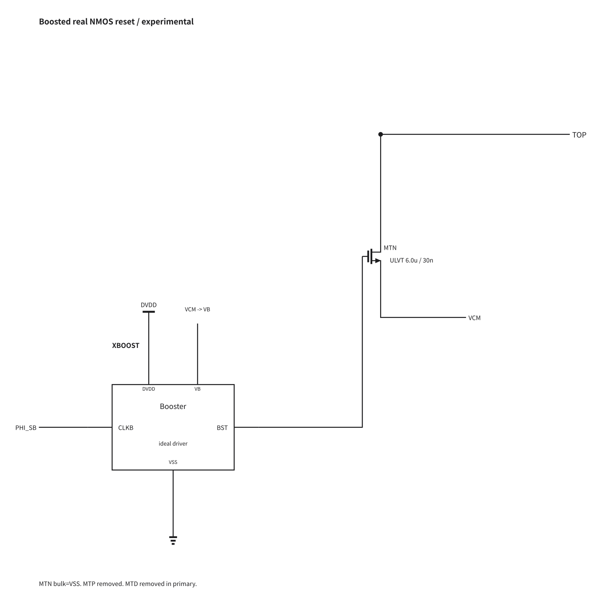
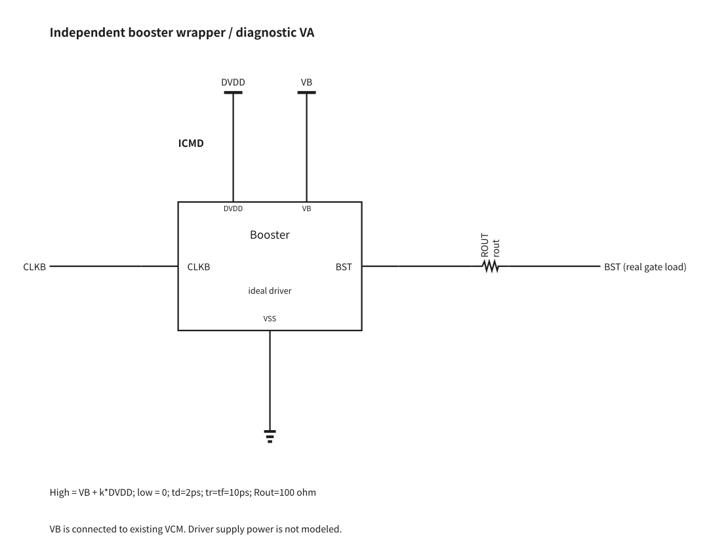
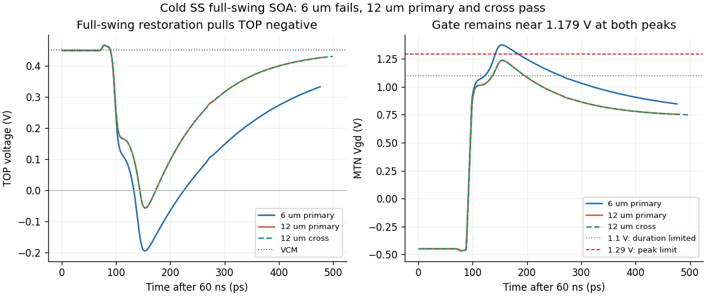

# Independent boosted-reset experiment

This is an authorized diagnostic experiment, separate from the frozen V29 candidate.
Only the booster driver is idealized; the TOP-to-VCM switch is a real core ULVT NMOS.
The canonical source, formal failures and completed attribution study remain frozen at
[e73442f](https://github.com/many-question/ADC-12b-100M/blob/e73442f8a456822f0ba8c313eb3afaa42cdf447d/design/xtor/adc_cdac/many-question-codex/validation-status.md). The candidate remains WIP.

## Circuit and assumptions

`mq_cdac_reset_booster(CLKB BST DVDD VB VSS)` is a separate replaceable subcircuit.
Each P/N CDAC instantiates the same definition as `XBOOST`; it is outside XCAP/XSW.
`CLKB=PHI_SB` is active low, `VB=VCM`, and `BST` drives only the real reset gate.
The 37 external ports, all array/control instances and the official top load remain unchanged.
MTP is removed. The primary omits MTD; a 3 um MTD with the original gate polarity is a
deliberate compensation comparison, not inherited proof that the old dummy remains suitable.

| Model parameter | First-stage setting |
|---|---|
| Command high / low | VCM + 0.9*DVDD / 0 V; high=1.179 V at hot SS |
| Input threshold | 0.5*DVDD on actual PHI_SB |
| Delay / rise / fall | 2 ps / 10 ps / 10 ps |
| Output resistance | 100 ohm, driving actual MOS gate capacitance |
| Reset geometry | 6 um / nf3 or 12 um / nf6; L=30 nm |
| Optional dummy | 3 um / nf2; L=30 nm; source/drain tied to TOP |

All three geometries passed ordered callback evaluation without warnings. The macro
invocation retains the original w/l/nf convention; full callback outputs are private evidence.
VB, DVDD and CLKB are sense-only ports in this ideal model: it draws no bias charge,
supply current or input-clock load. Output energy and Rout loss can be measured, but
do not represent real booster efficiency, total power, area or bias-drive feasibility.
The model provides maintained high level and ideal internal replenishment through finite Rout.
It includes neither CB droop/leakage nor internal MOS stress. These must be assessed in
a later transistor implementation only after a useful real-switch window is demonstrated.

## Reproducible source

[VA model](boosted-reset-model.txt) and [source patches](boosted-reset-patches.txt) are
diagnostic text artifacts, not the submitted transistor candidate. Apply the first patch
to the frozen V29 source; each following delta starts from n6_k09, independently.
The experiment deck supplies the VA include outside the candidate netlist.

| Variant | Source SHA-256 |
|---|---|
| n6_k09 | `582d69bfe4203fa9cee9995321b959889ddd43dedb0fb8bb09e29b45e2deeb4f` |
| n12_k09 | `12fb8cc3a1e7f747513da6a0416a997a29885a74e8c7432c4833bb2032744dbd` |
| n6_k09_d3 | `f36e0924f5794478ff28ddcbc63c5c6cf363fd686b98cdce3ce2879ad5c93c66` |

VA SHA-256: `d7c6ce43d97e4946cee348eeb53b63605b93f7759a9dec071e0af8a4a441f365`.
Frozen canonical SHA-256: `a57472585adc914ab1b2fc9fcf67fc9ecae4e0ffdad1649a87c5a72fdc9e4981`.
All full hierarchy RNL checks report zero errors/warnings; drawings were visually reviewed.
The local drawing tool was 0.5.5. The canonical netlist is unchanged.

## Validation status

Official APS precision remains conservative, effective reltol 1e-7 and vabstol 10 nV.
Short records cover 80 ns and only four samples; they are functional/stress prechecks,
never spectral acceptance. Full tracking requires all 256 samples at hot SS. The
crosscheck changes to traponly/1 ps on the same frozen source. Dense saved waves for
full runs cover the first 100 ns, so those waves alone do not establish full-run SOA.
Reset stresses use actual Vgs/Vgd/Vds and the project 1.1 V / transient 1.29 V,
100 ps per sliding 10 ns allowance. Other-device and corner qualification stays unmeasured
until explicitly reported. A single hot-corner result cannot establish readiness.

| Variant | 80 ns reset SOA | Full256 SFDR / SNDR | Status |
|---|---|---|---|
| n6_k09 | 0 violating pairs | Not yet measured | Cold full-swing SOA fails; spectrum diagnostic only |
| n12_k09 | 0 violating pairs | Not yet measured | In progress |
| n6_k09_d3 | 0 violating pairs | Not yet measured | In progress |

Baseline full256 hot-SS SFDR/SNDR: 63.13694 / 63.06129 dB; H3/H5:
545.389 / 71.487 uV. Targets remain 85 / 80 dB. No formal pass or source promotion
is claimed by the present stage. Raw evidence is retained privately with hashes.

## Short-record comparison

The table uses the same 40..79.9 ns track windows and the same first four sample times
for every variant and baseline. It is not a 256-point spectral estimate.

| Case | TOP-VCM RMS P/N (mV) | Differential last-50-ps drift RMS (uV) | Worst reset terminal (V) |
|---|---:|---:|---:|
| Frozen V29 | 36.648 / 36.813 | 16.212 | See separate official failures |
| n6_k09 | 22.015 / 22.053 | 6.333 | 1.07740 |
| n12_k09 | 10.800 / 10.812 | 14.517 | 1.03201 |
| n6_k09_d3 | 22.016 / 22.054 | 6.221 | 1.07783 |

All completed short cases have zero logged numerical LTE relaxations. They use
the same finite driver and true transistor gate loading. The 12 um version reduces
tracking error but increases late drift relative to 6 um; the 3 um dummy has a small
short-record effect, whose spectral significance must be judged from complete records.
The output current follows (VCMD-VBST)/100 ohm. Nominal 10 ps model transitions
produce about 8 ps measured 10%-90% edges; the loaded half-amplitude delay is about
7.3 ps for 6 um. Switching overshoot is included in the terminal SOA check.
Driver energy is split into delivered and absorbed portions because the signal can
return charge to the ideal source; net delivered energy is not total booster power.
Terminal-charge integrals include displacement and are not a unique channel-injection attribution.

The first three controllers completed normally, but a post-fetch metadata dictionary
duplicate-key error prevented summary writing. The summaries were reconstructed from
the already-fetched rc=0 records after staged hashes were verified; no solver rerun,
deck change or tolerance change was used. The local metadata assembler was corrected
before launching full records.

## Cold full-swing SOA

The original dedicated 70 ns cold-SS stimulus checks 594 remaining real MOS /
1782 terminal pairs. Plans are generated from the actual experimental hierarchy,
with MTN gate on `XDUT.GBST`, MTP absent and the correct dummy configuration.
The ideal booster has no internal physical devices to qualify.

| Case / method | Violating pairs | Max terminal voltage (V) | Worst time above 1.1 V per 10 ns (ps) |
|---|---:|---:|---:|
| n6_k09 primary | 1 | 1.37379 | 155.315 |
| n12_k09 primary | 0 | 1.23572 | 80.520 |
| n12_k09 cross | 0 | 1.23587 | 79.877 |

The 6 um reset fails both the 1.29 V peak limit and the 100 ps duration limit.
At the worst edge its gate is 1.17912 V and TOP is -0.19467 V. In the 12 um
primary, the corresponding gate/TOP values are 1.17864/-0.05708 V. Thus the
failure comes from insufficient TOP restoration during the bottom-plate transient,
not a large overshoot of the ideal gate source. The 12 um primary passes by the
project transient allowance; its same-source crosscheck is reported above when complete.
Primary SOA uses the official conservative defaults (effective reltol1e-4/1uV);
the official crosscheck uses traponly/1ps, effective reltol1e-8/10nV. Neither
setting changes the strict effective1e-7/10nV hot tracking runs.

Already-running 6 um full spectra remain diagnostic comparisons; the failed SOA
prevents promoting that endpoint or starting its physical booster implementation.
No further 6 um qualification expansion is launched.

The completed 12 um crosscheck retains zero violations. Its critical reset
Vgd differs from primary by +0.15 mV and its worst-window duration by -0.643 ps;
the crosscheck leaves 54.13 mV peak margin and 20.123 ps duration margin. Across
all 1782 pairs, the largest peak change is 4.12 mV on XSW6.XDL.MNB1 Vds,
with no verdict changes. This supports this endpoint under the dedicated cold stimulus.
It does not establish other corners, full tracking behavior or booster-internal SOA.

The original cross solver completed normally. Remote reduction wrote all device-pair
results, then failed to export a thin wave on non-quoted TRACE metadata. The untouched
full waveform exceeded the automatic fetch size cap. It was retrieved separately;
all 1782 pairs were independently recomputed locally and matched the remote rows
exactly. No simulation or source change was needed. The original failed summary
and full wave remain in private evidence.

## Completed-run archive index

Each listed ZIP was checked against the original remote files and every extracted
member hash. Full waveforms and process data remain private; these are diagnostic
records, separate from the frozen formal results.

| Case / record | Run | Files | ZIP SHA-256 |
|---|---|---:|---|
| n6_k09 / short | `20261105-112829-e53e-tb_cdac_track` | 65 | `48f7901114899d8230978a1f1d69b39274f949b20aecebe883ad4efd2dc7d881` |
| n6_k09 / tb_cdac_soa-ss_low_m40 | `20261105-114828-091e-tb_cdac_soa` | 70 | `a6af430b61afcb25bd057352cdfe3c28599e1d49def56bb7ef2651f1c68b7278` |
| n12_k09 / short | `20261105-113331-122b-tb_cdac_track` | 65 | `85aa230e797ba47658fe4b6c0286620c2d7ef0c8578553c9562958a530a38024` |
| n12_k09 / tb_cdac_soa-ss_low_m40-cross | `20261105-115500-bd04-tb_cdac_soa` | 68 | `bf64d211dbe0c3b93068b0088e9ded2ecda2b7270ecf4e9a8c4b65672ebdc431` |
| n12_k09 / tb_cdac_soa-ss_low_m40 | `20261105-114839-9c46-tb_cdac_soa` | 70 | `024486b90ce7400d535070938a2bd365c0c00d35c9daa291d6a4a6be74696d23` |
| n6_k09_d3 / short | `20261105-113341-80bd-tb_cdac_track` | 65 | `52ac1e2fa43bb96bc5ae8bfba5387b310f6e4581ac0523ce6920c5ce205deff7` |
