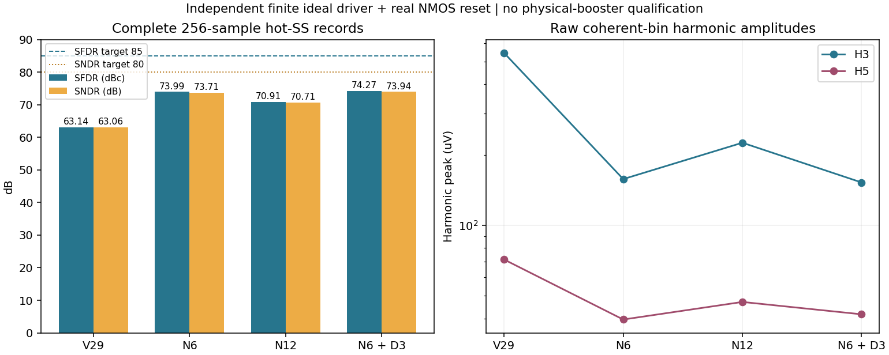

# Independent boosted-reset experiment

This is an authorized diagnostic experiment, separate from the frozen V29 candidate.
Only the booster driver is idealized; the TOP-to-VCM switch is a real core ULVT NMOS.
The canonical source, formal failures and completed attribution study remain frozen at
[e73442f](https://github.com/many-question/ADC-12b-100M/blob/e73442f8a456822f0ba8c313eb3afaa42cdf447d/design/xtor/adc_cdac/many-question-codex/validation-status.md). The candidate remains WIP.

## Circuit and assumptions

`mq_cdac_reset_booster(CLKB BST DVDD VB VSS)` is a separate replaceable subcircuit.
Each P/N CDAC instantiates the same definition as `XBOOST`; it is outside XCAP/XSW.
`CLKB=PHI_SB` is active low, `VB=VCM`, and `BST` drives only the real reset gate.
The 37 external ports, all array/control instances and the official top load remain unchanged.
MTP is removed. The primary omits MTD; a 3 um MTD with the original gate polarity is a
deliberate compensation comparison, not inherited proof that the old dummy remains suitable.

| Model parameter | First-stage setting |
|---|---|
| Command high / low | VCM + 0.9*DVDD / 0 V; high=1.179 V at hot SS |
| Input threshold | 0.5*DVDD on actual PHI_SB |
| Delay / rise / fall | 2 ps / 10 ps / 10 ps |
| Output resistance | 100 ohm, driving actual MOS gate capacitance |
| Reset geometry | 6 um / nf3 or 12 um / nf6; L=30 nm |
| Optional dummy | 3 um / nf2; L=30 nm; source/drain tied to TOP |

All three geometries passed ordered callback evaluation without warnings. The macro
invocation retains the original w/l/nf convention; full callback outputs are private evidence.
VB, DVDD and CLKB are sense-only ports in this ideal model: it draws no bias charge,
supply current or input-clock load. Output energy and Rout loss can be measured, but
do not represent real booster efficiency, total power, area or bias-drive feasibility.
The model provides maintained high level and ideal internal replenishment through finite Rout.
It includes neither CB droop/leakage nor internal MOS stress. These must be assessed in
a later transistor implementation only after a useful real-switch window is demonstrated.

## Reproducible source

[VA model](boosted-reset-model.txt) and [source patches](boosted-reset-patches.txt) are
diagnostic text artifacts, not the submitted transistor candidate. Apply the first patch
to the frozen V29 source; each following delta starts from n6_k09, independently.
The experiment deck supplies the VA include outside the candidate netlist.

| Variant | Source SHA-256 |
|---|---|
| n6_k09 | `582d69bfe4203fa9cee9995321b959889ddd43dedb0fb8bb09e29b45e2deeb4f` |
| n12_k09 | `12fb8cc3a1e7f747513da6a0416a997a29885a74e8c7432c4833bb2032744dbd` |
| n6_k09_d3 | `f36e0924f5794478ff28ddcbc63c5c6cf363fd686b98cdce3ce2879ad5c93c66` |

VA SHA-256: `d7c6ce43d97e4946cee348eeb53b63605b93f7759a9dec071e0af8a4a441f365`.
Frozen canonical SHA-256: `a57472585adc914ab1b2fc9fcf67fc9ecae4e0ffdad1649a87c5a72fdc9e4981`.
All full hierarchy RNL checks report zero errors/warnings; drawings were visually reviewed.
The local drawing tool was 0.5.5. The canonical netlist is unchanged.

## Validation status

Official APS precision remains conservative, effective reltol 1e-7 and vabstol 10 nV.
Short records cover 80 ns and only four samples; they are functional/stress prechecks,
never spectral acceptance. Full tracking requires all 256 samples at hot SS. The
crosscheck changes to traponly/1 ps on the same frozen source. Dense saved waves for
full runs cover the first 100 ns, so those waves alone do not establish full-run SOA.
Reset stresses use actual Vgs/Vgd/Vds and the project 1.1 V / transient 1.29 V,
100 ps per sliding 10 ns allowance. Other-device and corner qualification stays unmeasured
until explicitly reported. A single hot-corner result cannot establish readiness.

| Variant | 80 ns reset SOA | Full256 SFDR / SNDR | Status |
|---|---|---|---|
| n6_k09 | 0 violating pairs | 73.99182031453526 / 73.70732371865574 | Hot tracking and cold SOA fail |
| n12_k09 | 0 violating pairs | 70.90724555341939 / 70.70803827403607 | Hot tracking and cold SOA fail |
| n6_k09_d3 | 0 violating pairs | 74.26757285245561 / 73.9359497675731 | Hot tracking fails; dedicated cold SOA unmeasured |

Baseline full256 hot-SS SFDR/SNDR: 63.13694 / 63.06129 dB; H3/H5:
545.389 / 71.487 uV. Targets remain 85 / 80 dB. No formal pass or source promotion
is claimed by the present stage. Raw evidence is retained privately with hashes.

## Short-record comparison

The table uses the same 40..79.9 ns track windows and the same first four sample times
for every variant and baseline. It is not a 256-point spectral estimate.

| Case | TOP-VCM RMS P/N (mV) | Differential last-50-ps drift RMS (uV) | Worst reset terminal (V) |
|---|---:|---:|---:|
| Frozen V29 | 36.648 / 36.813 | 16.212 | See separate official failures |
| n6_k09 | 22.015 / 22.053 | 6.333 | 1.07740 |
| n12_k09 | 10.800 / 10.812 | 14.517 | 1.03201 |
| n6_k09_d3 | 22.016 / 22.054 | 6.221 | 1.07783 |

All completed short cases have zero logged numerical LTE relaxations. They use
the same finite driver and true transistor gate loading. The 12 um version reduces
tracking error but increases late drift relative to 6 um; the 3 um dummy has a small
short-record effect, whose full-record spectral effect is reported below.
The output current follows (VCMD-VBST)/100 ohm. Nominal 10 ps model transitions
produce about 8 ps measured 10%-90% edges; the loaded half-amplitude delay is about
7.3 ps for 6 um. Switching overshoot is included in the terminal SOA check.
Driver energy is split into delivered and absorbed portions because the signal can
return charge to the ideal source; net delivered energy is not total booster power.
Terminal-charge integrals include displacement and are not a unique channel-injection attribution.

The same short records measure approximately 3.53..3.71 fC rising gate charge for
6 um and 6.85..7.62 fC for 12 um. Peak absolute driver current in the measured
40..70 ns cycles is about 0.533 mA / 1.023 mA, respectively. At low supply,
VB+DVDD is 1.26 V and the maintained target is 1.179 V. A simple Q/81 mV
estimate gives optimistic CB lower bounds of about 46 / 94 fF. These are not
chosen capacitors: booster device parasitics, CB bottom parasitics, precharge
leakage and changing output impedance are excluded. A floating-capacitor booster
must be evaluated directly before drawing power, clock-load or area conclusions.

The first three short simulations completed normally, but their controllers hit a
post-fetch metadata duplicate-key error that prevented summary writing. Summaries were reconstructed from
the already-fetched rc=0 records after staged hashes were verified; no solver rerun,
deck change or tolerance change was used. The local metadata assembler was corrected
before launching full records.

## Complete hot-SS spectra

All rows below use 256 samples with matched nominal sampling times, 100 MS/s and the
actual coherent input frequency 48.828125 MHz (bin125). The official estimator
was rerun locally and exactly reproduced each stored metric. The maximum measured
sample-time difference is about 1 fs. All three solvers completed normally at
effective reltol1e-7/10nV, without numerical LTE warnings. No partial record
or early waveform FFT is used. H3/H5 below are raw coherent-bin peak amplitudes;
complex differences use a common fundamental-phase reference.

| Case | SFDR (dBc) | SNDR (dB) | H3 (uV peak) | H5 (uV peak) |
|---|---:|---:|---:|---:|
| Frozen V29 | 63.13694 | 63.06129 | 545.389 | 71.487 |
| n6_k09 | 73.99182 | 73.70732 | 157.662 | 39.621 |
| n12_k09 | 70.90725 | 70.70804 | 225.414 | 47.091 |
| n6_k09_d3 | 74.26757 | 73.93595 | 152.540 | 41.708 |

The 3 um dummy changes the matched N6 record by 4.136 uV rms
after removing DC and fundamental; the H3 difference vector has magnitude 5.144 uV.
The N12-minus-N6 nonfundamental difference is 59.138 uV rms.
These are circuit interventions, not independent distortion percentages.
Small differences have not been resolved with a numerical crosscheck and should
not be treated as established design margin. These remain diagnostic spectra:
N6 fails low-supply cold SOA, N12 fails high-supply cold SOA, and the dummy
variant has no dedicated full-swing cold SOA result. No source is promoted and
no transistor booster is started from these results.

The dummy changes nominal SFDR/SNDR by +0.276/+0.229 dB. Increasing
reset width from 6 to 12 um instead changes them by -3.085/-2.999 dB,
despite reducing the short-record tracking error. In the matched first-four-sample
late-hold window (250..370.667 ps after PHI_S falls), the largest absolute
MTN drain-terminal charge grows from 0.0602 to 0.1393 fC. The matched
last-50-ps differential drift RMS grows from 6.333 to 14.517 uV. This is
consistent with a remaining hold-period terminal-current/charge mechanism;
it does not uniquely separate channel, junction, displacement or other contributions.
A stronger on-state reset alone has not solved the sampling error.

The first cohort is complete. Even its best nominal spectrum misses SFDR/SNDR
by 10.732/6.064 dB, and no tested endpoint has demonstrated the combined
performance and SOA window needed to justify a transistor booster. The next
useful mechanism test would isolate the retained off-state reset flow and hold
error before revising the booster hardware. No broad amplitude/size sweep or
physical-booster implementation is inferred from these failed endpoints.

## Cold full-swing SOA

The original dedicated 70 ns cold-SS stimulus checks 594 remaining real MOS /
1782 terminal pairs. Plans are generated from the actual experimental hierarchy,
with MTN gate on `XDUT.GBST`, MTP absent and the correct dummy configuration.
The ideal booster has no internal physical devices to qualify.

| Case / method | Violating pairs | Max terminal voltage (V) | Worst time above 1.1 V per 10 ns (ps) |
|---|---:|---:|---:|
| n6_k09 low supply primary | 1 | 1.37379 | 155.315 |
| n12_k09 low supply primary | 0 | 1.23572 | 80.520 |
| n12_k09 low supply cross | 0 | 1.23587 | 79.877 |
| n12_k09 high supply primary | 1 | 1.39407 | 130.004 |

The 6 um reset fails both the 1.29 V peak limit and the 100 ps duration limit.
At the worst edge its gate is 1.17912 V and TOP is -0.19467 V. In the 12 um
primary, the corresponding gate/TOP values are 1.17864/-0.05708 V. Thus the
failure comes from insufficient TOP restoration during the bottom-plate transient,
not a large overshoot of the ideal gate source. The 12 um primary passes by the
project transient allowance; its completed same-source crosscheck is also reported above.
Primary SOA uses the official conservative defaults (effective reltol1e-4/1uV);
the official crosscheck uses traponly/1ps, effective reltol1e-8/10nV. Neither
setting changes the strict effective1e-7/10nV hot tracking runs.

The completed 6 um full spectra remain diagnostic comparisons; the failed SOA
prevents promoting that endpoint or starting its physical booster implementation.
No further 6 um qualification expansion is launched.

The same 12 um source fails at high-supply cold SS: the command scales to
1.341 V, and at the worst peak the actual gate is 1.34073 V while TOP is
-0.05333 V. Both peak and duration limits fail. The low-supply pass therefore
does not establish a usable supply window for this fixed k=0.9 model. This
73 s primary record has no numerical LTE warnings. Its failure is retained;
no physical booster or extra qualification expansion is started for this endpoint.
The completed hot spectra are compared above; the combined failures do not
justify proceeding to a transistor booster from this endpoint.

The completed 12 um crosscheck retains zero violations. Its critical reset
Vgd differs from primary by +0.15 mV and its worst-window duration by -0.643 ps;
the crosscheck leaves 54.13 mV peak margin and 20.123 ps duration margin. Across
all 1782 pairs, the largest peak change is 4.12 mV on XSW6.XDL.MNB1 Vds,
with no verdict changes. This supports this endpoint under the dedicated cold stimulus.
It does not establish other corners, full tracking behavior or booster-internal SOA.

The original cross solver completed normally. Remote reduction wrote all device-pair
results, then failed to export a thin wave on non-quoted TRACE metadata. The untouched
full waveform exceeded the automatic fetch size cap. It was retrieved separately;
all 1782 pairs were independently recomputed locally and matched the remote rows
exactly. No simulation or source change was needed. The original failed summary
and full wave remain in private evidence.

## Cold tracking short record

The unchanged 12 um source also completed the 80 ns low-supply cold-SS tracking
preview with four matched-time samples, strict effective reltol1e-7/10nV, and no
numerical LTE warnings (288 s). It crossed the frozen V29 failure time of
60.1007 ns without a solver error. Reset-only stress over this saved record is
1.02072 V with zero violating pairs.
This is not a full256 cold spectrum or all-device/corner qualification. A hot
baseline waveform is deliberately not used as a matched-corner comparator.
The high-supply cold full-swing SOA failure remains binding.

## Completed-run archive index

Each listed ZIP was checked against the original remote files and every extracted
member hash. Full waveforms and process data remain private; these are diagnostic
records, separate from the frozen formal results.

| Case / record | Run | Files | ZIP SHA-256 |
|---|---|---:|---|
| n6_k09 / full | `20261105-113547-fe86-tb_cdac_track` | 66 | `146d28767a290024b75494eebde71eb83039102e7dcbd3a3efebd51ec6fb5b8b` |
| n6_k09 / short | `20261105-112829-e53e-tb_cdac_track` | 65 | `48f7901114899d8230978a1f1d69b39274f949b20aecebe883ad4efd2dc7d881` |
| n6_k09 / tb_cdac_soa-ss_low_m40 | `20261105-114828-091e-tb_cdac_soa` | 70 | `a6af430b61afcb25bd057352cdfe3c28599e1d49def56bb7ef2651f1c68b7278` |
| n12_k09 / full | `20261105-114129-df31-tb_cdac_track` | 66 | `8377da61c65b18f16a930648d3bc78c7bbb13aa2a80dc707303a171e98eadc4c` |
| n12_k09 / short | `20261105-113331-122b-tb_cdac_track` | 65 | `85aa230e797ba47658fe4b6c0286620c2d7ef0c8578553c9562958a530a38024` |
| n12_k09 / short-ss_low_m40 | `20261105-123126-39ab-tb_cdac_track` | 65 | `8d74c87ef5861609d4e8f697ab6457168996a1fc06774630a8cf0880db9f5cf7` |
| n12_k09 / tb_cdac_soa-ss_high_m40 | `20261105-123115-2da6-tb_cdac_soa` | 70 | `9ab1901992f6beeeef4e851f6a5c9a5f9fe9e46c7850e300e43acd237b33f70c` |
| n12_k09 / tb_cdac_soa-ss_low_m40-cross | `20261105-115500-bd04-tb_cdac_soa` | 68 | `bf64d211dbe0c3b93068b0088e9ded2ecda2b7270ecf4e9a8c4b65672ebdc431` |
| n12_k09 / tb_cdac_soa-ss_low_m40 | `20261105-114839-9c46-tb_cdac_soa` | 70 | `024486b90ce7400d535070938a2bd365c0c00d35c9daa291d6a4a6be74696d23` |
| n6_k09_d3 / full | `20261105-114140-bd3a-tb_cdac_track` | 66 | `47f1bf88fc337a4727c8ea12d71a7e6a52390246afd2d89b33093b93659ac99d` |
| n6_k09_d3 / short | `20261105-113341-80bd-tb_cdac_track` | 65 | `52ac1e2fa43bb96bc5ae8bfba5387b310f6e4581ac0523ce6920c5ce205deff7` |
