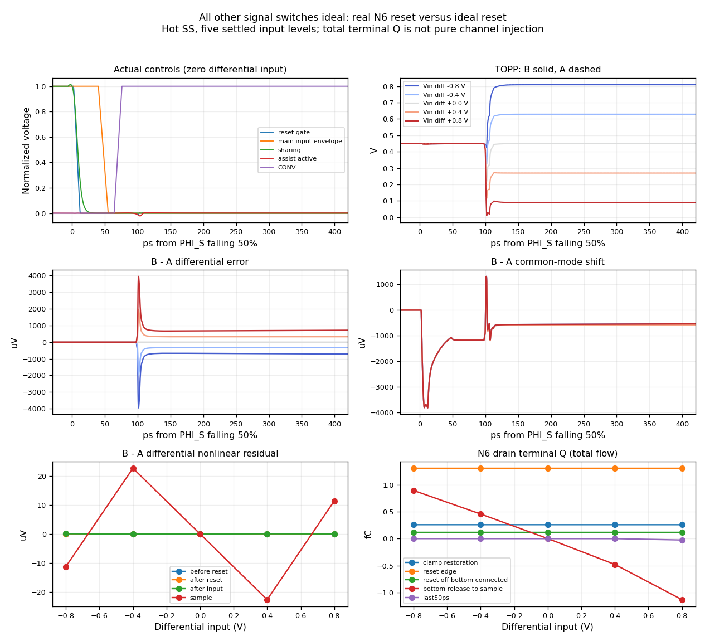

# All-other-switches ideal: reset mechanism isolation

Status: fixed-input A/B, the limited original-top-cell reference, short sine
A/B and B full256 are complete. A full256 and B numerical crosscheck are in
progress; the full-sine conclusions remain provisional. V29 and the
[completed first boosted-reset cohort](boosted-reset-experiment.md) stay frozen.
This is a mechanism experiment, not a candidate promotion or a physical booster.

The five settled DC inputs do **not** show appreciable signal dependence in the
immediate top-reset turnoff offset. With only the N6 reset real, that early change
is nearly a constant common-mode shift. Input-dependent error appears after the
reference outputs redistribute the bottom voltages, and continues growing during
hold. Five static MOS bias snapshots reproduce the late transient drain flow to
within 0.102%, supporting sustained off-state conduction in that late window.
Fast-edge terminal charge still includes displacement and is not pure channel
injection. Dynamic input may also produce an imperfect initial TOP clamp; the
full sine records specifically test that separate mechanism.

## Exact replacement boundary

| Per single CDAC | All three new cases |
|---|---:|
| Main input NMOS | 22 ideal |
| Assist input PMOS | 22 ideal |
| Series midpoint switches | 12 ideal |
| Sharing switches | 22 ideal |
| Reference output switches, all 13 bits and both branches | 52 ideal |
| Real control MOS, including internal control cancellation/load devices | 463 retained |
| Explicit MOM/Cp leaves | 126 unchanged: 72 in XCAP, 54 in control paths |

The expanded connectivity audit finds **zero** retained-control MOS terminals
touching VIN, TOP, bottom plates, series midpoints or EQBUS. This checks every
terminal, including cancellation branches, rather than relying on device names.
All original capacitors and their 5% bottom parasitics, 50-ohm source resistors,
external TOP20fF loads, XCAP/XSW hierarchy and 37 external ports remain unchanged.

- **A:** all signal switches ideal, including one top reset branch; no top dummy.
- **B:** only the frozen 6um/nf3/L30nm reset NMOS is real; no dummy. Its original
  ideal booster remains unchanged, including its 100-ohm output resistor and
  actual gate loading. High/low = VCM+0.9*DVDD / 0, delay2ps, rise/fall10ps.
- **Reference:** original V29 MTN/MTP/MTD top cell, explicitly including the real
  top dummy; the same 130 other signal MOS are idealized. This is a limited
  reference, not the primary A/B comparison.

Ideal switches have finite, fixed Ron and Roff=1e12ohm; their conductance uses a
C1 cubic handover over normalized control0.45..0.55. Existing diagnostic Ron values
are preserved: bit12 main/assist/share35/57/100ohm with inverse-width scaling;
midpoint uses the same main/assist per-width values; reference bit12 MN/MP30ohm
with inverse-width scaling. A's top branch is fixed100ohm. These are diagnostic
constants, not optimized or DC-matched MOS resistances. Replaced MOS capacitance,
charge and leakage are absent. No guessed compensating gate load is added.
Bootstrap input control is VG/(VIN+DVDD), not a fixed absolute gate threshold.

## Actual controls and measurement windows

B runs with the unchanged booster. A then replays **every accepted B GBST point**
through a PWL source; it does not unload the booster and assume the same edge.
The P and N replay sources are independent. A's recorded gate voltage matches
that frozen interpolant at its actual accepted times within7e-12V. Re-interpolating
A back onto B's different time grid produces a66uV peak at sharp knots; that is
a resampling error, not a source discrepancy, and is reported separately.

All other real digital control paths have the same unloaded signal-gate load in
A/B. Their111 unique actual control observers have a maximum50% edge difference
of0.552fs. Gate unloading does change timing relative to the prior loaded V29
observation: sharing advances about2.51ps, and largest-bit H/L reference controls
advance2.08/2.69ps. Thus these results establish an isolated A/B mechanism under
the measured common controls; they do not claim unchanged original timing.

At hotSS/0.81V/125C, measured times relative to PHI_S falling50% are:

| Event | Time (ps) |
|---|---:|
| Midpoint NMOS normalized50% | 0 |
| B top gate falling90% / 10% | 3.445 / 11.220 |
| Sharing50% | 8.673 |
| Main input conductance handover55% / 45% | 46.750 / 48.250 |
| CONV50% | 70.667 |
| Largest-bit reference L/H50% | 100.031 / 102.012 |
| Official sampling, CONV+300ps | 370.667 |

The assist PMOS gate is already high/off during this window. Top gate90/10%
describes the actual waveform, not a uniquely measured channel conductance.
The phrase 'bottom still connected' refers to the main input branches: midpoint
and sharing switches have their own earlier disconnect times, listed above.

## Five settled input levels

Differential source levels are -0.8,-0.4,0,+0.4,+0.8V, with fixed0.45V common
mode. Each record is240ns and has20 official samples. Measurements use the final
settled cycle of each plateau, at75/115/155/195/235ns. Fit each window as offset
+ linear gain*input, then report the maximum absolute residual across five points.
These are static transfer residuals, not FFT-derived SFDR.

| Window | A differential nonlinear max (uV) | B (uV) | B-A (uV) | V29 top reference (uV) |
|---|---:|---:|---:|---:|
| Before reset | 0.0714 | 0.0141 | 0.0573 | 0.1624 |
| After reset, main inputs connected (~29ps) | 0.0922 | 0.0201 | 0.0720 | 0.2128 |
| After main input disconnect (~50ps) | 0.0974 | 0.0214 | 0.0760 | 0.2191 |
| 50ps before official sample | 0.0739 | 19.2188 | 19.1891 | 53.2438 |
| Official sample | 0.0739 | 22.6595 | 22.6299 | 64.4696 |

At the after-reset observation, B's fixed common-mode term is -1.596172mV,
with only0.0025uV nonlinear common-mode residual and essentially no differential
offset. At exactly30ps, the common-mode term has recovered to -1.556317mV;
these numbers refer to different observation times, not different input effects.

At the official sample, A/B/reference differential gains are
-0.900229386/-0.899361459/-0.896411659V/V. B-A has a linear gain change
+0.000867927V/V and fixed differential offset+0.0247uV. Its additional nonlinear
residual is22.6299uV maximum; those three effects are reported separately.
B's sample common-mode offset is -0.565364mV, with24.2412uV nonlinear residual.

## Signed terminal flow and fixed-bias confirmation

During the actual reset gate90%→10% interval, B MTN drain-terminal integral is
approximately+1.306236fC across all five input levels (span about1.3e-6fC).
Gate/source/body integrals are about-2.852742/+1.395513/+0.150993fC. Their sum
is near zero; the drain integral alone must not be labeled pure channel injection.
Clamp restoration before this edge, reset-off while the main input remains
connected, reference redistribution, and the last50ps are separate windows.

At the lowest held TOPP (~0.08972V), final50ps drain/source integrals are
-0.025553/+0.025581fC; gate/body contributions are about
-0.00000926/-0.00001874fC. Gate voltage is only18.52nV. The corresponding
late drain current is -0.511004uA, while an independent static operating point
of the unchanged N6 at the same D/G/S/B voltages gives -0.511526uA. The other
four bias points also agree within0.102%. This is direct evidence for persistent
off-state flow in the late hold window, rather than continued turnoff injection.
It does not uniquely decompose the fast reference-edge displacement current.

## Dynamic input is a separate condition

The matched80ns sine records complete normally with four official samples each.
Their other-control edge difference is again0.552fs, and actual gate-replay error
is below9e-13V. They do not provide a full spectrum or enough phases for a
reliable nonlinear fit.

Before reset turnoff, B's TOP-VCM values already reach approximately
+10.947/-10.671,-12.337/+12.688,+14.365/-13.934,-15.452/+15.969mV (P/N,
four successive cycles). A's corresponding deviations are approximately
symmetrical +/-15.332,17.605,19.782,21.852mV; its fixed100ohm reset has a
different linear tracking response. The B-A raw differential differences are
9..12mV, which must not be labeled distortion before removing gain and phase.

B's reset-edge drain terminal integral now varies about1.06..1.57fC with phase,
unlike the almost identical1.306236fC in the settled-DC tests. The initial TOP
clamp is therefore a necessary part of the dynamic mechanism investigation.
Neither signal-dependent total Q nor pre-reset tracking error alone proves
nonlinear channel injection. The full records compare fixed-time window
harmonic vectors before reset, after reset, after input disconnect, after
reference redistribution and at sampling, using one common phase reference.

A separate nine-point DC check of the unchanged N6, with gate fixed1.179V,
covers the observed pre-reset TOP range0.42465..0.47653V. Its secant on-resistance
changes from72.22 to75.64ohm. Thus the real reset is a finite, nonlinear clamp
even before turnoff. Constant resistance alone would produce linear tracking
error, which is removed before comparing harmonics.

As a limited physical consistency check, a cubic fit of that DC I-V curve and
the observed25.926mV per-side fundamental TOP excursion give a quasistatic
estimate of0.298mV rectified common-mode shift,0.298mV common-mode H2 and
35.2uV differential H3. B's measured values are0.299mV,0.294mV and32.84uV.
The estimate assumes sinusoidal forcing and omits dynamic capacitor feedback,
source effects and charge; it supports on-state nonlinearity without uniquely
partitioning the full transient distortion. No width or drive optimization
was performed.

The completed B full256 gives provisional SFDR85.8016dBc / SNDR85.1862dB.
Its H3 vector is already8.309+j31.773uV before reset turnoff (32.842uV peak),
then10.914+j29.221uV at+30ps,0.187+j29.706uV at+150ps and
-27.643+j29.727uV at the official sample (40.593uV peak). These vectors share
the final B sample fundamental phase. The gate-turnoff interval changes H3
by only a few uV, while a different-phase component grows later in hold.
Final H5 is15.292uV. These observations are not a unique additive physical
source decomposition; A's complete nonlinear baseline and the numerical
crosscheck are still required.

B's primary log contains one SPECTRE-16780 LTE relaxation at1.33517us on an
internal reference-control node, plus SPECTRE-16881. The ongoing A record also
contains an LTE relaxation at355.165ns. Both warnings are retained. No
zero-warning or full-sine convergence claim is made at this stage.

## Evidence and next checks

All three240ns records complete with rc0, actual reltol1e-7/vabstol10nV,
gear2only/conservative and zero numerical warnings. Only model reliability
warnings remain; this experiment does not close the prior N6 SOA failures.
The five-point static check uses the same hotSS models and unchanged geometry;
it has no sampler or transient result. Its launch metadata inherited256 as a
sample-count field; the analysis explicitly corrects that field to0.

| Record | Run | Raw archive SHA256 |
|---|---|---|
| B levels | 20261105-163256-fd4c-tb_cdac_track | eeac6ec4eef4a935ba64518d7ba9e07538d16f25d0cbf71f1bec0ebf9e36343b |
| A levels | 20261105-164235-bc24-tb_cdac_track | f25504286a28e2eb0bad73bb1b294723212e212c398342ef184c7bc56fabe258 |
| V29 top reference | 20261105-163256-9948-tb_cdac_track | 786b25d587684bc01692931bf902b0ba1065f20ccd53febd26228f5ff08c2882 |
| Static off-bias check | 20261105-164818-d7a5-tb_cdac_track | 51ad7092e5b3da59c9d4c823e7fc2726e6ea7293b4cd53d600b50e243e68335d |
| B sine80 | 20261105-165258-0532-tb_cdac_track | c53de9d082ce64a0b5fd0ef419af05ce15c108fe5d70f61d7d1b3960ee6fd63b |
| A sine80 | 20261105-170229-632f-tb_cdac_track | 242ac65d0107376ca4fa9f9641305b6b954d5f131bd3cfcb045be7bcdeaa5ead |
| B full256, provisional | 20261105-165258-1b38-tb_cdac_track | cc2d53a438424b8acc3764478fdb56380285308c764fadb06c48d2ecdc4d57cc |
| Static on-bias check | 20261105-181856-aa46-tb_cdac_track | e5f3f0f31f08675343dade703eed79277e73b437ee8c38de698da8df6b1f58b4 |

Each completed transient archive is checked against remote hashes and every ZIP
member. Sources are frozen: B36e0396ee0535c1c7a8d18557b270f87e071303a7a7891239fba2390910faa93,
A4a29b745067559a290aeb4b0ad543d7e2e8183ea30134fe1c08b7105638fdadf,
referencef98ad8c275b82b97b88924c3aa3ce137f321de4696568ba23f37b0006a594603.
The unchanged booster SHA isd7c6ce43d97e4946cee348eeb53b63605b93f7759a9dec071e0af8a4a441f365.
See [normalized source patches and switch model](reset-mechanism-sources.txt).

Pending: the key matched full256 spectra and the B traponly/1ps numerical
crosscheck. No width/amplitude
optimization, broad Ron sweep or transistor-booster implementation is underway.
