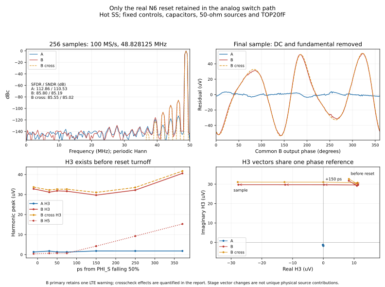

# All-other-switches ideal: reset mechanism isolation

Status: the mechanism stage is complete: fixed-input A/B, the limited original
top-cell reference, short sine A/B, matched full256 A/B and the B numerical
crosscheck are reviewed and archived. V29 and the
[completed first boosted-reset cohort](boosted-reset-experiment.md) stay frozen.
This is a mechanism experiment, not a candidate promotion or a physical booster.

The five settled DC inputs do **not** show appreciable signal dependence in the
immediate top-reset turnoff offset. With only the N6 reset real, that early change
is nearly a constant common-mode shift. Input-dependent error appears after the
reference outputs redistribute the bottom voltages, and continues growing during
hold. Five static MOS bias snapshots reproduce the late transient drain flow to
within 0.102%, supporting sustained off-state conduction in that late window.
Fast-edge terminal charge still includes displacement and is not pure channel
injection. Under dynamic input, the complete A/B pair finds substantial H3
already before reset turnoff, followed by growth in a different phase during
hold. The settled-input constant-offset result does not extend unchanged to
that dynamic condition.

## Exact replacement boundary

| Per single CDAC | All three new cases |
|---|---:|
| Main input NMOS | 22 ideal |
| Assist input PMOS | 22 ideal |
| Series midpoint switches | 12 ideal |
| Sharing switches | 22 ideal |
| Reference output switches, all 13 bits and both branches | 52 ideal |
| Real control MOS, including internal control cancellation/load devices | 463 retained |
| Explicit MOM/Cp leaves | 126 unchanged: 72 in XCAP, 54 in control paths |

The expanded connectivity audit finds **zero** retained-control MOS terminals
touching VIN, TOP, bottom plates, series midpoints or EQBUS. This checks every
terminal, including cancellation branches, rather than relying on device names.
All original capacitors and their 5% bottom parasitics, 50-ohm source resistors,
external TOP20fF loads, XCAP/XSW hierarchy and 37 external ports remain unchanged.

- **A:** all signal switches ideal, including one top reset branch; no top dummy.
- **B:** only the frozen 6um/nf3/L30nm reset NMOS is real; no dummy. Its original
  ideal booster remains unchanged, including its 100-ohm output resistor and
  actual gate loading. High/low = VCM+0.9*DVDD / 0, delay2ps, rise/fall10ps.
- **Reference:** original V29 MTN/MTP/MTD top cell, explicitly including the real
  top dummy; the same 130 other signal MOS are idealized. This is a limited
  reference, not the primary A/B comparison.

Ideal switches have finite, fixed Ron and Roff=1e12ohm; their conductance uses a
C1 cubic handover over normalized control0.45..0.55. Existing diagnostic Ron values
are preserved: bit12 main/assist/share35/57/100ohm with inverse-width scaling;
midpoint uses the same main/assist per-width values; reference bit12 MN/MP30ohm
with inverse-width scaling. A's top branch is fixed100ohm. These are diagnostic
constants, not optimized or DC-matched MOS resistances. Replaced MOS capacitance,
charge and leakage are absent. No guessed compensating gate load is added.
Bootstrap input control is VG/(VIN+DVDD), not a fixed absolute gate threshold.

## Actual controls and measurement windows

B runs with the unchanged booster. A then replays **every accepted B GBST point**
through a PWL source; it does not unload the booster and assume the same edge.
The P and N replay sources are independent. In the fixed-input pair, A's recorded gate voltage matches
that frozen interpolant at its actual accepted times within7e-12V. Re-interpolating
A back onto B's different time grid produces a66uV peak at sharp knots; that is
a resampling error, not a source discrepancy, and is reported separately.

All other real digital control paths have the same unloaded signal-gate load in
A/B. Their111 unique actual control observers have a maximum50% edge difference
of0.552fs. Gate unloading does change timing relative to the prior loaded V29
observation: sharing advances about2.51ps, and largest-bit H/L reference controls
advance2.08/2.69ps. Thus these results establish an isolated A/B mechanism under
the measured common controls; they do not claim unchanged original timing.

At hotSS/0.81V/125C, measured times relative to PHI_S falling50% are:

| Event | Time (ps) |
|---|---:|
| Midpoint NMOS normalized50% | 0 |
| B top gate falling90% / 10% | 3.445 / 11.220 |
| Sharing50% | 8.673 |
| Main input conductance handover55% / 45% | 46.750 / 48.250 |
| CONV50% | 70.667 |
| Largest-bit reference L/H50% | 100.031 / 102.012 |
| Official sampling, CONV+300ps | 370.667 |

The assist PMOS gate is already high/off during this window. Top gate90/10%
describes the actual waveform, not a uniquely measured channel conductance.
The phrase 'bottom still connected' refers to the main input branches: midpoint
and sharing switches have their own earlier disconnect times, listed above.

## Five settled input levels

Differential source levels are -0.8,-0.4,0,+0.4,+0.8V, with fixed0.45V common
mode. Each record is240ns and has20 official samples. Measurements use the final
settled cycle of each plateau, at75/115/155/195/235ns. Fit each window as offset
+ linear gain*input, then report the maximum absolute residual across five points.
These are static transfer residuals, not FFT-derived SFDR.

| Window | A differential nonlinear max (uV) | B (uV) | B-A (uV) | V29 top reference (uV) |
|---|---:|---:|---:|---:|
| Before reset | 0.0714 | 0.0141 | 0.0573 | 0.1624 |
| After reset, main inputs connected (~29ps) | 0.0922 | 0.0201 | 0.0720 | 0.2128 |
| After main input disconnect (~50ps) | 0.0974 | 0.0214 | 0.0760 | 0.2191 |
| 50ps before official sample | 0.0739 | 19.2188 | 19.1891 | 53.2438 |
| Official sample | 0.0739 | 22.6595 | 22.6299 | 64.4696 |

At the after-reset observation, B's fixed common-mode term is -1.596172mV,
with only0.0025uV nonlinear common-mode residual and essentially no differential
offset. At exactly30ps, the common-mode term has recovered to -1.556317mV;
these numbers refer to different observation times, not different input effects.

At the official sample, A/B/reference differential gains are
-0.900229386/-0.899361459/-0.896411659V/V. B-A has a linear gain change
+0.000867927V/V and fixed differential offset+0.0247uV. Its additional nonlinear
residual is22.6299uV maximum; those three effects are reported separately.
B's sample common-mode offset is -0.565364mV, with24.2412uV nonlinear residual.

[Fixed-input controls, residuals and terminal-flow figure, preserved at the earlier stage](https://github.com/many-question/ADC-12b-100M/blob/185bcee0ac9f219895ce686c423de0d24cbe37bc/design/xtor/adc_cdac/many-question-codex/reset-mechanism.png)

## Signed terminal flow and fixed-bias confirmation

During the actual reset gate90%→10% interval, B MTN drain-terminal integral is
approximately+1.306236fC across all five input levels (span about1.3e-6fC).
Gate/source/body integrals are about-2.852742/+1.395513/+0.150993fC. Their sum
is near zero; the drain integral alone must not be labeled pure channel injection.
Clamp restoration before this edge, reset-off while the main input remains
connected, reference redistribution, and the last50ps are separate windows.

At the lowest held TOPP (~0.08972V), final50ps drain/source integrals are
-0.025553/+0.025581fC; gate/body contributions are about
-0.00000926/-0.00001874fC. Gate voltage is only18.52nV. The corresponding
late drain current is -0.511004uA, while an independent static operating point
of the unchanged N6 at the same D/G/S/B voltages gives -0.511526uA. The other
four bias points also agree within0.102%. This is direct evidence for persistent
off-state flow in the late hold window, rather than continued turnoff injection.
It does not uniquely decompose the fast reference-edge displacement current.

## Complete dynamic A/B pair

Both full records complete with 256 samples: 100 MS/s, coherent 48.828125 MHz,
N=256, k=125. Official metrics use the pinned project estimator and periodic
Hann window; stage harmonic vectors use the coherent unwindowed DFT. The
80ns/four-sample preflights were used only for controls and waveforms, never FFT.

| Case | SFDR (dBc) | SNDR (dB) | Final nonfundamental RMS (uV) |
|---|---:|---:|---:|
| A, all signal switches ideal | 112.8626 | 110.5341 | 1.6645 |
| B, only N6 reset real | 85.8016 | 85.1862 | 30.8039 |

The complete pair has identical sampling timestamps. All 111 other control
observers match within 0.5515fs; actual A gate voltages match the frozen B PWL
at A's accepted times within 55.6pV. A retains B's actual, potentially
signal-dependent gate trajectory, so A is the matched control baseline rather
than an assumed exactly linear zero-distortion reference.

At the final sample, fitted differential DC offsets are A +0.0053uV and B
+0.0122uV, negligible at this precision. Fundamental peaks are
0.78976797/0.79113957V, with B's phase
1.25549 degrees ahead of A. The raw B-A difference is 12.2858mV RMS; after
removing its DC and fundamental, it is 31.4774uV RMS. The raw difference must
not be labeled distortion. B's separate common-mode mean is -0.253929mV and
its nonfundamental common-mode RMS is 0.186342mV; A gives +0.4174uV and
0.2954uV respectively.

All stage vectors below use the same **B final-sample fundamental phase**.
Changes are complex-vector differences, not differences of magnitudes.

| Window from PHI_S50 | A H3 peak (uV) | B H3, real+j imaginary (uV) | B H3 peak (uV) | B H5 peak (uV) |
|---|---:|---|---:|---:|
| Before reset, -10ps | 1.308 | 8.309+j31.773 | 32.842 | 0.400 |
| After reset, +30ps | 1.745 | 10.921+j29.216 | 31.190 | 0.677 |
| After input disconnect, +50ps | 1.311 | 11.321+j29.780 | 31.859 | 0.726 |
| Reference settling, +150ps | 1.807 | 0.186+j29.706 | 29.707 | 4.223 |
| Late hold, +250ps | 1.800 | -12.418+j29.718 | 32.208 | 9.242 |
| Official sample, +370.667ps | 1.800 | -27.643+j29.727 | 40.593 | 15.292 |

A's pre-reset differential fundamental error is 69.989mV peak, greater than
B's 51.852mV, yet its H3 is much smaller. Finite constant resistance therefore
explains tracking error without making that error synonymous with distortion.
The real reset adds substantial nonlinear error **before** turnoff. Between
-10ps and +30ps the H3 vector changes by only a few uV; this interval also
contains midpoint and sharing events and is not an isolated channel-injection
measurement. After reference redistribution, another phase component grows
through hold. Stage changes are descriptive, not a unique decomposition into
independent physical sources.

A separate nine-point DC check of unchanged N6, with gate fixed at 1.179V,
covers the observed pre-reset TOP range 0.42465..0.47653V. Its secant resistance
changes from 72.22 to 75.64ohm. A cubic fit of that measured DC I-V curve and
the observed 25.926mV per-side fundamental TOP excursion gives a quasistatic
estimate of 0.298mV rectified common-mode shift, 0.298mV common-mode H2 and
35.2uV differential H3; B measures 0.299mV, 0.294mV and 32.84uV. This assumes
sinusoidal forcing and omits dynamic capacitor feedback, source effects and
charge. It corroborates nonlinear on-state clamping without uniquely
partitioning the full transient distortion. No width or drive optimization
was performed.

Signed total terminal-flow spectra provide a separate bookkeeping check.
B's differential drain-Q H3 peak is 0.001352fC over the actual gate90%-to-10%
interval. In the final50ps, drain/source H3 real components are opposite at
+0.018193/-0.018210fC; their quadrature components are about 0.000011fC.
Gate/body H3 peaks are only about 0.00000644/0.00001062fC. This is consistent
with the fixed-bias off-flow test.
These integrals include displacement and are never labeled pure channel
injection.

Relative to the earlier same-N6 case with the other switches real, SFDR
improves from 73.9918 to 85.8016dBc. This cannot be assigned uniquely to
bottom-switch Ron: idealization also removes intrinsic charge/leakage and
unloads controls by 2-3ps. Real bottom-MOS nonlinearity is not necessary for
the remaining pre-reset H3; finite bottom/source impedances still participate
in the isolated network.

## Numerical review

A retains two LTE relaxations, at 355.165ns and 1.31517us, each with a
SPECTRE-16881 companion. The following samples have fitted residuals
-3.129/+1.185uV; neither is the largest residual in the record (3.866uV).
A's observed baseline is bounded by the complete record, but no independent
A numerical convergence claim is made.

B primary retains one LTE relaxation at 1.33517us, plus SPECTRE-16881.
Its same-source traponly/1ps crosscheck completes all 256 samples with no
numerical warnings. Both use conservative, effective reltol=1e-7 and
vabstol=10nV; primary uses gear2only without an added maxstep. Crosscheck
SFDR/SNDR are **85.5543/85.0163dB**, changes of -0.2473/-0.1699dB. These are
measured method differences, not a guaranteed error bound or a physical
acceptance margin. Model reliability warnings remain.

There is no control-sequence mismatch; other control edges differ by at most
0.7171fs and sample timestamps by 1fs. Raw sample differences are 6.6435uV RMS
and 10.7910uV maximum. After removing only DC and the fundamental, the difference
is 1.2959uV RMS and 3.6350uV maximum; no per-record time alignment is performed.
The final H3 vector changes by -0.2203+j1.3503uV (1.3681uV peak), using the same
B-primary phase. Pre-reset H3 changes by 0.9129uV. The first sample after the
primary LTE has a -1.0663uV nonfundamental difference and is not the largest
outlier. This review does not uniquely isolate the warning's effect.

The crosscheck preserves the tens-of-uV stage separation and late signed flow:
reset-edge drain-Q H3 is 0.001366fC versus 0.001352fC primary; final50ps drain-Q
H3 is 0.0181937fC versus 0.0181926fC. The longer on-clamp Q vector is more
method-sensitive (0.00241fC difference), so it is not treated as an independent
precision attribution. The mechanisms remain supported, while the 0.25dB
spectral method sensitivity must be retained, particularly near the 85dBc target.

## Evidence and limits

All three240ns records complete with rc0, actual reltol1e-7/vabstol10nV,
gear2only/conservative and zero numerical warnings. Only model reliability
warnings remain; this experiment does not close the prior N6 SOA failures.
The five-point static check uses the same hotSS models and unchanged geometry;
it has no sampler or transient result. Its launch metadata inherited256 as a
sample-count field; the analysis explicitly corrects that field to0.

| Record | Run | Raw archive SHA256 |
|---|---|---|
| B levels | 20261105-163256-fd4c-tb_cdac_track | eeac6ec4eef4a935ba64518d7ba9e07538d16f25d0cbf71f1bec0ebf9e36343b |
| A levels | 20261105-164235-bc24-tb_cdac_track | f25504286a28e2eb0bad73bb1b294723212e212c398342ef184c7bc56fabe258 |
| V29 top reference | 20261105-163256-9948-tb_cdac_track | 786b25d587684bc01692931bf902b0ba1065f20ccd53febd26228f5ff08c2882 |
| Static off-bias check | 20261105-164818-d7a5-tb_cdac_track | 51ad7092e5b3da59c9d4c823e7fc2726e6ea7293b4cd53d600b50e243e68335d |
| B sine80 | 20261105-165258-0532-tb_cdac_track | c53de9d082ce64a0b5fd0ef419af05ce15c108fe5d70f61d7d1b3960ee6fd63b |
| A sine80 | 20261105-170229-632f-tb_cdac_track | 242ac65d0107376ca4fa9f9641305b6b954d5f131bd3cfcb045be7bcdeaa5ead |
| B full256 primary | 20261105-165258-1b38-tb_cdac_track | cc2d53a438424b8acc3764478fdb56380285308c764fadb06c48d2ecdc4d57cc |
| A full256 | 20261105-174746-709e-tb_cdac_track | 59719faec0b70601c48d88bbdb4333ab28a8243600310dd9feba3e68c09c5a12 |
| B full256 crosscheck | 20261105-171144-c2a5-tb_cdac_track | 60079d6ae1e102258ec3e8d34485c1f982dbc9eacc3da6c8f7bb638ced57ebb8 |
| Static on-bias check | 20261105-181856-aa46-tb_cdac_track | e5f3f0f31f08675343dade703eed79277e73b437ee8c38de698da8df6b1f58b4 |

All ten records have local archives checked against remote hashes and every ZIP
member. The final inventory confirms all ten audit records and archive sizes.
Canonical V29 SHA256 remains
a57472585adc914ab1b2fc9fcf67fc9ecae4e0ffdad1649a87c5a72fdc9e4981.
Sources are frozen: B36e0396ee0535c1c7a8d18557b270f87e071303a7a7891239fba2390910faa93,
A4a29b745067559a290aeb4b0ad543d7e2e8183ea30134fe1c08b7105638fdadf,
referencef98ad8c275b82b97b88924c3aa3ce137f321de4696568ba23f37b0006a594603.
The unchanged booster SHA isd7c6ce43d97e4946cee348eeb53b63605b93f7759a9dec071e0af8a4a441f365.
The ideal-switch model SHA is
a9d00e365255fa5905991ba0df2a9dafbc2ad08b449c4f6ab43be98f7022d6b1.
See [normalized source patches and switch model](reset-mechanism-sources.txt).

The settled-input constant-offset observation is supported. Under dynamic input,
substantial H3 already exists before turnoff, consistent with nonlinear on-state
clamping; reference/hold
then adds a different-phase component, with persistent late off-state flow
supported by the independent bias test. These are bounded mechanism conclusions,
not unique percentages assigned to individual physical sources. No width/amplitude
optimization, broad Ron sweep or transistor-booster implementation was performed.
The original V29 hot-spectrum failure, cold tracking abort and three-pair SOA
failure remain, as does the previous boosted N6 cold-SOA failure. The candidate
remains WIP; none of these diagnostic records replaces formal acceptance results.
