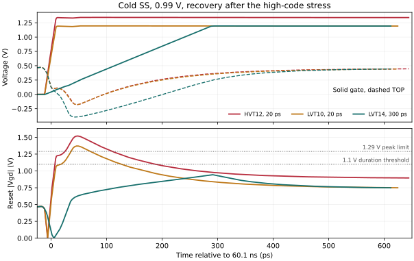

# Reset device and sampling switch repair

The DC screen found reset devices with lower leakage at comparable on-resistance. Two fast-rise variants reached their final gate voltage before TOP recovered in the cold SOA test. The wider LVT with a slower rise passes both cold supply checks. Its full hot spectrum and numerical crosscheck are underway. The frozen mechanism study supplies the comparison circuit and measured bias points. [Mechanism evidence](reset-mechanism.md)

## Hot SS reset screen

The reset source was held at 0.45 V and the body grounded. Nine drain biases span the observed pre-reset TOP excursion of 0.42465 to 0.47653 V. The high gate cases use 1.179 V and 1.0575 V, corresponding to `VCM + k*DVDD` with `k=0.90` and `0.75` at 0.81 V. Off-state drain current uses all five late hold biases, with TOP from about 0.09 to 0.81 V and the actual near-zero gate levels. Each geometry was verified by device callbacks and compiled in the hot SS model section. The requested 45 nm channel snapped to 40 nm in the callback, so the longer cases use exact 40 nm requests.

| NMOS | Total W / L | Median Ron at k=0.90 (ohm) | Median Ron at k=0.75 (ohm) | Max off drain magnitude (uA) |
|---|---|---:|---:|---:|
| ULVT baseline | 6 um / 30 nm | 73.77 | 95.31 | 0.51153 |
| LVT | 8 um / 30 nm | 58.77 | 76.93 | 0.34669 |
| SVT | 10 um / 30 nm | 63.06 | 95.94 | 0.05500 |
| HVT | 12 um / 30 nm | 72.57 | 126.41 | 0.00995 |
| ULVT | 10 um / 40 nm | 50.49 | 67.59 | 0.19207 |
| LVT | 12 um / 40 nm | 44.97 | 61.35 | 0.09898 |
| LVT | 10 um / 40 nm | 53.96 | 73.62 | 0.08248 |
| LVT | 14 um / 40 nm | 38.54 | 52.59 | 0.11547 |

The HVT point cuts the largest sampled off drain current by about 51 times at the original gate amplitude. Its on-resistance range is 69.25–76.25 ohm, compared with 72.22–75.64 ohm for N6. The absolute normalized cubic coefficient of the local I-V fit drops from 2.469 to 0.187 V^-2, while the secant resistance span increases. Both matter when the dynamic TOP swing and gate trajectory change. The larger gate and weaker drive case are separate tradeoffs. The operating-point export did not return gate capacitance, so actual gate-driver charge is being measured in transient.

Inverting the fitted I-V relation reveals the effect of the quadratic term on voltage H3. At a fixed 25.926 mV linear TOP fundamental, the quasistatic differential H3 estimates are 35.7 uV for N6, 62.1 uV for HVT12 at k=0.90 and 64.3 uV for LVT10 at k=0.75. The HVT short record shows about twice the pre-reset common-mode offset of B across its four sample phases. The inverse fit omits charge, source feedback and time-varying gate voltage. The wider LVT14 targets less TOP excursion at comparable current forcing, with a larger gate as the cost.

## Cold SOA and gate charge

HVT12 at k=0.90 and LVT10 at k=0.75 both passed the 80 ns hot functional preflight. Both use 20 ps rise and 10 ps fall commands through the independent ideal driver. The cold test restores the full physical periphery and judges all 1,782 gs/gd/ds pairs over 70 ns. All six runs completed with zero numerical warnings.

| Reset and supply at cold SS | Violations | Largest pair and peak (V) | Max above 1.1 V in 10 ns (ps) |
|---|---:|---|---:|
| HVT12, 0.81 V | 1 | Reset Vgd, 1.35776 | 130.540 |
| HVT12, 0.99 V | 1 | Reset Vgd, 1.51941 | 188.379 |
| LVT10, 0.81 V | 0 | Reset Vgd, 1.23673 | 63.628 |
| LVT10, 0.99 V | 1 | Reset Vgd, 1.37121 | 115.568 |
| LVT14 slow rise, 0.81 V | 0 | Reference output Vds, 1.19625 | 41.121 |
| LVT14 slow rise, 0.99 V | 0 | Reset Vgd, 1.21065 | 63.826 |

At the high-supply worst point, TOP is near -0.179 V while the HVT12 and LVT10 gates have reached about 1.341 V and 1.192 V respectively. The project allows a peak of 1.29 V with at most 100 ps above 1.1 V in any 10 ns. LVT14 uses k=0.75 and a 300 ps rise to let TOP recover before the gate reaches full amplitude. The fall remains 10 ps. Its cold low-supply reset Vgd peak is 1.18263 V, and its high-supply reset Vgd maximum occurs during startup at 0.102 ns. Both endpoints pass the project rule with the ideal driver. The same isolated LVT14 source now runs a full 256-point primary and traponly / 1 ps crosscheck.

At the plotted recovery event, slow-rise LVT14 limits |Vgd| to 0.947 V while TOP reaches -0.396 V. The fast LVT10 case reaches 1.371 V and TOP about -0.179 V. At the measured LVT14 minimum TOP and 0.218 V gate, a fixed-bias check at the same cold corner gives 1.55 nA body current magnitude and 4.52 mA drain current magnitude. These are DC terminal currents at one snapshot. They show predominantly reset channel flow at that bias, while the larger negative TOP transient remains part of the design tradeoff.

The same-source cold high-supply crosscheck used traponly, 1 ps maximum step, effective reltol=1e-8 and vabstol=10 nV. It completed with zero violations and no numerical warnings. The peak changes by 0.41 mV to 1.21106 V, and the longest above-threshold interval changes by 0.072 ps to 63.898 ps. Independent local recomputation from the retained full waveform reproduces all 1,782 server pair records.

Measured turn-on charge in the hot short records is 3.48–3.82 fC for N6, 5.57–5.96 fC for HVT12, 5.36–5.76 fC for LVT10, and 7.46–8.07 fC for LVT14. Assuming a fully charged boost capacitor and only gate charge as the load, the largest Q divided by allowable droop is 47.2, 73.6, 28.5 and 39.9 fF respectively. The lower LVT amplitude gives more droop headroom despite a larger gate. Actual booster parasitics, settling and internal SOA still need validation. DC probes emit model Vgb warnings with the body grounded. The project's acceptance checks gs, gd and ds, with body pairs treated separately under the existing rule. [Verification rule](https://github.com/many-question/ADC-12b-100M/blob/75f31c14790108d54fb7c57cbaeb461f2035a51c/docs/verification.md#L356)

Across the four short sine phases and both sides, the maximum absolute drain-terminal integral over the last 50 ps is 0.02573 fC for N6, 0.000502 fC for HVT12, 0.00415 fC for LVT10 and 0.00641 fC for LVT14. The integrals measure total signed terminal flow, including displacement. Their reduction agrees with the off-state DC trend. LVT14 also gives a slightly smaller pre-reset common-mode offset than N6 at these phases.

## Main input restoration

The first restoration keeps the frozen N6 reset and restores just the 22 original main input MOS per side. The remaining 108 replacements, all capacitors and digital controls keep the same source instances. The short run completed with all four expected sample times matching B, no numerical warnings and no control sequence mismatch. The input bootstrap gates shift by up to 1.78 ps. The other measured control edges shift by less than 0.04 fs in the short record.

The full main-input restoration gives **78.773 dBc SFDR and 78.084 dB SNDR**, compared with B's 85.802 dBc and 85.186 dB. The coherent 256-point record uses the official estimator, 100 MS/s and 48.828125 MHz. Its sample times match within about 1 fs and all 111 control sequences match. Removing DC and the fundamental from the sample difference reduces its RMS from 319.4 to 59.91 uV. The common-phase H3 difference is -60.68 - j51.92 uV with magnitude 79.86 uV. For context the frozen all-real N6 versus B difference is 130.03 uV H3 in the same phase convention. These are separate interventions in a coupled network.

| Stage after PHI_S falls | B H3 peak (uV) | Main restored H3 peak (uV) |
|---|---:|---:|
| Before reset, -10 ps | 32.84 | 32.65 |
| After reset gate fall, +30 ps | 31.19 | 38.42 |
| Before reference, +75 ps | 31.66 | 346.02 |
| Reference settling, +150 ps | 29.71 | 61.94 |
| Late hold, +250 ps | 32.21 | 79.51 |
| Official sample | 40.59 | 91.07 |

The fine-time coherent difference peaks at 1.100 mV H3 near +51 ps, during the main bootstrap gate fall. The early pre-reset H3 is almost identical. This localizes the large change to input disconnect and subsequent redistribution. It does not uniquely assign intrinsic charge, conductance or leakage. The primary retains five LTE relaxations with companion warnings. H3 and H5 account for 99.48% of the nonfundamental difference power and none of the first samples after a warning is the largest residual. This check does not replace same-source numerical convergence evidence.

A separate short control uses frozen B with the actual loaded input-gate voltages replayed at every accepted time. Actual replay error is below 0.95 pV. The largest final differential change from gate replay alone is 4.23 uV across four phases. Real restoration minus the replay case differs by up to 0.503 mV in the raw final samples. The comparison fixes the absolute gate trajectory and lets VIN respond to the circuit.

The restored main-input device sizes were also tested at five source voltages with `VG=VIN+0.81 V`, grounded bulk and symmetric +/-1 mV VDS. The largest bit's differential Ron is 33.02–35.61 ohm over VIN=0.05–0.85 V and 34.32 ohm at nominal VIN. The calibrated fixed-Ron replay uses each size's own nominal slope. It completes the four-phase preflight with the measured gate trajectory. The largest raw sample difference from real main restoration is 0.575 mV. Its full 256-point version now replays the complete measured gate record. This comparison preserves on-resistance at the center point and omits signal-dependent conductance, device charge and leakage. A targeted turnoff current capture is collecting the largest devices' terminal flow, and a first size intervention reduces the finger counts of only bits 12 and 11 to test the charge versus settling tradeoff.

The first targeted additional restoration is sharing. Its 80 ns run restores only the 22 sharing devices per side and retains N6. `SAMP_ON` moves by up to 2.54 ps with the other observed edges within 0.01 fs. The largest raw final difference across four phases is 0.504 mV. A full sharing-only record is underway to quantify nonlinear error. The timing shift remains part of that intervention until a matched-control comparison separates it.

The short `SAMP_ON` replay retains the original driver's two explicit load capacitors and applies the measured per-side gate voltage to the ideal sharing switches. Actual gate replay matches within 0.59 pV. The final timing-only difference is below 0.03 uV across four phases, while real sharing minus this replay remains as large as 0.504 mV in the raw samples. The complete record will establish the nonlinear part.

| Verified evidence | Archive SHA256 |
|---|---|
| First DC screen | `8115b6efa1b8eafee34f4684751715f8d0b06ad3951174bc9ca61ac29441e0b8` |
| Exact 40 nm DC cases | `90be65eb39f04578e6680528d6c2d860766fc4e1d47ccf921ee7264cdd8b9021` |
| Main input restoration 80 ns | `76fc5c985f60293857547c0f359540eaca7638e29e942e40e70ac6b88b5c4ba2` |
| Main input restoration full 256 | `a9368bd46d5443de72b68951eb8c37fa4410480f5361855cdd4c5787e9c0bcd4` |
| Loaded input gate replay 80 ns | `f6d2db0bbcc8497e04ec32a65d299b0401af2e70db9ff185fe77ccf7bea69748` |
| Main-input on-resistance DC | `81f0cd301f962b30c56d21473a015250cb019e55f525e3a6f3a823a8f5503297` |
| HVT12 cold low / high | `178f60103d4a69a27028a0e470652ff452068a19998b9a00308ab5d76b812a10` / `8d1d2405a1f940da681f7f17db6b7aed4726b6693072b54cc963f70c0b4b174a` |
| LVT10 cold low / high | `d69b33628f83755a1ffc2ff9c850ff757d46158442646eca7fcd739666c62ba4` / `99b65882d17916f08fc5884eb7f172bf73bcf50ab72e03e9fd09df1186244124` |
| LVT14 cold low / high | `8412bb82ca1cbd3d1ec8a367d0ec7d2c18467471ae2223b2f5cc68cb764c8f69` / `ec0d09c07419b6ba5789d3034b3b85c58cb1ca376a091d4357681d513042cdbf` |
| LVT14 slow-rise 80 ns | `6dd7227b41c67be3514619ab32af7784fe11b790f0b55a8ed07b6995b3baf90d` |
| Calibrated fixed-Ron loaded-gate replay 80 ns | `0f51b4e8d0ba12356ec34b018f5589ae5fc75170ccc8cef64df81a51caad95e4` |
| Sharing restoration 80 ns | `95f22b6969a0d96ce9831ea704c7cbcfcc627474f7aba172a48794b8689ad2c7` |
| Sharing gate replay 80 ns | `3569624afa6c70ed60e23496fa07c3c811268c0388c8c78a7338c41c9b3ad514` |
| LVT14 cold high numerical crosscheck | `36e8e389cfa01f17dd10a02461c4b7fd2dda48a77835e7cf57f02728b17c8dae` |
| Recovery-event fixed bias snapshots | `9781ff5d6700d6d291a986ae0e3bb65578c0981bd79c2d4083a53da081d396b2` |

The candidate is WIP. The selected ideal-driver point has passed the two cold supply gates. Complete hot SS spectra, numerical review and combined verification with real peripheral switches determine whether it is a useful repair.
