# CDAC diagnosis and trial ledger

The formal candidate is N4, source SHA256
`3d62b80300fc5d85e3fc4e498cd22cedfa92ed006c502922526f1641e0a2ae61`.
The [README](README.md) summarizes its topology, fixed 5% per-physical-unit
parasitic assumption, formal TT pass and incomplete PVT coverage.

The complete historical report is preserved at
[commit 6a4bf94](https://github.com/many-question/ADC-12b-100M/blob/6a4bf94977db967dbd27ef47669d5d3d25735477/design/xtor/adc_cdac/many-question-codex/sampling-entry-diagnosis.md),
with all its relative image links intact in that immutable tree. The
annotated `adc-cdac-many-question-history-20261031` tag retains the snapshot.
Only duplicate current-tree prose and old diagnostic images were compacted;
the source and all 12 official result/figure files remain byte-identical.
The prior report, figures and their original provenance also have a private
hash-verified copy. New experiments never inherit the older validation.

## Evidence ledger

| Version / scope | Observed result | Disposition and provenance |
|---|---|---|
| Pre-N4 | Genuine RL12 50.1 ps, Qref 2.629 pC, SFDR/SNDR 69.6121/69.5735 dB failures | Retained by [pre-N4 tag](https://github.com/many-question/ADC-12b-100M/tree/adc-cdac-many-question-pre-n4-20261030); full history in the archived report |
| Formal N4 TT | All 17 required metrics pass; complete prescribed tracking comparison passes | [N4 TT evidence tag](https://github.com/many-question/ADC-12b-100M/tree/adc-cdac-many-question-n4-tt-20261030) retains actual clean simulation commits; source unchanged |
| Formal N4 ss_low_125 | RL12 47.4 ps and start 117.7 ps fail; RL5 69.2 ps, tau 14.809442 ps and droop 0.008844550 LSB pass | First PVT expansion stopped; weights full scale 0.993092578 V passes; original evidence unchanged |
| Unchanged N4, private strict 28 ns | RL12/start remain 47.4/117.7 ps and tau 14.809442 ps | Mechanism diagnostic, not a new official record; 17 observed MOS / 51 pairs only |
| Private bit-12 output widths +25% | RL12/start improve to 42.2/113.0 ps but fail; tau 17.111203 ps newly fails | Rejected; no TT or expensive downstream expansion; one full 70 ns SS job |

The original N4 and rejected-width-trial stop records remain preserved.
Continuing design work uses separate variants and per-variant gates, rather
than resuming a failed variant's expensive expansion.

## Formal N4: limits and numerical evidence

TT weights/calibration gives Cs 2.065011578 pF, full scale 0.993034321 V,
calibration margin 0.369060944 LSB, calibrated ENOB loss 0.000364369 bit
and TOP gain 0.893800051. TT settling gives RL5/RL12 47.3/35.3 ps,
tau 9.120184 ps, start 83.4 ps, droop 0.004380784 LSB and Qref
1.124389535 pC. DH5/PHI_S/PHI_SB/CONV loads are
0.830865/6.432310/12.231291/9.850052 fF. These are formal N4 results.

TT tracking uses the full coherent 256-sample record after four warmup
cycles: 48.828125 MHz input at 100 MS/s, -1 dBFS, 50 ohm per half,
20 fF TOP load per half, sampled 300 ps after CONV. Main SFDR/SNDR are
86.417966859/84.523548567 dB; the 0.5 ps gear2only twin gives
86.418274708/84.523764369 dB. Sample differences are 0.155934342 uV RMS
and 0.223638200 uV maximum. The actual clean commits and complete sample
records remain retained; the original twin finished after its controller
wait expired and was collected without launching a replacement.

The project prescribes reltol 1e-7, voltage tolerance 1e-8, maxstep 1 ps
and traponly for tracking, with 0.5 ps/gear2only comparison. This tests
step/method sensitivity at the prescribed tolerances, not the loosest
adequate reltol. Formal weights/settling used reltol 0.001 and voltage
tolerance 1e-6; settling maxstep is 2 ps. The stricter private diagnostics
use 0.5 ps, 1e-7, 1e-8 and traponly, with actual settings read from logs.

The same-source private TT pressure records cover all 540 MOS / 1,620
gs/gd/ds pairs for 70 ns, maximum 0.977333326 V, and both halves
(1,080 MOS / 3,240 pairs) for 125 ns of sine input, maximum 0.990224783 V.
The latter leaves only 9.775 mV to the project 1.0 V limit. Model warnings,
including gate-to-bulk checks, remain retained separately. This is neither
complete PVT/startup/long-hold reliability nor actual-bootstrap integration.

## Confirmed slow-corner mechanism

The original SS deadlines fail in adjacent raw samples, not just by
interpolation. At 40 ps after RL12, TOP error is 36.462295 mV against
9.602916 mV allowed. At the 100 ps start deadline it is 5.147058 mV
against 1.585493 mV allowed. The unchanged strict 28 ns diagnostic gives
36.429220/5.146567 mV and the same 47.4/117.7 ps settling verdicts.
Sharp local waveform details differ, so this is not isolated reltol
convergence or an assertion that whole waveforms are identical.

At start, ENB/EN 50% crossings are 17.980/22.688 ps after CONV. The
low GN and high GP enter 1% bands at 44.9/54.1 ps, but bit-12 BL/BH need
118.8/121.8 ps. BH first dips to 0.515938 V before recovering. At RL12,
LHIB -> PCOND -> GP -> BL 50% times are 6.927 -> 13.825 -> 20.459 ->
37.503 ps. At 40 ps GP/GN are 0.010873/0.003276 V while BL is only
0.513880 V toward 0.899851 V. The high plate couples upward to
0.958726 V. Significant plate motion remains after the main gate edges;
these interacting stages cannot be added as independent delays.

[Archived figure: Unchanged N4 slow-corner stage timing](https://github.com/many-question/ADC-12b-100M/blob/20d4d8896dc8d9b94206b7c928e8e5e255b5c511/design/xtor/adc_cdac/many-question-codex/slow-corner-stage-timing.png)

The native currents include displacement. The strict N4 diagnostic saved
bit-12 and selected buses, not every other bit's bottom plates. Its 17-MOS
terminal-pair check does not establish full-device SS pressure coverage.

## Rejected bit-12 output-width +25% experiment

Only paired H/L output widths changed: N/P 15/30 -> 18.75/37.5 um,
length 30 nm, fingers 10/20 and ratio 2 unchanged. Geometry validation
had no warnings; two shared-driver lines affect four flattened MOS.
Private source SHA256:
`d456da333fcd63c6035af1a4c69b29b156ef8a630e9d5cabad6fba42181c8dbf`.

| Metric | Official N4 SS | Private +25% SS | Variant verdict |
|---|---:|---:|---|
| RL5 | 69.2 ps | 67.5 ps | PASS <=75 ps |
| RL12 | 47.4 ps | 42.2 ps | FAIL >40 ps |
| Equivalent tau | 14.809442 ps | 17.111203 ps | New FAIL >15 ps |
| Start | 117.7 ps | 113.0 ps | FAIL >100 ps |
| Droop | 0.008844550 LSB | 0.002201507 LSB | PASS <=0.1 LSB |

The same strict 28 ns N4 baseline confirms the early-window timing
comparison. The later charge/load comparison has only the coarser official
70 ns baseline: Qref 1.745559443 -> 1.774002032 pC (+1.6294%);
DH5/PHI_S/PHI_SB/CONV 0.807291/5.966357/12.102270/9.561514 fF in the
variant. These five metrics are typ-only and remain n/a in this SS screen;
no TT charge/load result is claimed for the rejected circuit.

The official equivalent tau is `(t_1pct - t_10pct)/ln(10)`, using last
out-of-band crossings, not an independent single-pole fit. The variant's
RL12 10% crossing advances 44.1 -> 39.9 ps but 1% moves 78.2 -> 79.3 ps.
TOP overshoot increases 3.319162 -> 6.879206 mV (1.728% -> 3.581%).
Low GP's 50% edge slows 20.459 -> 20.962 ps while BL's 50% crossing
advances 37.503 -> 35.824 ps and BL's 1% time improves 84.1 -> 75.2 ps.
The low PMOS absolute native gate charge over -120..+300 ps grows
22.323 -> 27.945 fC. Faster BL recovery does not ensure a shorter TOP
tail when output-gate load and network redistribution both change.

At the variant's TOP peak (+54.247 ps), held bit-11 BL/BH remain
+61.71/+24.37 mV away from their final values. Those other plates were
not saved in the strict N4 baseline, so their separate contributions to
the before/after change are not identified. At start, the widened gates
settle later but BL/BH settle earlier; TOP still needs 113 ps. ENB/EN
50% timing is effectively unchanged. This rejects the tested sizing,
without proving that a particular branch or alternative size is the fix.

The actual 70 ns settling TB has one XDUT and no external MOS-like
devices: all 540 MOS / 1,620 pairs were checked at all 199,960 saved times.
There are zero project gs/gd/ds violations, exact maximum 0.968497692620 V
at XDUT.XB2.XDL.MNOUT ds, 60.075866 ns. This is complete coverage of that
single-sided TB, not the two-sided sine test. Actual maxstep/reltol/voltage
tolerance are 0.5 ps/1e-7/1e-8, traponly. One job used four APS solver
threads, with 395 s job time / 393 s simulator time. Raw logs retain zero
errors, 16 warnings, eight notices and suppressed warnings.

Nine raw files and 50 frozen inputs were recovered/hash-verified before
exact cleanup; archive SHA256:
`63c14b394df86f5360176f17eea9fad126adc36c069dff6ae2e417b01c395bf9`.
The private full-pair table, signed waveform/charge/coupling audits,
scripts and inspected figure remain retained. No TT, tracking, noise,
second variant or other corner followed that failed gate.

## Matched full-window reference-output family experiment

Two independent 70 ns `ss_low_125` runs share the complete original
stimulus, saves and strict numerical settings: 0.5 ps maximum step,
reltol 1e-7, voltage tolerance 1e-8, traponly. Both started from clean
commit `8a8e88a0ba4e2b5bdfb88bd7710726d36d675c7d`. The unchanged-N4
reference fills the missing held-plate and late-window observations.
The private `v1-refout-ulvt` case changes only the model family of all
52 flattened reference-output MOS; W/L/fingers, logic and capacitors
remain unchanged. Eighteen unique device geometries and pinned RNL
validation pass without warnings. Its source SHA256 is
`25ba0e52d44f0f6db08d0fa8891c6be0f5d6874bc42f3e04ce559169e78cbf7e`.

| Quantity | Matched N4 reference | Private lower-threshold outputs | Requirement at SS |
|---|---:|---:|---|
| RL5 settling | 69.3 ps | 58.7 ps | both pass, <=75 ps |
| RL12 settling | 47.4 ps | 42.7 ps | both fail, <=40 ps |
| Equivalent tau | 14.809442 ps | 11.204798 ps | both pass, <=15 ps |
| Conversion-start settling | 117.7 ps | 100.6 ps | both fail, <=100 ps |
| Hold droop | 0.008769519 LSB | 0.004251046 LSB | both pass, <=0.1 LSB |
| VREFP charge / conversion | 1.746078108 pC | 2.619548392 pC | n/a, typ-only |
| DH5 input capacitance | 0.807291 fF | 0.807291 fF | n/a, typ-only |
| PHI_S input capacitance | 5.966224 fF | 5.966242 fF | n/a, typ-only |
| PHI_SB input capacitance | 12.093625 fF | 12.059253 fF | n/a, typ-only |
| CONV input capacitance | 9.561519 fF | 9.561489 fF | n/a, typ-only |

The strict reference retains both original timing failures. Its RL5 result
is 0.1 ps later than the coarse official reference; it remains passing.
The changed circuit still fails both deadline checks, including both raw
samples bracketing each deadline. At 100 ps, start error is 1.666544 mV
versus a 1.586790 mV allowance. At 40 ps, RL12 error is 18.839163 mV
versus 9.596509 mV. No TT or tracking run follows this failed case.

[Archived figure: Matched complete SS reference and output-family trial](https://github.com/many-question/ADC-12b-100M/blob/20d4d8896dc8d9b94206b7c928e8e5e255b5c511/design/xtor/adc_cdac/many-question-codex/matched-output-family-screen.png)

RL12's last 10%/1% crossings change from 44.1/78.2 ps to 39.9/65.7 ps.
TOP overshoot falls from 3.319162 to 2.812952 mV. The switched BL reaches
50% at 34.527 ps instead of 37.503 ps, while its PMOS gate reaches 50%
at 20.553 ps instead of 20.459 ps. The bit-11 held BL/BH last leave a
1 mV band at 107.1/74.9 ps instead of 127.2/84.1 ps. These matching
observations support improved output and held-bank recovery, with almost
unchanged command delay; they do not identify a unique pole or branch.

The charge increase is 0.873470284 pC, or 50.0247%. Quiet-window currents
show a substantial static cost. At VIN=0.65 V during 3..4 ns, with gate
and plate voltages constant to numerical precision, bit-12 low-side
disabled NMOS/PMOS native drain currents change from +0.999487/-0.505634
uA to +14.525968/-4.222254 uA. The sampled BL is 0.649982710 V in N4
and 0.649639693 V in the trial. During neutral hold at 7..8 ns, the
disabled high-side NMOS carries 1.520908 versus 23.818919 uA, and the
disabled low-side PMOS magnitude is 2.500204 versus 20.715273 uA.
Native currents include displacement; the quiet-window audit retains
voltage/current variation. These fixed-input observations support an
off-current contribution, but do not decompose all of Qref or establish
sampling linearity across input voltage and frequency.

Both actual testbenches contain one XDUT and no external MOS devices.
Each checks all 540 MOS / 1,620 gs/gd/ds pairs over its full saved record,
with zero project-limit violations. N4's exact maximum is
0.968951801189 V at XB2.XDL.MNOUT ds (60.075866186 ns); the changed
circuit's maximum is 0.967432353689 V at XB9.XDL.MPOUT ds
(5.165299322 ns). There are 199,924/199,744 time points and 354 saved
signals (277 voltages, 77 native currents), respectively. Job times are
348/343 s; the two-job peak is within the six-job session limit.

For each case, nine raw files and all 50 frozen inputs were recovered and
SHA256-verified before exact run cleanup. Full waveform caches, all-pair
tables, measurement scripts, comparisons and quiet-window audit are retained.
Archive SHA256 values:

- N4 reference: `608fb2e6b10a19cbf25aa29b13e6a75d2c54ff60573a5844cc95c658958a20ce`
- Changed outputs: `6c3732ae6999c971ce596f292746ede69d56fd1e0aee9f11d46567f2ee039cbb`

## Balanced nominal-threshold outputs and faster enable

The independent `v2-balanced-nvt-enfast` case starts from formal N4,
retaining nominal-threshold reference outputs. All 52 output MOS widths
increase by approximately 35%; legal geometry rounding gives factors
1.3333..1.3556. The existing shared ENB pull-down changes from 4 to 8 um,
with 2 um finger width retained. External DH/RL input devices are unchanged.
Nineteen geometries pass validation without warnings, and pinned RNL passes.
This case changes 53 flattened MOS. Source SHA256:
`123e6fd827f3c2f3e2f7355e5b2c249f03894de98eb828a64e7958d1bfc85fe5`.

The clean launch commit is `29db69357ab22019b76420eeb3832bd4522f22d4`.
The complete original 70 ns SS stimulus, full save coverage and strict
0.5 ps / 1e-7 / 1e-8 / traponly settings match the N4 reference above.

| Quantity | Matched N4 | Balanced outputs / enable | SS result |
|---|---:|---:|---|
| RL5 settling | 69.3 ps | 58.6 ps | pass |
| RL12 settling | 47.4 ps | 43.6 ps | fail, <=40 ps |
| Equivalent tau | 14.809442 ps | 11.117939 ps | pass |
| Conversion-start settling | 117.7 ps | 90.6 ps | pass, <=100 ps |
| Hold droop | 0.008769519 LSB | 0.010570126 LSB | pass |
| Qref | 1.746078108 pC | 1.865109260 pC | n/a, typ-only |
| DH5 capacitance | 0.807291 fF | 0.807291 fF | n/a, typ-only |
| PHI_S capacitance | 5.966224 fF | 5.965898 fF | n/a, typ-only |
| PHI_SB capacitance | 12.093625 fF | 11.785402 fF | n/a, typ-only |
| CONV capacitance | 9.561519 fF | 12.789483 fF | n/a, typ-only |

Start error at 100 ps is 0.721680 mV versus a 1.602966 mV allowance;
both bracketing raw points pass. RL12 error at 40 ps remains 24.207592 mV
versus 9.604096 mV; both bracketing points fail. The case stops before TT.

At conversion start, ENB/EN midpoint times advance from 17.980/22.688 ps
to 10.005/13.808 ps. BL/BH reach their 1% bands at 91.8/93.7 ps instead
of 118.8/121.8 ps. At RL12, PCOND stays at 13.824 ps, but GP's midpoint
moves from 20.459 to 21.159 ps with the larger output gate. BL reaches
50% at 35.666 ps and its 1% band at 71.6 ps, compared with 37.503/84.1 ps.
TOP overshoot is 3.098258 mV, and held bit-11 BL/BH reach a 1 mV band
at 104.8/71.8 ps. Thus start and recovery improve, while the remaining
RL12 delay includes the command-to-gate interval before the output moves.

Qref rises 6.8171% against the matched N4 reference, compared with the
50.0247% increase from the rejected output-family swap. At VIN=0.65 V
in the stationary 3..4 ns window, disabled low-side bit-12 N/P native
drain currents are +1.312900/-0.677505 uA and BL is 0.649977759 V.
The same quiet-window/displacement limitations stated above apply.

All 540 MOS / 1,620 terminal pairs pass over 200,198 saved time points;
the exact maximum is 0.971212536572 V at XB2.XDL.MNOUT ds,
60.076354993 ns. The job completed in 353 s. Nine raw files, 50 frozen
inputs, the full waveform cache, pair table, inspected comparison plot
and quiet-window audit are retained; exact cleanup followed hash verification.
Archive SHA256:
`0e3aa9712f6c4587cba7cf9e83a1f88548bb9ce5f0dede1fe1d42bc4e49ada6a`.

## Limited bit-12 gate-driver family change

The `v3-bit12-gate-nulvt` case retains the balanced nominal-threshold output
bank and faster enable. Only bit-12 MGPN/MGNN change to a supported
lower-threshold NMOS family: four flattened MOS across H/L, each still
8 um / 30 nm / four fingers. External DH/RL input devices stay unchanged.
Fresh geometry validation and pinned RNL pass. Source SHA256:
`15656257d7053fd526e3bacfecc549784ad9952715835b6b187440591e768186`.

The clean launch commit is `ad0fcaee86948c37238f9c1fd94172102927c79f`.
Full 70 ns stimulus, saves and strict numerics match the preceding cases.
RL12 improves from 43.6 to 40.6 ps but still fails; at the 40 ps deadline
error is 11.728393 mV versus 9.604083 mV allowed, and both adjacent raw
points remain outside the band. RL5 58.6 ps, tau 11.204798 ps, start
90.6 ps and droop 0.010550525 LSB pass. No TT expansion follows.

PCOND/GP/GN midpoint times are 14.043/19.207/17.929 ps, versus
13.824/21.159/19.537 ps in the preceding case. BL's midpoint advances
35.666 -> 32.882 ps; its 1% recovery is 68.6 ps. TOP overshoot is
3.209246 mV. These observations show a faster gate/output response,
while the input-to-PCOND interval remains.

Qref increases to 2.006878206 pC, from 1.865109260 pC (both n/a at SS).
DH5/PHI_S/PHI_SB/CONV capacitances are
0.807291/5.966345/11.977018/12.789483 fF, all n/a at SS. The bit-12
low/high PMOS native source charges over RL12 -120..+300 ps are
+524.173978/-113.975111 fC, almost unchanged from
+524.149438/-113.975859 fC. That limited event window does not decompose
the whole-conversion Qref change. Native terminal current includes
displacement, and gate voltage fractions are not inferred channel
turn-on thresholds. The separate gate/terminal-charge audit retains
both definitions and their sources.

All 540 MOS / 1,620 pairs pass at 200,267 saved time points, with exact
maximum 0.971020438390 V at XB2.XDL.MNOUT ds (60.076341436 ns).
The job took 347 s. All nine raw files and 50 frozen inputs were recovered
and hash-verified before exact cleanup; full waveform, all-pair and
gate/terminal-charge records are retained. Archive SHA256:
`f447e35cbdd85c544fa9d664a8f78c9db71f7224f182d5c2bb4f0031126ed779`.

## Upper-PMOS predrive: first complete private SS gate pass

The `v4-bit12-upper-pfast` case retains the preceding circuit and changes
only MPA0, the ENB-controlled upper PMOS in each bit-12 NOR stack,
from 8 to 16 um with 2 um finger width retained (four to eight fingers).
The RL-controlled PMOS and external DH/RL input sizes remain unchanged.
Fresh geometry validation and pinned RNL pass. Source SHA256:
`b704b05ae675c6903ccad09ab2a2707e2eeb98fbdeba5650e0863b83491ee2ae`.

The clean launch commit is `276a47eebd891bcc06d038e290ea44836abefdf4`.
The same complete original 70 ns SS stimulus, saves and strict numerical
settings are used. All five applicable settling-test requirements pass:

| Requirement | Value | Limit |
|---|---:|---:|
| RL5 settling | 58.6 ps | <=75 ps |
| RL12 settling | 39.2 ps | <=40 ps |
| Equivalent tau | 11.248227 ps | <=15 ps |
| Conversion-start settling | 91.3 ps | <=100 ps |
| Hold droop | 0.010413878 LSB | <=0.1 LSB |

At 40 ps, RL12 error is 7.357053 mV versus a 9.604082 mV allowance;
at 100 ps, start error is 0.770332 mV versus 1.602973 mV allowed.
Both raw points bracketing each deadline pass. The RL12 timing margin
is 0.8 ps; this is this case's SS settling result, not a complete-corner
or full-CDAC qualification.

[Archived figure: Matched N4 and first passing private SS settling case](https://github.com/many-question/ADC-12b-100M/blob/20d4d8896dc8d9b94206b7c928e8e5e255b5c511/design/xtor/adc_cdac/many-question-codex/balanced-predrive-ss-screen.png)

PCOND/GP/GN midpoint times are 13.146/17.962/18.149 ps, compared with
14.043/19.207/17.929 ps in the preceding case. BL reaches 50% at
31.457 ps and its 1% band at 67.2 ps; TOP overshoot is 3.210798 mV.
The added ENB load moves the start ENB/EN midpoint times to
10.677/14.623 ps. The start requirement remains passing.

Qref is 2.068876736 pC, 18.4871% above the matched N4 reference;
DH5/PHI_S/PHI_SB/CONV capacitances are
0.807291/5.966054/12.305049/12.789485 fF. These are all n/a at SS.
The isolated RL12 low/high output-PMOS source charges over
-120..+300 ps remain +524.148245/-113.976963 fC, so this window alone
does not explain the whole-conversion charge increase. The full waveform
and separate gate/terminal-charge audit retain the numerical definitions.

All 540 MOS / 1,620 pairs pass at all 200,529 saved times. The exact
maximum is 0.969976161936 V at XB2.XDL.MNOUT ds (60.076352652 ns).
The job took 348 s. All nine raw files and 50 frozen inputs were recovered
and hash-verified before exact cleanup. Archive SHA256:
`b01d69cef793d97fe24252c5aaea94a48a5eec8f2d9500bcaf893a0572083c1d`.

## Upper-PMOS predrive: TT reference-charge failure

The same frozen V4 source completed its conditional full 70 ns TT test
from clean commit `276a47eebd891bcc06d038e290ea44836abefdf4`. All nine
timing, droop and load requirements pass; reference charge fails:

| Quantity | TT value | Limit | Result |
|---|---:|---:|---|
| RL5 settling | 40.2 ps | <=75 ps | PASS |
| RL12 settling | 29.8 ps | <=40 ps | PASS |
| Equivalent tau | 6.861853 ps | <=15 ps | PASS |
| Conversion-start settling | 65.0 ps | <=100 ps | PASS |
| Hold droop | 0.002995030 LSB | <=0.1 LSB | PASS |
| Reference charge | 1.281322764 pC | <=1.2 pC | FAIL |
| DH5 input capacitance | 0.830865 fF | <=6 fF | PASS |
| PHI_S / PHI_SB capacitance | 6.432470 / 12.247828 fF | <=40 fF each | PASS |
| CONV capacitance | 13.170575 fF | <=80 fF | PASS |

All 540 MOS / 1,620 pairs pass at 231,226 saved times. The exact maximum
is 0.983052778673 V at XB12.XDL.MPA1 ds, 20.101423579 ns. The actual
settings remain 0.5 ps / 1e-7 / 1e-8 / traponly; runtime is 437 s.
Nine raw files and 50 frozen inputs, plus analysis and geometry provenance,
were recovered and hash-verified before exact run cleanup. Archive SHA256:
`4f5128b55a9e6cbecbfedc11b3289f02c656b0f9eb62d5c736a139e2f2501fa9`.
This case stops before weights, tracking or other-corner expansion. Its SS
pass and TT failure are both retained; formal N4 evidence remains unchanged.

A separate matched SS V3/V4 audit uses the actual reference-meter interval
54.8..64.8 ns and -120..+300 ps around its conversion-start and sampling-entry
edges. Native source-plus-body charge of the bit-12 high output PMOS at
sampling entry rises from 12.767975 to 43.996840 fC; over the full interval
it rises from 93.762504 to 124.994990 fC. Its conversion-start charge is
almost unchanged (309.494587 -> 309.502572 fC). The low output branch's
full-interval charge is also nearly unchanged (392.505794 -> 392.499525 fC).
Shared ENB/EN sampling-entry midpoints move from 17.550/22.538 ps to
19.101/24.279 ps. This locates part of the SS charge increase at entry and
supports testing a faster shared disable path. It does not decompose every
branch, establish the TT charge breakdown, or isolate channel-only overlap:
native terminal currents include displacement.

## Existing TT reference-current coverage and comparison

The official charge definition integrates signed IMREF current over
54.8..64.8 ns and takes the absolute value only after the whole 10 ns
interval. The V4 meter is 1,281.322764 fC, 81.322764 fC above its budget.
Its saved native currents cover selected devices, but do not include the
total reference-source current. Consequently its cumulative total and the
time distribution of that budget excess cannot be reconstructed from this
record. The SS phase audit above does not fill this TT coverage gap.

The original official N4 TT run used 2 ps / 1e-3 / 1e-6 / traponly and
saved eight signals plus time, with no reference current. An existing
private N4 70 ns pressure diagnostic provides the total and all output
reference-branch currents at 0.5 ps / 1e-7 / 1e-8 / traponly. Its retained
RNL circuit code matches formal N4, while its measurement deck includes
zero-volt probes. Selected traces were reread from hash-verified raw data;
no new simulation was needed. Integrating -VREFP:p gives 1,124.577988746 fC,
within 0.000028254 fC of that run's original meter (1,124.578017 fC).

| N4 strict TT phase | Signed total reference charge (fC) |
|---|---:|
| Before conversion start | 0.163256 |
| Start edge, -120..+300 ps | 586.399190 |
| Before decisions | 1.099446 |
| Decisions and hold | 358.483426 |
| Sampling entry, -120..+300 ps | 174.999402 |
| Sampling tail | 3.433270 |

These consecutive partitions cover the complete meter interval without
overlap. V4 is 156.744747 fC above this strict N4 record (156.933229 fC
above original official N4). Its two bit-12 output-PMOS source-plus-body
branches account for only 28.307356 fC of that difference: 8.373400 fC at
start, 10.620084 fC during decisions/hold, 9.212194 fC at sampling entry,
and 0.101679 fC across the remaining quiet intervals. The measured local
increase does not explain the total TT increase or assign the 81.322764 fC
budget excess to any phase. The existing private N4 instrumentation and
the official run's settings/save coverage are kept distinct.

The next already-required conditional TT test adds thirteen current saves:
the total reference source, source/body terminals of the two bit-11 output
PMOS, and source/body terminals of the four bit-12 final PMOS predrivers.
The circuit, stimulus and official meter definition are unchanged. This
will allow total-current integration to close against its own meter and
guide the next choice using the whole reference-charge budget. Native
terminal currents include displacement; a residual is not pure logic
power or channel-only overlap. All audit sources, selected traces, scripts
and hashes are retained privately.

## Faster shared enable pull-up: SS pass

The `v5-enable-pfast` case doubles only the shared enable pull-up M0P from
8 to 16 um, retaining its nominal-threshold family and 2 um finger width
(four to eight fingers). Fresh geometry validation and pinned RNL pass.
Its independent source SHA256 is
`d7db4b46de5cdb7bc026d66a72182e57ffc388d57d5fa225b4499ef99d49c3b7`.

The full 70 ns SS test from clean commit
`d2e07f3016b37abc8fc5db3af4a616541cc2f7ad` uses the same strict numerics
and saves as V4. All five applicable requirements pass: RL5 58.6 ps,
RL12 39.2 ps, tau 11.248227 ps, start 91.9 ps and droop 0.010623373 LSB.
Both raw points bracketing the RL12/start deadlines pass; errors at the
deadlines are 7.357185/0.807929 mV against 9.604083/1.603094 mV allowed.
The RL12 margin remains 0.8 ps; start slows by 0.6 ps relative to V4.

SS Qref falls from 2.068876736 to 1.916043704 pC. The matched phase audit
shows ENB/EN entry midpoints advance from 19.101/24.279 to 11.061/15.061 ps.
Bit-12 high-output PMOS source-plus-body entry charge changes from
+43.996840 to -18.895307 fC, while its start charge is nearly unchanged
(309.502572 -> 309.494357 fC). The low branch's full-window charge changes
by only +0.042848 fC. Native current includes displacement and signed
return charge. These are SS observations; the TT budget needs its own test.

DH5/PHI_S/PHI_SB/CONV capacitances are
0.807291/5.969808/12.286130/19.121914 fF, all n/a at SS. All 540 MOS /
1,620 pairs pass at 200,395 saved times; maximum stress is 0.979957590297 V
at XB2.XDL.MNOUT ds, 60.082217773 ns. Runtime is 345 s. All nine raw files
and 50 frozen inputs were recovered and hash-verified before exact cleanup.
Archive SHA256:
`62b4b36d23db40e17a9b7eafe765510056a0c9e56043203b1cb2effcc5b87830`.

## Faster shared enable pull-up: TT charge and internal-node stress failure

The same V5 source completed the original 70 ns TT stimulus with strict
0.5 ps / 1e-7 / 1e-8 / traponly settings and thirteen extra current saves,
from clean launch commit `d2e07f3016b37abc8fc5db3af4a616541cc2f7ad`.
Nine applicable requirements pass, but Qref is 1.203200599 pC, above the
1.2 pC budget by 3.200599 fC. This is a failure despite the 78.122165 fC
reduction from V4. RL5/RL12/start are 40.2/29.8/65.4 ps, tau is
6.861853 ps, droop is 0.002983484 LSB, and DH5/PHI_S/PHI_SB/CONV
capacitances are 0.830865/6.437933/12.250828/19.698541 fF.

The complete 540-MOS / 1,620-pair scan at 231,501 times finds one new
violation: XB12.XDL.MPA1 |Vds| peaks at 1.014916187066 V at
60.079919053 ns, against 1.0 V. At that point AP is 1.016445918 V and
PCOND is 0.001529731 V; ENB and LHIB are 0.890564036/0.899250830 V.
The series-PMOS intermediate node is raised during sampling entry, while
the output-side node is low. V4's ENB/LHIB 50% crossings occurred
15.364/9.664 ps after the entry edge; V5 advances ENB to 9.071 ps while
LHIB is 9.725 ps. This is consistent with the faster disable leaving AP
floating while the command changes. It does not justify further enable
acceleration without treating that node.

The job took 433 s and saved 367 signals. All nine raw files and 50 frozen
inputs were recovered and hash-verified before exact cleanup. Archive SHA256:
`a663443de367c6626b68f6b4e5425c6494464030edc2e2ea7ec386d018f1ee64`.
Both the reference-charge failure and the stress violation stop this case
before weights, tracking and other-corner expansion.

### Closed TT reference-charge audit

Integrating the newly saved -VREFP:p over the original 54.8..64.8 ns window
gives 1,203.200553413 fC, only -0.000045587 fC from its official meter.
The signed cumulative trace and consecutive partitions therefore account
for the complete reference charge. Relative to the retained strict N4
diagnostic, the total difference is +78.622565 fC:

| Phase | V5 minus strict N4 (fC) |
|---|---:|
| Start and its neighbouring pre-decision intervals | +36.751077 |
| Thirteen decisions | +31.511703 |
| Post-decision hold | +0.454055 |
| Sampling entry | -15.747576 |
| Sampling tail | +25.653305 |

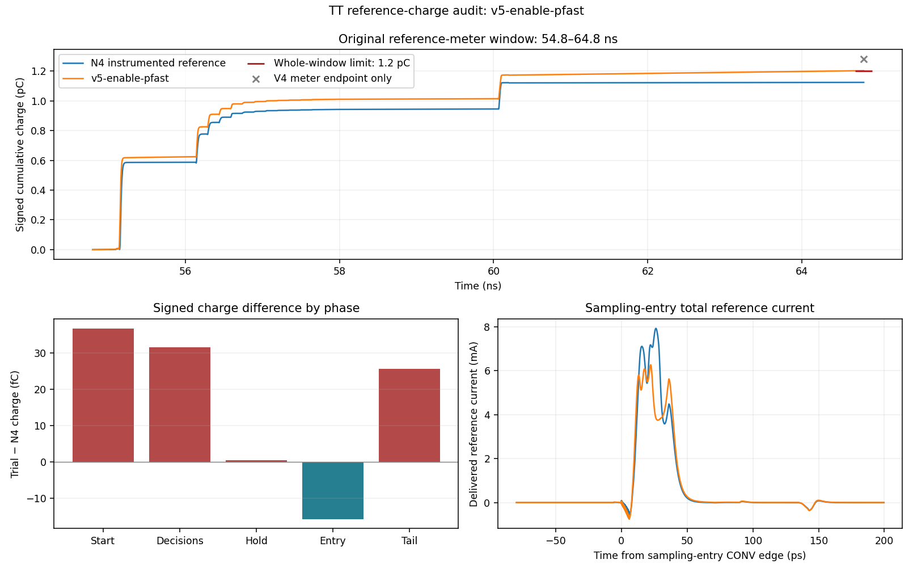

The sampling-entry charge is already below N4. During the remaining
4.444 ns sampling tail, the two bit-12 MGPP source-plus-body branches
draw 12.926594/12.946106 fC, totalling 25.872700 fC. The paired MGNP
branches total 0.220307 fC and the output-PMOS branches are only
0.095713/0.095714 fC. This localizes a substantial tail contribution to
the reference-powered GP inverters and motivates examining their NMOS
off state. Native terminal currents include displacement; neither a
residual nor these charges alone are labelled pure channel leakage.
N4 retains its zero-volt measurement probes; V5 uses native saves.
The official N4 numerical/save differences and V4 total-current gap remain
as described above. No historical simulation was repeated for the audit.

## Controlled AP keeper and gate-family SS result

The independent V6 source adds a HIB inverter and a PMOS between AP and
DVDD in each bit-12 driver. When HIB is high, the lower series PMOS is
off and the keeper holds AP toward DVDD. When HIB is low, the keeper is
off. The inverter uses a 0.4 um ULVT NMOS and 0.8 um nominal-threshold
PMOS; the keeper is a 0.8 um nominal-threshold PMOS. All have 30 nm length
and one finger. MGPN changes from ULVT 8 um / four fingers to LVT
10 um / five fingers. Upper MPA0 changes from 16 to 20 um / ten fingers
to compensate loading. The shared enable remains unchanged from V5.
Fresh geometry callbacks have no warnings, and pinned RNL check and
render pass. The circuit contains 546 MOS per half; all added devices
are included in its pressure plan.

Source SHA256:
`743450313c4c14225a9a28dceb4ec7b61f075e7ba5926abb793abee5787bc5b6`.
This is an independent private source; no V5, V4 or formal N4 evidence
is inherited. The full 70 ns SS run used clean launch commit
`b2756851618b9c49016f20cafebfcba2c0c618f2` and the same strict numerical
settings and original stimulus.

| SS quantity | V6 | Result |
|---|---:|---|
| RL5 / RL12 / start | 58.6 / 38.7 / 92.3 ps | PASS |
| Tau | 11.291656529 ps | PASS |
| Droop | 0.010551466 LSB | PASS |
| All 546 MOS / 1638 terminal pairs | max 0.978430006497 V | PASS |
| Qref | 1.871702918 pC | n/a at SS |
| DH5 / PHI_S / PHI_SB / CONV | 0.807291 / 5.969836 / 12.395270 / 19.121915 fF | n/a at SS |

RL12 improves by 0.5 ps from V5, leaving 1.3 ps margin. At the 40 ps
deadline, TOP error is 6.217460 mV against 9.604085 mV allowed; both
bracketing raw samples pass. At the 100 ps start deadline the error is
0.832997 mV against 1.603094 mV allowed, also with both raw brackets
passing. The global stress maximum is XB2.XDL.MNOUT drain/source at
60.080165087 ns. The run took 415 s and contains 200,487 time points
(200,486 accepted steps), 279 voltage traces and 99 current traces.

The matched SS event audit finds low-branch AP's sampling-entry maximum
falls from 0.884406717 to 0.853786769 V. Its 62..64 ns mean changes from
0.734012127 to 0.807332142 V, close to the 0.81 V digital supply.
The largest low-branch MPA1
drain/source voltage over the full run falls from 0.881696149 to
0.843589717 V. These are SS observations, not a TT pressure verdict.

In the same quiet window V6's two MGPP source-plus-body currents average
8.257379 and 8.326296 uA; V5 SS lacks those saves. V6's low/high keeper
currents are 4.059493 / 0.034709 uA and digital-supply current is
251.108130 uA. These include terminal displacement and are diagnostic;
the absence of a V5 digital-supply trace prevents a total supply-cost
comparison. V6's reference-current integral closes to its meter within
0.000023536 fC. No SS phase reduction is substituted for the TT charge
budget.

All nine raw files and 50 frozen inputs were recovered and hash-verified
before exact cleanup. Archive SHA256:
`6f2c22d1cbbe6e802012932c31ec430b43994088d9271178e114cf08fef4d957`.
The conditional same-source TT run follows below, with total reference,
digital-supply and keeper current saves.

### Same-source TT settling, charge and pressure pass

V6 passes all ten applicable TT specifications and all 1,638 MOS pairs.
The source and full 70 ns stimulus are unchanged from its SS pass;
launch commit is `b2756851618b9c49016f20cafebfcba2c0c618f2`.

| TT quantity | V6 | Result |
|---|---:|---|
| RL5 / RL12 / start | 40.2 / 29.5 / 65.7 ps | PASS |
| Tau / droop | 6.905282262 ps / 0.002986435 LSB | PASS |
| Qref | 1.187183082 pC | PASS, 12.816918 fC margin |
| DH5 / PHI_S / PHI_SB / CONV | 0.830865 / 6.437863 / 12.251146 / 19.698543 fF | PASS |
| All 546 MOS / 1638 pairs | max 0.996299049770 V | PASS |

The global maximum is now XB11.XDL.MPA1 drain/source at 60.079361417 ns,
with only 3.700950 mV margin; representative fast-corner checks follow.
The previously failing bit-12 low MPA1 maximum falls from 1.014916187
to 0.945160621 V. Its AP sampling-entry peak falls from 1.017091473
to 0.962597334 V, and its 62..64 ns mean is 0.899535832 V.

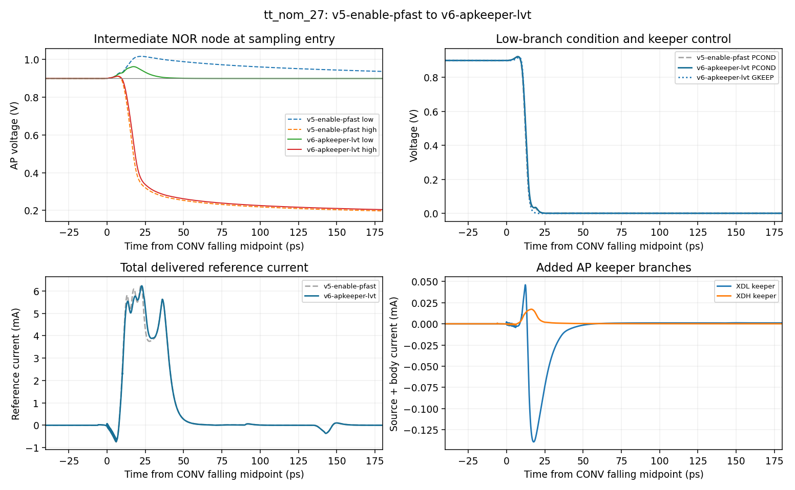

The official meter gives 1,187.183082 fC. Direct integration gives
1,187.183062198 fC, a difference of -0.000019802 fC. Relative to V5,
the signed total decrease is 16.017491 fC:

| Phase | V6 minus V5 (fC) |
|---|---:|
| Start and neighbouring pre-decision intervals | -2.460128 |
| Thirteen decisions | -0.254734 |
| Post-decision hold | -0.000475 |
| Sampling entry | +0.059986 |
| Sampling tail | -13.362140 |

The tail's total reference charge falls from 29.086575 to 15.724435 fC.
The two bit-12 MGPP branches contribute 6.250398 / 6.260085 fC there,
versus 12.926594 / 12.946106 fC in V5. Their 62..64 ns mean currents
fall from 2.908252 / 2.912797 uA to 1.406354 / 1.408315 uA; total
reference current falls from 6.566860 to 3.560434 uA. This supports the
targeted reduction in sampling-tail current. Terminal currents still
include displacement; no channel-only leakage measurement is claimed.

V6's digital supply averages 139.143622 uA in that quiet interval.
Its low/high keeper currents are 1.043243 / 0.003015 uA. V5 lacks the
digital-supply save, so the audit cannot establish the change in total
power. Relative to the existing strict N4 diagnostic, V6 still consumes
62.605073 fC more reference charge over the complete meter window.

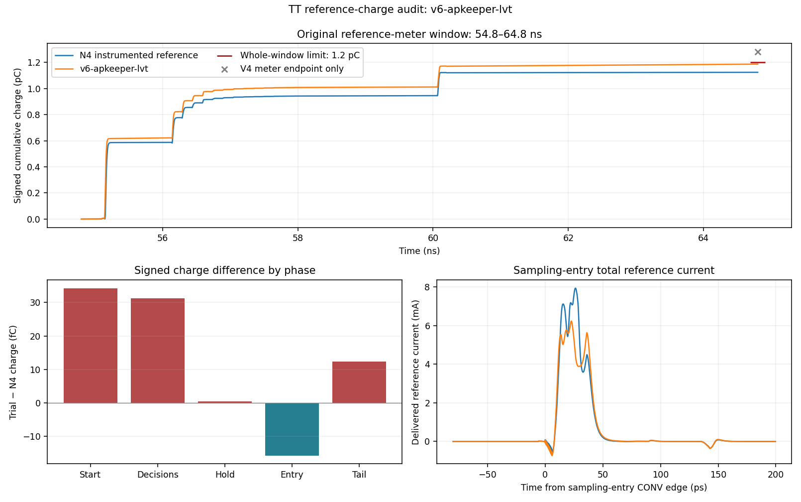

The run took 448 s, saving 231,641 time points and 378 signals at the
same strict numerics. All nine raw files and 50 frozen inputs were
recovered and hash-verified before exact cleanup. Archive SHA256:
`e2ba8b561535062dcae75c5d36910c32662a5a891388c495c00eae09e5d47972`.

### Same-source TT weights and calibration pass

After both complete settling/pressure gates passed, the unchanged V6
source passed all five original TT weight/calibration requirements:
Cs 2.065012117 pF, full scale 0.993022722 V, calibratability margin
0.369043499 LSB, calibrated ENOB loss -0.000371007 bit, and top gain
0.893816038. The small signed ENOB difference is retained as measured
by the unchanged comparison procedure. The 29 pre/hold samples use the
original stimulus and numerics (actual reltol 0.001, voltage tolerance
1e-6, maximum step setting 5820 ps, traponly), with ADCToolbox 0.6.4
and the unchanged four-chip calibration seeds 300..303. This weights
test does not claim full transient pressure coverage.

The 36 s run started from clean commit
`970c57142e56e390545549c5d4053ab89294eb09`. All ten raw files and
50 frozen inputs were recovered and verified before exact cleanup.
Archive SHA256:
`0248285924d988148335fdadc66527d5291bf103ee875794db3d269da357b378`.

### Same-source fast-corner checks fail device voltage

The ff_high_m40 checks use the same frozen V6 source. The full 70 ns
settling sequence complements the 125 ns differential sine screen: the
latter holds the decision controls low and cannot cover the complete
conversion sequence. The two pressure runs were launched before either
failed, with a maximum of two concurrent jobs. Both failures are retained;
V6's other-corner and full FFT expansion is stopped.

| FF high, -40 C check | Result |
|---|---|
| Weights: full scale (only applicable specification) | 0.993016018 V, PASS |
| Full settling: RL5 / RL12 / start | 27.4 / 22.4 / 47.4 ps, PASS |
| Full settling: tau / droop | 4.038938682 ps / 0.000602788 LSB, PASS |
| Full settling: 546 MOS / 1638 pairs | 387 failing pairs; max 1.103478636613 V, FAIL |
| Differential sine: 1092 MOS / 3276 pairs | 550 failing pairs; max 1.108169154214 V, FAIL |

The full-sequence maximum is XB11.XDL.MPA1 drain/source at
60.075266947 ns: AP reaches 1.105147984 V while PCOND is 0.001669348 V.
Other representative failures include bit-12 HHIB at -0.067291401 V,
bit-9 PCOND at 1.025622703 V, bit-12 NOFF at -0.032952788 V and a
bit-2 bottom plate at -0.055118233 V. Thus the failures span floating
AP nodes, control/prelogic feedthrough and bottom-plate excursions.
The 387 failing terminal pairs are not 387 independent mechanisms.

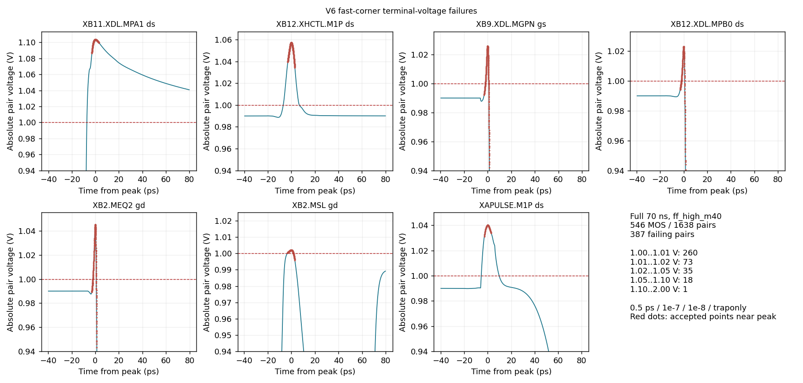

The plotted principal peaks are smooth and have accepted time steps of
approximately 10--30 fs nearby. No obvious alternating numerical ringing
is seen in these selected records. This does not establish isolated
numerical convergence, and neither the 1.0 V limit nor the stimulus has
been changed. Exact node-pair and event clustering, including external
gate/control-source checks, precedes the next circuit change.

The differential sine retains 48.828125 MHz, -1 dBFS, 50 ohm per side,
20 fF top load and the original phase/ideal-bootstrap models. Only the
duration, saves and maximum step are changed for this diagnostic. Its
worst pair is XDACN.XB0.MEQ1 gate/drain at 5.142329994 ns. Eight sampled
outputs are not an FFT or a tracking-specification pass.

Both pressure runs use 0.5 ps / reltol 1e-7 / voltage tolerance 1e-8 /
traponly. Full settling has 235753 saved times and 378 signals, taking
457 s; the sine has 354741 saved times and 485 signals, taking 1275 s.
Weights retains its original numerical settings. The weights/settling
launch commit is `a08bba88806774b0e37813b21567203257bca8e1`; the sine
launch commit is `970c57142e56e390545549c5d4053ab89294eb09`.

All raw files and 50 frozen inputs per run were recovered and verified
before exact owned-directory cleanup. Archive SHA256 values are:

- FF weights (10 raw files):
  `5a65a3682311fb98494828dee556b2c04265e62f8de64d9b2db98d97da3ce68f`
- FF settling (9 raw files):
  `340f31b1a85725e68183ad3dcc2e3d6ec99b15939500f492b269517796129fb7`
- FF differential sine (8 raw files):
  `896786482658607a36ee483f1cff4ec099ce6abd8c4912c35b5e1a13bd0af57e`

### Actual-node and event clustering of the fast-corner failures

Re-reading the retained raw data removes duplicate terminal labels by
grouping the actual two nets whose voltage is measured. This is descriptive
grouping, not a count of independent root causes. A structural template
also identifies repeated halves/bits without replacing their individual data.

| Full retained record | Failing terminal pairs | Distinct actual net pairs | Repeated structural templates |
|---|---:|---:|---:|
| 70 ns settling | 387 | 235 | 29 |
| 125 ns differential sine | 550 | 374 | 28 |

Of the settling pairs, 265 global peaks are near CONV falling, 44 near
CONV rising and 78 near decision edges. The sine has 338 near CONV rising
and 212 near CONV falling. Classification uses the nearby external edge;
the complete audit also retains every contiguous over-limit episode.
For example, ENB-to-EQBUS is only one net pair per half yet maps to
44 failing terminal pairs across the two halves. APGATE-to-VIN similarly
maps two net pairs to 44 terminal pairs; PHI_SB-to-VIN maps two to 12.

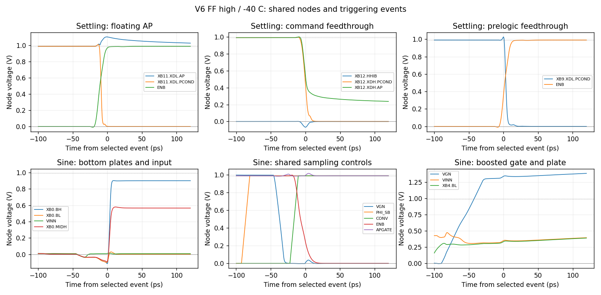

The low-input first conversion contains two negative plate steps:

- At 5.108779136 ns, VG is turning off: VINN is -0.037138425 V,
  VGN is 0.238327126 V, and bit-0 BH/BL are approximately -0.035843 V.
  CONV is still low and ENB remains 0.987964790 V.
- At 5.122864329 ns, VGN is nearly zero, VINN has recovered to
  0.005567167 V, but the shared plates remain near -0.036771 V while
  ENB reaches 0.997719366 V.
- At the 5.142329994 ns worst-pair peak, ENB has fallen to 0.244880553 V
  as reference control takes over. BH reaches -0.113962968 V and BL
  -0.093364966 V; APGATE is 0.994206187 V and VINN is 0.010048976 V.

The topology and sequence indicate input-switch turn-off injection followed
by sharing-switch turn-off and reference-gate feedthrough. Their individual
charge contributions have not been isolated. A common structural experiment
will separate the 22 sharing gates from conversion ENB and buffer PHI_SB
inside the DUT, opening sharing while VG still conducts. The original
external phases remain unchanged. Its extra PHI_SB load, SS timing and
complete device voltages must be measured independently.

Floating AP is a separate mechanism: as both series prelogic PMOS turn
off, AP retains the positive kick while PCOND falls. A keeper applicable
across the repeated prelogic
structure is a candidate remedy, with its loading/current cost still to
be tested. Control-buffer negative swings occur while a nominally low HIB
drives the rapidly falling prelogic nodes; buffering relative to that
coupling load needs separate attention. Neither mechanism is assumed
fixed by the sharing experiment.

The frozen phase/bootstrap models match the current repository files by
hash. DVDD is 0.99 V and VREFP 0.9 V. PHI_S, PHI_SB and CONV remain
between 0 and 0.99 V, with measured 10--90% edges of 9.6 ps, consistent
with the 12 ps transition parameter. The bootstrap uses kboost=1,
60 ps turn-on, 15 ps turn-off and 50 ohm output resistance. Stable
tracking VG minus VIN is approximately 0.99 V. Its actual loaded VG can
overshoot; the behavioral source is not a zero-impedance voltage clamp.

The ideal sine source spans 0.007493909..0.892506091 V. The actual VIN
port after the 50 ohm source resistance transiently reaches -0.037138425 V.
This is observed kickback in the loaded circuit, not a negative-input
stimulus modification. The present evidence identifies no discrepancy
between the frozen test and its source/edge conventions. It does not
establish transistor-level bootstrap or clock integration.

Subsequent mechanism trials can screen the original 0..12 ns FF sine
alongside SS settling, covering the first low-input conversion and next
sampling entry before costly TT/weights expansion. That short interval
does not cover the complete conversion history responsible for the 60 ns
AP maximum; full settling and longer pressure checks remain necessary.

### Independent sharing-phase source prepared

V7 adds one physical inverter, ULVT NMOS 8 um / four fingers and ULVT
PMOS 16 um / eight fingers, both 30 nm long. Its SAMP_ON output is the
inverse of PHI_SB and replaces ENB only at the 22 sharing-switch gates.
All other MOS lines, physical MOM/Cp lines and top-level ports are
unchanged from V6. It has 548 MOS per half, 1096 in the differential
test and 3288 terminal pairs. Fresh geometry callbacks have no warnings;
the complete pinned RNL check/render has zero errors, warnings or hints.
The private source and drawing are frozen; its independent results follow.

V7 source SHA256:
`ee633589f59275c413d47f00e46674fbc00b2956fc59d1e204514007521f920f`.
This is a targeted experiment on sharing timing, with the other known
mechanisms retained for observation. It inherits no V6 passing result.

### V7 SS pass and early FF failure

The complete SS 70 ns run passes all five applicable specifications and
all 548 MOS / 1644 pairs. RL5/RL12/start are 58.7/38.7/91.0 ps,
tau 11.291656529 ps and droop 0.006090525 LSB. The maximum voltage is
0.996250123617 V on XB2.MSHAREL gate/drain at 60.082693379 ns, leaving
only 3.749876 mV margin. Both raw samples bracketing the RL12 and start
deadlines pass. SS Qref is 1.871470009 pC and PHI_SB load is
32.048788 fF, both n/a at this corner; they are not TT budget evidence.

The original-stimulus 0..12 ns FF diagnostic fails: 472 of 3288 pairs
across 1096 actual MOS exceed 1.0 V. Its maximum is 1.082194855432 V,
XDACP.XB11.XDL.MPA1 drain/source at 10.074419594 ns. TT, weights and
longer expansion are stopped for this source, despite its SS pass.

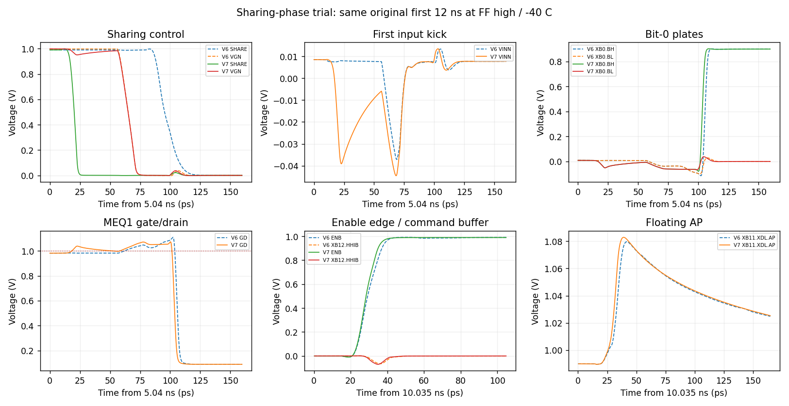

Restricting the retained V6 data to the same 0..12 ns interval gives
355 failing pairs, not the 550 from its entire 125 ns record. V7's
sharing-gate 50% falling crossing moves from 5.135472908 to 5.060285280 ns.
Bit-0 BH's minimum improves from -0.114612710 to -0.078819331 V, BL
from -0.101566119 to -0.066309729 V, and MEQ1 gate/drain from
1.108169154 to 1.071896996 V. However, VINN's minimum worsens from
-0.037138425 to -0.044593525 V, and total failing pairs increase to 472.
The experiment therefore does not establish an overall improvement.

Removing sharing-gate load accelerates ENB's 10--90% rise from
12.921128 to 11.071397 ps. The bit-12 HIB negative excursion increases
from -0.065980344 to -0.069980266 V. At conversion start EN reaches
-0.010746808 V against NOFF 0.989946157 V, creating a repeated
1.000692965 V difference. The new sharing buffer itself reaches
1.000285324 and -0.014318542 V, producing three failing pairs.
These shared effects motivate controlling enable and sharing-output
edge rates before evaluating the timing change further. AP floating
and the remaining input/plate injection still require separate treatment.

Both runs launched from clean commit
`79959fc0f61763a27ee0632fedc1a30a19c91602` with 0.5 ps / 1e-7 /
1e-8 / traponly. SS took 410 s and FF 118 s. All raw data and 50 frozen
inputs per run were recovered and verified before exact cleanup:

- V7 SS (9 raw files):
  `21d725155540f6f2ca67d0fae9a8733a34eedb4396d0ae3e393317e61a5d05c6`
- V7 early FF (8 raw files):
  `ad2021648070d9758db9d282b45e9c88ec65c53fe0ace8fa740ac910be374124`

### V8 common-edge control: SS pass, early FF still fails

V8 reduces the shared-enable first-stage NMOS from 8 to 6 um and nominal-
threshold PMOS from 16 to 12 um, retaining 30 nm length and 2 um fingers.
It also adds 50 existing validated physical MOM units to SAMP_ON:
50.1145 fF plus exactly 2.505725 fF bottom-plate Cp. Original MOM/Cp lines,
other MOS and external ports remain unchanged. Fresh callbacks and complete
pinned RNL check/render pass without warnings. There are still 548 MOS
per half and 1096 in the differential test.

Source SHA256:
`ec01ed7effbeb53894bffeae0563837fb60d2b9ef7ffea93eb96cb5d48249555`.

| V8 check | Independent result |
|---|---|
| SS applicable specifications | All five pass: RL5/RL12/start 58.7/38.7/94.1 ps; tau 11.291656529 ps; droop 0.005334046 LSB |
| SS all-MOS voltage | All 1644 pairs pass; maximum 0.978616967240 V on XB2.MSHAREL gate/drain at 60.082866587 ns |
| Early FF, original 0..12 ns | Fails: 299/3288 pairs; maximum 1.075905098325 V on XDACN.XB11.XDL.MPA1 drain/source at 10.078701238 ns |

SS Qref is 1.878457519 pC; PHI_S/PHI_SB/CONV loads are
5.963333/31.922153/14.340644 fF. These are n/a at SS, not TT budget
passes. The failed FF gate stops this source before TT, weights or longer
expansion. It does not stop further independent design work.

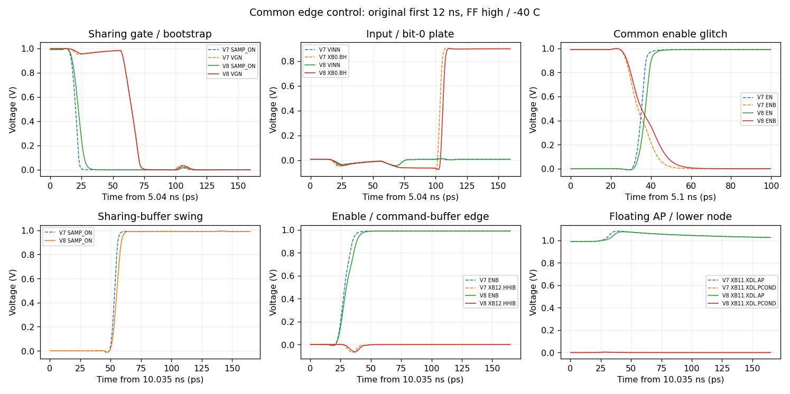

Both saved records cover the identical original first 12 ns. V7's 472
terminal labels span 310 devices and 287 distinct actual net pairs; V8's
299 span 215 devices and 212 actual net pairs. These are descriptive
counts, not independent root-cause counts. Two circuit changes were made
together, so the audit does not isolate their individual causal effect.

- ENB's 10--90% sampling-entry rise changes from 11.071397 to 14.001999 ps.
  Its associated EN negative excursion at conversion start changes from
  -10.753927 to -9.231748 mV. The repeated MNB0 violations disappear
  (44 to zero); MPB0 violations decrease from 110 to 22.
- SAMP_ON's 50% falling crossing moves only 2.162307 ps, to
  5.062447587 ns, still before VG turns off. Its NMOS buffer violation
  disappears, but two PMOS pairs still fail, with a 1.000525356 V maximum.
  The negative output swing is reduced, not eliminated.
- The low-input VINN minimum is -45.035396 mV, versus -44.593525 mV in V7.
  Bit-0 BH improves modestly from -78.819331 to -75.010269 mV; its
  sampling-PMOS gate/drain peak remains 1.070564544 V. MID PMOS stress
  also remains. Common edge control has not repaired input/plate injection.
- The bit-12 HIB negative swing changes from -69.980266 to -63.730084 mV,
  while the pulse-chain D1 remains near -49.95 mV. These still create
  repeated logic-buffer violations.
- At V8's worst event, AP is 1.076359230 V and PCOND is 0.000454131 V.
  The two series PMOS can still leave AP floating when both are off.
  Twenty-two MPA1 terminal pairs fail, so this is a repeated prelogic
  structure, not a lone device requiring a special-case keeper.

The next discriminating experiment will provide an ENB-controlled NMOS
discharge path on AP in every repeated prelogic driver, replacing the
bit-12-only high-state keeper. This makes AP actively low when the upper
PMOS is off. Its extra enable load, AP edge feedthrough, SS start timing
and reference charge remain measurements to be made. Other residual
mechanisms are not assumed fixed by that experiment.

Both V8 runs launched from clean commit
`83e299ed99eeeabdef833df6d9b59324c3654de2` with 0.5 ps / 1e-7 /
1e-8 / traponly. SS took 396 s and early FF 110 s. All raw data and
50 frozen inputs per run were recovered and verified before exact cleanup:

- V8 SS (9 raw files):
  `3741d99bd697c40fcac42a5b153357d6b6e99066c43321467097995dd43287d1`
- V8 early FF (8 raw files):
  `2fcb5bfe39cf4f75e76c144b3954e0f3188631268634315ebd93d2aabf970323`

### V9 active AP discharge: the floating state is removed, other stress remains

V9 adds an ENB-controlled ULVT NMOS from AP to VREFN in every repeated
driver, complementing the upper PMOS. Widths are 1/0.575/0.325/0.185/0.12 um
for bits 12/11/10/9/smaller, all 30 nm long with one finger. It removes
the three bit-12 high-state keeper devices in each branch to avoid
contention. The net change is +20 MOS per half: 568 per half, 1136 in the
differential test. Fresh geometry callbacks and full pinned RNL checks
pass without warnings. All capacitors, other MOS and external ports remain
unchanged from V8.

Source SHA256:
`6adc4c24b88bc29251f9bfd72c0a74d7c5d7cbe5ad7e879080bd647f3ef7d3f1`.

The full SS run passes all five applicable specifications and all
1704 terminal pairs. RL5/RL12/start are 58.7/38.4/95.6 ps, tau
11.291656529 ps and droop 0.005148503 LSB. The worst voltage is
0.977265105026 V on XB2.XDL.MNOUT drain/source at 60.077348509 ns.
Raw samples bracketing both deadlines pass. SS Qref 1.877272342 pC
and PHI_SB load 31.798972 fF are n/a, not TT evidence.

The original early FF screen still fails: 279 of 3408 pairs, across
198 devices and 200 distinct actual net pairs. Its maximum is now
1.070564545153 V on XDACN.XB0.MEQ1 gate/drain at 5.117493141 ns,
with APGATE 1.009392881 V and BH -0.061171665 V. That sampling-path
peak is essentially unchanged from V8. Every newly added MNDAP pair
passes this window; the failure count includes the changed device set.

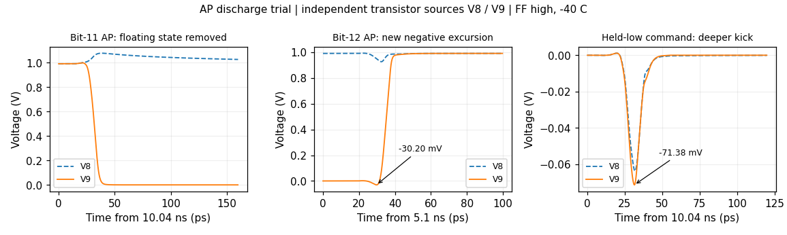

Bit-11 low-branch AP's full-window maximum falls from 1.076371625 to
0.997353408 V. It now discharges to ground at sampling entry instead
of retaining positive charge. However, AP starts from ground before
conversion; the falling ENB edge causes a new negative excursion.
Bit-12 AP reaches -0.030199873 V at 5.129748929 ns, producing
MPA0 drain/source 1.020199873 V and MPA1 gate/source 1.019672849 V.
There are 16 new MPA0 failing pairs and 12 remaining MPA1 pairs, so
this is not a complete AP voltage repair. The held-low bit-12 command
buffer also worsens from -63.730084 to -71.380816 mV. Its deeper
excursion is retained alongside the removed floating state.

V9 stops before TT, weights and longer expansion. The next independent
experiment adds physical AP capacitance uniformly scaled to upper-PMOS
width, with 5% bottom Cp on every added unit. It will test whether
diluting feedthrough and slowing AP edges can retain the 4.4 ps SS start
margin. The size choice is an empirical experiment, not a proven charge
model, and the separate sampling/MID/pulse-chain failures remain open.

V9 launched from clean `bc896cd8c4543bac76d3ba483454307610a8a512`,
with the same 0.5 ps / 1e-7 / 1e-8 / traponly settings. SS took 372 s,
early FF 119 s. All raw data and 50 frozen inputs per run were recovered
and verified before exact cleanup. Archive SHA256 values:

- V9 SS (9 raw files):
  `b7efa3a1667c97bb62a8a0f846ee8266cd216fabab84dd67d949c2ddb15c6af5`
- V9 early FF (8 raw files):
  `8d4cc05eac31f04a82ac6161093681f87566dcaced97ca0e1daecab4e6d12d21`

### V10 physical AP capacitance: limited improvement and retained tradeoffs

V10 adds existing validated physical MOM units at every AP, sized as
ceil(2.5 units per um of upper-PMOS width). There are 170 added units
per half, with exactly 8.519465 fF of bottom Cp. All MOS, original
capacitors and top-level ports are unchanged from V9. Complete pinned
RNL check/render passes; primitive geometry is reused without modification.
The device count remains 568 per half and 1136 differential.

Source SHA256:
`92923f4f3e0bf9ccabd7630d247f59a422e9a66872d88829c78f7c92937597b6`.

SS passes all five applicable requirements and all 1704 voltage pairs:
RL5/RL12/start 58.3/38.3/96.4 ps, tau 11.248227081 ps and droop
0.005063857 LSB. Both deadline raw brackets pass. Maximum voltage is
0.983116663707 V on XB9.XDL.MPOUT drain/source at 5.162004726 ns.
However, TOP now overshoots its start-step final value by 34.428847 mV,
and Qref increases from 1.877272342 to 1.891814685 pC at SS (n/a).
These costs are retained despite the passing settling deadline.

Early FF still fails: 272/3408 terminal pairs, 191 distinct actual net
pairs. The maximum remains 1.070564544970 V on XDACN.XB0.MEQ1
gate/drain at 5.117493141 ns. Bit-12 AP's negative excursion decreases
from -30.199873 to -11.478720 mV, and its command-buffer excursion from
-71.380816 to -48.214454 mV. MPA0 has four remaining failing pairs,
maximum 1.001478720 V; MPA1 and MNA1 each have four, maximum
1.002796115 V. Some GN-driver failures increase. The unchanged largest
sampling-path peak demonstrates that the AP treatment does not repair
all mechanisms. V10 stops before TT, weights and further expansion.

Runs launched from clean `20d4d8896dc8d9b94206b7c928e8e5e255b5c511`
with 0.5 ps / 1e-7 / 1e-8 / traponly. SS took 370 s; early FF 118 s.
All raw files and 50 frozen inputs per run were recovered and verified
before exact cleanup. Archive SHA256 values:

- V10 SS (9 raw files):
  `2320e8272cc43afec235cd98fc70b43ba6aae3d75e1cc50a8f905a8b6806eec9`
- V10 early FF (8 raw files):
  `6fb7fc5a8d624ff070f054de6381ab3d4fc4cac417911348c2bc1dd2828416db`

### Numerical-settings notice #94 takes priority

[The new notice](https://github.com/many-question/ADC-12b-100M/issues/94)
is an unmerged announcement at this report's check: fetched main remains
`3b0c002a507b5f5fba1dfbc7059db5ef103e2860`, with the prior numerical
configuration and ADCToolbox 0.6.4. No implementing open flow PR or new
CDAC module notice was found; #94 has no comments and requires no acknowledgement.

The announced flow uses conservative transient settings without an explicit
maxstep for CDAC tests, APS only, and a fixed upstream ADCToolbox commit
`cd72061`. Effective settings must come from the simulator log: ordinary
conservative tests are expected to use gear2only, reltol 1e-4, relref
alllocal and lteratio 10; tracking retains effective reltol 1e-7 and
10 nV voltage tolerance. Requested and effective reltol are not identical.
The same-number PyPI 0.9.1 package does not identify the announced fix.

All prior N4 and V0--V10 records remain evidence under their recorded
settings, not evidence of acceptance under the new protocol. The first
independent same-source private comparisons recheck N4 SS settling,
V6 FF full settling, and V6's original first 12 ns of tracking input.
They change numerical configuration without changing the circuits or
stimuli, and report every actual saved step and device pair. Any failure
that disappears will be retained as a numerical comparison, not erased
from the old record. No old-setting full-corner formal acceptance is started.

After the change merges, affected official weights, settling and tracking
must be rerun with the merged runner/testbenches and fixed dependency;
rehashing old records does not restore validity. Merge state and module
notices will be checked before each batch and PR update. Formal module
acknowledgements will follow their notice, not this preliminary announcement.

The next circuit source, V11, was initially frozen at
`49b16dce926ab575c321b89837fd779983db6643fb1b34488dee99074b72b7b0`
before the numerical comparison. It routes the existing sampling-assist hold
PMOS source/body to VREFP and the six MID PMOS gates to that off-state
control. All primitive geometry and capacitors are unchanged. Its proposed
benefit, overlap/reference-current cost and leakage were hypotheses at
that checkpoint. Its subsequent matched measurements are recorded below.

## Continuing verification

### Completed same-source notice-94 diagnostics

Three independent runs from clean `a3eb13c278466b833f06edf55c9ab6045e6ca7f8`
apply the announced numerical settings to the exact archived N4/V6
circuits. All 50 staged inputs per run were verified; only the job deck
and testbench differ. Device sizes, physical MOMs and 5% bottom Cp,
loads, source waveforms, initial state, save sets and metric definitions
remain unchanged. The tracking-input run ends at 12 ns; its comparison
uses the same first 12 ns of the old 125 ns run, never the full-run count.

| Diagnostic | Old private strict settings | Notice-94 settings |
|---|---|---|
| N4 SS full 70 ns: RL5/RL12/start | 69.3/47.4/117.7 ps | 68.6/47.4/116.8 ps |
| N4 SS device-voltage pairs | 0/1620 fail | 0/1620 fail |
| V6 FF full 70 ns: RL5/RL12/start | 27.4/22.4/47.4 ps | 27.2/22.4/47.2 ps |
| V6 FF full settling voltage pairs | 387/1638 fail, max 1.103478637 V | Same 387 pairs fail, max 1.103506458 V |
| V6 FF original 0..12 ns voltage pairs | 355/3276 fail, max 1.108169154 V | Same 355 pairs fail, max 1.108166729 V |

Both N4 timing failures persist in the raw points bracketing their
deadlines: start error at 100 ps is 5.093684 mV against 1.585677 mV
allowed, and RL12 error at 40 ps is 36.532154 mV against 9.602924 mV.
The V6 full-settling maximum remains bit-11 low-driver MPA1 drain/source
at 60.075189254 ns. The first-12-ns maximum remains negative-side bit-0
MEQ1 gate/drain at 5.142333029 ns. Pair-by-pair comparison confirms no
added or removed failing pair in either V6 window. These principal
failures therefore persist under the announced preset; this does not
prove every old waveform detail or every circuit variant is insensitive.

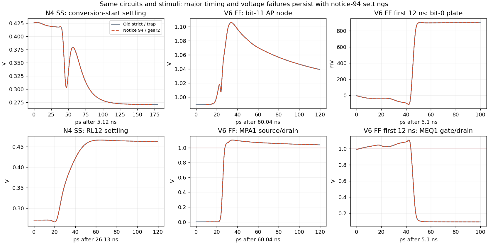

Logs confirm APS, gear2only, conservative, relref alllocal and lteratio 10
for all three. The settling runs use effective reltol 1e-4 and voltage
tolerance 1 uV. Tracking requests reltol 1e-6 and records effective 1e-7
with 10 nV voltage tolerance. No maxstep is explicitly configured.
Spectre nevertheless reports its internal default maximum: 700 ps for
each 70 ns run and 120 ps for the 12 ns run. Actual largest saved gaps
are 700/700/17.237846 ps respectively; adaptive edge steps are smaller.
The complete waveforms contain 5159/5444/6181 points and cover t=0 to
the specified end without missing or nonfinite values.

Observed simulator runtimes are 23/23/36 s. The comparable old complete
settling runs took 348/457 s; no equivalent old 12 ns runtime was measured,
so the old 125 ns runtime is not used for a speed ratio. This comparison
changes tolerances, integration method and step control together; it is
not an isolated reltol-convergence experiment. All runs have four solver
threads as reported by Spectre, with at most three concurrent jobs.

All raw evidence (9/9/8 files), frozen inputs and analysis/cache seals
were recovered and verified before exact owned-run cleanup. Archive hashes:

- N4 SS: `f274c54ed7e0b599498fc2df574f379cfdbd69617fd34a694ebb3be1d010d86c`
- V6 FF settling: `af9f3c47cdfa25267808cf5ba511bdeb94db545571a7aa7736d18ca95144332b`
- V6 FF first 12 ns: `04aa9e469d0528c9d637b0257081208859e7b1bb27804c32d7dff849d3f24121`

These are private proposed-setting diagnostics, not formal results. No
FFT is performed, no ADCToolbox result is claimed, and no prior failure
is erased. The formal N4 circuit and 12 official result/figure files
remain unchanged. Official reruns still require the merged flow and its
pinned dependency. The observations support continuing circuit diagnosis
with the announced numerical settings instead of relying solely on the
old traponly screens.

### V10/V11 matched conservative circuit comparison

After the same-source numerical checks, both V10 and V11 were run under
the verified announced settings from clean `2cf53ad15c6807a996447410f43dd2dbb2e5f314`.
V11's independent flattened-netlist check confirms exactly seven changed
MOS connections, unchanged geometry/capacitors and 568 MOS per half.
Complete RNL validation and the assist/bit-0 drawings were checked.
Both runs save identical native MPUP/MPPASS and supply currents, without
adding any electrical instrumentation to the circuit.

| Check | V10 baseline | V11 reference-powered assist hold |
|---|---|---|
| SS RL5/RL12/start | 57.8/38.4/95.7 ps, pass | 57.8/38.4/95.6 ps, pass |
| SS tau / droop | 11.335086 ps / 0.004904730 LSB | 11.335086 ps / 0.005444980 LSB |
| SS voltage check | 0/1704 fail, max 0.982867868 V | 0/1704 fail, max 0.983099466 V |
| Early FF voltage check | 272/3408 fail, 191 actual net pairs | 269/3408 fail, 187 actual net pairs |
| Early FF maximum | 1.070563930 V at 5.117470582 ns | 1.056373570 V at 5.146911407 ns |
| SS Qref (n/a for TT budget) | 1.891895712 pC | 1.981721744 pC |

The maximum in both cases is negative-side bit-0 MEQ1 gate/drain. V11
initially holds APGATE near VREFP, but the original phase pass pair later
connects it to the 0.99 V PHI_SB. At V11's maximum, APGATE is
1.001566381 V and BH is -0.054807190 V. Lowering only MPUP's supply
therefore does not bound the assist voltage through the whole handover.
The late pass-path excursion remains, while the changed MID gate routing
worsens its largest PMOS pair from 1.043154643 to 1.051176546 V.

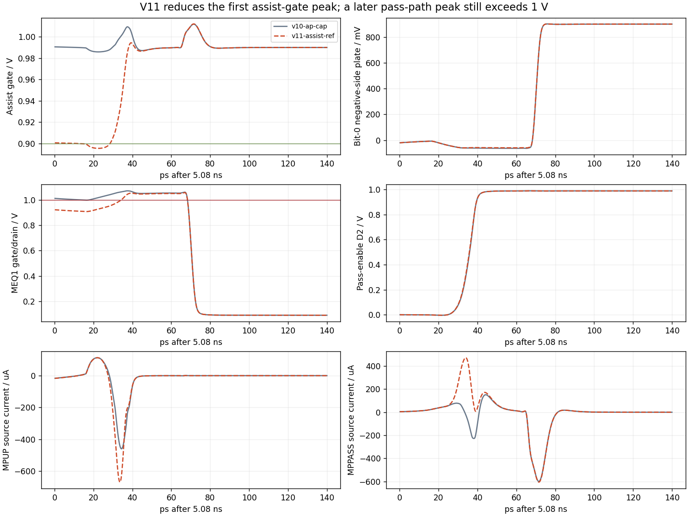

Only three failing pairs disappear: the two MPUP drain/source pairs and
negative-side bit-2 MSL gate/drain. No new failing pair appears, but all
55 MEQ1/MEQ2 failing pairs and all 12 MID-PMOS failing pairs remain.
SS reference charge increases by 89.826032 fC, not an improvement; SS
is not the TT charge budget. Native current records retain the overlap
and backflow. Their saved-sample integral is diagnostic, whereas the
table's Qref is the original testbench's charge integral.

Both SS deadline brackets pass; V11 stops before TT, weights and longer
pressure expansion because early FF fails. All four proposed-setting
runs are private. Each uses the same effective profile as the preceding
batch, no explicit maxstep, APS only, and complete finite waveforms.
The 9/8/9/8 raw files and 50 staged inputs per run were verified before
exact remote cleanup. Archive SHA256 values:

- V10 SS: `545b8e808d9c4edbed10ec775e5e73fac94cc223dff8e2555fba2f30c94f2eb7`
- V10 early FF: `e41f9ff9a6cc00dab37d4b0412c7120f640dd5bf37d96a7ac8f925e846b4469c`
- V11 SS: `eb826816e28931b269a3e1a717012f1e6f445b1afe468c5706e9cf26cdbb6ccb`
- V11 early FF: `05f99a15c3e03df8189ed99c9e2ea9f2e0783b0eafc4d4839b0d137f0f0c4764`

### V12 physical reference phase: sampling-PMOS repair with retained control failures

V12 adds a VREFP-powered PHI_S inverter and uses its physical output as
both assist-pass source nodes. The new N/P devices exactly reuse the
existing 12 um ULVT/NF6 and 8 um nominal-threshold/NF4 geometries, L30 nm.
All original geometry, capacitors, bottom Cp and external ports remain
unchanged. There are now 570 MOS per half / 1140 differential. Complete
flattened connectivity and pinned RNL checks pass; the first unplaced
unused-port drawing attempt is preserved, followed by a drawing-only fix.
No electrical source was clipped or replaced with an ideal limiter.

Source SHA256:
`5f9586530c87cf02fff3c3363ebd8f56cc0fb79b01bcf731561c33a3079a24dc`.

Under the same private notice-94 settings, SS passes all five applicable
metrics and 1710 device-voltage pairs: RL5/RL12/start 57.7/38.4/95.7 ps,
tau 11.335085978 ps, droop 0.005047516 LSB, and maximum voltage
0.982833690 V. Both raw deadline brackets pass.

Early FF still fails 205/3420 pairs, representing 148 actual net pairs,
versus V11's 269/3408 and 187. Seventy old failures disappear and six
are added. All 55 MEQ1/MEQ2 failures and all 12 MID-PMOS failures are
removed in this complete 0..12 ns window; the four new physical phase
MOS also pass every pair. This is a local repair, not a complete result.

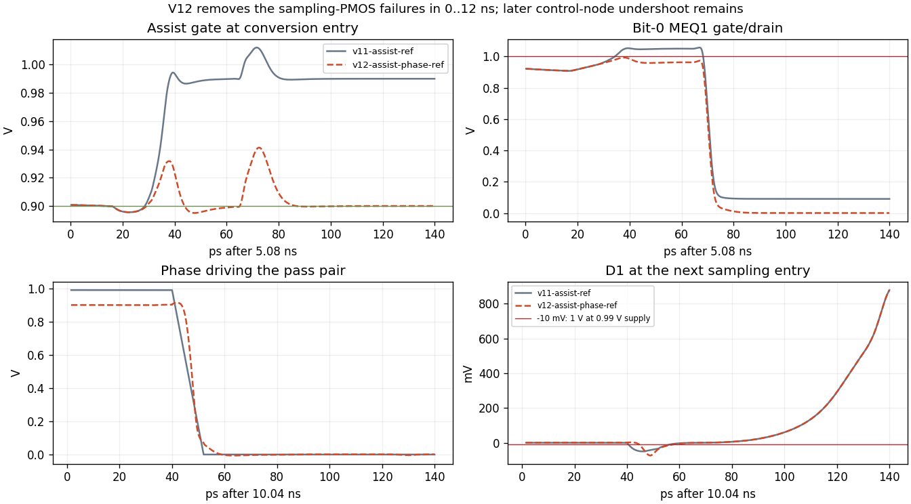

The largest voltage now **increases** to 1.063647898 V on negative-side
assist M1P drain/source at 10.088861177 ns: D1 reaches -73.647898 mV
while its source is 0.99 V. At the old MEQ1 peak time, APGATE/BH are
0.914417859/-0.058256032 V, so the original sampling-PMOS mechanism
has changed; the later control undershoot is retained separately. Six
new failures involve positive D1 overshoot (M1N drain/source and M2N
gate/source, both halves) and MPPASS gate/source. HIB, NOFF/BN, AP/GN
and sampling-NMOS excursions also remain.

SS Qref rises from 1.981721744 to 1.992977713 pC (+11.255969 fC).
PHI_S input capacitance rises from 5.960165 to 22.713011 fF in the same
SS measurement. These are SS diagnostics, not TT-budget passes. The
additional phase delay and its input/reference loading are real costs;
no spectral result or all-corner claim is inferred from this short run.
V12 stops before TT, weights and longer pressure expansion.

Runs launched from clean `590a41c2240e81e585381042885e3320c2cec530` and
took 24 s (SS) / 38 s (early FF). Logs match the same conservative profiles;
all 5427/6552 waveform points are finite and cover the full 70/12 ns.
All native assist/phase/supply-current saves are present. Every raw file
(9/8) and 50 frozen inputs per run was verified before exact remote cleanup:

- SS archive: `b5aa721ee22a0d66d446b80bfa8a74c9be70c0cbaba9c8b17f68de55dee6bcdc`
- Early FF archive: `7d9784affb5639bd15a5e3d347083d900344088b5e946c67e131c992eb06a06f`

At publication, implementing [PR #95](https://github.com/many-question/ADC-12b-100M/pull/95)
is open at `4096aba890302b1d2a1c3474c8d84a44ccf23b16`; main remains
`3b0c002`. Its proposed tracking cross-check is traponly / maxstep 1 ps,
distinct from the old cross-check. Final merged specifications, runner
and effective logs will govern the formal rerun. Downgrading some stale
records to warnings does not make them eligible.

A brief separately controlled reference-drive assist remains an unimplemented
hypothesis, with additional pulse alignment and loading questions.
Each case screens SS settling plus all MOS pairs in its actual TB before
TT charge/load/settling, then spectra and further corners. A failed case
stops its costly expansion and informs the next independent change.
Formal N4 and all official results remain unchanged.

### Official numerical-flow migration and refreshed N4 SS baseline

PR #95 subsequently merged as `c6152d236e525793ecc4809b9a6c9dfb9fd0ad77`.
This branch incorporates it at `301ace8b2688d8c8261a93beed25c5ae1fa6d8d0`.
The exact ADCToolbox commit `cd72061ff3b7a977163dac540da126ae22f5e38d` was
installed in an isolated environment, verified from installed VCS provenance;
all 73 spectrum, numerical-settings and dependency tests pass. Generated
testbenches match the merged generator.

The first rerun uses the unmodified official runner, N4 source and full
`tb_cdac_settle` at SS. The source remains
`3d62b80300fc5d85e3fc4e498cd22cedfa92ed006c502922526f1641e0a2ae61`.
It records RL5/RL12/start **68.6/47.4/116.8 ps**, tau 14.852871281 ps
and droop 0.008877301 LSB. RL12 and conversion-start still fail their
40/100 ps limits. Qref is 1.745048234 pC at SS, where the TT charge
budget does not apply.

The log confirms APS, conservative, effective reltol 1e-4, voltage tolerance
1 uV, gear2only, relref alllocal and lteratio 10. There is no configured
maxstep; the logged default is 700 ps. It completes in 26 solver seconds
from clean `301ace8`, with 5158 finite points over the full 0..70 ns.
The official test saves eight signals; it is not a replacement for the
private full-device-voltage audits. All nine raw files and 50 staged inputs
were recovered and hash-verified before deleting only this owned run.
Archive SHA256: `8e13974c0b953757e0b5ffe31455d5256afc469f0ab44b5b95c111080c6a1e68`.

The preceding 12 official result/figure files were copied and verified
before rerunning, and remain in Git history. Only the SS result and its
two figures are replaced by this actual rerun. Other old results remain
stale; they are not rehashed or counted as current passes. Known failures
continue to gate expensive expansion. Subsequent circuit diagnostics will
be generated from the merged flow; tracking cross-checks, when needed,
use its prescribed traponly / maxstep 1 ps configuration.

### V13: stronger control inverters, matched against V12 after the merge

V13 changes the second-stage N/P widths from 2/4 um to 8/16 um in the
high-command buffer and assist pulse chain. The exact existing ULVT
geometries are reused: NF4/NF8, L30 nm. There are 28 changed MOS instances
per half, with 570 MOS per half overall. Every connection, capacitor,
bottom Cp, top-level port and direct RL input inverter is unchanged.
Independent parsed hierarchy/connectivity checks and pinned RNL checks pass.
Source SHA256: `9c1c1ba2ea2633476e946d093890c7c330cc0c6cacded1f59e1d94001914a71a`.

Both variants are newly staged using the merged official build_jobs,
make_deck and stage functions, with the pinned ADCToolbox. Numerical controls
come directly from that flow. These remain private circuit diagnostics:
full MOS/native-current saves are added, and FF tracking stops at the
original first 12 ns. Matched testbench text, normalized decks, stimuli,
loads, globals and observation lists are identical between V12 and V13.

Both SS cases pass all five applicable metrics and 1710 voltage pairs.
V12 RL5/RL12/start are 57.8/38.4/95.7 ps; V13 is 57.8/38.3/95.7 ps,
with tau 11.291656529 ps and droop 0.005085171 LSB. V13's adjacent
raw points both satisfy the RL12/start deadline bands. Its largest SS
pair is 0.978617235 V. SS Qref changes from 1.992984241 to 1.992188196 pC;
PHI_S capacitance changes from 22.713011 to 22.680599 fF. These SS values
do not establish the TT charge or pin-loading budgets.

Early FF fails **175/3420 pairs**, versus V12's 205/3420. Thirty previous
failures disappear and none is added; distinct failed net pairs decrease
from 148 to 130. The largest pair decreases from 1.063647898 to
**1.021300057 V**, now positive-side bit-12 low-driver MPB0 drain/source
at 10.066510798 ns. D1 minimum improves from -73.647898 to -21.578018 mV
and maximum from 1.010690485 to 0.996408905 V. Worst high-command HIB
minimum improves from -48.214613 to -12.491100 mV. These remaining
undershoots are still failures where the other terminal is near 0.99 V.

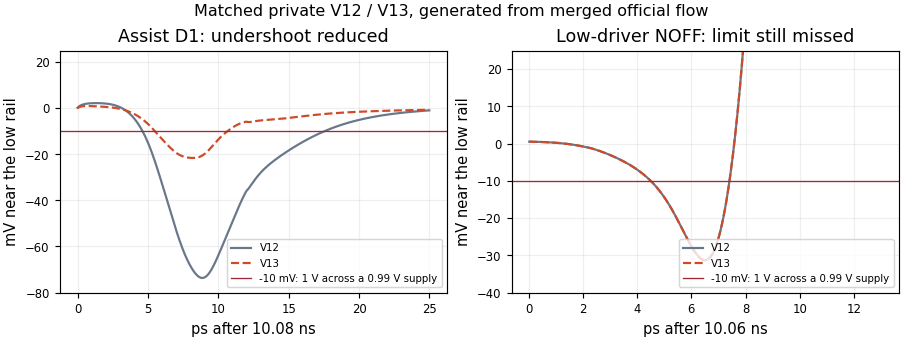

The largest NOFF excursion is -31.300057 mV. At its peak, EN is falling
through 0.681944547 V, LHIB is 0.988372371 V, and the lower NAND node
BN is -21.923751 mV. This is a separate mechanism from the repaired
control-buffer excursion. NOFF/BN, AP/GN and sampling-NMOS failures remain;
V13 does not proceed to TT, weights or longer pressure tests.

The initial two FF attempts retained the official FFT's save=none option,
so 484 required voltage nodes were absent. They were fully archived and
explicitly marked unverified, with no pressure verdict. Two fresh runs
change only the private output-recording option to save=selected; all
official tolerances and stimuli are unchanged. These reruns save every
required voltage and native current. The incomplete attempts are retained,
not overwritten or presented as passing circuit evidence.

All runs use clean `bd54f61f92b2abca6d26b04ed5853944297e8d96`. The verified
SS runs take 28/29 s and contain 5428/5451 points (V12/V13); the complete
FF runs take 36/36 s with 6552/6608 points. All waves are finite and cover
70/12 ns. Each archive verifies 50 staged inputs and every raw file before
exact owned-run cleanup. Archives of the four complete comparisons:

- V12 SS: `cbd8046510d62a88155e286f09ceda78e1d7c80a9497de5278aaacb77656b01b`
- V13 SS: `faa841debf04af546e2af9723d051c84c4cb27b9317929a025c7a5e65f5db5df`
- V12 FF: `2b332d1d40540bf0dc94ed06d09c9a91628bfd996f163cb6b3fa4b63e8122969`
- V13 FF: `2c9f79b3435467ad1943de9f1564fac33ce20af0a8ba7908fe5b7faf843d979a`
