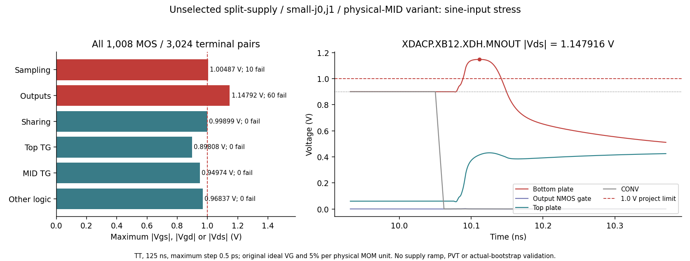
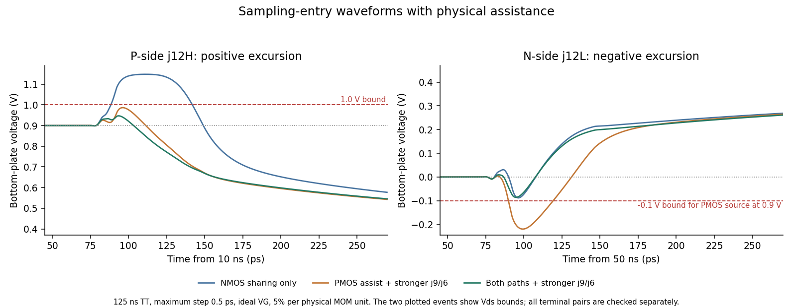
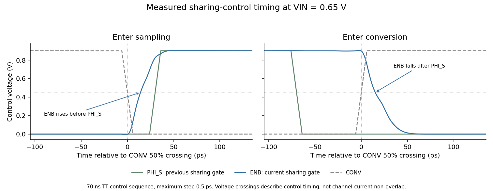
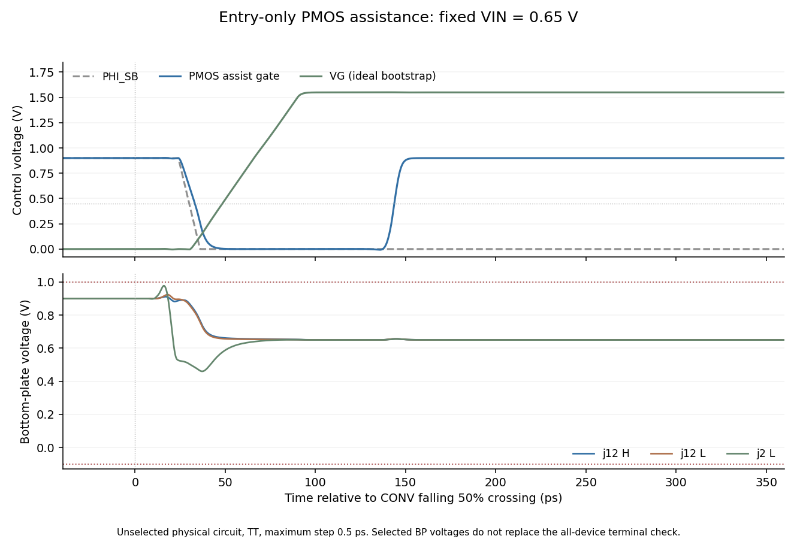

# Sampling-entry diagnosis

These are private exploratory simulations of the circuit frozen at `2ecc285`,
reported on 2026-10-30. They do not replace the official test results or validate
an actual bootstrap circuit. All cases retain the user-specified 5% ground
capacitance on each physical MOM unit, including both units of every series tail.

The six cases use TT, VIN = 0.65 V, the first 34 ns of the official settling
stimulus, maximum step 0.5 ps, reltol 1e-7, and voltage tolerance 1e-8. Inputs
and retrieved simulator outputs were hash-verified. The sampling check covers
22 devices and 66 gs/gd/ds pairs, or 44 devices and 132 pairs in the doubled-width
case. The output check covers 52 devices and 156 pairs in every case. Internal
logic and top-switch stress are outside this six-case comparison.

| Case | Sampling peak absolute voltage (V) | Failing sampling pairs | Output peak absolute voltage (V) | Failing output pairs |
|---|---:|---:|---:|---:|
| Frozen baseline, finer step | 1.06736 | 7 | 1.15921 | 22 |
| Recorded VG imposed by an ideal PWL source | 1.06400 | 7 | 1.15921 | 22 |
| Same recorded VG, TOP clamped to VCM | 1.01509 | 5 | 0.98110 | 0 |
| CONV falls 40 ps earlier; PHI_S/PHI_B unchanged | 1.06713 | 7 | 1.15866 | 22 |
| Behavioral VG turn-on transition 120 ps, instead of 60 ps | 0.95397 | 0 | 1.14560 | 22 |
| Two copies of every sampling MOS | 0.94779 | 0 | 1.18106 | 24 |

The limit is 1.0 V, including brief excursions. Counts above apply to this
34 ns interval; the earlier 70 ns output check found 26 failing pairs. The PWL
trace was recorded in that earlier run. It reproduces its VG waveform, not the
slightly different waveform produced by the finer-step baseline.

The replay/clamp pair supports a contribution from TOP motion to H-side
bottom-plate overshoot. The clamp disables normal conversion and changes the
initial charge state, so it is an isolation experiment, not a repair or a
quantitative prediction of a stronger physical top switch. Residual sampling
stress with the clamp shows that local bottom-plate charging also matters.
Advancing CONV alone has little effect in this case.

Slowing VG or doubling the sampling devices removes the observed sampling
violations over this interval, but neither removes output-device violations.
Doubling sampling width from 48.69 to 97.38 um increases the measured VG rise
charge from 38.47–40.24 fC to 76.95–80.48 fC and peak rise current from about
1.05 to 2.13 mA. This uses the ideal behavioral gate source and excludes wire
capacitance. A width-only change is therefore not selected.

The physical follow-ups below test stronger top-plate clamping and H/L charge
sharing during sampling. Any implementation must check sampling, output, top-switch, added,
and internal devices, as well as settling, reference charge, tracking distortion,
and joint bootstrap behavior. The candidate remains `wip`.

## Physical follow-ups

Two further hypotheses retain the original clock stimuli and the same 5%
parasitics. The first duplicates both top-plate TG devices. The second adds two
copies of each sampled pair's validated input-NMOS geometry between its H and L
bottom plates, gated directly by PHI_S; non-sampled pairs remain unchanged.
These are exploratory variants, not changes to the committed circuit.

| Variant and interval | MOS / gs-gd-ds pairs checked | Failing pairs | Maximum absolute voltage (V) |
|---|---:|---:|---:|
| Top TG doubled, 34 ns | 628 / 1,884 | 29 | 1.13112 |
| Pair charge sharing, 34 ns | 648 / 1,944 | 0 | 0.97255 |
| Pair charge sharing, full 70 ns | 648 / 1,944 | 11 | 1.07948 |

The 34 ns result does **not** establish a repair. Over 70 ns, the pair-sharing
variant has ten failing output pairs and one failing sampling pair. The exact
output maximum is j5L NMOS Vds = 1.079480 V at 40.127138 ns. Before that sampling
entry, both j5 bottom plates are at 0.899935 V, so local sharing cannot lower
their voltage. At the peak, TOP = 0.462507 V and VG = 1.028191 V. After the full
13-step pattern, j0L sampling Vgd reaches -1.003500 V at 60.086107 ns, with
VG = 0.002114 V and its bottom plate at 1.005614 V. A short excursion is still
a failure.

The full interval saves all MOS terminal nodes and checks 173,039 time points.
The added sharing devices and top TG stay within the project gs/gd/ds limit in
this run. Other model voltage warnings are retained; this table does not claim
that every model warning or a supply-ramp startup check has passed.

Using the official settling measurement on the private 70 ns variant gives
RL12 = 50.4 ps and reference charge = 2.671275 pC, both failing their limits.
PHI_S capacitance is 31.1848 fF, PHI_SB is 16.1850 fF, and CONV is 9.8492 fF.
Zero-volt output-source probes partition reference charge into 1.116475 pC
through the output PMOS source/bulk branches and 1.554800 pC through the other
logic. These figures motivate further driver work; no new official acceptance
result or candidate selection is implied.

## Driver and supply-domain comparisons

Further private experiments use the full original 70 ns TT settling sequence,
the same physical-unit 5% estimate, and a 0.5 ps maximum step. All MOS terminal
nodes are saved. These are unselected circuit variants; the committed netlist
and official results still describe `2ecc285`.

The shared-node variant connects each sampled bottom plate through one
PHI_S-controlled NMOS to a common internal node. It improves the pair-sharing
result but still fails. After the full decision pattern, j0L output Vgd reaches
1.009743 V: its bottom plate is 0.984858 V while GN has undershot to -0.024885 V.
The sampling-switch maximum is 1.000276 V, also a failure. The shared node has
no extracted wire capacitance in these experiments.

The simpler driver uses skewed NAND2/NOR2 gates and removes the turn-off
feedback. The split-supply driver moves command and enable prelogic to the
specified DVDD port, followed by standard-threshold inverters that restore
GP/GN to the reference rails. Its H and L command paths are also shortened.
Both driver families use 75% of the original output width, with geometry
validated before simulation. Boolean functions alone do not establish
non-overlap.

| Variant | Sharing arrangement | MOS / failing gs-gd-ds pairs | Maximum (V) | RL12 (ps) | Qref (pC) |
|---|---|---:|---:|---:|---:|
| Original feedback driver | Shared node | 648 / 4 | 1.00974 | 50.2 | 2.639093 |
| Simple driver, low threshold | H/L pair | 440 / 18 | 1.08464 | 36.8 | 2.272340 |
| Simple driver, standard threshold | H/L pair | 440 / 36 | 1.09772 | 48.2 | 1.505366 |
| DVDD prelogic, low-threshold outputs | Shared node | 492 / 2 | 1.00150 | 30.5 | 1.236260 |
| DVDD prelogic, standard-threshold outputs | Shared node | 492 / 9 | 1.02125 | 34.1 | 1.071765 |

Limits are 1.0 V, 40 ps, and 1.2 pC respectively. The last row satisfies the
two listed performance limits in this experiment but fails device stress.
The two failures in the preceding row are Vgd and Vds of the same j0H output
NMOS near 30.086 ns; the small excess is not rounded into a pass. Its sampling
maximum is 0.99889 V, leaving little margin. No row is a complete repair.

The supply split also changes where energy is drawn. Over the official
54.8–64.8 ns charge window, zero-volt probes give:

| Output threshold | Reference output branches (pC) | Other reference branches (pC) | DVDD prelogic (pC) | Signed sum (pC) |
|---|---:|---:|---:|---:|
| Low | 1.034075 | 0.202185 | 0.902989 | 2.139249 |
| Standard | 0.875401 | 0.196364 | 0.902991 | 1.974755 |

The DVDD column measures internal prelogic only; these sums exclude direct
DVDD current into the top-switch bulk and ideal external clock and bootstrap
sources. The integrated minimum of the positive
P-output-source and N-output-source currents is 0.153061 pC and 0.014734 pC,
respectively. This proxy includes leakage and displacement current and does
not prove channel-current non-overlap or safety at other supply values.

## Limited TT passes with smaller output devices

Two subsequent variants retain the split supply and shared sampling node. One
reduces low-threshold output width to about 50% of the original, with j0 output
N/P widths of 0.12/0.24 um. The other retains standard-threshold 75% outputs,
reduces both j0 and j1 to those widths, and adds a physical transmission gate
from each of the six series midpoints to VIN. These minimum-size midpoint
switches use PHI_S/PHI_SB and open with the top-plate switch. Their junction
and gate parasitics are part of the simulated circuit.

| Variant, original 70 ns TT sequence at VIN=0.65 V | MOS / gs-gd-ds pairs | Failing pairs | Maximum (V) | RL12 (ps) | Qref (pC) |
|---|---:|---:|---:|---:|---:|
| Low-threshold 50% outputs, smaller j0 | 492 / 1,476 | 0 | 0.98671 | 34.9 | 1.116935 |
| Standard-threshold 75% outputs, smaller j0/j1, physical MID switches | 504 / 1,512 | 0 | 0.99707 | 34.1 | 1.068123 |

These are **limited experimental passes**, not a validation of the committed
candidate. In the second row, the sampling maximum is 0.99351 V and the output
maximum is 0.99707 V, leaving little voltage margin. RL5 is 46.2 ps, conversion
start is 80.0 ps, tau is 9.989 ps, and droop is 0.002369 LSB. PHI_S/PHI_SB/CONV
capacitance is 27.814/16.610/9.849 fF. Internal DVDD prelogic draws another
0.902993 pC in the reference-charge window, for a signed two-rail sum of
1.971116 pC, excluding direct DVDD top-switch bulk current and ideal external
clock and bootstrap sources.

The second variant also passes the five weight and calibration limits with the
original weight stimulus: C_S = 2.065030 pF, top gain = 0.888807, full scale =
0.992823 V, minimum calibration margin = 0.369004 LSB, and calibrated ENOB loss
= 0.001320 bit. The actual midpoint-switch parasitics reduce the j0 weight to
0.9038 LSB; this 9.61% maximum nominal weight error is retained in the evidence,
and the measured array remains calibratable under the specified model.

At seven late-tracking observations, all six midpoints agree with VIN within
the transient voltage tolerance. Over the 4 ns quiet-hold windows in the first
two conversions, their largest voltage drift is 17.53 uV. This establishes
physical initialization for this stimulus, not long-term behavior across the
full input range or supply-ramp startup. The simulator still reports a roughly
11.4 uV Gmin influence on an internal logic node; no global Gmin-independence
claim is made.

Complete tracking acceptance, actual-bootstrap integration, startup, and PVT
remain unverified for these variants. Original failures and all model warnings remain
in the retained evidence. In particular, a pass against the project's
gs/gd/ds criterion is not a claim that every model-specific voltage warning
has passed. The formal netlist and official results have not been replaced.

## Short tracking probe of the midpoint-switch variant

The standard-threshold smaller-j0/j1 variant with physical midpoint switches
was also run for 32 samples at 48.828125 MHz, using the original 50 ohm sources,
ideal VG generators, 1 ps maximum step, traponly, reltol 1e-7, and voltage
tolerance 1e-8. A least-squares fit at the known fundamental and odd harmonics
3, 5, and 7 gives:

| Diagnostic | Frozen circuit, first 32 samples | Midpoint-switch variant, 32 samples |
|---|---:|---:|
| Third harmonic relative to fundamental (dBc) | -69.6431 | -75.1339 |
| Fifth harmonic relative to fundamental (dBc) | -90.6398 | -87.6231 |
| Seventh harmonic relative to fundamental (dBc) | -103.2819 | -90.9593 |
| Residual RMS after fitting (uV) | 0.46 | 7.76 |

The frozen-circuit reference reuses its completed strict run; that simulation
was not repeated. The third harmonic improves by about 5.5 dB, but the new
variant still needs substantial linearity improvement. This short regression
is not an FFT, SFDR/SNDR result, or numerical convergence comparison. The
noncoherent 32-sample fit has condition number 9.84, and its higher residual
also limits interpretation of individual fitted harmonics.

Additional voltage observations at PHI_S falling and immediately before VG
turn-off show large, opposing VIN and TOP harmonic terms. The top-plate switch
is already opening during the PHI_S crossing, so the observed VIN harmonic
cannot be assigned directly to final sampled error. A static-gain charge
reconstruction is only approximate: finite tracking lag, nonlinear parasitics,
and switch injection remain mixed. The separate sine-input stress result below
finds additional failures; the remaining physical sampling changes require
new evidence.

A matched 32-sample comparison removes only the 12 MID-switch MOS devices
while retaining all 5% capacitances and the rest of the circuit. It gives
h3 = -75.1170 dBc and a 7.748 uV fit residual, versus -75.1339 dBc and 7.757 uV
with the switches. This small change does not support the MID switches as
the dominant source of the observed third harmonic. The comparison removes
their parasitics and initialization together, so it does not isolate either
effect individually. Its missing physical initialization path excludes it
from adoption.

## Sine-input stress of the midpoint-switch variant

The same unselected variant was checked over 125 ns with the original sine
sources and ideal VG generators. Both CDAC halves save every MOS terminal
from time zero: 1,008 devices, 3,024 gs/gd/ds pairs, and 282,412 accepted time
points with a 0.5 ps maximum step. The stimulus uses 48.828125 MHz, -1 dBFS,
50 ohm per side, traponly, reltol 1e-7, and voltage tolerance 1e-8.

| Device group, both halves | MOS | Failing pairs | Maximum absolute terminal difference (V) |
|---|---:|---:|---:|
| Sampling NMOS | 44 | 10 | 1.00487 |
| Output N/P | 104 | 60 | 1.14792 |
| Shared-node NMOS | 44 | 0 | 0.99899 |
| Top-plate TG | 4 | 0 | 0.89808 |
| MID TG | 24 | 0 | 0.94974 |
| Other logic | 788 | 0 | 0.96837 |
| Total | 1,008 | **70** | **1.14792** |

The exact maximum occurs at 10.111177551 ns on the P-side j12H output NMOS:
D = 1.147915514 V, G = 4.719 uV, and S = B = 0 V. At that instant CONV is
low, PHI_S is high, TOP is 0.414483 V, VIN is 0.481908 V, and VG is 0.558330 V.
The high bottom plate overshoots while TOP returns from its prior held level
to VCM. Thus the earlier fixed-VIN pass does not cover sampling entry after
the larger sine-driven top-plate excursions.

Rechecking all terminal pairs only over 40-125 ns still finds 70 failing
pairs, with a 1.132552531 V maximum on N-side j12H at 40.109095358 ns.
The failure therefore persists beyond the initial four cycles. This interval
comparison does not establish periodic steady state or supply-ramp startup.

A second failure occurs when entering conversion: on the N side, the
nonsampled j9H output NMOS reaches Vds = 1.106712376 V at 5.161260550 ns;
j6H reaches 1.103907729 V. These halves remain connected to their reference
rails, but their finite drive strength permits bottom-plate overshoot as TOP
moves. This is distinct from the sampled-half entry event in the figure.

The sampling-switch maximum is positive Vgd = 1.004872340 V on P-side j10L
at 70.148704136 ns: G = 1.626193151 V, D = 0.621320811 V, and VIN = 0.740160753 V.
The loaded VIN nodes also have brief negative excursions, down to -40.64 mV,
despite the nominal in-range sine sources. These excursions remain part of
the retained evidence.

The run completed successfully and all retrieved raw files were hash-verified.
A private postprocessing error on a pair of grounded terminals was fixed and
the saved waveforms reanalyzed; the simulation was not repeated. The checks
cover the project's gs/gd/ds limit for this stimulus, including its initial
condition and subsequent cycles. They do not establish a supply-ramp startup,
PVT, real-bootstrap, or model-warning pass. The candidate remains WIP and the
frozen official results remain unchanged.

## PMOS sampling assistance and stronger nonsampled outputs

A further physical variant replaces the 22 shared-node NMOS per side with
PHI_SB-controlled PMOS switches from each sampled bottom plate to VIN. Their
widths match the main sampling NMOS widths. It also triples only the j9/j6
output N/P finger counts to strengthen the nonsampled reference connections.
All changed geometries were validated before simulation; the six MID TGs,
clock phases, and 5% estimate remain. These two changes address the distinct
sampling-entry and conversion-entry events above; this comparison does not
isolate their individual effects.

The same 125 ns sine-input check covers 1,008 MOS, 3,024 terminal pairs, and
281,891 accepted points at a 0.5 ps maximum step:

| Group | Failing pairs | Maximum absolute terminal difference (V) |
|---|---:|---:|
| Main sampling NMOS | 0 | 0.98061 |
| New PMOS assistance | 0 | 0.99369 |
| j9/j6 output devices | 0 | 0.98673 |
| All output devices | **36** | **1.11951** |
| Top-plate TG | 0 | 0.88415 |
| MID TG | 0 | 0.93844 |

All remaining failures are on sampled L-side output PMOS devices. The worst
is N-side j12L at 50.099391365 ns: D = -0.219514683 V, G = 0.899838051 V,
and S = B = 0.9 V, giving Vds = -1.119514683 V. At that instant TOP is
0.539874370 V, VIN is 0.322397778 V, VG is 0.238380961 V, PHI_S is high,
and CONV is low. The low bottom plate undershoots while TOP returns toward
VCM. With PMOS assistance and no NMOS sharing path, this negative excursion
remains uncontrolled even though the main sampling-device failures are removed.
This variant is therefore still unsuccessful. Loaded VIN also peaks at
0.934345 V in this run; its input kickback has not been accepted.

Its matched 32-sample tracking probe gives h3 = -77.2407 dBc, h5 = -86.6147 dBc,
h7 = -95.5741 dBc, and a 2.658 uV regression residual. The approximately 2.1 dB
third-harmonic improvement over the MID-switch/shared-node variant remains
insufficient to resolve linearity. The same short-fit limitations apply; this
is not an SFDR/SNDR or convergence pass, and the output stress failure remains.

## Combined physical paths: limited sine-stress pass

Restoring the original 22 NMOS shared-node devices per side while retaining
PMOS-to-VIN assistance and stronger j9/j6 outputs gives 526 MOS per CDAC.
The six physical MID TGs and every 5% unit parasitic remain. The main VG-driven
sampling NMOS width remains 48.69 um per side. This is still an unselected
experimental circuit.

The matched 125 ns TT sine run checks all 1,052 MOS in both CDAC halves and
3,156 gs/gd/ds pairs. All pairs pass the 1.0 V project limit over 281,800
accepted points, including time zero, with a 0.5 ps maximum step. The deck
hash, device count, complete 0-125 ns coverage, and retrieved raw-file hashes
were checked.

| Device group | Maximum absolute terminal difference (V) | Failing pairs |
|---|---:|---:|
| Main sampling NMOS | 0.97401 | 0 |
| Output devices | 0.98568 | 0 |
| PMOS VIN assistance | 0.95862 | 0 |
| NMOS shared-node path | 0.98568 | 0 |
| Top-plate TG | 0.88250 | 0 |
| MID TG | 0.94166 | 0 |
| Complete circuit | **0.98568** | **0 of 3,156** |

The exact largest difference is 0.985680847 V on N-side j12L output PMOS Vds
at 50.094865824 ns: D = -0.085680847 V, G = 0.899667934 V, and S = B = 0.9 V.
The NMOS sharing device at the same bottom plate has the same magnitude of
Vgd. This leaves only 14.32 mV nominal margin at the worst event.

This pass is limited to the stated TT sine stimulus. Loaded VIN still spans
approximately -34.56 mV to 0.92227 V. Input kickback, other sampling phases,
supply-ramp startup, PVT, real-bootstrap operation, and model-specific warning
limits are not validated by this result. Tracking linearity is checked
separately before any formal adoption.

The original 70 ns TT control sequence also has zero project SOA violations
over 526 MOS / 1,578 pairs, with a 0.97887 V maximum and 164,327 accepted points
at a 0.5 ps maximum step. It gives RL12 = 35.3 ps, RL5 = 47.3 ps, tau = 9.120 ps,
conversion-start settling = 81.5 ps, droop = 0.002368 LSB, and reference charge
= 1.107164 pC, all meeting their respective limits. However, **PHI_SB
capacitance is 45.126 fF and fails the 40 fF limit**. Control, PHI_S, and CONV
capacitances are 0.831, 27.799, and 9.849 fF. The added paths therefore solve
the observed TT stress cases while introducing a clock-load failure.

Reference charge partitions into 0.898882 pC through output PMOS source/bulk
branches and 0.208282 pC through the remaining reference branches, including
the auxiliary and MID switch bulk currents. Internal DVDD prelogic draws
0.902994 pC, giving a reference-plus-prelogic signed sum of 2.010157 pC.
This sum excludes direct DVDD top-switch bulk current and ideal external
clock/bootstrap sources; it is not total circuit power. The candidate remains
WIP, with the committed netlist and official results unchanged.

The combined-path circuit's matched 32-sample tracking diagnostic gives
h3 = -72.5568 dBc, h5 = -86.0754 dBc, h7 = -87.1466 dBc, and an 8.219 uV
regression residual. Restoring NMOS sharing therefore repairs the observed
stress cases but worsens the third harmonic relative to PMOS assistance
alone (-77.2407 dBc). This short regression does not establish official
SFDR/SNDR or numerical convergence.

## Smaller top-plate switches

Changing only the combined circuit's top-plate N/P switch widths from 32 to
16 um each, with the same channel length and finger width, addresses the
measured clock-load failure. Both geometries were validated before use.
All 526 MOS, six MID transmission gates, and 36 explicit 5% parasitics remain.
The original 70 ns TT sequence gives:

| Quantity | Top N/P 32 um each | Top N/P 16 um each |
|---|---:|---:|
| PHI_S capacitance (fF) | 27.799 | 20.892 |
| PHI_SB capacitance (fF), limit 40 | **45.126, fail** | 37.036 |
| RL12 settling (ps), limit 40 | 35.3 | 35.3 |
| RL5 settling (ps) | 47.3 | 47.3 |
| Tau (ps) | 9.120 | 9.164 |
| Conversion-start settling (ps) | 81.5 | 81.4 |
| Droop (LSB) | 0.002368 | 0.004270 |
| Reference charge (pC), limit 1.2 | 1.107164 | 1.103859 |
| Maximum project terminal stress (V) | 0.97887 | 0.97898 |
| Failing terminal pairs | 0 of 1,578 | 0 of 1,578 |

The smaller-switch run retains the 0.5 ps maximum step over all 164,339
accepted points. Control and CONV capacitances are 0.831 and 9.849 fF.
All listed settling, charge, and input-capacitance limits pass for this
stimulus. The reference charge consists of 0.895573 pC through output
source/bulk branches and 0.208286 pC through other reference branches.
Internal DVDD prelogic adds 0.902994 pC; the resulting signed sum of
2.006852 pC has the same exclusions stated above.

Its matched 32-sample tracking diagnostic gives h3 = -75.1069 dBc,
h5 = -86.3977 dBc, h7 = -88.0209 dBc, a 0.788909 V fundamental, and a
7.827 uV regression residual. The third harmonic improves by about 2.55 dB
relative to the 32 um top switches, but remains too large to resolve
linearity. The same short-fit limitations apply.

This geometry change still requires its own sine-input stress and official
tracking checks; the larger-switch circuit's sine pass cannot be inherited.
The formal candidate and official result records remain unchanged.

## Shared-node switches controlled by ENB

A further single-connection comparison drives the 22 shared-node NMOS gates
from the existing internal ENB signal instead of PHI_S. All device dimensions,
six MID transmission gates, and 36 explicit 5% capacitances remain unchanged.
Eight unused internal PHI_S ports are removed with their matching parent
arguments. A comparison of every expanded MOS connection confirms that only
the 22 sharing-gate nodes change. The top-plate TG remains directly driven
by PHI_S/PHI_SB.

The original 70 ns fixed-input TT control sequence gives zero project
voltage-stress violations over 526 MOS / 1,578 pairs, with a 0.97729 V maximum,
164,183 accepted points, and a 0.5 ps maximum step. RL12 = 35.3 ps,
RL5 = 47.3 ps, tau = 9.164 ps, conversion-start settling = 83.4 ps, and
droop = 0.003816 LSB meet their limits. Reference charge rises from
1.103859 to 1.125511 pC, still below 1.2 pC. Control/PHI_S/PHI_SB/CONV
capacitances are 0.831/7.185/37.036/9.849 fF, all below their limits.

ENB crosses half supply about 15.14 ps after CONV rises, versus 13.12 ps
before the added gate load. On sampling entry, its rising crossing occurs
13.84-14.27 ps after CONV falls, versus 12.12-12.33 ps before. These voltage
crossings document timing; they are not a test of channel-current non-overlap.
Internal DVDD prelogic charge increases to 0.936574 pC. The reference-plus-
prelogic sum is 2.062085 pC, with the same exclusions stated above.

Keeping sharing enabled across the top-plate aperture separates its turn-off
event from sampling. The matched 32-sample result is h3 = -75.7139 dBc,
h5 = -85.6893 dBc, h7 = -87.9167 dBc, fundamental = 0.788851 V, and regression
residual = 7.842 uV. The approximately 0.61 dB third-harmonic improvement over
PHI_S-controlled sharing is small and leaves linearity unresolved. This is
still a short diagnostic, not SFDR/SNDR or convergence acceptance.

| Differential third-harmonic peak from the same 32-point fit (uV) | PHI_S sharing | ENB sharing |
|---|---:|---:|
| VIN at the PHI_S falling 50% crossing | 3265.86 | 104.33 |
| TOP at the PHI_S falling 50% crossing | 3434.70 | 392.61 |
| TOP at the PHI_B falling 50% crossing | 154.84 | 96.93 |
| Final TOP, 300 ps after CONV rises | 138.57 | 129.21 |

The large decrease in VIN's instantaneous harmonic does not translate into
the same decrease in final TOP error. Clock crossings are measurement markers,
not exact physical switch-opening times. Cancellation between these stages,
finite tracking response, nonlinear capacitance, and charge injection remain
mixed; the table is not a unique decomposition of their causes.

The full sine-input stress test is also still required for this control
change. The limited fixed-input pass does not establish acceptance or
replace the formal circuit.

## PMOS assistance controlled by EN

Starting from the ENB-sharing circuit, another single-connection comparison
moves only the 22 PMOS VIN-assistance gates from PHI_SB to existing internal
EN. All dimensions, physical MID switches, and 5% capacitances remain.
Removing eight unused internal PHI_SB ports preserves their parent mappings;
the expanded MOS comparison confirms that only these 22 gate nodes change.
The top-plate TG still receives PHI_S/PHI_SB directly.

The original 70 ns fixed-input TT sequence checks 526 MOS / 1,578 pairs over
163,417 accepted points at a 0.5 ps maximum step. It has zero project stress
violations, with a 0.97394 V maximum. RL12 = 35.3 ps, RL5 = 47.3 ps,
tau = 9.164 ps, start = 84.0 ps, and droop = 0.004292 LSB pass. Control,
PHI_S, PHI_SB, and CONV capacitances are 0.831, 7.189, 8.521, and 9.849 fF.

Reference charge rises to 1.185523 pC, leaving only 0.014477 pC below the
1.2 pC limit. Output source/bulk branches account for 0.966923 pC and other
reference branches for 0.218600 pC. DVDD prelogic adds 0.949569 pC, giving
a signed sum of 2.135092 pC with the previously stated exclusions. Both
reference and internal DVDD prelogic charge increase in this comparison.

Partitioning the same 54.8-64.8 ns charge window localizes the reference
increment: sampling entry (59.9-60.6 ns) adds 0.074230 pC, while conversion
entry (54.8-55.6 ns) decreases by 0.014151 pC. The remaining windows change
by less than 0.0001 pC in total. These are net source-current integrals,
including displacement current; they do not isolate channel overlap.

The recorded start step changes from -157.786 to -169.354 mV. The official
measure subtracts TOP at CONV minus 20 ps from TOP at CONV plus 900 ps:

| First conversion, fixed VIN = 0.65 V | PMOS gate on PHI_SB | PMOS gate on EN |
|---|---:|---:|
| TOP at CONV - 200 ps (V) | 0.450000 | 0.450000 |
| TOP at CONV - 20 ps (V) | 0.429151 | 0.440744 |
| TOP at CONV + 900 ps (V) | 0.271365 | 0.271391 |

The large step difference is mainly a change at the measurement's initial
time marker, while final TOP differs by approximately 26 uV. The official
settling definition and limits are unchanged.

The matched 32-sample tracking result is h3 = -76.1315 dBc,
h5 = -85.2316 dBc, h7 = -87.7472 dBc, fundamental = 0.788814 V, and residual
= 7.806 uV. Moving the PMOS gates to EN therefore improves the third harmonic
by only 0.42 dB while increasing reference charge by approximately 0.060 pC.
That tradeoff leaves linearity unresolved and materially reduces charge
margin. The next size comparison uses the earlier ENB-sharing circuit with
PMOS gates on PHI_SB. Sine-input stress and official acceptance have not been
established for this EN-controlled PMOS experiment; its evidence is retained.

## Top-plate switches reduced to 8 um

This comparison returns to ENB-controlled NMOS sharing with PMOS assistance
on PHI_SB. Only the top N/P total widths change from 16 to 8 um each, with
finger counts reduced from eight to four at unchanged finger width and
length. Both geometries are validated. All other device connections and
dimensions, the six physical MID transmission gates, and the 36 explicit
5% capacitances remain unchanged. The circuit still has 526 MOS per half.

The matched 32-sample diagnostic gives h3 = -79.8954 dBc,
h5 = -86.3692 dBc, h7 = -89.0435 dBc, fundamental = 0.789395 V, and regression
residual = 7.101 uV. The third harmonic improves approximately 4.18 dB from
the ENB-sharing 16 um circuit. This remains a short known-frequency
regression, not an official SFDR/SNDR or convergence result.

The harmonic phase also changes with size. Width changes affect on-state
resistance, off-state capacitance, and switching charge together; the
comparison does not isolate a unique distortion mechanism or establish
that further shrinking will improve linearity monotonically.

The geometry's own original 70 ns fixed-input TT sequence checks all 526 MOS
and 1,578 gs/gd/ds pairs from time zero through subsequent cycles, using
164,181 accepted points and a 0.5 ps maximum step. It gives zero project
stress violations and a 0.97734 V maximum. RL12 = 35.2 ps, RL5 = 47.3 ps,
tau = 9.120 ps, conversion-start settling = 83.4 ps, and droop = 0.004805 LSB
meet their limits. Qref = 1.123941 pC and control/PHI_S/PHI_SB/CONV
capacitances = 0.831/3.741/32.989/9.849 fF also meet their limits.

Reference output branches contribute 0.908316 pC and other reference branches
0.215625 pC. Internal DVDD prelogic contributes 0.936578 pC, for a signed
reference-plus-prelogic sum of 2.060519 pC with the previously stated
exclusions. This is not total circuit power. The new geometry still needs
its own sine-input stress, weight/calibration, and official tracking checks;
no prior circuit's finite-stimulus pass is inherited.

## Further reduction to 4 um

The next single-variable comparison reduces only the top N/P widths from
8 to 4 um each, with two fingers at the same finger width and length. Both
geometries are validated; the expanded circuit and all other parameters
remain unchanged. It uses the same 32-point stimulus and numerical settings.

The result deteriorates sharply: h3 = -61.9891 dBc, h5 = -81.6905 dBc,
h7 = -91.0520 dBc, fundamental = 0.785761 V, and regression residual =
5.705 uV. The smaller residual measures fit error, not total distortion;
the fitted third harmonic is much larger. This geometry is not pursued.
The measured trend therefore does not support continued uniform shrinking
of the top switch. Subsequent diagnosis uses the 8 um circuit as its basis.
The 4 um circuit has no full settling, weight, or sine-stress acceptance.

## Physical pulse for sampling-entry assistance

Separate device diagnostics motivated limiting PMOS assistance to sampling
entry. The next circuit retains the 8 um top switches, ENB sharing, and all
526 existing MOS. Thirteen additional MOS generate a short auxiliary-gate
pulse. A small PHI_S inverter drives four physical MOS gate loads; two
inverters restore its delayed control. A transmission gate initially passes
PHI_SB to the auxiliary gate, then disconnects it while a PMOS pulls that
gate high. The delay uses physical devices, without an ideal timing element.
All added dimensions come from validated geometries already used in the
candidate experiments.

Only the 22 existing PMOS-assistance gate connections change. Every other
existing MOS connection, all 36 explicit parasitic capacitances, and all
six physical MID transmission gates remain unchanged. MID control and the
top-plate gate control still use PHI_S/PHI_SB directly. The added pulse
circuit uses the monitored internal DVDD logic supply. Expanded connection
and geometry checks, complete RNL validation, and drawing inspection cover
the 539-device circuit.

In the full 70 ns fixed-input sequence, the auxiliary-gate falling 50%
crossing follows PHI_S rising by 3.14-3.36 ps. Its low pulse lasts
110.34-110.55 ps. Across every conversion, the auxiliary gate remains between
0.899929 and 0.900355 V during the last 500 ps before PHI_S falls. These are
voltage-timing measurements, not a channel-current non-overlap proof or a
guarantee across input waveforms, startup conditions, and corners.

All 539 MOS / 1,617 gs/gd/ds pairs are checked over 231,062 accepted points
from 0 to 70 ns, with a 0.5 ps maximum step. There are zero project stress
violations. The exact saved-point maximum is 0.977358790 V on j2L's output
NMOS Vds at 60.071987741 ns: D = 0.977358790 V, G = 0.409143528 V,
S = B = 0 V.

RL12 = 35.2 ps, RL5 = 47.3 ps, tau = 9.120 ps, start = 83.4 ps, and
droop = 0.004808 LSB meet their limits. Qref = 1.123502 pC and
control/PHI_S/PHI_SB/CONV capacitances = 0.831/4.717/11.889/9.849 fF
also meet their limits for this stimulus.

Reference output branches contribute 0.907877 pC and other reference branches
0.215625 pC. Internal DVDD logic, now including the pulse circuit, contributes
1.119784 pC, an increase of approximately 0.183207 pC. The reference-plus-
logic signed sum is 2.243286 pC, with the previously stated exclusions;
it is not total circuit power. The pulse therefore has a measurable charge
cost.

The matched 32-sample result is h3 = -75.0770 dBc, h5 = -89.5628 dBc,
h7 = -93.2795 dBc, fundamental = 0.789321 V, and regression residual =
6.699 uV. Although the fifth and seventh harmonics decrease, the third
harmonic worsens by approximately 4.82 dB from continuous PMOS assistance
with the same 8/8 um top switches. This pulse configuration therefore
provides no overall tracking-linearity benefit in this diagnostic, while
increasing internal logic charge. It remains unselected.

A subsequent diagnostic keeps the pulse and changes only the top N/P
widths to 12/4 um at the same total width, using validated geometries.
It gives matched 32-point h3 = -81.6220 dBc, h5 = -88.9667 dBc,
h7 = -92.8922 dBc, fundamental = 0.789828 V, and residual = 6.968 uV.
This is a 6.55 dB h3 improvement within the common regression model.
However, extending that fit through h9, h11, or h13 changes h3 to
-88.85, -86.41, or -82.33 dBc, respectively. The short-record limitation
described below also applies to this geometry.

The 12/4 um pulse circuit has not been adopted and has no own fixed-input,
sine-stress, weight/calibration, startup, long-hold, PVT, or actual-bootstrap
acceptance. A continuous-assistance 12/4 um comparison is being run with
48 samples. Only record duration changes from its matched 32-point deck;
the frequency, initial skipped cycles, circuit, and strict numerical
settings are unchanged. This allows comparison of the first 32 samples
while providing broader phase coverage for the complete fit.

## Sensitivity of short-record harmonic estimates

The matched 32-point results above consistently fit the fundamental and odd
harmonics through h7. A read-only audit extends the basis through h9, h11,
and h13 using the same saved samples. For continuous assistance with 8/8 um top switches,
the h3 estimates change from -79.90 to -85.97, -91.85, and -80.92 dBc.
The corresponding regression condition numbers rise from 9.84 to 21.08,
47.46, and 112.02. These larger fits are not established as more accurate;
the variation exposes sensitivity to the limited phase coverage and model
basis. The pulse-assisted 8/8 um estimates range from -76.23 to -74.64 dBc
over these fits, while the 4/4 um estimates stay near -62 dBc.

The canonical h1/h3/h5/h7 figures remain unchanged for matched comparisons.
Their differences are diagnostic, and must not be treated as demonstrated
changes in official SFDR. A longer record with broader phase coverage is
needed before choosing a near-limit circuit on the strength of these
estimates. No higher-order fit is used to claim a passing result.
