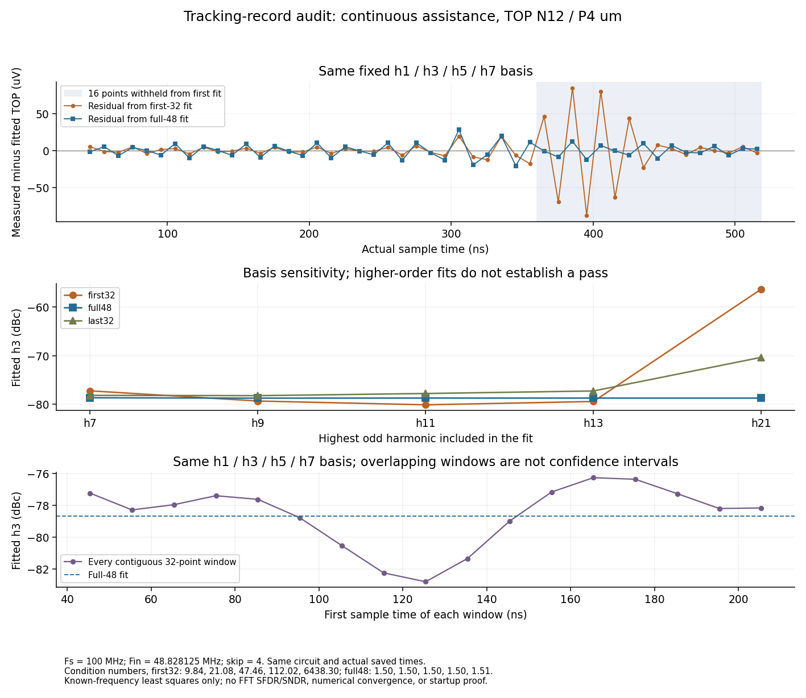
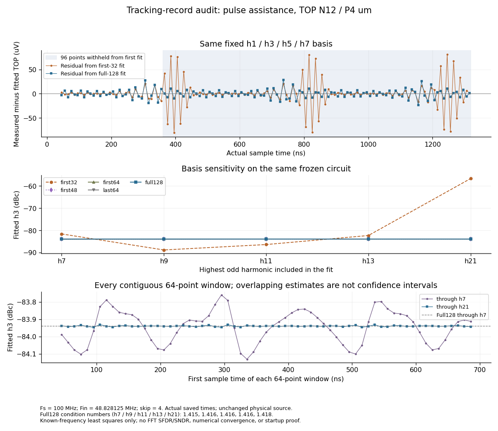
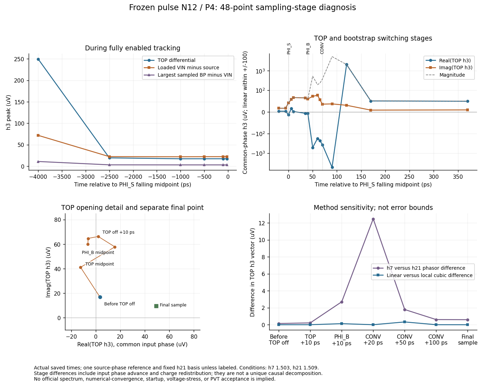
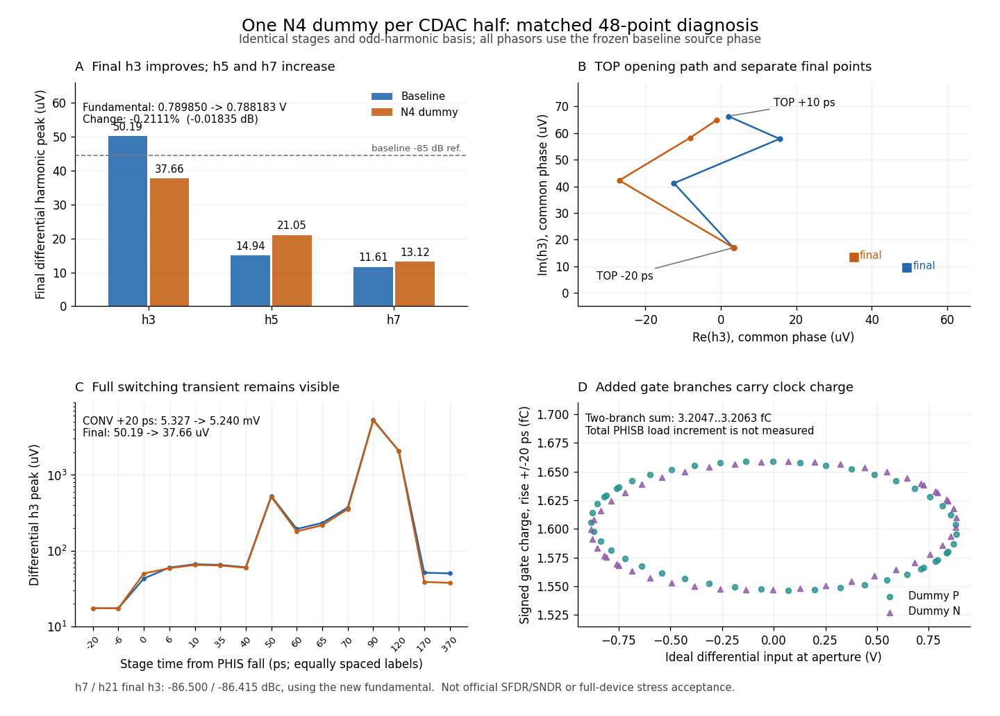
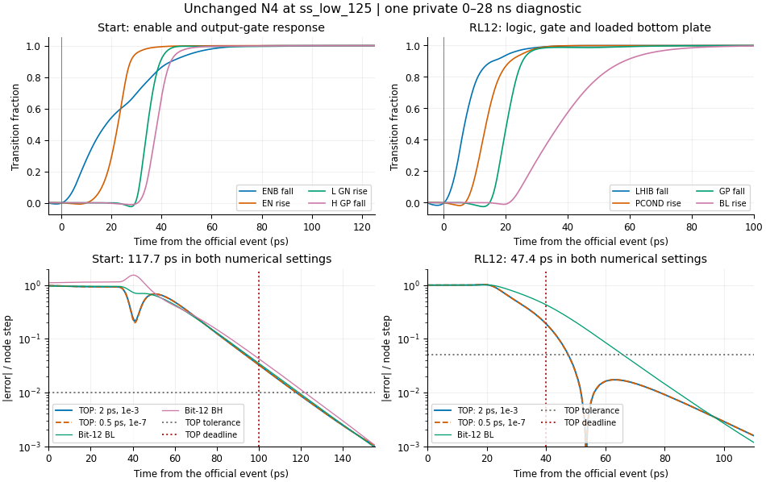

# Sampling-entry diagnosis

The final N4 variant below has now been promoted to the current WIP source
with unchanged physical connectivity and geometry. Earlier references to
an unselected or unchanged committed circuit describe the state when each
experiment was recorded. Current status is in the [candidate README](README.md).
The limited PVT screen stopped after two applicable settling failures at
`ss_low_125`. A separately authorized single 28 ns private diagnostic,
recorded in the final section, retains both failures and adds internal
stage observations. The N4 circuit and all official records are unchanged.
The original failed source and formal evidence remain available through
[the pre-N4 history tag](https://github.com/many-question/ADC-12b-100M/tree/adc-cdac-many-question-pre-n4-20261030).

These are private exploratory simulations of the circuit frozen at `2ecc285`,
reported on 2026-10-30. They do not replace the official test results or validate
an actual bootstrap circuit. All cases retain the user-specified 5% ground
capacitance on each physical MOM unit, including both units of every series tail.

The six cases use TT, VIN = 0.65 V, the first 34 ns of the official settling
stimulus, maximum step 0.5 ps, reltol 1e-7, and voltage tolerance 1e-8. Inputs
and retrieved simulator outputs were hash-verified. The sampling check covers
22 devices and 66 gs/gd/ds pairs, or 44 devices and 132 pairs in the doubled-width
case. The output check covers 52 devices and 156 pairs in every case. Internal
logic and top-switch stress are outside this six-case comparison.

| Case | Sampling peak absolute voltage (V) | Failing sampling pairs | Output peak absolute voltage (V) | Failing output pairs |
|---|---:|---:|---:|---:|
| Frozen baseline, finer step | 1.06736 | 7 | 1.15921 | 22 |
| Recorded VG imposed by an ideal PWL source | 1.06400 | 7 | 1.15921 | 22 |
| Same recorded VG, TOP clamped to VCM | 1.01509 | 5 | 0.98110 | 0 |
| CONV falls 40 ps earlier; PHI_S/PHI_B unchanged | 1.06713 | 7 | 1.15866 | 22 |
| Behavioral VG turn-on transition 120 ps, instead of 60 ps | 0.95397 | 0 | 1.14560 | 22 |
| Two copies of every sampling MOS | 0.94779 | 0 | 1.18106 | 24 |

The limit is 1.0 V, including brief excursions. Counts above apply to this
34 ns interval; the earlier 70 ns output check found 26 failing pairs. The PWL
trace was recorded in that earlier run. It reproduces its VG waveform, not the
slightly different waveform produced by the finer-step baseline.

The replay/clamp pair supports a contribution from TOP motion to H-side
bottom-plate overshoot. The clamp disables normal conversion and changes the
initial charge state, so it is an isolation experiment, not a repair or a
quantitative prediction of a stronger physical top switch. Residual sampling
stress with the clamp shows that local bottom-plate charging also matters.
Advancing CONV alone has little effect in this case.

Slowing VG or doubling the sampling devices removes the observed sampling
violations over this interval, but neither removes output-device violations.
Doubling sampling width from 48.69 to 97.38 um increases the measured VG rise
charge from 38.47–40.24 fC to 76.95–80.48 fC and peak rise current from about
1.05 to 2.13 mA. This uses the ideal behavioral gate source and excludes wire
capacitance. A width-only change is therefore not selected.

The physical follow-ups below test stronger top-plate clamping and H/L charge
sharing during sampling. Any implementation must check sampling, output, top-switch, added,
and internal devices, as well as settling, reference charge, tracking distortion,
and joint bootstrap behavior. The candidate remains `wip`.

## Physical follow-ups

Two further hypotheses retain the original clock stimuli and the same 5%
parasitics. The first duplicates both top-plate TG devices. The second adds two
copies of each sampled pair's validated input-NMOS geometry between its H and L
bottom plates, gated directly by PHI_S; non-sampled pairs remain unchanged.
These are exploratory variants, not changes to the committed circuit.

| Variant and interval | MOS / gs-gd-ds pairs checked | Failing pairs | Maximum absolute voltage (V) |
|---|---:|---:|---:|
| Top TG doubled, 34 ns | 628 / 1,884 | 29 | 1.13112 |
| Pair charge sharing, 34 ns | 648 / 1,944 | 0 | 0.97255 |
| Pair charge sharing, full 70 ns | 648 / 1,944 | 11 | 1.07948 |

The 34 ns result does **not** establish a repair. Over 70 ns, the pair-sharing
variant has ten failing output pairs and one failing sampling pair. The exact
output maximum is j5L NMOS Vds = 1.079480 V at 40.127138 ns. Before that sampling
entry, both j5 bottom plates are at 0.899935 V, so local sharing cannot lower
their voltage. At the peak, TOP = 0.462507 V and VG = 1.028191 V. After the full
13-step pattern, j0L sampling Vgd reaches -1.003500 V at 60.086107 ns, with
VG = 0.002114 V and its bottom plate at 1.005614 V. A short excursion is still
a failure.

The full interval saves all MOS terminal nodes and checks 173,039 time points.
The added sharing devices and top TG stay within the project gs/gd/ds limit in
this run. Other model voltage warnings are retained; this table does not claim
that every model warning or a supply-ramp startup check has passed.

Using the official settling measurement on the private 70 ns variant gives
RL12 = 50.4 ps and reference charge = 2.671275 pC, both failing their limits.
PHI_S capacitance is 31.1848 fF, PHI_SB is 16.1850 fF, and CONV is 9.8492 fF.
Zero-volt output-source probes partition reference charge into 1.116475 pC
through the output PMOS source/bulk branches and 1.554800 pC through the other
logic. These figures motivate further driver work; no new official acceptance
result or candidate selection is implied.

## Driver and supply-domain comparisons

Further private experiments use the full original 70 ns TT settling sequence,
the same physical-unit 5% estimate, and a 0.5 ps maximum step. All MOS terminal
nodes are saved. These are unselected circuit variants; the committed netlist
and official results still describe `2ecc285`.

The shared-node variant connects each sampled bottom plate through one
PHI_S-controlled NMOS to a common internal node. It improves the pair-sharing
result but still fails. After the full decision pattern, j0L output Vgd reaches
1.009743 V: its bottom plate is 0.984858 V while GN has undershot to -0.024885 V.
The sampling-switch maximum is 1.000276 V, also a failure. The shared node has
no extracted wire capacitance in these experiments.

The simpler driver uses skewed NAND2/NOR2 gates and removes the turn-off
feedback. The split-supply driver moves command and enable prelogic to the
specified DVDD port, followed by standard-threshold inverters that restore
GP/GN to the reference rails. Its H and L command paths are also shortened.
Both driver families use 75% of the original output width, with geometry
validated before simulation. Boolean functions alone do not establish
non-overlap.

| Variant | Sharing arrangement | MOS / failing gs-gd-ds pairs | Maximum (V) | RL12 (ps) | Qref (pC) |
|---|---|---:|---:|---:|---:|
| Original feedback driver | Shared node | 648 / 4 | 1.00974 | 50.2 | 2.639093 |
| Simple driver, low threshold | H/L pair | 440 / 18 | 1.08464 | 36.8 | 2.272340 |
| Simple driver, standard threshold | H/L pair | 440 / 36 | 1.09772 | 48.2 | 1.505366 |
| DVDD prelogic, low-threshold outputs | Shared node | 492 / 2 | 1.00150 | 30.5 | 1.236260 |
| DVDD prelogic, standard-threshold outputs | Shared node | 492 / 9 | 1.02125 | 34.1 | 1.071765 |

Limits are 1.0 V, 40 ps, and 1.2 pC respectively. The last row satisfies the
two listed performance limits in this experiment but fails device stress.
The two failures in the preceding row are Vgd and Vds of the same j0H output
NMOS near 30.086 ns; the small excess is not rounded into a pass. Its sampling
maximum is 0.99889 V, leaving little margin. No row is a complete repair.

The supply split also changes where energy is drawn. Over the official
54.8–64.8 ns charge window, zero-volt probes give:

| Output threshold | Reference output branches (pC) | Other reference branches (pC) | DVDD prelogic (pC) | Signed sum (pC) |
|---|---:|---:|---:|---:|
| Low | 1.034075 | 0.202185 | 0.902989 | 2.139249 |
| Standard | 0.875401 | 0.196364 | 0.902991 | 1.974755 |

The DVDD column measures internal prelogic only; these sums exclude direct
DVDD current into the top-switch bulk and ideal external clock and bootstrap
sources. The integrated minimum of the positive
P-output-source and N-output-source currents is 0.153061 pC and 0.014734 pC,
respectively. This proxy includes leakage and displacement current and does
not prove channel-current non-overlap or safety at other supply values.

## Limited TT passes with smaller output devices

Two subsequent variants retain the split supply and shared sampling node. One
reduces low-threshold output width to about 50% of the original, with j0 output
N/P widths of 0.12/0.24 um. The other retains standard-threshold 75% outputs,
reduces both j0 and j1 to those widths, and adds a physical transmission gate
from each of the six series midpoints to VIN. These minimum-size midpoint
switches use PHI_S/PHI_SB and open with the top-plate switch. Their junction
and gate parasitics are part of the simulated circuit.

| Variant, original 70 ns TT sequence at VIN=0.65 V | MOS / gs-gd-ds pairs | Failing pairs | Maximum (V) | RL12 (ps) | Qref (pC) |
|---|---:|---:|---:|---:|---:|
| Low-threshold 50% outputs, smaller j0 | 492 / 1,476 | 0 | 0.98671 | 34.9 | 1.116935 |
| Standard-threshold 75% outputs, smaller j0/j1, physical MID switches | 504 / 1,512 | 0 | 0.99707 | 34.1 | 1.068123 |

These are **limited experimental passes**, not a validation of the committed
candidate. In the second row, the sampling maximum is 0.99351 V and the output
maximum is 0.99707 V, leaving little voltage margin. RL5 is 46.2 ps, conversion
start is 80.0 ps, tau is 9.989 ps, and droop is 0.002369 LSB. PHI_S/PHI_SB/CONV
capacitance is 27.814/16.610/9.849 fF. Internal DVDD prelogic draws another
0.902993 pC in the reference-charge window, for a signed two-rail sum of
1.971116 pC, excluding direct DVDD top-switch bulk current and ideal external
clock and bootstrap sources.

The second variant also passes the five weight and calibration limits with the
original weight stimulus: C_S = 2.065030 pF, top gain = 0.888807, full scale =
0.992823 V, minimum calibration margin = 0.369004 LSB, and calibrated ENOB loss
= 0.001320 bit. The actual midpoint-switch parasitics reduce the j0 weight to
0.9038 LSB; this 9.61% maximum nominal weight error is retained in the evidence,
and the measured array remains calibratable under the specified model.

At seven late-tracking observations, all six midpoints agree with VIN within
the transient voltage tolerance. Over the 4 ns quiet-hold windows in the first
two conversions, their largest voltage drift is 17.53 uV. This establishes
physical initialization for this stimulus, not long-term behavior across the
full input range or supply-ramp startup. The simulator still reports a roughly
11.4 uV Gmin influence on an internal logic node; no global Gmin-independence
claim is made.

Complete tracking acceptance, actual-bootstrap integration, startup, and PVT
remain unverified for these variants. Original failures and all model warnings remain
in the retained evidence. In particular, a pass against the project's
gs/gd/ds criterion is not a claim that every model-specific voltage warning
has passed. The formal netlist and official results have not been replaced.

## Short tracking probe of the midpoint-switch variant

The standard-threshold smaller-j0/j1 variant with physical midpoint switches
was also run for 32 samples at 48.828125 MHz, using the original 50 ohm sources,
ideal VG generators, 1 ps maximum step, traponly, reltol 1e-7, and voltage
tolerance 1e-8. A least-squares fit at the known fundamental and odd harmonics
3, 5, and 7 gives:

| Diagnostic | Frozen circuit, first 32 samples | Midpoint-switch variant, 32 samples |
|---|---:|---:|
| Third harmonic relative to fundamental (dBc) | -69.6431 | -75.1339 |
| Fifth harmonic relative to fundamental (dBc) | -90.6398 | -87.6231 |
| Seventh harmonic relative to fundamental (dBc) | -103.2819 | -90.9593 |
| Residual RMS after fitting (uV) | 0.46 | 7.76 |

The frozen-circuit reference reuses its completed strict run; that simulation
was not repeated. The fitted third harmonic changes by about 5.5 dB under
this short-record model; the variant's full linearity remains unresolved. This regression
is not an FFT, SFDR/SNDR result, or numerical convergence comparison. The
noncoherent 32-sample fit has condition number 9.84, and its higher residual
also limits interpretation of individual fitted harmonics.

Additional voltage observations at PHI_S falling and immediately before VG
turn-off show large, opposing VIN and TOP harmonic terms. The top-plate switch
is already opening during the PHI_S crossing, so the observed VIN harmonic
cannot be assigned directly to final sampled error. A static-gain charge
reconstruction is only approximate: finite tracking lag, nonlinear parasitics,
and switch injection remain mixed. The separate sine-input stress result below
finds additional failures; the remaining physical sampling changes require
new evidence.

A matched 32-sample comparison removes only the 12 MID-switch MOS devices
while retaining all 5% capacitances and the rest of the circuit. It gives
h3 = -75.1170 dBc and a 7.748 uV fit residual, versus -75.1339 dBc and 7.757 uV
with the switches. These nearly equal short-fit estimates do not identify
the MID switches' contribution to a fully resolved spectrum. The comparison removes
their parasitics and initialization together, so it does not isolate either
effect individually. Its missing physical initialization path excludes it
from adoption.

## Sine-input stress of the midpoint-switch variant

The same unselected variant was checked over 125 ns with the original sine
sources and ideal VG generators. Both CDAC halves save every MOS terminal
from time zero: 1,008 devices, 3,024 gs/gd/ds pairs, and 282,412 accepted time
points with a 0.5 ps maximum step. The stimulus uses 48.828125 MHz, -1 dBFS,
50 ohm per side, traponly, reltol 1e-7, and voltage tolerance 1e-8.

| Device group, both halves | MOS | Failing pairs | Maximum absolute terminal difference (V) |
|---|---:|---:|---:|
| Sampling NMOS | 44 | 10 | 1.00487 |
| Output N/P | 104 | 60 | 1.14792 |
| Shared-node NMOS | 44 | 0 | 0.99899 |
| Top-plate TG | 4 | 0 | 0.89808 |
| MID TG | 24 | 0 | 0.94974 |
| Other logic | 788 | 0 | 0.96837 |
| Total | 1,008 | **70** | **1.14792** |

The exact maximum occurs at 10.111177551 ns on the P-side j12H output NMOS:
D = 1.147915514 V, G = 4.719 uV, and S = B = 0 V. At that instant CONV is
low, PHI_S is high, TOP is 0.414483 V, VIN is 0.481908 V, and VG is 0.558330 V.
The high bottom plate overshoots while TOP returns from its prior held level
to VCM. Thus the earlier fixed-VIN pass does not cover sampling entry after
the larger sine-driven top-plate excursions.

Rechecking all terminal pairs only over 40-125 ns still finds 70 failing
pairs, with a 1.132552531 V maximum on N-side j12H at 40.109095358 ns.
The failure therefore persists beyond the initial four cycles. This interval
comparison does not establish periodic steady state or supply-ramp startup.

A second failure occurs when entering conversion: on the N side, the
nonsampled j9H output NMOS reaches Vds = 1.106712376 V at 5.161260550 ns;
j6H reaches 1.103907729 V. These halves remain connected to their reference
rails, but their finite drive strength permits bottom-plate overshoot as TOP
moves. This is distinct from the sampled-half entry event in the figure.

The sampling-switch maximum is positive Vgd = 1.004872340 V on P-side j10L
at 70.148704136 ns: G = 1.626193151 V, D = 0.621320811 V, and VIN = 0.740160753 V.
The loaded VIN nodes also have brief negative excursions, down to -40.64 mV,
despite the nominal in-range sine sources. These excursions remain part of
the retained evidence.

The run completed successfully and all retrieved raw files were hash-verified.
A private postprocessing error on a pair of grounded terminals was fixed and
the saved waveforms reanalyzed; the simulation was not repeated. The checks
cover the project's gs/gd/ds limit for this stimulus, including its initial
condition and subsequent cycles. They do not establish a supply-ramp startup,
PVT, real-bootstrap, or model-warning pass. The candidate remains WIP and the
frozen official results remain unchanged.

## PMOS sampling assistance and stronger nonsampled outputs

A further physical variant replaces the 22 shared-node NMOS per side with
PHI_SB-controlled PMOS switches from each sampled bottom plate to VIN. Their
widths match the main sampling NMOS widths. It also triples only the j9/j6
output N/P finger counts to strengthen the nonsampled reference connections.
All changed geometries were validated before simulation; the six MID TGs,
clock phases, and 5% estimate remain. These two changes address the distinct
sampling-entry and conversion-entry events above; this comparison does not
isolate their individual effects.

The same 125 ns sine-input check covers 1,008 MOS, 3,024 terminal pairs, and
281,891 accepted points at a 0.5 ps maximum step:

| Group | Failing pairs | Maximum absolute terminal difference (V) |
|---|---:|---:|
| Main sampling NMOS | 0 | 0.98061 |
| New PMOS assistance | 0 | 0.99369 |
| j9/j6 output devices | 0 | 0.98673 |
| All output devices | **36** | **1.11951** |
| Top-plate TG | 0 | 0.88415 |
| MID TG | 0 | 0.93844 |

All remaining failures are on sampled L-side output PMOS devices. The worst
is N-side j12L at 50.099391365 ns: D = -0.219514683 V, G = 0.899838051 V,
and S = B = 0.9 V, giving Vds = -1.119514683 V. At that instant TOP is
0.539874370 V, VIN is 0.322397778 V, VG is 0.238380961 V, PHI_S is high,
and CONV is low. The low bottom plate undershoots while TOP returns toward
VCM. With PMOS assistance and no NMOS sharing path, this negative excursion
remains uncontrolled even though the main sampling-device failures are removed.
This variant is therefore still unsuccessful. Loaded VIN also peaks at
0.934345 V in this run; its input kickback has not been accepted.

Its matched 32-sample tracking probe gives h3 = -77.2407 dBc, h5 = -86.6147 dBc,
h7 = -95.5741 dBc, and a 2.658 uV regression residual. The approximately 2.1 dB
third-harmonic improvement over the MID-switch/shared-node variant remains
insufficient to resolve linearity. The same short-fit limitations apply; this
is not an SFDR/SNDR or convergence pass, and the output stress failure remains.

## Combined physical paths: limited sine-stress pass

Restoring the original 22 NMOS shared-node devices per side while retaining
PMOS-to-VIN assistance and stronger j9/j6 outputs gives 526 MOS per CDAC.
The six physical MID TGs and every 5% unit parasitic remain. The main VG-driven
sampling NMOS width remains 48.69 um per side. This is still an unselected
experimental circuit.

The matched 125 ns TT sine run checks all 1,052 MOS in both CDAC halves and
3,156 gs/gd/ds pairs. All pairs pass the 1.0 V project limit over 281,800
accepted points, including time zero, with a 0.5 ps maximum step. The deck
hash, device count, complete 0-125 ns coverage, and retrieved raw-file hashes
were checked.

| Device group | Maximum absolute terminal difference (V) | Failing pairs |
|---|---:|---:|
| Main sampling NMOS | 0.97401 | 0 |
| Output devices | 0.98568 | 0 |
| PMOS VIN assistance | 0.95862 | 0 |
| NMOS shared-node path | 0.98568 | 0 |
| Top-plate TG | 0.88250 | 0 |
| MID TG | 0.94166 | 0 |
| Complete circuit | **0.98568** | **0 of 3,156** |

The exact largest difference is 0.985680847 V on N-side j12L output PMOS Vds
at 50.094865824 ns: D = -0.085680847 V, G = 0.899667934 V, and S = B = 0.9 V.
The NMOS sharing device at the same bottom plate has the same magnitude of
Vgd. This leaves only 14.32 mV nominal margin at the worst event.

This pass is limited to the stated TT sine stimulus. Loaded VIN still spans
approximately -34.56 mV to 0.92227 V. Input kickback, other sampling phases,
supply-ramp startup, PVT, real-bootstrap operation, and model-specific warning
limits are not validated by this result. Tracking linearity is checked
separately before any formal adoption.

The original 70 ns TT control sequence also has zero project SOA violations
over 526 MOS / 1,578 pairs, with a 0.97887 V maximum and 164,327 accepted points
at a 0.5 ps maximum step. It gives RL12 = 35.3 ps, RL5 = 47.3 ps, tau = 9.120 ps,
conversion-start settling = 81.5 ps, droop = 0.002368 LSB, and reference charge
= 1.107164 pC, all meeting their respective limits. However, **PHI_SB
capacitance is 45.126 fF and fails the 40 fF limit**. Control, PHI_S, and CONV
capacitances are 0.831, 27.799, and 9.849 fF. The added paths therefore solve
the observed TT stress cases while introducing a clock-load failure.

Reference charge partitions into 0.898882 pC through output PMOS source/bulk
branches and 0.208282 pC through the remaining reference branches, including
the auxiliary and MID switch bulk currents. Internal DVDD prelogic draws
0.902994 pC, giving a reference-plus-prelogic signed sum of 2.010157 pC.
This sum excludes direct DVDD top-switch bulk current and ideal external
clock/bootstrap sources; it is not total circuit power. The candidate remains
WIP, with the committed netlist and official results unchanged.

The combined-path circuit's matched 32-sample tracking diagnostic gives
h3 = -72.5568 dBc, h5 = -86.0754 dBc, h7 = -87.1466 dBc, and an 8.219 uV
regression residual. Restoring NMOS sharing therefore repairs the observed
stress cases but worsens the third harmonic relative to PMOS assistance
alone (-77.2407 dBc). This short regression does not establish official
SFDR/SNDR or numerical convergence.

## Smaller top-plate switches

Changing only the combined circuit's top-plate N/P switch widths from 32 to
16 um each, with the same channel length and finger width, addresses the
measured clock-load failure. Both geometries were validated before use.
All 526 MOS, six MID transmission gates, and 36 explicit 5% parasitics remain.
The original 70 ns TT sequence gives:

| Quantity | Top N/P 32 um each | Top N/P 16 um each |
|---|---:|---:|
| PHI_S capacitance (fF) | 27.799 | 20.892 |
| PHI_SB capacitance (fF), limit 40 | **45.126, fail** | 37.036 |
| RL12 settling (ps), limit 40 | 35.3 | 35.3 |
| RL5 settling (ps) | 47.3 | 47.3 |
| Tau (ps) | 9.120 | 9.164 |
| Conversion-start settling (ps) | 81.5 | 81.4 |
| Droop (LSB) | 0.002368 | 0.004270 |
| Reference charge (pC), limit 1.2 | 1.107164 | 1.103859 |
| Maximum project terminal stress (V) | 0.97887 | 0.97898 |
| Failing terminal pairs | 0 of 1,578 | 0 of 1,578 |

The smaller-switch run retains the 0.5 ps maximum step over all 164,339
accepted points. Control and CONV capacitances are 0.831 and 9.849 fF.
All listed settling, charge, and input-capacitance limits pass for this
stimulus. The reference charge consists of 0.895573 pC through output
source/bulk branches and 0.208286 pC through other reference branches.
Internal DVDD prelogic adds 0.902994 pC; the resulting signed sum of
2.006852 pC has the same exclusions stated above.

Its matched 32-sample tracking diagnostic gives h3 = -75.1069 dBc,
h5 = -86.3977 dBc, h7 = -88.0209 dBc, a 0.788909 V fundamental, and a
7.827 uV regression residual. The third harmonic improves by about 2.55 dB
relative to the 32 um top switches, but remains too large to resolve
linearity. The same short-fit limitations apply.

This geometry change still requires its own sine-input stress and official
tracking checks; the larger-switch circuit's sine pass cannot be inherited.
The formal candidate and official result records remain unchanged.

## Shared-node switches controlled by ENB

A further single-connection comparison drives the 22 shared-node NMOS gates
from the existing internal ENB signal instead of PHI_S. All device dimensions,
six MID transmission gates, and 36 explicit 5% capacitances remain unchanged.
Eight unused internal PHI_S ports are removed with their matching parent
arguments. A comparison of every expanded MOS connection confirms that only
the 22 sharing-gate nodes change. The top-plate TG remains directly driven
by PHI_S/PHI_SB.

The original 70 ns fixed-input TT control sequence gives zero project
voltage-stress violations over 526 MOS / 1,578 pairs, with a 0.97729 V maximum,
164,183 accepted points, and a 0.5 ps maximum step. RL12 = 35.3 ps,
RL5 = 47.3 ps, tau = 9.164 ps, conversion-start settling = 83.4 ps, and
droop = 0.003816 LSB meet their limits. Reference charge rises from
1.103859 to 1.125511 pC, still below 1.2 pC. Control/PHI_S/PHI_SB/CONV
capacitances are 0.831/7.185/37.036/9.849 fF, all below their limits.

ENB crosses half supply about 15.14 ps after CONV rises, versus 13.12 ps
before the added gate load. On sampling entry, its rising crossing occurs
13.84-14.27 ps after CONV falls, versus 12.12-12.33 ps before. These voltage
crossings document timing; they are not a test of channel-current non-overlap.
Internal DVDD prelogic charge increases to 0.936574 pC. The reference-plus-
prelogic sum is 2.062085 pC, with the same exclusions stated above.

Keeping sharing enabled across the top-plate aperture separates its turn-off
event from sampling. The matched 32-sample result is h3 = -75.7139 dBc,
h5 = -85.6893 dBc, h7 = -87.9167 dBc, fundamental = 0.788851 V, and regression
residual = 7.842 uV. The approximately 0.61 dB third-harmonic improvement over
PHI_S-controlled sharing is small and leaves linearity unresolved. This is
still a short diagnostic, not SFDR/SNDR or convergence acceptance.

| Differential third-harmonic peak from the same 32-point fit (uV) | PHI_S sharing | ENB sharing |
|---|---:|---:|
| VIN at the PHI_S falling 50% crossing | 3265.86 | 104.33 |
| TOP at the PHI_S falling 50% crossing | 3434.70 | 392.61 |
| TOP at the PHI_B falling 50% crossing | 154.84 | 96.93 |
| Final TOP, 300 ps after CONV rises | 138.57 | 129.21 |

The large decrease in VIN's instantaneous harmonic does not translate into
the same decrease in final TOP error. Clock crossings are measurement markers,
not exact physical switch-opening times. Cancellation between these stages,
finite tracking response, nonlinear capacitance, and charge injection remain
mixed; the table is not a unique decomposition of their causes.

The full sine-input stress test is also still required for this control
change. The limited fixed-input pass does not establish acceptance or
replace the formal circuit.

## PMOS assistance controlled by EN

Starting from the ENB-sharing circuit, another single-connection comparison
moves only the 22 PMOS VIN-assistance gates from PHI_SB to existing internal
EN. All dimensions, physical MID switches, and 5% capacitances remain.
Removing eight unused internal PHI_SB ports preserves their parent mappings;
the expanded MOS comparison confirms that only these 22 gate nodes change.
The top-plate TG still receives PHI_S/PHI_SB directly.

The original 70 ns fixed-input TT sequence checks 526 MOS / 1,578 pairs over
163,417 accepted points at a 0.5 ps maximum step. It has zero project stress
violations, with a 0.97394 V maximum. RL12 = 35.3 ps, RL5 = 47.3 ps,
tau = 9.164 ps, start = 84.0 ps, and droop = 0.004292 LSB pass. Control,
PHI_S, PHI_SB, and CONV capacitances are 0.831, 7.189, 8.521, and 9.849 fF.

Reference charge rises to 1.185523 pC, leaving only 0.014477 pC below the
1.2 pC limit. Output source/bulk branches account for 0.966923 pC and other
reference branches for 0.218600 pC. DVDD prelogic adds 0.949569 pC, giving
a signed sum of 2.135092 pC with the previously stated exclusions. Both
reference and internal DVDD prelogic charge increase in this comparison.

Partitioning the same 54.8-64.8 ns charge window localizes the reference
increment: sampling entry (59.9-60.6 ns) adds 0.074230 pC, while conversion
entry (54.8-55.6 ns) decreases by 0.014151 pC. The remaining windows change
by less than 0.0001 pC in total. These are net source-current integrals,
including displacement current; they do not isolate channel overlap.

The recorded start step changes from -157.786 to -169.354 mV. The official
measure subtracts TOP at CONV minus 20 ps from TOP at CONV plus 900 ps:

| First conversion, fixed VIN = 0.65 V | PMOS gate on PHI_SB | PMOS gate on EN |
|---|---:|---:|
| TOP at CONV - 200 ps (V) | 0.450000 | 0.450000 |
| TOP at CONV - 20 ps (V) | 0.429151 | 0.440744 |
| TOP at CONV + 900 ps (V) | 0.271365 | 0.271391 |

The large step difference is mainly a change at the measurement's initial
time marker, while final TOP differs by approximately 26 uV. The official
settling definition and limits are unchanged.

The matched 32-sample tracking result is h3 = -76.1315 dBc,
h5 = -85.2316 dBc, h7 = -87.7472 dBc, fundamental = 0.788814 V, and residual
= 7.806 uV. Moving the PMOS gates to EN therefore improves the third harmonic
by only 0.42 dB while increasing reference charge by approximately 0.060 pC.
That tradeoff leaves linearity unresolved and materially reduces charge
margin. The next size comparison uses the earlier ENB-sharing circuit with
PMOS gates on PHI_SB. Sine-input stress and official acceptance have not been
established for this EN-controlled PMOS experiment; its evidence is retained.

## Top-plate switches reduced to 8 um

This comparison returns to ENB-controlled NMOS sharing with PMOS assistance
on PHI_SB. Only the top N/P total widths change from 16 to 8 um each, with
finger counts reduced from eight to four at unchanged finger width and
length. Both geometries are validated. All other device connections and
dimensions, the six physical MID transmission gates, and the 36 explicit
5% capacitances remain unchanged. The circuit still has 526 MOS per half.

The matched 32-sample diagnostic gives h3 = -79.8954 dBc,
h5 = -86.3692 dBc, h7 = -89.0435 dBc, fundamental = 0.789395 V, and regression
residual = 7.101 uV. The third harmonic improves approximately 4.18 dB from
the ENB-sharing 16 um circuit. This remains a short known-frequency
regression, not an official SFDR/SNDR or convergence result.

The harmonic phase also changes with size. Width changes affect on-state
resistance, off-state capacitance, and switching charge together; the
comparison does not isolate a unique distortion mechanism or establish
that further shrinking will improve linearity monotonically.

The geometry's own original 70 ns fixed-input TT sequence checks all 526 MOS
and 1,578 gs/gd/ds pairs from time zero through subsequent cycles, using
164,181 accepted points and a 0.5 ps maximum step. It gives zero project
stress violations and a 0.97734 V maximum. RL12 = 35.2 ps, RL5 = 47.3 ps,
tau = 9.120 ps, conversion-start settling = 83.4 ps, and droop = 0.004805 LSB
meet their limits. Qref = 1.123941 pC and control/PHI_S/PHI_SB/CONV
capacitances = 0.831/3.741/32.989/9.849 fF also meet their limits.

Reference output branches contribute 0.908316 pC and other reference branches
0.215625 pC. Internal DVDD prelogic contributes 0.936578 pC, for a signed
reference-plus-prelogic sum of 2.060519 pC with the previously stated
exclusions. This is not total circuit power. The new geometry still needs
its own sine-input stress, weight/calibration, and official tracking checks;
no prior circuit's finite-stimulus pass is inherited.

## Further reduction to 4 um

The next single-variable comparison reduces only the top N/P widths from
8 to 4 um each, with two fingers at the same finger width and length. Both
geometries are validated; the expanded circuit and all other parameters
remain unchanged. It uses the same 32-point stimulus and numerical settings.

The result deteriorates sharply: h3 = -61.9891 dBc, h5 = -81.6905 dBc,
h7 = -91.0520 dBc, fundamental = 0.785761 V, and regression residual =
5.705 uV. The smaller residual measures fit error, not total distortion;
the fitted third harmonic is much larger. This geometry is not pursued.
The measured trend therefore does not support continued uniform shrinking
of the top switch. Subsequent diagnosis uses the 8 um circuit as its basis.
The 4 um circuit has no full settling, weight, or sine-stress acceptance.

## Physical pulse for sampling-entry assistance

Separate device diagnostics motivated limiting PMOS assistance to sampling
entry. The next circuit retains the 8 um top switches, ENB sharing, and all
526 existing MOS. Thirteen additional MOS generate a short auxiliary-gate
pulse. A small PHI_S inverter drives four physical MOS gate loads; two
inverters restore its delayed control. A transmission gate initially passes
PHI_SB to the auxiliary gate, then disconnects it while a PMOS pulls that
gate high. The delay uses physical devices, without an ideal timing element.
All added dimensions come from validated geometries already used in the
candidate experiments.

Only the 22 existing PMOS-assistance gate connections change. Every other
existing MOS connection, all 36 explicit parasitic capacitances, and all
six physical MID transmission gates remain unchanged. MID control and the
top-plate gate control still use PHI_S/PHI_SB directly. The added pulse
circuit uses the monitored internal DVDD logic supply. Expanded connection
and geometry checks, complete RNL validation, and drawing inspection cover
the 539-device circuit.

In the full 70 ns fixed-input sequence, the auxiliary-gate falling 50%
crossing follows PHI_S rising by 3.14-3.36 ps. Its low pulse lasts
110.34-110.55 ps. Across every conversion, the auxiliary gate remains between
0.899929 and 0.900355 V during the last 500 ps before PHI_S falls. These are
voltage-timing measurements, not a channel-current non-overlap proof or a
guarantee across input waveforms, startup conditions, and corners.

All 539 MOS / 1,617 gs/gd/ds pairs are checked over 231,062 accepted points
from 0 to 70 ns, with a 0.5 ps maximum step. There are zero project stress
violations. The exact saved-point maximum is 0.977358790 V on j2L's output
NMOS Vds at 60.071987741 ns: D = 0.977358790 V, G = 0.409143528 V,
S = B = 0 V.

RL12 = 35.2 ps, RL5 = 47.3 ps, tau = 9.120 ps, start = 83.4 ps, and
droop = 0.004808 LSB meet their limits. Qref = 1.123502 pC and
control/PHI_S/PHI_SB/CONV capacitances = 0.831/4.717/11.889/9.849 fF
also meet their limits for this stimulus.

Reference output branches contribute 0.907877 pC and other reference branches
0.215625 pC. Internal DVDD logic, now including the pulse circuit, contributes
1.119784 pC, an increase of approximately 0.183207 pC. The reference-plus-
logic signed sum is 2.243286 pC, with the previously stated exclusions;
it is not total circuit power. The pulse therefore has a measurable charge
cost.

The matched 32-sample result is h3 = -75.0770 dBc, h5 = -89.5628 dBc,
h7 = -93.2795 dBc, fundamental = 0.789321 V, and regression residual =
6.699 uV. Although the fifth and seventh harmonics decrease, the third
harmonic worsens by approximately 4.82 dB from continuous PMOS assistance
with the same 8/8 um top switches. This pulse configuration therefore
provides no overall tracking-linearity benefit in this diagnostic, while
increasing internal logic charge. It remains unselected.

A subsequent diagnostic keeps the pulse and changes only the top N/P
widths to 12/4 um at the same total width, using validated geometries.
It gives matched 32-point h3 = -81.6220 dBc, h5 = -88.9667 dBc,
h7 = -92.8922 dBc, fundamental = 0.789828 V, and residual = 6.968 uV.
This is a 6.55 dB h3 improvement within the common regression model.
However, extending that fit through h9, h11, or h13 changes h3 to
-88.85, -86.41, or -82.33 dBc, respectively. The short-record limitation
described below also applies to this geometry.

The 12/4 um pulse circuit has not been adopted and has no own fixed-input,
sine-stress, weight/calibration, startup, long-hold, PVT, or actual-bootstrap
acceptance. A continuous-assistance 12/4 um comparison uses
48 samples. Only record duration changes from its matched 32-point deck;
the frequency, initial skipped cycles, circuit, and strict numerical
settings are unchanged. This allows comparison of the first 32 samples
while providing broader phase coverage for the complete fit.

## Sensitivity of short-record harmonic estimates

The matched 32-point results above consistently fit the fundamental and odd
harmonics through h7. A read-only audit extends the basis through h9, h11,
and h13 using the same saved samples. For continuous assistance with 8/8 um top switches,
the h3 estimates change from -79.90 to -85.97, -91.85, and -80.92 dBc.
The corresponding regression condition numbers rise from 9.84 to 21.08,
47.46, and 112.02. These larger fits are not established as more accurate;
the variation exposes sensitivity to the limited phase coverage and model
basis. The pulse-assisted 8/8 um estimates range from -76.23 to -74.64 dBc
over these fits, while the 4/4 um estimates stay near -62 dBc.

The canonical h1/h3/h5/h7 figures remain unchanged for matched comparisons.
Their differences are diagnostic, and must not be treated as demonstrated
changes in official SFDR. Apparent improvements and deteriorations alike
remain exploratory rankings under the stated fit. A longer record with broader
phase coverage is
needed before choosing a near-limit circuit on the strength of these
estimates. No higher-order fit is used to claim a passing result.

A read-only implementation control reuses the already completed frozen
circuit's 256 samples. With the fixed h1/h3/h5/h7 basis, the first 128,
last 128, and all 256 give h3 = -69.612106 dBc to the shown precision.
This checks the analysis implementation on that old record; it does not
establish that 128 points suffice for every new circuit or constitute a
new simulation or convergence result.

## Same-source 48-point stability audit

The continuous-assistance N12/P4 circuit retains PHI_SB-controlled PMOS
assistance, ENB-controlled sharing, and 526 MOS per half. Its 48-point run
changes only the record length from the prepared 32-point deck. Fs is
100 MHz and Fin is 48.828125 MHz, exactly 125/256 of Fs. Four cycles are
skipped. The run covers 0 to 525 ns; the actual saved sample times are
45.426 + 10k ns for k = 0..47. The sampler records TOP 300 ps after CONV
crosses its threshold, with a 10 fs event tolerance. Fits use the saved
times directly. The archive and every retrieved file were hash-verified.

The following comparison uses this one record and a fixed h1/h3/h5/h7
basis, including an intercept. Each matrix has rank 9 of 9.

| Window | Actual interval (ns) | Condition number | h3 (dBc) | Residual RMS (uV) |
|---|---|---:|---:|---:|
| First 32 | 45.426-355.426 | 9.843 | -77.2363 | 7.306 |
| All 48 | 45.426-515.426 | 1.503 | -78.6602 | 9.615 |
| Last 32 | 205.426-515.426 | 9.843 | -78.1656 | 8.732 |

The first-32 fit predicts the withheld 16 samples, at 365.426-515.426 ns,
with 46.552 uV RMS error and 87.110 uV maximum absolute error. This is
substantially larger than its training residual. The complete 48-point
fit gives fundamental = 0.789925 V, h5 = -86.1022 dBc, and h7 = -92.4754 dBc.
Adding a linear trend to that same fixed basis changes h3 by less than
0.0001 dB. That sensitivity check does not rule out other transient errors.

An exhaustive check of all 17 contiguous 32-point windows keeps the same
h1/h3/h5/h7 basis throughout. Their h3 estimates range from -82.7938 dBc
for the window starting at 125.426 ns to -76.2668 dBc for the window starting
at 165.426 ns. This 6.53 dB spread occurs within one circuit and one record,
without changing the harmonic order. It is window sensitivity, not a
physical performance spread or an independent statistical confidence range.
The complete set of windows is shown below; none is selected as the result.

Extending the basis on the full 48 points gives:

| Highest odd harmonic | Rank / columns | Condition number | h3 (dBc) | Residual RMS (uV) |
|---|---:|---:|---:|---:|
| h9 | 11 / 11 | 1.503 | -78.7396 | 4.738 |
| h11 | 13 / 13 | 1.503 | -78.7194 | 3.580 |
| h13 | 15 / 15 | 1.503 | -78.7264 | 2.527 |
| h21 | 23 / 23 | 1.509 | -78.7267 | 0.744 |

At Fs = 100 MHz, h1/h3/h5/h7 fold to
48.828125/46.484375/44.140625/41.796875 MHz. The additional
h9/h11/h13/h15/h17/h19/h21 terms fold to
39.453125/37.109375/34.765625/32.421875/30.078125/27.734375/25.390625 MHz.
All fits retain their specified harmonic sets; a fit is not selected because
it gives a preferred h3 value.

For this circuit, the full-record h3 span is less than 0.080 dB across the
tested bases. It shows little prospect of meeting the required linearity.
This is still a noncoherent known-frequency LS diagnosis, with no official
SFDR/SNDR, convergence, or startup pass. The early and late 32-point windows
overlap and cover different input phases, so their differences cannot
uniquely separate startup from omitted harmonics. No fixed-input, sine-stress,
or weight acceptance is inherited by this geometry.

Under the same first-32 basis, the previously measured pulse-assisted
N12/P4 circuit gives -81.6220 dBc, compared with -77.2363 dBc here. This is
a lead for further diagnosis, rather than a comparison of complete spectra.
The following run freezes that existing pulse circuit and extends its record
to 128 points, with unchanged frequency, skipped cycles, and strict numerical
settings.

## Frozen pulse-assisted 128-point audit

The N12/P4 pulse circuit retains 539 MOS per half, all physical MOM units,
all 36 parasitic branches, and the MID initialization paths. Only the sample
count changes from its earlier 32-point run. Exact source, deck, and supporting
TB files were frozen before launch; all 27 TB dependency hashes still match
afterward. The 52 retrieved files were individually hash-verified. The run
completed in 61.35 minutes with zero simulator errors; warnings and notices
remain in the archive and are not interpreted as voltage-stress bounds.

Fs = 100 MHz, Fin = 48.828125 MHz, skip = 4, and the strict numerical and noise
settings remain unchanged. The simulation ends at 1325 ns. Actual sample
times are 45.426 + 10k ns for k = 0..127, with maximum interval deviation
of approximately 1 fs from 10 ns. The first 32 saved times exactly match the
earlier same-source run, and their saved voltages agree within 6e-13 V.
This duration-only reproduction is not the required numerical cross-check.
The 128 points span 62.5 input cycles, so this remains a noncoherent
known-frequency regression rather than an official FFT spectrum.

With the fixed h1/h3/h5/h7 basis and an intercept, all matrices have rank 9:

| Window | Actual interval (ns) | Condition number | h3 (dBc) | Residual RMS (uV) |
|---|---|---:|---:|---:|
| First 32 | 45.426-355.426 | 9.843 | -81.6220 | 6.968 |
| First 48 | 45.426-515.426 | 1.503 | -83.9867 | 8.549 |
| First 64 | 45.426-675.426 | 1.733 | -83.9883 | 7.694 |
| Last 64 | 685.426-1315.426 | 1.733 | -83.9126 | 9.784 |
| All 128 | 45.426-1315.426 | 1.415 | -83.9397 | 8.951 |

The first-32 fit predicts the remaining 96 points with 31.585 uV RMS error
and 81.331 uV maximum absolute error. The full record gives fundamental
peak = 0.789850 V, h5 = -94.4571 dBc, and h7 = -96.6587 dBc. A linear
trend added to the same full-record basis changes h3 by less than 1e-7 dB;
this sensitivity check does not establish startup independence.

Expanding the odd-harmonic basis on the complete record gives:

| Highest odd harmonic | Rank / columns | Condition number | h3 (dBc) | Residual RMS (uV) |
|---|---:|---:|---:|---:|
| h7 | 9 / 9 | 1.4153 | -83.939715 | 8.951 |
| h9 | 11 / 11 | 1.4156 | -83.939689 | 5.717 |
| h11 | 13 / 13 | 1.4159 | -83.939789 | 4.066 |
| h13 | 15 / 15 | 1.4162 | -83.939709 | 2.545 |
| h21 | 23 / 23 | 1.4179 | -83.939736 | 0.771 |

The folded frequencies are the same as in the 48-point audit above. The
full-record h3 spread across these bases is approximately 0.00010 dB.
With h21 included, h9/h11/h13 are -98.1803/-102.8578/-104.9167 dBc;
the remaining fitted odd terms through h21 are below -110 dBc. The poorly
conditioned first-32 h21 fit remains shown in the figure as a warning about
that short window, rather than being selected as a result.

All 65 contiguous 64-point windows are also retained. With the fixed h7
basis, h3 ranges from -84.1312 to -83.7599 dBc, a 0.3713 dB span. With
the fixed h21 basis, it ranges from -83.9470 to -83.9313 dBc, a 0.01564 dB
span. These overlapping estimates are not independent confidence intervals.
The disjoint first and last 64 points give h3 = -83.9381 and -83.9427 dBc
with h21, rank 23/23, and condition approximately 1.735. Fitting the first
half and predicting the second gives 0.881 uV RMS error; the reverse gives
0.719 uV. Both predictions use the same coefficients and actual saved times
without fitting the withheld half.

A supplementary fit includes every harmonic from h1 through h21, including
even terms. It has rank 43/43 and condition 1.667 on all 128 samples,
giving h3 = -83.939588 dBc and residual = 0.574 uV. The fitted even terms
are all below -124 dBc in this model. The first/last 64-point versions have
condition approximately 1.829 and h3 = -83.9401/-83.9416 dBc; their cross-
prediction errors are 1.198/0.902 uV RMS. Thus including even terms does not
materially change this record's h3 estimate. These are additional model
sensitivity checks, not measurements of broadband noise or official SNDR.

The stable h3 estimate is about 1.06 dB above -85 dBc, leaving no margin
against the required largest-spur level in this diagnostic. The circuit
remains unselected. Its official coherent-256 spectrum, numerical
cross-check, own fixed-input and sine-input stress, weights, startup,
long-hold behavior, actual-bootstrap integration, and PVT remain unverified.
None of the 8/8 um circuit's passes is inherited. At this run's measured
speed, a corresponding 256-point main run would take roughly 121 minutes;
the numerical cross-check would add a separate run.

The following diagnostic keeps this physical circuit and collects
48 points of selected tracking and switching waveforms. It compares
complex harmonics on a common input-phase reference before and after TOP
and VG turn-off, including representative BP/MID nodes. This is intended
to locate when errors appear before selecting one structural experiment;
stage correlations and cancellation alone will not be presented as a
unique physical cause. Further size sweeps and formal acceptance runs are
deferred pending that diagnosis.

## Frozen 48-point sampling-stage diagnosis

This run keeps the same pulse-assisted N12/P4 source, frequency, skipped
cycles, numerical settings, noise settings, and existing samplers. The only
deck changes from the 128-point reference are npts = 48, waveform output
from time zero, and explicit saving of 61 existing voltage nodes. No analog
observer or timing event is added. Both halves still expand to 1,078 MOS.
The saves include the ideal and loaded input, TOP, VG, clocks, actual TOP
gate nets, pulse/sharing controls, representative sampled and nonsampled
bottom plates, and all three kinds of series-tail midpoint.

The run completed in 32.00 minutes. All 52 retrieved files were hash-verified,
including 765,209 waveform points over 0-525 ns; the 27 supporting TB files
still match their frozen hashes. Final sample times exactly reproduce the
first 48 points of the 128-point run, and their saved voltages differ by at
most 5.79e-13 V. This is reproduction after changing record length and output
saves, not a numerical-convergence result.

Twenty stages are extracted from the accepted waveforms. The primary
interpolation is linear, with at most 1 ps between bracketing points; local
shape-preserving cubic interpolation is a sensitivity check. Clock crossing
times agree with the original sampler references within 0.001 fs in the
saved numerical representation, and the final interpolated voltage agrees
within 7.5e-14 V. These alignment figures are not physical timing or solver
error bounds. The four existing marker files also reproduce their previous
first-48 h3 vectors within 0.000073 uV.

All stages use the same actual PHI_S aperture times and ideal-source phase
reference. With C_h = cosine coefficient - j*sine coefficient, one common
phase rotation makes the ideal source fundamental real and positive.
Absolute complex harmonics and adjacent-stage differences are retained;
normalization, where shown, uses the same final TOP fundamental. The h7
and h21 matrices have ranks 9/9 and 23/23 and conditions 1.503 and 1.509.
Natural input phase advance is separately removed when comparing the
fully enabled tracking stages. Adjacent-stage differences also include
ordinary charge redistribution and are not isolated physical error sources.

The following TOP h3 vectors use the fixed h21 basis throughout. Time is
relative to PHI_S's falling 50% crossing; PHI_B falls at +40 ps and CONV
rises at +70 ps.

| Stage | Relative time (ps) | Real h3 (uV) | Imaginary h3 (uV) | Magnitude (uV) |
|---|---:|---:|---:|---:|
| Fully enabled, before TOP off | -20 | 3.471 | 17.027 | 17.377 |
| After TOP off | 10 | 1.991 | 66.272 | 66.302 |
| PHI_B midpoint | 40 | -6.431 | 60.015 | 60.358 |
| PHI_B +10 ps | 50 | -520.678 | 71.886 | 525.617 |
| CONV +20 ps | 90 | -5326.776 | 37.090 | 5326.905 |
| CONV +50 ps | 120 | 2082.184 | 30.664 | 2082.409 |
| CONV +100 ps | 170 | 50.593 | 8.351 | 51.277 |
| Final sample | 370 | 49.302 | 9.378 | 50.186 |

During the late enabled interval, TOP h3 magnitudes at -1000/-500/-100/-20 ps
are 17.341/17.363/17.369/17.377 uV. After removing natural source-phase
advance, the vector moves only from (3.021, 17.076) to (3.157, 17.088) uV.
The earlier -4000 ps value, 249.93 uV, decreases toward this level rather
than continuing to grow. This describes settling within the observed
sampling cycles; it does not establish supply-ramp or long-run startup
acceptance.

Between -20 and +10 ps, the common-phase TOP h3 increment is
(-1.481, +49.245) uV, with magnitude 49.267 uV. VG-VIN remains approximately
0.900 V at +10 ps, while the actual TOP gates have completed their transition.
The loaded-input error and representative BP/MID observables change too.
The VG-VIN = 0.45 V falling marker occurs 5.628-9.555 ps after PHI_B; this
is a timing reference rather than a device threshold or proof of channel
turn-off. Later switching produces much larger transient harmonics, but the
vector changes by only 1.649 uV between CONV +100 ps and the final sample.
The 5.33 mV transient must not be described as a 5.33 mV final distortion.
Similarly, millivolt-scale midpoint harmonics do not establish dominant
output-error contributions without their coupling weights.

Across all stages, the TOP h3 vector difference between h7 and h21 reaches
12.48 uV during the large reference-switching transient. It is 0.217 uV
at TOP +10 ps and 0.593 uV at the final sample. The corresponding largest
linear-versus-cubic difference is 0.327 uV, and only 0.00389 uV at TOP +10 ps.
These sensitivities are retained rather than selecting a favorable fit.
The final h21 result is -83.9393 dBc, consistent with the longer record and
still above the -85 dBc target; no official spectrum is inferred.

The observations favor investigating switching-stage errors before further
conducting-width sweeps: late enabled tracking is nearly stable, and a
substantial vector change appears during TOP opening. They do not uniquely
separate channel charge, feedthrough, midpoint coupling, or later nonlinear
charge redistribution.

One proposed structural experiment is a physical dummy NMOS in each half,
with drain and source tied to TOP, gate driven by PHI_SB, and bulk at VSS,
while retaining the existing N12/P4 pair and all MOM, Cp, and MID elements.
The already validated 4 um NMOS geometry is a possible single starting
point, not an optimum. Opposite-clock dummy compensation is a general
sampling-switch technique, but its effectiveness depends on charge
partition; the usual simple sizing assumption is not guaranteed.
[Charge injection cancellation, section 12.2.4](https://www.ee.ucla.edu/~brweb/teaching/AIC_Ch12.pdf)
describes that limitation. This reference is not evidence that the proposed
change succeeds in this circuit.

The testable expectation is a smaller TOP-opening h3 vector increment
together with an improvement in the final sampled harmonic. Reducing only
an intermediate transient would not meet that expectation. The costs are
additional voltage-dependent TOP capacitance, PHI_SB load, and switching
charge; gain/weights, sampling capacitance, clock load, reference charge,
hold behavior, and device stress need rechecking. The next section tests
this one geometry; no geometry sweep is underway.

Finally, the existing saved nodes permit a limited stress audit of 80 of
the 1,078 MOS, covering 240 gs/gd/ds pairs over all saved points. None exceeds
1.0 V in this record. The maximum is 0.991223884 V on the N-side bit-0
PMOS-assistance device's Vgd at 5.156437461 ns. The other 998 MOS are not
covered, and the 1 ps stage record is not the finer-step full-device stress
test. No complete SOA or other acceptance is claimed.

## One N4 dummy per half: matched 48-point comparison

This experiment adds one physical NMOS per half, with D/S tied to TOP,
gate at PHI_SB, and bulk at VSS. Its previously validated geometry is
W = 4 um, L = 30 nm, with two fingers. Static expansion confirms that all
1,078 existing MOS remain unchanged and only two dummy instances are added.
The 2,278 physical MOM units, 36 Cp elements, midpoint paths, ports, and
existing N12/P4 TOP pair remain unchanged. The private RNL contains all
31 subcircuits and 540 MOS per half; it passed drawing checks and its
electrical connectivity matches the physical variant after removal of
zero-volt measurement probes. The committed candidate source is unchanged.

The run uses exactly the previous 48-point stimulus, numerical settings,
noise settings, and 61 voltage saves. Two dummy gate-terminal currents
are additionally saved. It completed in 32.31 minutes, with 764,585 accepted
waveform points over 0-525 ns. Retrieved raw files and all 27 supporting TB
dependencies were hash-verified. The original and added-device sources,
decks, geometry evidence, analysis scripts, and comparison data are retained.

All 20 extraction stages and both regression matrices use the frozen
baseline time grid. The h7/h21 ranks remain 9/9 and 23/23, with conditions
1.503/1.509. Each fit uses its corresponding frozen baseline source phase
and final TOP fundamental. A final sampler timestamp differs by up to
0.2 fs in its saved numerical representation; interpolation on the frozen
grid avoids changing the comparison phases. This is neither a physical
timing precision claim nor a numerical-convergence check.

The table separates normalization to each circuit's own final fundamental
from normalization to the frozen baseline fundamental. The baseline
columns have the same value under both definitions.

| Final differential quantity | Baseline, own fundamental | Dummy, own fundamental | Dummy, baseline fundamental |
|---|---:|---:|---:|
| h3, odd basis through h7 (dB) | -83.9867 | -86.4998 | -86.5182 |
| h3, odd basis through h21 (dB) | -83.9393 | -86.4153 | -86.4337 |
| h5, basis through h21 (dB) | -94.4629 | -91.4680 | -91.4864 |
| h7, basis through h21 (dB) | -96.6575 | -95.5734 | -95.5917 |

The h21 fundamental decreases from 0.789850075 to 0.788182811 V peak,
a 0.211086% loss (-0.018354 dB). Thus the h3 improvement is not obtained
by hiding a changed gain normalization. Its absolute amplitude falls
from 50.1859 to 37.6583 uV, while h5 rises from 14.9417 to 21.0487 uV and
h7 from 11.6057 to 13.1207 uV. Full-record fit residual RMS is
8.5488 -> 8.5223 uV with h7 and 0.7360 -> 0.7342 uV with h21. These
residuals depend on the included harmonics and are not noise measurements.

Removing only DC and the fixed-frequency fundamental on the same frozen
48-point grid leaves 37.3746 -> 31.7322 uV RMS residual, a 1.4215 dB
reduction; maximum absolute residual is 93.3532 -> 86.9570 uV. This includes
higher harmonics and other unfitted content. It confirms that their growth
does not erase the aggregate improvement in this record, but does not
convert the noncoherent time-domain fit into an official SNDR or THD test.

With the same h21 phase reference, the TOP-opening increment from -20 to
+10 ps changes from (-1.4808, +49.2449) to (-4.6546, +47.7610) uV.
Its magnitude declines only from 49.2671 to 47.9873 uV. The final vector
changes much more, from (49.3020, 9.3776) to (35.2526, 13.2438) uV.
This supports further verification of the single dummy, but does not
establish that TOP-opening charge cancellation alone causes the final
improvement. Later charge redistribution and nonlinear TOP capacitance
also change. At CONV +20 ps, h3 is still 5.240 mV, versus 5.327 mV before;
the subsequent decline is not an independent success criterion. The
CONV +100 ps to final vector increment increases from 1.6491 to 1.9151 uV.

The separate halves remain available rather than assuming perfect
antisymmetry. These final h3 vectors use the same differential-source
phase and the fixed h21 odd basis.

| Observable | Baseline (real, imaginary), uV | Dummy (real, imaginary), uV |
|---|---:|---:|
| TOPP | (21.6428, 2.4371) | (15.1007, 4.9841) |
| TOPN | (-27.6592, -6.9405) | (-20.1519, -8.2596) |
| (TOPP + TOPN)/2 | (-3.0082, -2.2517) | (-2.5256, -1.6378) |

Each single-half odd-basis residual is approximately 260 uV before and
214 uV after the change, much larger than the differential residual.
These projections do not constitute a complete single-half spectrum.
For the new differential final h3, the h7/h21 vector difference is
0.5813 uV; the maximum over all stages is 12.3701 uV during the large
switching transient. The largest linear-versus-cubic difference is
0.7425 uV at CONV +50 ps. These are sensitivity checks, not error bounds.

Both new devices have all terminals saved over the full interval. Their
maximum absolute gs/gd values are 0.8438432 V on the P half and 0.8431354 V
on the N half; ds is identically zero. The complete-terminal saved-node
subset now covers 82 of 1,080 MOS and 246 project gs/gd/ds pairs. None
exceeds 1.0 V at the saved points; the subset maximum is 0.9902248 V on
the N-side bit-0 PMOS-assistance Vgd. The other 998 MOS remain outside
this audit. The log retains model-limit warnings, including sampling
gate-to-bulk voltage and 0.99 V checks, with repeated warnings suppressed.
Neither this subset nor the absence of new-dummy project violations
establishes full-device SOA, model reliability, or finer-step acceptance.

The added gate currents provide direct but limited clock-burden evidence.
Current is positive into the device gate. Integrating the accepted-point
current from 20 ps before to 20 ps after each retained PHI_SB rising edge
gives 1.5467-1.6588 fC for P and 1.5468-1.6590 fC for N. Their simultaneous
sum is 3.2047-3.2063 fC. Over complete 10 ns windows, the integral of the
absolute summed gate current is 8.7370-12.1675 fC even though the signed
net charge is close to zero. These are the two new branches only: they
do not measure the change in total PHI_SB port current, held capacitance,
or power. Currents in the existing circuit can change too. The gate-current
integrals have no finer-step convergence bound.

The h21 h3 diagnostic margin to -85 dBc is only about 1.42 dB, and higher
harmonics and gain have changed. No official SFDR/SNDR pass follows from
this result. The following limited checks use the same frozen dummy source;
no older variant's pass is inherited. No size sweep, formal source
replacement, 128/256-point run, PVT expansion, or numerical cross-check
has been launched for this dummy version.

## N4 dummy: original weights and complete 70 ns fixed-input checks

The original weights/calibration stimulus completed in 34.9 seconds.
All five required metrics pass for the frozen dummy version.

| Required weight metric | Measured | Limit |
|---|---:|---:|
| Sampling capacitance C_S | 2.065012 pF | 1.98-2.12 pF |
| Full scale | 0.993034 V | >= 0.97 V |
| Calibration margin | 0.369061 LSB | >= 0 LSB |
| Calibrated ENOB loss | 0.000364 bit | <= 0.02 bit |
| TOP gain | 0.893800 | >= 0.78 |

Additional recorded quantities are maximum normalized weight error
9.61418%, H/L asymmetry 0.515161%, and nominal-weight ENOB loss
0.241835 bit. The five required passes above use the original calibration
definitions; they do not mean the nominal weights are exact.

The measured C_S divided by TOP gain is 2.310373 pF under the original
charge-transfer definition. It is not a direct small-signal measurement
of total held-node capacitance or an isolated dummy capacitance increment.

The unchanged original 70 ns control sequence, at fixed VIN = 0.65 V,
completed in 1,023.6 seconds with zero errors and 18 reported warnings.
All ten required metrics pass. Added terminal-current saves support the
branch audit below without changing the excitation or numerical settings.

| Required fixed-input metric | Measured | Maximum |
|---|---:|---:|
| RL5 settling | 47.3 ps | 75 ps |
| RL12 settling | 35.3 ps | 40 ps |
| Time constant | 9.16361 ps | 15 ps |
| Start-of-conversion settling | 83.4 ps | 100 ps |
| Hold droop | 0.00443904 LSB | 0.1 LSB |
| Reference charge | 1.124578 pC | 1.2 pC |
| DH5 control capacitance | 0.830865 fF | 6 fF |
| PHI_S total port capacitance | 6.433830 fF | 40 fF |
| PHI_SB total port capacitance | 12.242328 fF | 40 fF |
| CONV total port capacitance | 9.849301 fF | 80 fF |

Reference-charge headroom is 0.075422 pC, about 6.29% of the limit.
RL12 headroom is 4.7 ps. The capacitance values use the original port
charge meters and rising-edge integration windows. PHI_S spans
6.16802-7.26798 fF across six edges; PHI_SB spans
12.2423265-12.2423282 fF across seven edges. These total-port values
include the existing circuitry as well as the new dummy.

Over the same original 10 ns charge interval, internal DVDD prelogic
draws 1.119779 pC signed charge. Reference plus that logic charge is
2.244357 pC. This excludes direct TOP-switch bulk current and ideal
external clock/bootstrap sources, and combines supplies at different
voltages; it is not total energy or a power-ranking result.

On those same PHI_SB windows, the dummy gate contributes approximately
2.37629 fF and the remaining current-version branches contribute
9.86604 fF. Subtraction describes this version's branch composition;
the remainder is not a separately simulated no-dummy baseline. The
earlier two-half, narrow-window gate-charge result has a different
stimulus and integration scope and cannot replace this port measurement.

For the held-node load audit, the dummy gate stays at 0.9 V and bulk at
0 V while the original RL12/RL5/RL0 steps move TOP. Integrating D+S
current from 50 ps before each step through 1.5 ns after it gives the
following charge/voltage ratios. The two corrected columns subtract
the respective steady current measured before or after the step.

| Existing held-TOP step | TOP change | Raw D+S charge | Raw ratio | Before-current correction | After-current correction |
|---|---:|---:|---:|---:|---:|
| RL12 | 191.6225 mV | 1.030167 fC | 5.37602 fF | 5.37636 fF | 5.37607 fF |
| RL5 | 3.51845 mV | 0.0196888 fC | 5.59588 fF | 5.61404 fF | 5.61318 fF |
| RL0 | 0.175998 mV | 0.00092923 fC | 5.27976 fF | 5.64265 fF | 5.63469 fF |

The smallest step is visibly more sensitive to leakage subtraction.
These values characterize the dummy branch along the stated trajectories;
they are not a constant AC capacitance, the complete held-node capacitance,
or a circuit-power measurement. Gate and bulk charge are retained with
D+S charge. Their integrated sum has magnitude below 1.2e-13 fC for
each step, providing a terminal-current consistency check rather than
a physical accuracy bound. In the original hold window, from CONV
+0.5 ns to +4.5 ns, the full saved-point range equals the endpoint
droop of 0.00443904 LSB. No longer hold interval is inferred.

Complete terminal-voltage coverage includes all 540 MOS in this
single-half test, or 1,620 project gs/gd/ds pairs. All 231,022 accepted
points over 0-70 ns are checked with a 0.5 ps maximum step. No pair
exceeds 1.0 V. The unrounded maximum is 0.977333326 V on bit-2 L-output
NMOS Vds at 60.071987637 ns. The new dummy reaches 0.634463612 V on
gs/gd and has zero ds voltage. These are project terminal-pair checks;
model warnings and gate-to-bulk reliability remain separate questions.
The numerical integrity audit also confirms strictly increasing times,
equal trace lengths, and finite values throughout all 391 saved scalar
traces, including time. This does not establish numerical convergence.

For both runs, the physical source, supporting inputs, and original
45-file TB dependency snapshot were frozen and checked before and after
execution. All 69 weights raw files and 68 fixed-input raw files were
hash-verified. Their complete recovered archives and analysis are retained.
The exact owned run directories were removed only after full archive
recovery verification; shared TB dependencies remain available.

## N4 dummy: complete 125 ns sine-input project-stress check

The same frozen version also passes its own original 125 ns sine-input
stress sequence. The run completed in 1,116.6 seconds with zero errors,
26 reported warnings, and five notices. It retains the original
48.828125 MHz, -1 dBFS input, 50 ohm source, ideal bootstrap, 20 fF TOP
load, four skipped cycles, and eight retained sampling events. No
spectral result is calculated from those eight events.

All 1,080 MOS in both halves have complete terminal coverage: 587 unique
terminal nodes, 3,240 gs/gd/ds pairs, and every one of 343,433 accepted
times from zero through 125 ns. Maximum step is 0.5 ps, with traponly,
reltol 1e-7, and voltage tolerance 1e-8. Independent exact peak extraction
and the project checker agree that no pair exceeds 1.0 V.

| Pair | Largest absolute value | Device | Time |
|---|---:|---|---:|
| gs | 0.950431516 V | N-side pulse-restoring PMOS | 30.086317680 ns |
| gd | 0.990224783 V | N-side bit-0 PMOS assistance | 5.156438273 ns |
| ds | 0.990166247 V | N-side bit-0 H-output PMOS | 5.156372947 ns |

At the global Vgd maximum, D = -0.090142250 V, G = 0.900082534 V,
S = 0.007490631 V, and B = 0.9 V. Headroom to the project limit is
only 9.775217 mV. The new P/N dummy gs/gd maxima are
0.841475333/0.837213316 V; both ds values are zero. The lower maxima
than in the longer 48-point stage record come from a record with a
different duration and finer maximum step. The physical source is the
same, but these two records are not a numerical-convergence pair.

All 595 saved scalar traces, including time, have equal lengths and
finite values; time is strictly increasing. All 52 raw files and the
27-file supporting TB snapshot were hash-verified, with frozen source
and external model hashes checked before and after execution. Complete
raw data, frozen inputs, per-pair peak times/terminal voltages, analysis,
and the recovered archive are retained. Repeated model warnings remain
in the evidence, including gate-to-bulk and 0.99 V checks. The project
gs/gd/ds pass does not establish model reliability or actual-bootstrap
acceptance, and this finite stimulus does not cover all input phases,
supply startup, longer holds, or PVT.

## Next TT verification stage

The limited same-source batch now passes its five weights/calibration
metrics, ten fixed-input metrics, and full applicable project stress
checks in both stimuli. This exact frozen dummy design is now the WIP
source after review of current project rules, RNL equivalence, and drawings.
The previous failed source and all formal failure evidence remain available
through the history tag linked above. Its old result fingerprints are stale;
they must not be rewritten to claim validation of the new circuit.

| Longer-record choice | Purpose | Estimated main simulation time |
|---|---|---:|
| Additional 128-point diagnostic, not selected | Audit harmonic-fit stability without official spectral acceptance | About 62 minutes |
| Official coherent 256-point tracking, selected next | Measure official-definition SFDR/SNDR and the complete spectrum of this dummy version | About 122 minutes |

The new committed source must first pass the current official TT weights
and settling tests. Only then will the current project tracking flow run
its complete 256-point coherent record and official analysis. At the
current frequency, Fs = 100 MHz and Fin = 125/256 Fs, that record covers
125 input cycles. The original warmup, amplitude, sampling, and numerical
configuration must be recorded without selective truncation. A failed
main result requires an audit before spending a separate cross-check run.
If the main result passes, the required numerical cross-check and waveform,
sampling, harmonic, and precision audit remain necessary. The current
0.5 ps, gear2only cross-check has no measured runtime estimate for this
version. No additional 128-point diagnostic is planned.

These rough durations scale the measured preceding 128-point runtime
by the matched dummy/baseline 48-point runtime ratio; the 256 estimate
then scales by total simulated duration. They exclude setup, retrieval,
analysis, and any cross-check. The 1.42 dB h3 diagnostic margin and
growth of h5/h7 require longer phase coverage before claiming TT linearity.
The limited batch reported above has not prepared or launched those
official jobs. PVT, actual-bootstrap integration, and full-system runs
remain outside the next TT-only stage.

## Promoted source: initial official TT results

The current project runner has now rerun original TT weights and settling
on clean committed source `14881ba`, using `xtor:many-question-codex`,
`typ`, APS, one job, and retained raw data. All five weight/calibration
and ten settling/charge/input-capacitance metrics pass. These are new
official results; the older failures remain in the pre-N4 history tag.

The five weight metrics are identical to the same-source limited table
above. That official run completed in 35 seconds with reltol 0.001,
voltage tolerance 1e-6, traponly, and the simulator's reported maximum
step setting of 5,820 ps; its 9,701 accepted adaptive steps have mean
spacing 29.9969 ps. The test records the sampler outputs rather than a
full transient waveform, so no saved-waveform maximum step is inferred.

Official settling completed in 30 seconds with reltol 0.001, voltage
tolerance 1e-6, traponly, and a 2 ps maximum step. All 36,050 accepted
points span the original record. RL12/RL5 settling is 35.3/47.3 ps,
time constant 9.120184 ps, conversion-start settling 83.4 ps, droop
0.004380784 LSB, and Qref 1.124389535 pC. DH5/PHI_S/PHI_SB/CONV
capacitance is 0.830865/6.432310/12.231291/9.850052 fF.

The numerical configuration differs from the strict 0.5 ps private
diagnostic. Both actual settings and values remain recorded; the private
record is not inserted as an official cross-check. The current CDAC
weights and settling tests have no prescribed cross-check entry, whereas
tracking explicitly requires the separate comparison described above.

Official figures have been inspected. Complete recovered jobs contain
10 weights files and nine settling files; each has a 50-file staged-input
snapshot verified against the remote inputs. Archive recovery and local
file hashes were verified before removing each exact owned remote run.
The original shared testbench runs remain available. At that checkpoint,
the next job was official 256-point tracking and its previous failure
still had a genuine stale fingerprint. The newly completed run follows.

## Promoted source: complete official 256-point main record

The current unmodified official tracking flow completed on clean commit
`9a68c59`, using the promoted N4 source, TT, APS, and one job. It passed
both required spectral metrics. All 17 required TT main metrics pass.
The prescribed numerical twin and its margin audit, pending at the main
checkpoint, are completed in the following section. The candidate stays
WIP; full-corner acceptance is not claimed. The previous failed source
and actual failed results remain in the pre-N4 history tag.

| Requirement | Current official TT main value | Limit | Verdict |
|---|---:|---:|---|
| DAC-01 sampled capacitance | 2.065012 pF | 1.98–2.12 pF | Pass |
| DAC-02 full scale | 0.993034 V | >=0.97 V | Pass |
| DAC-03 calibration margin | 0.369061 LSB | >=0 LSB | Pass |
| DAC-04 TOP gain | 0.893800 | >=0.78 | Pass |
| DAC-05 RL5 settling | 47.3 ps | <=75 ps | Pass |
| DAC-06 RL12 settling | 35.3 ps | <=40 ps | Pass |
| DAC-07 time constant | 9.120184 ps | <=15 ps | Pass |
| DAC-08 conversion-start settling | 83.4 ps | <=100 ps | Pass |
| DAC-09 tracking SFDR | 86.417967 dBc | >=85 dBc | Pass |
| DAC-10 tracking SNDR | 84.523549 dB | >=80 dB | Pass |
| DAC-11 hold droop | 0.004380784 LSB | <=0.1 LSB | Pass |
| DAC-12 reference charge | 1.124389535 pC | <=1.2 pC | Pass |
| DAC-13 DH5 input capacitance | 0.830865 fF | <=6 fF | Pass |
| DAC-14 calibrated ENOB loss | 0.000364369 bit | <=0.02 bit | Pass |
| DAC-15 PHI_S input capacitance | 6.432310 fF | <=40 fF | Pass |
| DAC-16 PHI_SB input capacitance | 12.231291 fF | <=40 fF | Pass |
| DAC-17 CONV input capacitance | 9.850052 fF | <=80 fF | Pass |

The tracking main reports THD -85.235595 dBc and sampled half-range
0.788085132 V. Its SFDR/SNDR margins are 1.417967/4.523549 dB. It took
8,567 seconds, compared with the rough earlier 122-minute estimate.
Actual settings are reltol 1e-7, voltage tolerance 1e-8, maxstep 1 ps,
traponly, moderate errpreset, and lteratio 3.5. There are 3,729,396
accepted steps with mean spacing 0.698505 ps.

The complete sampler file has exactly indices 1 through 256, all finite,
from 45.426 to 2595.426 ns. The largest deviation of the printed sample
times from their 10 ns grid is 0.001 ps; this is not an independent jitter
measurement. Preparation selected 48.828125 MHz at 100 MS/s, giving
125 cycles in 256 samples with coprime bin and record length. The original
four-cycle warmup, -1 dBFS input, 50 ohm source per half, 20 fF external
TOP load per half, 300 ps sampling delay after CONV, and 2605 ns stop
time are unchanged. No sample was dropped or selected for acceptance.
The official metrics recomputed from all samples agree exactly with the
recorded values, and the official spectrum figure has been inspected.

The largest spur is bin 119, the aliased third harmonic. Full-record
fixed-frequency fits give fundamental 0.788182821 V, h3 -86.417725 dBc
(37.647895 uV peak), h5 -91.465043 dBc (21.055948 uV), and h7
-95.576838 dBc (13.115506 uV). Removing only DC and the fundamental
leaves residual RMS 33.106962 uV and maximum 89.324746 uV. Fitting
h1 through h21 leaves 0.772669 uV RMS; that remainder is not a thermal
noise measurement. Odd/all bases through h7/h21 change full-record h3
by only 0.000000252 dB. Across all 129 sliding 128-sample h1-through-h21
fits, h3 ranges from -86.422389 to -86.412766 dBc, a 0.009622 dB span.
These are read-only sensitivity checks on the complete record, not new
128-point simulations or substitute acceptance windows.

The first 48 samples agree with the earlier frozen N4 diagnostic to
0.00041249 uV RMS and 0.00285570 uV maximum, with maximum printed-time
difference 0.0007 ps. That diagnostic retained ideal measurement probes
and analog saves; the agreement is not the prescribed numerical twin.

The official TB uses save=none and outputstart=tstop. Its complete
sampler record therefore does not provide complete analog waveforms or
extend the prior 125 ns all-MOS terminal-pair coverage. The log retains
26 warnings, six notices, and 56,143,339 suppressed warning occurrences,
with zero errors. Model checks remain distinct from the project's
gs/gd/ds limit. The earlier 125 ns maximum still has only 9.775 mV
headroom and does not establish all-phase or actual-bootstrap stress.

All eight raw job files and the 50-file staged-input snapshot have been
recovered, hashed, and checked against the complete archive. Analysis,
plots, and their exact script are retained with the recovery record.
Only the uniquely owned completed run directory was removed; shared
testbench runs remain intact. The prescribed 0.5 ps, gear2only numerical
twin on this same physical source follows, with the original main
samples retained for the official comparison.

## Promoted source: prescribed TT numerical comparison

The one prescribed twin was launched on clean commit `21a4546`, using
the same promoted physical source, models, staged dependencies, original
stimulus, four-cycle warmup, and complete 256-sample record. The only
testbench changes are maxstep 1 to 0.5 ps and traponly to gear2only.
The unchanged official measurement and comparison functions give:

| Metric | Main | Numerical twin | Twin minus main | Minimum margin |
|---|---:|---:|---:|---:|
| SFDR (dBc) | 86.417966859 | 86.418274708 | +0.000307850 dB | 1.417966859 dB |
| SNDR (dB) | 84.523548567 | 84.523764369 | +0.000215801 dB | 4.523548567 dB |
| Reported THD (dBc) | -85.235594759 | -85.235830278 | -0.000235519 dB | No separate limit |
| Sampled half-range (V) | 0.788085132 | 0.788085177 | +0.044714 uV | No separate limit |

Both required twin metrics pass. The SFDR/SNDR changes are respectively
0.021711% and 0.004771% of the smaller margin to the applicable limit.
These differences are negligible compared with the available margins,
supporting numerical convergence for this tested TT condition. The ratios
report the comparison; they do not introduce a new acceptance threshold.
The public main JSON retains its original metrics and adds the actual
standard comparison in `meta.crosscheck`.

Both sampler files have exactly 256 finite samples with indices 1–256,
from 45.426 to 2595.426 ns, at the same coherent frequency. Their raw
pointwise difference is 0.155934342 uV RMS and 0.223638200 uV maximum.
Maximum printed-time difference is 0.001 ps, not a measured clock-jitter
specification. The twin's official metrics recompute exactly from the
complete record. Its official spectrum and complete-record audit plots
have been inspected; the largest spur remains bin 119 (aliased h3).

Fixed-frequency full-record fits give twin fundamental 0.788182863 V,
h3 -86.418336 dBc (37.645250 uV peak), h5 -91.463665 dBc
(21.059291 uV), and h7 -95.575139 dBc (13.118072 uV). Relative to the
main fit, fundamental amplitude changes by +0.042247 uV and h3/h5/h7
amplitudes by -0.002645/+0.003343/+0.002566 uV. Removing only DC and
the fundamental leaves 33.107314 uV RMS; fitting h1 through h21 leaves
0.768897 uV RMS. Neither remainder is a thermal-noise measurement.
The raw main-to-twin difference after an h1-through-h21 fit has residual
0.003301 uV RMS. The odd/all h7/h21 full-record h3 basis spread is below
0.000000001 dB. All 129 sliding 128-sample h1-through-h21 windows span
-86.422642 to -86.413245 dBc, or 0.009397 dB. These remain diagnostic
fits on all data, without another 128-point simulation or a selected
acceptance window.

The actual twin settings are reltol 1e-7, voltage tolerance 1e-8,
maxstep 0.5 ps, gear2only, moderate errpreset, and lteratio 3.5.
It took 25,028 seconds (6 hours 57 minutes 8 seconds), with 7,478,510
accepted steps and mean spacing 0.348331 ps. The original local
controller's bounded wait expired after 23,217.5 seconds. The original
simulation was directly confirmed still running, then finished with
return code zero; only that completed run was collected. No replacement
simulation or changed numerical setting was used. The wait failure,
launch intent, unchanged controller, collection procedure, and recovery
evidence are retained separately. The numerical settings come from the
project tracking specification; this step/method comparison does not
determine whether a looser reltol would also be adequate.

The twin log retains zero errors, 26 warnings, six notices, and
103,213,781 suppressed warning occurrences. These model warnings are
not cleared by the project gs/gd/ds result. The eight original raw job
files, complete archive, and 50 staged input files passed recovery and
hash verification. Analysis and exact scripts are retained with the
archive. Only this uniquely owned completed run was cleaned, preserving
shared testbench runs. The official sampler-only output does not extend
the separate 125 ns all-MOS stress coverage or its 9.775 mV headroom.

This completes the authorized TT-only batch: all 17 required metrics
pass and the prescribed tracking precision comparison is negligible
against its measured margins. Candidate and PR remain WIP/draft. PVT,
all-phase and supply-startup stress, long-hold behavior, actual-bootstrap
integration, full-system regression, and project-lead verification are
still outside this result.

## Unchanged N4: limited PVT screen stopped at ss_low_125

The limited screen began with official weights and settling at
`ss_low_125`, using slow process, vdd = 0.81 V, vdd18 = 1.62 V,
temperature = 125 C, and the specified vref_in = 0.9 V. The physical
source SHA256 remains
`3d62b80300fc5d85e3fc4e498cd22cedfa92ed006c502922526f1641e0a2ae61`.
Weights ran on clean commit `aeff71c`; settling ran on clean `035c468`.
The unchanged official flow ran serially, with no numerical overrides,
and stopped immediately after the settling failures. The seven TT JSON and
figure files, formal circuit, MOM parasitics, and candidate status are
unchanged by this screen.

| Applicable requirement | TT | ss_low_125 | Limit | Slow-corner verdict |
|---|---:|---:|---:|---|
| DAC-02 full scale (V) | 0.993034 | 0.993093 | >= 0.97 | PASS |
| DAC-05 RL5 settling (ps) | 47.3 | 69.2 | <= 75 | PASS |
| DAC-06 RL12 settling (ps) | 35.3 | 47.4 | <= 40 | **FAIL** |
| DAC-07 time constant (ps) | 9.120184 | 14.809442 | <= 15 | PASS |
| DAC-08 conversion-start settling (ps) | 83.4 | 117.7 | <= 100 | **FAIL** |
| DAC-11 hold droop (LSB) | 0.00438078 | 0.00884455 | <= 0.1 | PASS |

The time-constant margin is only 0.190558 ps and the RL5 margin is 5.8 ps.
The other nine measured requirements apply only at typ and have no
pass/fail verdict here: Cs = 2.595661 pF, calibration margin = 0.384917 LSB,
TOP gain = 0.895848, calibrated ENOB loss = -0.0117865 bit,
Qref = 1.745559443 pC, and DH5/PHI_S/PHI_SB/CONV capacitances =
0.807291/5.964114/12.086117/9.562094 fF. They remain in `specs_na`.
In particular, the typ-only Qref limit is not counted as a third failure
at this corner. Standard figures retain their original annotations;
corner applicability is taken from the official result JSON.

Weights took 37 seconds and settling 32 seconds of simulator runtime.
Both use actual reltol 0.001, voltage tolerance 1e-6, and traponly.
Weights has the official 5,820 ps maximum step; settling has 2 ps.
The complete 0-to-70 ns settling record contains 35,864 saved times and
35,863 accepted steps, mean spacing 1.95187 ps and maximum spacing 2 ps.
Its log retains zero errors, 16 warnings, eight notices, and separately
reported suppressed warning occurrences. A successful simulator return
code does not change the two measured requirement failures.

### Events and deadline errors from the existing complete records

The audit reopens the recovered official TT and slow-corner raw files,
checks their hashes, finite values, increasing times, and complete spans,
and reruns the unchanged official measurement function. All metrics
reproduce exactly. It does not launch another physical simulation.
Each record contains TOP, CONV, PHI_S, PHI_SB, the three clock-charge
signals, and the DH5 current, in addition to time.

Start is referenced to the first measured CONV half-supply rising
crossing, 5.126 ns. Its initial TOP is 0.429474769 V at -20 ps and its
final reference is 0.270925512 V at +0.9 ns. RL12 uses the official
scheduled midpoint, the third measured CONV crossing plus 1.005 ns,
giving 26.131005 ns. RL12 itself is not a saved voltage. Its initial TOP
is 0.270922138 V at -15 ps and its final reference is 0.462980450 V
at +1.5 ns.

| Slow-corner event | TOP step | Error allowance | Deadline | TOP at deadline | Absolute error | Error / allowance |
|---|---:|---:|---:|---:|---:|---:|
| Start | -158.549257 mV | 1% = 1.585493 mV | 5.226 ns | 0.276072570 V | 5.147058 mV | 3.246 |
| RL12 | +192.058313 mV | 5% = 9.602916 mV | 26.171005 ns | 0.426518156 V | 36.462295 mV | 3.797 |

These errors are well outside their bands. The original start samples
at +99.5599/+101.5599 ps have errors 5.292994/4.629763 mV; the original
RL12 samples at +38.1298/+40.1298 ps have errors 45.694196/35.821353 mV.
Both samples bracketing each deadline fail, so interpolation at the
deadline does not create either failure. Moving the final-reference
evaluation by +/-10 ps varies it by at most 0.470304 uV for start and
0.000319 uV for RL12, far below the observed errors. The official last
out-of-band times are 117.7 and 47.4 ps. Their 0.1 ps reporting grid is
an interpolation grid, not the integration resolution of this 2 ps run.
No finer-step convergence claim is made for this corner.

### What became slower, and what the saved signals cannot resolve

All seven CONV rising crossings, seven PHI_S falling crossings, and
seven PHI_SB rising crossings agree between TT and the slow corner
within the printed waveform precision after normalization to each
actual supply. The supply amplitudes do change. Thus the prescribed
external phase timing does not explain the response-time difference.
The start and RL12 step magnitudes change by only 0.6472% and 0.2274%.

| Last time outside normalized TOP residual band (ps) | TT start | Slow start | TT RL12 | Slow RL12 |
|---|---:|---:|---:|---:|
| 90% | 14.7 | 34.3 | 17.1 | 22.9 |
| 50% | 46.3 | 59.4 | 22.5 | 30.0 |
| 10% | 61.4 | 83.3 | 33.0 | 44.1 |
| 5% | 67.9 | 93.5 | 35.3 | 47.4 |
| 1% | 83.4 | 117.7 | 54.0 | 78.2 |

For start, the 50%-to-1% interval expands from 37.1 to 58.3 ps.
This accounts for 21.2 ps, about 62% of the added 34.3 ps, while
13.1 ps accumulates before the last 50% crossing. The 10%-to-1% tail
expands from 22.0 to 34.4 ps. The waveform also has an initial notch
and rebound, so a single pure propagation delay does not describe it.
The slower later recovery is the largest measured contributor to the
start degradation; it does not by itself identify an internal device.

For RL12, reaching 10% of the final response (90% residual) takes an
extra 5.8 ps, and proceeding from there to 95% response takes another
6.3 ps. Together these make the added 12.1 ps at the 5% band. Both the
early response and transition width therefore matter. There is a small
later overshoot, below the 5% band. The 10%-to-1% interval expands from
21.0 to 34.1 ps, giving the reported time constant 14.809442 ps versus
9.120184 ps. This response-equivalent time constant is not a proof of
a single-pole waveform or a measured internal gate delay.

Topology makes the RL12 path the first place to inspect:
`RL12 -> XLCTL/LHIB -> XDL.PCOND/NOFF -> XDL.GP/GN -> BL -> array/TOP`
inside bit 12. The final reference output devices have P/N widths
30/15 um and drive the large physical array. RL12 switches about 1 ns
after CONV, while the prescribed phase signals are steady. The existing
TOP waveform cannot separate control-inverter delay, predriver delay,
output-gate slew, and loaded bottom-plate settling.

Start additionally exercises `CONV -> XEN.EN/ENB`, release of the
ENB-controlled sharing switches, and reference enable across the array.
The notch and longer tail are consistent with several branches changing
state and redistributing charge. Internal EN/ENB, LHIB, PCOND/NOFF,
GP/GN, BL/BH, EQBUS, APGATE, and external VG were not saved. Therefore
neither enable delay, sharing release, reference-output drive, nor
sampling-switch turnoff can be singled out as the dominant device-level
cause. These data also cannot split process, voltage, and temperature
contributions or establish transistor terminal stress at this corner.

### Smallest useful follow-up, proposed only

This was the recommendation when the limited screen stopped. Its subsequent
execution as a single separately authorized exception is recorded below.

A future single private 0-to-28 ns diagnostic at this same corner and
unchanged N4 circuit would include the original startup history, first
start event, RL12 event, and its +1.5 ns final-reference point. Preserve
the original stimulus and measure TOP alongside RL12, VG, supply and
reference voltages; EN/ENB, EQBUS and APGATE; bit-12 LHIB/BL/BH; and its
low-branch PCOND/NOFF/GP/GN, with corresponding high-branch gates and
selected native output, sampling, and sharing terminal currents. A
0.5 ps maximum step with reltol 1e-7 and voltage tolerance 1e-8 would
also test the event timings at finer numerical settings. This is a
proposal for mechanism diagnosis, not a completed run or formal new
acceptance record. It would distinguish enable/control propagation,
gate drive, and capacitive redistribution before selecting a resize.

The authorized stop condition remains active. The planned
`ff_high_m40` 125 ns sine stress was never launched; `ss_low_m40` and
`ff_high_125` were not run. No new variant, TT rerun, tracking run,
tracking comparison, or 45-corner expansion followed the failures.
There is no new PVT terminal-stress evidence; the earlier 9.775 mV
headroom remains limited to its TT sine experiment.

Both completed official jobs are recoverable: weights retains ten raw
files and 50 staged inputs, settling nine raw files and 50 staged inputs.
The archives contain 11 and ten files respectively, including their hash
manifests. Archive SHA256 digests are
`58af3e111025421cc9e016499660995ef12b25a1e05964c0c94b2be1c5b0687d`
and `2b96ebb91bf2aafe272a328d4cc6cb0326bbed802c9fd08daeb59386905a31f7`.
All raw and staged file hashes, archive recovery, and exact analysis
scripts were checked before cleaning only each owned completed run.
The audit JSON, inspected comparison figure, and script are retained
with their own SHA256 receipt. Shared testbench inputs were preserved.
The candidate remains WIP and the PR remains draft with both actual
slow-corner failures recorded.

## Unchanged N4: single private 28 ns slow-corner diagnostic

One subsequent diagnostic was explicitly authorized at `ss_low_125`,
from t = 0 to 28 ns, on the same N4 circuit and original stimulus.
The original failed batch remains halted: this exception neither unlocks
its remaining corners nor authorizes another variant or tracking run.
It ran once on clean source commit `97b555b`, retaining the source SHA256
and all 12 official result/figure files byte-for-byte. No device, size,
connection, MOM value, Cp value, or stimulus parameter changed.

The diagnostic starts from the hash-verified official slow-corner input
snapshot. Of its 50 staged files, only the private deck and job testbench
copy differ: include locations point to the new isolated run; the deck
adds tolerances and saved nodes/currents; the transient stops at 28 ns
with maxstep 0.5 ps and traponly. The original 70 ns `tstop` parameter
and all source/sequence definitions remain unchanged. Exact before/after
differences, the prior stop record, and the bounded authorization are
retained independently. No public testbench or official result is edited.

The single simulator process completed in 142 seconds, returning zero.
The actual settings are reltol 1e-7, voltage tolerance 1e-8, maxstep 0.5 ps,
traponly, moderate errpreset, and lteratio 3.5. The record contains all
72,813 accepted times from 0 through 28 ns, 72,812 accepted steps, mean
spacing 0.384552 ps, and maximum spacing 0.5 ps. Its 104 signals comprise
35 voltages and 69 currents: the original saves plus 28 internal/external
voltages and 68 native terminal currents from 17 MOS. All samples are
finite and every requested signal is present. The log retains zero
errors, 16 warnings, eight notices, and 83,983/17 suppressed occurrences
reported by the transient/AC analyses respectively.

### Numerical comparison: the existing failures remain

Only the start and RL12 windows are evaluated with the unchanged official
event and settling definitions; 28 ns does not contain the later RL5,
RL0, or cycle-six reference-charge windows. This is a private comparison,
not a replacement official acceptance record.

| Metric | Official 2 ps / reltol 0.001 | Private 0.5 ps / reltol 1e-7 | Limit |
|---|---:|---:|---:|
| Start settling | 117.7 ps | 117.7 ps | <= 100 ps |
| RL12 settling | 47.4 ps | 47.4 ps | <= 40 ps |
| RL12 equivalent tau | 14.809442 ps | 14.809442 ps | <= 15 ps |
| Start error at 100 ps | 5.147058 mV | 5.146567 mV | 1.585493 / 1.587077 mV |
| RL12 error at 40 ps | 36.462295 mV | 36.429220 mV | 9.602916 / 9.602917 mV |

The event references are 5.126000 ns for start and 26.131000 ns for RL12.
The newly saved RL12 half-supply crossing agrees with its scheduled
reference within printed precision; its 0.005 ps shift from the original
scheduled reference does not affect the verdict. Both original samples
bracketing each new deadline remain outside the band. Final TOP values
change only +0.129286 uV for start and +1.867780 uV for RL12.

This comparison tightens both step and tolerances while adding observations;
it does not isolate reltol sensitivity or prove the entire waveform is
identical. The event-aligned local TOP difference reaches 3.246941 mV
near the start notch at +40.2 ps and 0.703372 mV near RL12 +20.1 ps.
The deadline errors change by only -0.491006 uV and -33.074398 uV.
Thus the known failures are stable under this stricter setting, while
the sharp switching details retain measurable numerical sensitivity.

The upper panels normalize each observed transition to its own measured
initial/final values. Lower panels show absolute residual divided by each
node's own step; tolerance and deadline lines apply to TOP only. The
bottom-plate curves are diagnostics, not extra acceptance requirements.

### Start: enable propagation followed by loaded plate recovery

Times below are relative to the measured CONV midpoint. They describe
observed voltage transitions, not MOS threshold-crossing or isolated
intrinsic delay. Values are interpolated from the saved waveform.

| Observed node | 50% transition time | 10%-to-90% interval | Last outside 1% of its step |
|---|---:|---:|---:|
| ENB falling | 17.98 ps | 5.43 to 44.03 ps | 65.8 ps |
| EN rising | 22.69 ps | 16.27 to 27.73 ps | 37.7 ps |
| Low-branch NOFF falling | 28.97 ps | 24.70 to 35.90 ps | 45.9 ps |
| Low-branch GN rising | 34.54 ps | 31.13 to 39.61 ps | 44.9 ps |
| High-branch PCOND rising | 30.58 ps | 22.10 to 41.15 ps | 52.4 ps |
| High-branch GP falling | 38.22 ps | 33.73 to 43.77 ps | 54.1 ps |
| BL falling | 56.85 ps | 36.22 to 84.00 ps | 118.8 ps |
| BH rising after its initial dip | 55.97 ps | 47.50 to 86.58 ps | 121.8 ps |
| TOP, official last residual crossing | 59.4 ps at 50% residual | 83.3 ps at 10% residual | 117.7 ps |

The low path is `CONV -> ENB -> EN -> NOFF -> GN -> BL`;
the high path is `CONV -> ENB -> PCOND -> GP -> BH`. The slow ENB fall
and different prelogic paths affect their launch timing. The low GN
midpoint precedes the high GP midpoint by 3.68 ps. The high bottom plate
initially falls from about 0.650 V to 0.515938 V at +40.319 ps before
rising toward 0.900 V. This coupled opposite-direction excursion and
subsequent recovery accompany the TOP notch and rebound.

Once GN and GP have entered their 1% bands at 44.9/54.1 ps, their
respective bottom plates still take another 73.9/67.7 ps to enter their
own 1% bands. At +60 ps, BL/BH are 0.278671/0.797050 V; at +100 ps,
they remain 0.023177/0.889239 V. At +100 ps the low NMOS and high PMOS
output drain currents are +0.803447/-0.678290 mA. Each saved bit-12
sampling/sharing/assist drain current then has magnitude <= 0.014949 mA.
These observations place the late response in driven capacitive recovery
after the main gate transitions, rather than attributing all 117.7 ps
to a control-inverter delay.

VG's falling 90% transition is already complete at -15.63 ps. APGATE
stays near its high level, with a minimum 0.797862 V in the start window.
ENB continues its low-voltage tail, and the floating EQBUS also moves;
their nonzero terminal currents cannot be interpreted as channel overlap
alone. Every native terminal current includes displacement as well as
channel and junction currents. No single switching transistor is proved
to dominate all branches by these observations.

### RL12: control, gate drive, then bottom-plate redistribution

The prescribed CONV and phase signals are steady at this event. The
active low-reference path is
`RL12 -> XLCTL/LHIB -> XDL.PCOND -> XDL.GP -> BL`, with the parallel
`NOFF -> GN` path disabling the low NMOS.

| Observed transition | 50% time from RL12 midpoint | Increment from preceding node |
|---|---:|---:|
| LHIB falling | 6.93 ps | 6.93 ps |
| PCOND rising | 13.83 ps | 6.90 ps |
| GP falling | 20.46 ps | 6.63 ps |
| BL rising | 37.50 ps | 17.04 ps |

NOFF and GN midpoints occur at 13.85 and 18.94 ps. GN has completed
90% of its falling transition by 21.24 ps and GP by 25.56 ps. At the
40 ps TOP deadline, GP/GN are 0.010873/0.003276 V while BL is only
0.513880 V on its way to 0.899851 V. The low PMOS drain current is
-13.468412 mA; the low NMOS, sampling, sharing and assist drain currents
have magnitudes 0.132512, 0.112911, 0.113850 and 0.124990 mA respectively.
The loaded bottom plate continues moving after the main logic/gate edges.

The high bottom plate, whose final reference is unchanged, rises to
0.958726 V at +32.939 ps, then relaxes. Its high PMOS drain current is
+3.615006 mA at +40 ps, consistent with charge returning toward the
reference during that excursion. This coupling helps explain why TOP
enters its 5% band at 47.4 ps while BL enters its own 5% band only at
65.9 ps; these times must not be added as independent serial delays.
The late TOP 1% time is 78.2 ps and BL's is 84.1 ps.

The 17 selected devices provide 51 complete gs/gd/ds traces over this
28 ns record. Their largest absolute pair voltage is 0.958725752 V,
the high-branch output NMOS ds voltage at 26.163939 ns; none exceeds
1.0 V. This subset does not verify all 540 MOS, another stimulus, or
model-specific reliability checks. It does not enlarge the separate
TT 125 ns sine result into a full-corner stress claim.

### Smallest modification options and their untested tradeoffs

The shared measured feature of both failures is significant plate motion
after the main reference gate transitions. The first sizing hypothesis
to test would therefore be a modest increase in bit-12 reference-output
drive, keeping the H/L devices paired and preserving the P/N ratio as
one controlled change. This targets the low PMOS charging path at RL12
and both reference paths at start. Increasing output gate capacitance
also burdens GP/GN drivers; the net timing benefit is not established
without a subsequent measured variant. The existing data do not justify
simultaneously resizing the entire array or claiming a required scale.

A separate start-specific option is to strengthen the ENB pull-down
in `XEN.M0N`, since ENB's 10%-to-90% fall takes 38.59 ps and feeds both
sharing release and high-side prelogic. This could advance the launch,
but ENB is already steady at RL12 and this option does not target its
late plate response. It would affect enable timing across all branches
and both sampling transitions. It is an alternative hypothesis, not a
demonstrated fix or an additional run in this batch.

Either change can alter reference charge, control load, charge injection,
relative switching time, and the short-record excursions. TT Qref has
only 0.075610465 pC margin to its 1.2 pC limit; tracking SFDR has only
1.417967 dB margin; the earlier all-MOS TT sine check has only 9.775 mV
terminal-pair headroom. More output drive can speed a plate while raising
overshoot or changing the previously tuned harmonic cancellation. A
proposed size change therefore carries TT charge/spectrum/stress risks
even if the two slow-corner timing metrics improve. No size, circuit
variant, other corner, or further tracking simulation was executed here.

The complete diagnostic raw archive contains nine job files plus its
hash manifest; all 50 input files and their two-file difference record
are preserved. Archive SHA256 is
`0cc25935891c3b0dfff6c999732547a415736295785ae487add3517858d5a44d`.
All archive members and recovered file hashes were checked before
cleaning only the exact owned run; shared testbench data were preserved.
Analysis JSON, exact parser/analysis/plot scripts, and three inspected
figures have separate hashes. The original stop record and all official
evidence remain byte-identical. The candidate remains WIP with the two
unresolved official failures; these diagnostics do not change coverage
or project-lead verification status.
