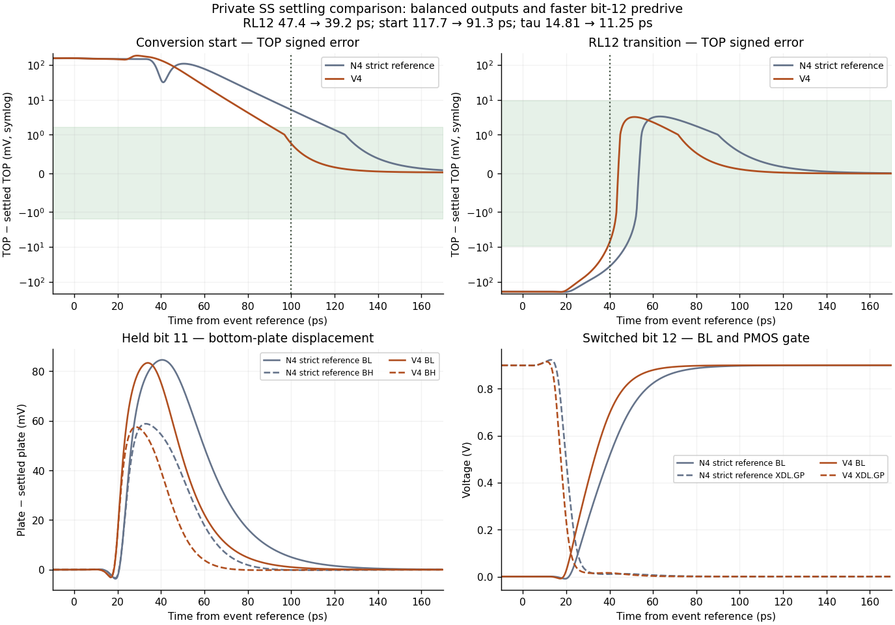

# CDAC diagnosis and trial ledger

The formal candidate is N4, source SHA256
`3d62b80300fc5d85e3fc4e498cd22cedfa92ed006c502922526f1641e0a2ae61`.
The [README](README.md) summarizes its topology, fixed 5% per-physical-unit
parasitic assumption, formal TT pass and incomplete PVT coverage.

The complete historical report is preserved at
[commit 6a4bf94](https://github.com/many-question/ADC-12b-100M/blob/6a4bf94977db967dbd27ef47669d5d3d25735477/design/xtor/adc_cdac/many-question-codex/sampling-entry-diagnosis.md),
with all its relative image links intact in that immutable tree. The
annotated `adc-cdac-many-question-history-20261031` tag retains the snapshot.
Only duplicate current-tree prose and old diagnostic images were compacted;
the source and all 12 official result/figure files remain byte-identical.
The prior report, figures and their original provenance also have a private
hash-verified copy. New experiments never inherit the older validation.

## Evidence ledger

| Version / scope | Observed result | Disposition and provenance |
|---|---|---|
| Pre-N4 | Genuine RL12 50.1 ps, Qref 2.629 pC, SFDR/SNDR 69.6121/69.5735 dB failures | Retained by [pre-N4 tag](https://github.com/many-question/ADC-12b-100M/tree/adc-cdac-many-question-pre-n4-20261030); full history in the archived report |
| Formal N4 TT | All 17 required metrics pass; complete prescribed tracking comparison passes | [N4 TT evidence tag](https://github.com/many-question/ADC-12b-100M/tree/adc-cdac-many-question-n4-tt-20261030) retains actual clean simulation commits; source unchanged |
| Formal N4 ss_low_125 | RL12 47.4 ps and start 117.7 ps fail; RL5 69.2 ps, tau 14.809442 ps and droop 0.008844550 LSB pass | First PVT expansion stopped; weights full scale 0.993092578 V passes; original evidence unchanged |
| Unchanged N4, private strict 28 ns | RL12/start remain 47.4/117.7 ps and tau 14.809442 ps | Mechanism diagnostic, not a new official record; 17 observed MOS / 51 pairs only |
| Private bit-12 output widths +25% | RL12/start improve to 42.2/113.0 ps but fail; tau 17.111203 ps newly fails | Rejected; no TT or expensive downstream expansion; one full 70 ns SS job |

The original N4 and rejected-width-trial stop records remain preserved.
Continuing design work uses separate variants and per-variant gates, rather
than resuming a failed variant's expensive expansion.

## Formal N4: limits and numerical evidence

TT weights/calibration gives Cs 2.065011578 pF, full scale 0.993034321 V,
calibration margin 0.369060944 LSB, calibrated ENOB loss 0.000364369 bit
and TOP gain 0.893800051. TT settling gives RL5/RL12 47.3/35.3 ps,
tau 9.120184 ps, start 83.4 ps, droop 0.004380784 LSB and Qref
1.124389535 pC. DH5/PHI_S/PHI_SB/CONV loads are
0.830865/6.432310/12.231291/9.850052 fF. These are formal N4 results.

TT tracking uses the full coherent 256-sample record after four warmup
cycles: 48.828125 MHz input at 100 MS/s, -1 dBFS, 50 ohm per half,
20 fF TOP load per half, sampled 300 ps after CONV. Main SFDR/SNDR are
86.417966859/84.523548567 dB; the 0.5 ps gear2only twin gives
86.418274708/84.523764369 dB. Sample differences are 0.155934342 uV RMS
and 0.223638200 uV maximum. The actual clean commits and complete sample
records remain retained; the original twin finished after its controller
wait expired and was collected without launching a replacement.

The project prescribes reltol 1e-7, voltage tolerance 1e-8, maxstep 1 ps
and traponly for tracking, with 0.5 ps/gear2only comparison. This tests
step/method sensitivity at the prescribed tolerances, not the loosest
adequate reltol. Formal weights/settling used reltol 0.001 and voltage
tolerance 1e-6; settling maxstep is 2 ps. The stricter private diagnostics
use 0.5 ps, 1e-7, 1e-8 and traponly, with actual settings read from logs.

The same-source private TT pressure records cover all 540 MOS / 1,620
gs/gd/ds pairs for 70 ns, maximum 0.977333326 V, and both halves
(1,080 MOS / 3,240 pairs) for 125 ns of sine input, maximum 0.990224783 V.
The latter leaves only 9.775 mV to the project 1.0 V limit. Model warnings,
including gate-to-bulk checks, remain retained separately. This is neither
complete PVT/startup/long-hold reliability nor actual-bootstrap integration.

## Confirmed slow-corner mechanism

The original SS deadlines fail in adjacent raw samples, not just by
interpolation. At 40 ps after RL12, TOP error is 36.462295 mV against
9.602916 mV allowed. At the 100 ps start deadline it is 5.147058 mV
against 1.585493 mV allowed. The unchanged strict 28 ns diagnostic gives
36.429220/5.146567 mV and the same 47.4/117.7 ps settling verdicts.
Sharp local waveform details differ, so this is not isolated reltol
convergence or an assertion that whole waveforms are identical.

At start, ENB/EN 50% crossings are 17.980/22.688 ps after CONV. The
low GN and high GP enter 1% bands at 44.9/54.1 ps, but bit-12 BL/BH need
118.8/121.8 ps. BH first dips to 0.515938 V before recovering. At RL12,
LHIB -> PCOND -> GP -> BL 50% times are 6.927 -> 13.825 -> 20.459 ->
37.503 ps. At 40 ps GP/GN are 0.010873/0.003276 V while BL is only
0.513880 V toward 0.899851 V. The high plate couples upward to
0.958726 V. Significant plate motion remains after the main gate edges;
these interacting stages cannot be added as independent delays.

The native currents include displacement. The strict N4 diagnostic saved
bit-12 and selected buses, not every other bit's bottom plates. Its 17-MOS
terminal-pair check does not establish full-device SS pressure coverage.

## Rejected bit-12 output-width +25% experiment

Only paired H/L output widths changed: N/P 15/30 -> 18.75/37.5 um,
length 30 nm, fingers 10/20 and ratio 2 unchanged. Geometry validation
had no warnings; two shared-driver lines affect four flattened MOS.
Private source SHA256:
`d456da333fcd63c6035af1a4c69b29b156ef8a630e9d5cabad6fba42181c8dbf`.

| Metric | Official N4 SS | Private +25% SS | Variant verdict |
|---|---:|---:|---|
| RL5 | 69.2 ps | 67.5 ps | PASS <=75 ps |
| RL12 | 47.4 ps | 42.2 ps | FAIL >40 ps |
| Equivalent tau | 14.809442 ps | 17.111203 ps | New FAIL >15 ps |
| Start | 117.7 ps | 113.0 ps | FAIL >100 ps |
| Droop | 0.008844550 LSB | 0.002201507 LSB | PASS <=0.1 LSB |

The same strict 28 ns N4 baseline confirms the early-window timing
comparison. The later charge/load comparison has only the coarser official
70 ns baseline: Qref 1.745559443 -> 1.774002032 pC (+1.6294%);
DH5/PHI_S/PHI_SB/CONV 0.807291/5.966357/12.102270/9.561514 fF in the
variant. These five metrics are typ-only and remain n/a in this SS screen;
no TT charge/load result is claimed for the rejected circuit.

The official equivalent tau is `(t_1pct - t_10pct)/ln(10)`, using last
out-of-band crossings, not an independent single-pole fit. The variant's
RL12 10% crossing advances 44.1 -> 39.9 ps but 1% moves 78.2 -> 79.3 ps.
TOP overshoot increases 3.319162 -> 6.879206 mV (1.728% -> 3.581%).
Low GP's 50% edge slows 20.459 -> 20.962 ps while BL's 50% crossing
advances 37.503 -> 35.824 ps and BL's 1% time improves 84.1 -> 75.2 ps.
The low PMOS absolute native gate charge over -120..+300 ps grows
22.323 -> 27.945 fC. Faster BL recovery does not ensure a shorter TOP
tail when output-gate load and network redistribution both change.

At the variant's TOP peak (+54.247 ps), held bit-11 BL/BH remain
+61.71/+24.37 mV away from their final values. Those other plates were
not saved in the strict N4 baseline, so their separate contributions to
the before/after change are not identified. At start, the widened gates
settle later but BL/BH settle earlier; TOP still needs 113 ps. ENB/EN
50% timing is effectively unchanged. This rejects the tested sizing,
without proving that a particular branch or alternative size is the fix.

The actual 70 ns settling TB has one XDUT and no external MOS-like
devices: all 540 MOS / 1,620 pairs were checked at all 199,960 saved times.
There are zero project gs/gd/ds violations, exact maximum 0.968497692620 V
at XDUT.XB2.XDL.MNOUT ds, 60.075866 ns. This is complete coverage of that
single-sided TB, not the two-sided sine test. Actual maxstep/reltol/voltage
tolerance are 0.5 ps/1e-7/1e-8, traponly. One job used four APS solver
threads, with 395 s job time / 393 s simulator time. Raw logs retain zero
errors, 16 warnings, eight notices and suppressed warnings.

Nine raw files and 50 frozen inputs were recovered/hash-verified before
exact cleanup; archive SHA256:
`63c14b394df86f5360176f17eea9fad126adc36c069dff6ae2e417b01c395bf9`.
The private full-pair table, signed waveform/charge/coupling audits,
scripts and inspected figure remain retained. No TT, tracking, noise,
second variant or other corner followed that failed gate.

## Matched full-window reference-output family experiment

Two independent 70 ns `ss_low_125` runs share the complete original
stimulus, saves and strict numerical settings: 0.5 ps maximum step,
reltol 1e-7, voltage tolerance 1e-8, traponly. Both started from clean
commit `8a8e88a0ba4e2b5bdfb88bd7710726d36d675c7d`. The unchanged-N4
reference fills the missing held-plate and late-window observations.
The private `v1-refout-ulvt` case changes only the model family of all
52 flattened reference-output MOS; W/L/fingers, logic and capacitors
remain unchanged. Eighteen unique device geometries and pinned RNL
validation pass without warnings. Its source SHA256 is
`25ba0e52d44f0f6db08d0fa8891c6be0f5d6874bc42f3e04ce559169e78cbf7e`.

| Quantity | Matched N4 reference | Private lower-threshold outputs | Requirement at SS |
|---|---:|---:|---|
| RL5 settling | 69.3 ps | 58.7 ps | both pass, <=75 ps |
| RL12 settling | 47.4 ps | 42.7 ps | both fail, <=40 ps |
| Equivalent tau | 14.809442 ps | 11.204798 ps | both pass, <=15 ps |
| Conversion-start settling | 117.7 ps | 100.6 ps | both fail, <=100 ps |
| Hold droop | 0.008769519 LSB | 0.004251046 LSB | both pass, <=0.1 LSB |
| VREFP charge / conversion | 1.746078108 pC | 2.619548392 pC | n/a, typ-only |
| DH5 input capacitance | 0.807291 fF | 0.807291 fF | n/a, typ-only |
| PHI_S input capacitance | 5.966224 fF | 5.966242 fF | n/a, typ-only |
| PHI_SB input capacitance | 12.093625 fF | 12.059253 fF | n/a, typ-only |
| CONV input capacitance | 9.561519 fF | 9.561489 fF | n/a, typ-only |

The strict reference retains both original timing failures. Its RL5 result
is 0.1 ps later than the coarse official reference; it remains passing.
The changed circuit still fails both deadline checks, including both raw
samples bracketing each deadline. At 100 ps, start error is 1.666544 mV
versus a 1.586790 mV allowance. At 40 ps, RL12 error is 18.839163 mV
versus 9.596509 mV. No TT or tracking run follows this failed case.

RL12's last 10%/1% crossings change from 44.1/78.2 ps to 39.9/65.7 ps.
TOP overshoot falls from 3.319162 to 2.812952 mV. The switched BL reaches
50% at 34.527 ps instead of 37.503 ps, while its PMOS gate reaches 50%
at 20.553 ps instead of 20.459 ps. The bit-11 held BL/BH last leave a
1 mV band at 107.1/74.9 ps instead of 127.2/84.1 ps. These matching
observations support improved output and held-bank recovery, with almost
unchanged command delay; they do not identify a unique pole or branch.

The charge increase is 0.873470284 pC, or 50.0247%. Quiet-window currents
show a substantial static cost. At VIN=0.65 V during 3..4 ns, with gate
and plate voltages constant to numerical precision, bit-12 low-side
disabled NMOS/PMOS native drain currents change from +0.999487/-0.505634
uA to +14.525968/-4.222254 uA. The sampled BL is 0.649982710 V in N4
and 0.649639693 V in the trial. During neutral hold at 7..8 ns, the
disabled high-side NMOS carries 1.520908 versus 23.818919 uA, and the
disabled low-side PMOS magnitude is 2.500204 versus 20.715273 uA.
Native currents include displacement; the quiet-window audit retains
voltage/current variation. These fixed-input observations support an
off-current contribution, but do not decompose all of Qref or establish
sampling linearity across input voltage and frequency.

Both actual testbenches contain one XDUT and no external MOS devices.
Each checks all 540 MOS / 1,620 gs/gd/ds pairs over its full saved record,
with zero project-limit violations. N4's exact maximum is
0.968951801189 V at XB2.XDL.MNOUT ds (60.075866186 ns); the changed
circuit's maximum is 0.967432353689 V at XB9.XDL.MPOUT ds
(5.165299322 ns). There are 199,924/199,744 time points and 354 saved
signals (277 voltages, 77 native currents), respectively. Job times are
348/343 s; the two-job peak is within the six-job session limit.

For each case, nine raw files and all 50 frozen inputs were recovered and
SHA256-verified before exact run cleanup. Full waveform caches, all-pair
tables, measurement scripts, comparisons and quiet-window audit are retained.
Archive SHA256 values:

- N4 reference: `608fb2e6b10a19cbf25aa29b13e6a75d2c54ff60573a5844cc95c658958a20ce`
- Changed outputs: `6c3732ae6999c971ce596f292746ede69d56fd1e0aee9f11d46567f2ee039cbb`

## Balanced nominal-threshold outputs and faster enable

The independent `v2-balanced-nvt-enfast` case starts from formal N4,
retaining nominal-threshold reference outputs. All 52 output MOS widths
increase by approximately 35%; legal geometry rounding gives factors
1.3333..1.3556. The existing shared ENB pull-down changes from 4 to 8 um,
with 2 um finger width retained. External DH/RL input devices are unchanged.
Nineteen geometries pass validation without warnings, and pinned RNL passes.
This case changes 53 flattened MOS. Source SHA256:
`123e6fd827f3c2f3e2f7355e5b2c249f03894de98eb828a64e7958d1bfc85fe5`.

The clean launch commit is `29db69357ab22019b76420eeb3832bd4522f22d4`.
The complete original 70 ns SS stimulus, full save coverage and strict
0.5 ps / 1e-7 / 1e-8 / traponly settings match the N4 reference above.

| Quantity | Matched N4 | Balanced outputs / enable | SS result |
|---|---:|---:|---|
| RL5 settling | 69.3 ps | 58.6 ps | pass |
| RL12 settling | 47.4 ps | 43.6 ps | fail, <=40 ps |
| Equivalent tau | 14.809442 ps | 11.117939 ps | pass |
| Conversion-start settling | 117.7 ps | 90.6 ps | pass, <=100 ps |
| Hold droop | 0.008769519 LSB | 0.010570126 LSB | pass |
| Qref | 1.746078108 pC | 1.865109260 pC | n/a, typ-only |
| DH5 capacitance | 0.807291 fF | 0.807291 fF | n/a, typ-only |
| PHI_S capacitance | 5.966224 fF | 5.965898 fF | n/a, typ-only |
| PHI_SB capacitance | 12.093625 fF | 11.785402 fF | n/a, typ-only |
| CONV capacitance | 9.561519 fF | 12.789483 fF | n/a, typ-only |

Start error at 100 ps is 0.721680 mV versus a 1.602966 mV allowance;
both bracketing raw points pass. RL12 error at 40 ps remains 24.207592 mV
versus 9.604096 mV; both bracketing points fail. The case stops before TT.

At conversion start, ENB/EN midpoint times advance from 17.980/22.688 ps
to 10.005/13.808 ps. BL/BH reach their 1% bands at 91.8/93.7 ps instead
of 118.8/121.8 ps. At RL12, PCOND stays at 13.824 ps, but GP's midpoint
moves from 20.459 to 21.159 ps with the larger output gate. BL reaches
50% at 35.666 ps and its 1% band at 71.6 ps, compared with 37.503/84.1 ps.
TOP overshoot is 3.098258 mV, and held bit-11 BL/BH reach a 1 mV band
at 104.8/71.8 ps. Thus start and recovery improve, while the remaining
RL12 delay includes the command-to-gate interval before the output moves.

Qref rises 6.8171% against the matched N4 reference, compared with the
50.0247% increase from the rejected output-family swap. At VIN=0.65 V
in the stationary 3..4 ns window, disabled low-side bit-12 N/P native
drain currents are +1.312900/-0.677505 uA and BL is 0.649977759 V.
The same quiet-window/displacement limitations stated above apply.

All 540 MOS / 1,620 terminal pairs pass over 200,198 saved time points;
the exact maximum is 0.971212536572 V at XB2.XDL.MNOUT ds,
60.076354993 ns. The job completed in 353 s. Nine raw files, 50 frozen
inputs, the full waveform cache, pair table, inspected comparison plot
and quiet-window audit are retained; exact cleanup followed hash verification.
Archive SHA256:
`0e3aa9712f6c4587cba7cf9e83a1f88548bb9ce5f0dede1fe1d42bc4e49ada6a`.

## Limited bit-12 gate-driver family change

The `v3-bit12-gate-nulvt` case retains the balanced nominal-threshold output
bank and faster enable. Only bit-12 MGPN/MGNN change to a supported
lower-threshold NMOS family: four flattened MOS across H/L, each still
8 um / 30 nm / four fingers. External DH/RL input devices stay unchanged.
Fresh geometry validation and pinned RNL pass. Source SHA256:
`15656257d7053fd526e3bacfecc549784ad9952715835b6b187440591e768186`.

The clean launch commit is `ad0fcaee86948c37238f9c1fd94172102927c79f`.
Full 70 ns stimulus, saves and strict numerics match the preceding cases.
RL12 improves from 43.6 to 40.6 ps but still fails; at the 40 ps deadline
error is 11.728393 mV versus 9.604083 mV allowed, and both adjacent raw
points remain outside the band. RL5 58.6 ps, tau 11.204798 ps, start
90.6 ps and droop 0.010550525 LSB pass. No TT expansion follows.

PCOND/GP/GN midpoint times are 14.043/19.207/17.929 ps, versus
13.824/21.159/19.537 ps in the preceding case. BL's midpoint advances
35.666 -> 32.882 ps; its 1% recovery is 68.6 ps. TOP overshoot is
3.209246 mV. These observations show a faster gate/output response,
while the input-to-PCOND interval remains.

Qref increases to 2.006878206 pC, from 1.865109260 pC (both n/a at SS).
DH5/PHI_S/PHI_SB/CONV capacitances are
0.807291/5.966345/11.977018/12.789483 fF, all n/a at SS. The bit-12
low/high PMOS native source charges over RL12 -120..+300 ps are
+524.173978/-113.975111 fC, almost unchanged from
+524.149438/-113.975859 fC. That limited event window does not decompose
the whole-conversion Qref change. Native terminal current includes
displacement, and gate voltage fractions are not inferred channel
turn-on thresholds. The separate gate/terminal-charge audit retains
both definitions and their sources.

All 540 MOS / 1,620 pairs pass at 200,267 saved time points, with exact
maximum 0.971020438390 V at XB2.XDL.MNOUT ds (60.076341436 ns).
The job took 347 s. All nine raw files and 50 frozen inputs were recovered
and hash-verified before exact cleanup; full waveform, all-pair and
gate/terminal-charge records are retained. Archive SHA256:
`f447e35cbdd85c544fa9d664a8f78c9db71f7224f182d5c2bb4f0031126ed779`.

## Upper-PMOS predrive: first complete private SS gate pass

The `v4-bit12-upper-pfast` case retains the preceding circuit and changes
only MPA0, the ENB-controlled upper PMOS in each bit-12 NOR stack,
from 8 to 16 um with 2 um finger width retained (four to eight fingers).
The RL-controlled PMOS and external DH/RL input sizes remain unchanged.
Fresh geometry validation and pinned RNL pass. Source SHA256:
`b704b05ae675c6903ccad09ab2a2707e2eeb98fbdeba5650e0863b83491ee2ae`.

The clean launch commit is `276a47eebd891bcc06d038e290ea44836abefdf4`.
The same complete original 70 ns SS stimulus, saves and strict numerical
settings are used. All five applicable settling-test requirements pass:

| Requirement | Value | Limit |
|---|---:|---:|
| RL5 settling | 58.6 ps | <=75 ps |
| RL12 settling | 39.2 ps | <=40 ps |
| Equivalent tau | 11.248227 ps | <=15 ps |
| Conversion-start settling | 91.3 ps | <=100 ps |
| Hold droop | 0.010413878 LSB | <=0.1 LSB |

At 40 ps, RL12 error is 7.357053 mV versus a 9.604082 mV allowance;
at 100 ps, start error is 0.770332 mV versus 1.602973 mV allowed.
Both raw points bracketing each deadline pass. The RL12 timing margin
is 0.8 ps; this is this case's SS settling result, not a complete-corner
or full-CDAC qualification.

PCOND/GP/GN midpoint times are 13.146/17.962/18.149 ps, compared with
14.043/19.207/17.929 ps in the preceding case. BL reaches 50% at
31.457 ps and its 1% band at 67.2 ps; TOP overshoot is 3.210798 mV.
The added ENB load moves the start ENB/EN midpoint times to
10.677/14.623 ps. The start requirement remains passing.

Qref is 2.068876736 pC, 18.4871% above the matched N4 reference;
DH5/PHI_S/PHI_SB/CONV capacitances are
0.807291/5.966054/12.305049/12.789485 fF. These are all n/a at SS.
The isolated RL12 low/high output-PMOS source charges over
-120..+300 ps remain +524.148245/-113.976963 fC, so this window alone
does not explain the whole-conversion charge increase. The full waveform
and separate gate/terminal-charge audit retain the numerical definitions.

All 540 MOS / 1,620 pairs pass at all 200,529 saved times. The exact
maximum is 0.969976161936 V at XB2.XDL.MNOUT ds (60.076352652 ns).
The job took 348 s. All nine raw files and 50 frozen inputs were recovered
and hash-verified before exact cleanup. Archive SHA256:
`b01d69cef793d97fe24252c5aaea94a48a5eec8f2d9500bcaf893a0572083c1d`.

## Upper-PMOS predrive: TT reference-charge failure

The same frozen V4 source completed its conditional full 70 ns TT test
from clean commit `276a47eebd891bcc06d038e290ea44836abefdf4`. All nine
timing, droop and load requirements pass; reference charge fails:

| Quantity | TT value | Limit | Result |
|---|---:|---:|---|
| RL5 settling | 40.2 ps | <=75 ps | PASS |
| RL12 settling | 29.8 ps | <=40 ps | PASS |
| Equivalent tau | 6.861853 ps | <=15 ps | PASS |
| Conversion-start settling | 65.0 ps | <=100 ps | PASS |
| Hold droop | 0.002995030 LSB | <=0.1 LSB | PASS |
| Reference charge | 1.281322764 pC | <=1.2 pC | FAIL |
| DH5 input capacitance | 0.830865 fF | <=6 fF | PASS |
| PHI_S / PHI_SB capacitance | 6.432470 / 12.247828 fF | <=40 fF each | PASS |
| CONV capacitance | 13.170575 fF | <=80 fF | PASS |

All 540 MOS / 1,620 pairs pass at 231,226 saved times. The exact maximum
is 0.983052778673 V at XB12.XDL.MPA1 ds, 20.101423579 ns. The actual
settings remain 0.5 ps / 1e-7 / 1e-8 / traponly; runtime is 437 s.
Nine raw files and 50 frozen inputs, plus analysis and geometry provenance,
were recovered and hash-verified before exact run cleanup. Archive SHA256:
`4f5128b55a9e6cbecbfedc11b3289f02c656b0f9eb62d5c736a139e2f2501fa9`.
This case stops before weights, tracking or other-corner expansion. Its SS
pass and TT failure are both retained; formal N4 evidence remains unchanged.

A separate matched SS V3/V4 audit uses the actual reference-meter interval
54.8..64.8 ns and -120..+300 ps around its conversion-start and sampling-entry
edges. Native source-plus-body charge of the bit-12 high output PMOS at
sampling entry rises from 12.767975 to 43.996840 fC; over the full interval
it rises from 93.762504 to 124.994990 fC. Its conversion-start charge is
almost unchanged (309.494587 -> 309.502572 fC). The low output branch's
full-interval charge is also nearly unchanged (392.505794 -> 392.499525 fC).
Shared ENB/EN sampling-entry midpoints move from 17.550/22.538 ps to
19.101/24.279 ps. This locates part of the SS charge increase at entry and
supports testing a faster shared disable path. It does not decompose every
branch, establish the TT charge breakdown, or isolate channel-only overlap:
native terminal currents include displacement.

## Continuing verification

The next independent case doubles only the shared enable pull-up M0P from
8 to 16 um, retaining its nominal-threshold family and 2 um finger width.
The intended change is earlier ENB rise at sampling entry; extra drain
capacitance can also affect conversion start. Both effects and the full SS
gate must be measured before a conditional TT rerun. No circuit pass is
inherited from V4 or formal N4.

A brief separately controlled reference-drive assist remains an unimplemented
hypothesis, with additional pulse alignment and loading questions.
Each case screens SS settling plus all MOS pairs in its actual TB before
TT charge/load/settling, then spectra and further corners. A failed case
stops its costly expansion and informs the next independent change.
Formal N4 and all official results remain unchanged.
