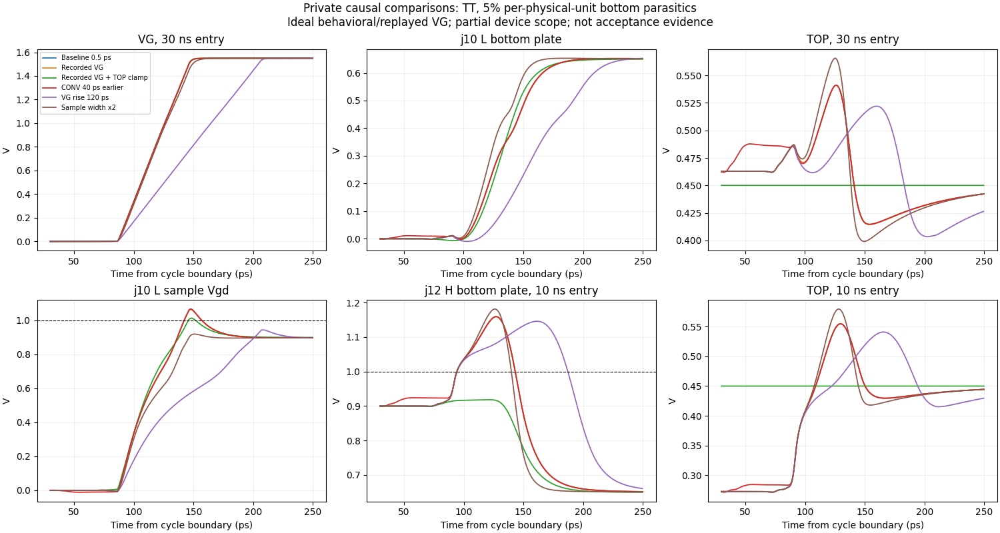

# Sampling-entry diagnosis

These are private exploratory simulations of the circuit frozen at `2ecc285`,
reported on 2026-10-30. They do not replace the official test results or validate
an actual bootstrap circuit. All cases retain the user-specified 5% ground
capacitance on each physical MOM unit, including both units of every series tail.

The six cases use TT, VIN = 0.65 V, the first 34 ns of the official settling
stimulus, maximum step 0.5 ps, reltol 1e-7, and voltage tolerance 1e-8. Inputs
and retrieved simulator outputs were hash-verified. The sampling check covers
22 devices and 66 gs/gd/ds pairs, or 44 devices and 132 pairs in the doubled-width
case. The output check covers 52 devices and 156 pairs in every case. Internal
logic and top-switch stress are outside this six-case comparison.

| Case | Sampling peak absolute voltage (V) | Failing sampling pairs | Output peak absolute voltage (V) | Failing output pairs |
|---|---:|---:|---:|---:|
| Frozen baseline, finer step | 1.06736 | 7 | 1.15921 | 22 |
| Recorded VG imposed by an ideal PWL source | 1.06400 | 7 | 1.15921 | 22 |
| Same recorded VG, TOP clamped to VCM | 1.01509 | 5 | 0.98110 | 0 |
| CONV falls 40 ps earlier; PHI_S/PHI_B unchanged | 1.06713 | 7 | 1.15866 | 22 |
| Behavioral VG turn-on transition 120 ps, instead of 60 ps | 0.95397 | 0 | 1.14560 | 22 |
| Two copies of every sampling MOS | 0.94779 | 0 | 1.18106 | 24 |

The limit is 1.0 V, including brief excursions. Counts above apply to this
34 ns interval; the earlier 70 ns output check found 26 failing pairs. The PWL
trace was recorded in that earlier run. It reproduces its VG waveform, not the
slightly different waveform produced by the finer-step baseline.

The replay/clamp pair supports a contribution from TOP motion to H-side
bottom-plate overshoot. The clamp disables normal conversion and changes the
initial charge state, so it is an isolation experiment, not a repair or a
quantitative prediction of a stronger physical top switch. Residual sampling
stress with the clamp shows that local bottom-plate charging also matters.
Advancing CONV alone has little effect in this case.

Slowing VG or doubling the sampling devices removes the observed sampling
violations over this interval, but neither removes output-device violations.
Doubling sampling width from 48.69 to 97.38 um increases the measured VG rise
charge from 38.47–40.24 fC to 76.95–80.48 fC and peak rise current from about
1.05 to 2.13 mA. This uses the ideal behavioral gate source and excludes wire
capacitance. A width-only change is therefore not selected.

The physical follow-ups below test stronger top-plate clamping and H/L charge
sharing during sampling. Any implementation must check sampling, output, top-switch, added,
and internal devices, as well as settling, reference charge, tracking distortion,
and joint bootstrap behavior. The candidate remains `wip`.

## Physical follow-ups

Two further hypotheses retain the original clock stimuli and the same 5%
parasitics. The first duplicates both top-plate TG devices. The second adds two
copies of each sampled pair's validated input-NMOS geometry between its H and L
bottom plates, gated directly by PHI_S; non-sampled pairs remain unchanged.
These are exploratory variants, not changes to the committed circuit.

| Variant and interval | MOS / gs-gd-ds pairs checked | Failing pairs | Maximum absolute voltage (V) |
|---|---:|---:|---:|
| Top TG doubled, 34 ns | 628 / 1,884 | 29 | 1.13112 |
| Pair charge sharing, 34 ns | 648 / 1,944 | 0 | 0.97255 |
| Pair charge sharing, full 70 ns | 648 / 1,944 | 11 | 1.07948 |

The 34 ns result does **not** establish a repair. Over 70 ns, the pair-sharing
variant has ten failing output pairs and one failing sampling pair. The exact
output maximum is j5L NMOS Vds = 1.079480 V at 40.127138 ns. Before that sampling
entry, both j5 bottom plates are at 0.899935 V, so local sharing cannot lower
their voltage. At the peak, TOP = 0.462507 V and VG = 1.028191 V. After the full
13-step pattern, j0L sampling Vgd reaches -1.003500 V at 60.086107 ns, with
VG = 0.002114 V and its bottom plate at 1.005614 V. A short excursion is still
a failure.

The full interval saves all MOS terminal nodes and checks 173,039 time points.
The added sharing devices and top TG stay within the project gs/gd/ds limit in
this run. Other model voltage warnings are retained; this table does not claim
that every model warning or a supply-ramp startup check has passed.

Using the official settling measurement on the private 70 ns variant gives
RL12 = 50.4 ps and reference charge = 2.671275 pC, both failing their limits.
PHI_S capacitance is 31.1848 fF, PHI_SB is 16.1850 fF, and CONV is 9.8492 fF.
Zero-volt output-source probes partition reference charge into 1.116475 pC
through the output PMOS source/bulk branches and 1.554800 pC through the other
logic. These figures motivate further driver work; no new official acceptance
result or candidate selection is implied.

## Driver and supply-domain comparisons

Further private experiments use the full original 70 ns TT settling sequence,
the same physical-unit 5% estimate, and a 0.5 ps maximum step. All MOS terminal
nodes are saved. These are unselected circuit variants; the committed netlist
and official results still describe `2ecc285`.

The shared-node variant connects each sampled bottom plate through one
PHI_S-controlled NMOS to a common internal node. It improves the pair-sharing
result but still fails. After the full decision pattern, j0L output Vgd reaches
1.009743 V: its bottom plate is 0.984858 V while GN has undershot to -0.024885 V.
The sampling-switch maximum is 1.000276 V, also a failure. The shared node has
no extracted wire capacitance in these experiments.

The simpler driver uses skewed NAND2/NOR2 gates and removes the turn-off
feedback. The split-supply driver moves command and enable prelogic to the
specified DVDD port, followed by standard-threshold inverters that restore
GP/GN to the reference rails. Its H and L command paths are also shortened.
Both driver families use 75% of the original output width, with geometry
validated before simulation. Boolean functions alone do not establish
non-overlap.

| Variant | Sharing arrangement | MOS / failing gs-gd-ds pairs | Maximum (V) | RL12 (ps) | Qref (pC) |
|---|---|---:|---:|---:|---:|
| Original feedback driver | Shared node | 648 / 4 | 1.00974 | 50.2 | 2.639093 |
| Simple driver, low threshold | H/L pair | 440 / 18 | 1.08464 | 36.8 | 2.272340 |
| Simple driver, standard threshold | H/L pair | 440 / 36 | 1.09772 | 48.2 | 1.505366 |
| DVDD prelogic, low-threshold outputs | Shared node | 492 / 2 | 1.00150 | 30.5 | 1.236260 |
| DVDD prelogic, standard-threshold outputs | Shared node | 492 / 9 | 1.02125 | 34.1 | 1.071765 |

Limits are 1.0 V, 40 ps, and 1.2 pC respectively. The last row satisfies the
two listed performance limits in this experiment but fails device stress.
The two failures in the preceding row are Vgd and Vds of the same j0H output
NMOS near 30.086 ns; the small excess is not rounded into a pass. Its sampling
maximum is 0.99889 V, leaving little margin. No row is a complete repair.

The supply split also changes where energy is drawn. Over the official
54.8–64.8 ns charge window, zero-volt probes give:

| Output threshold | Reference output branches (pC) | Other reference branches (pC) | DVDD prelogic (pC) | Signed sum (pC) |
|---|---:|---:|---:|---:|
| Low | 1.034075 | 0.202185 | 0.902989 | 2.139249 |
| Standard | 0.875401 | 0.196364 | 0.902991 | 1.974755 |

The DVDD column measures internal prelogic only; these sums exclude ideal
external clock and bootstrap sources. The integrated minimum of the positive
P-output-source and N-output-source currents is 0.153061 pC and 0.014734 pC,
respectively. This proxy includes leakage and displacement current and does
not prove channel-current non-overlap or safety at other supply values.

The remaining work includes sampling-entry injection, physical series-midpoint
initialization, tracking distortion, actual-bootstrap integration, startup,
and PVT. Original failures and model warnings remain in the retained evidence.
