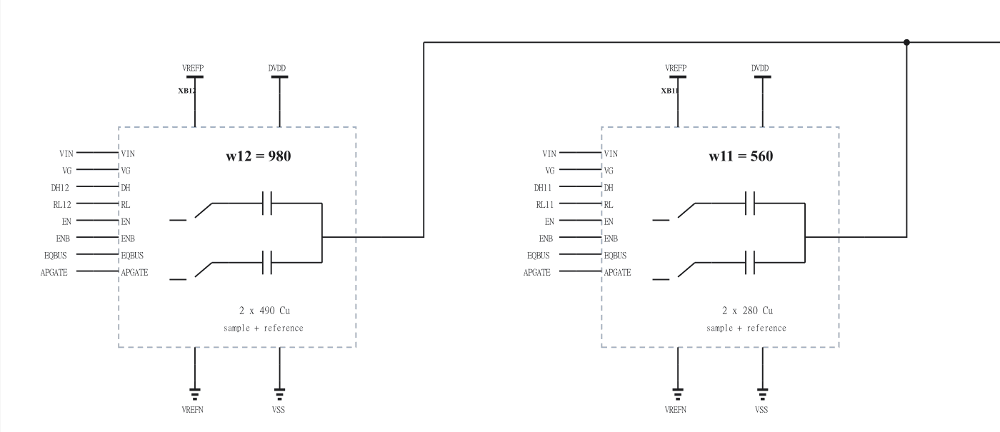

# CDAC 图纸整理与不变性核验

2026-11-01。本次只整理 RNL 图纸及说明，未启动仿真。N4 仍为正式提交的 WIP 候选；V29、V33 仅为历史独立诊断版本。电气优化继续暂停，等待 [issue #125](https://github.com/many-question/ADC-12b-100M/issues/125) 的顶层决策。

## 图纸

| 内容 | 修改前 | 修改后 |
|---|---|---|
| N4 主阵列与控制层级 | [原图](schematic-before-array.png) | [新图](schematic-array.png) |
| N4 最高位驱动器 | [原图](schematic-before-driver12.png) | [新图](schematic-driver12.png) |
| N4 最高两位、端口和权重 | — | [可读局部](schematic-array-detail.png) |
| N4 最高位 H/L 电容与开关 | — | [新图](schematic-bit12.png) |
| V29 辅助支路，参考供电 | — | [诊断图](schematic-v29-assist.png) |
| V33 辅助支路，数字供电 | — | [诊断图](schematic-v33-assist.png) |

完整 N4 的 31 级图纸均在 [RNL 源文件](adc_cdac.scs) 中，可用 RNL core 0.5.2 的 `render` 重绘。每版包括主阵列、13 个位单元、13 个驱动器、两个命令整形器、使能和辅助脉冲电路；不含器件的文件级空图不计数。

候选目录限制为扁平目录、总计不超过 2 MB，因此此处发布精选压缩预览。三版共 93 个层级 SVG、八张 N4 阵列分区图、修改前图和完整前后源文件快照保留在本地 `build/cdac-rnl-polish/published-atlas/`，其中 README 提供逐级索引。该完整图集不随本 PR 入库；本 PR 的 V29/V33 供电图不构成资格验证。

## 改动

- 命令整形采用标准 BUFFER / INVERTER；MOS、电容、电源、地和连接点采用标准符号。位单元、驱动器、使能和辅助脉冲使用带功能图形及明确端口的层级符号。
- 阵列按权重排列，共享控制移至末行。位单元依次画命令、驱动、底板开关与 Cp、MOM 和 TOP；非串联位上下间距由 47 缩至 38 绘图单位，增大器件、端口和权重文字。
- 驱动器分为 NOR/NAND 控制、参考域栅驱动和输出开关。诊断版 AP 负载、NOFF 抵消支路、PHI_SB_REF 输出均有对应网络标注。
- 常规体端连接使用三端 MOS，每页列明 PMOS 体端的 DVDD/VREFP 归属。V29/V33 辅助页分别显示其真实供电。
- 每个物理 MOM 的底板对地 Cp 仍为 5%；串联单位电容的 MID 寄生和采样传输门单独画清。5% 是用户给定估计，不是提取结果。j9、j6 标为不参与采样。
- 连接点仅放在真实分支，不放在拐角或直线拼接处。修正 Cp 接地符号与 MSHARE 标签冲突、重复 EN 和缺少的网络标签。

## 核验

N4 修改前基线为 `54f7819e559cb9d5de7635e0e35436c0498f2983`。三版均先冻结原文件，再仅重建 RNL 记录。移除 RNL 后，**全部剩余字节逐字节相同**，包含普通注释、端口、参数、模型和连接。原 V29/V33 诊断源文件也未改写，图纸在独立副本上生成。

| 版本 | adcflow 依赖哈希（前后相同） | Cp 定义条目数（前后相同） |
|---|---|---:|
| N4 | `e51ec096bda93b5c` | 36 |
| V29 | `f4a9af07414d6a4e` | 50 |
| V33 | `41553fa42c6f8286` | 50 |

条目数按子电路定义统计，不是展开层级后的物理器件总数。完整文件哈希随图纸变化，电气字节哈希保持不变。[核验记录](schematic-audit.txt) 列出三版前后文件 SHA-256、电气及非 RNL 字节 SHA-256、全部 93 张 SVG 的哈希和复核目录。

每个原始实例均有位置；三版 RNL check/render 分别为 0 errors、0 warnings、0 hints。视觉复核覆盖全部 93 个层级，并对主图、位单元、驱动器、串联 MID、两版辅助供电和修改过的标签复看。

397 份已有结果用 `checks.judge` 对修改前和修改后的依赖内容重新判定，判定及过期列表全部一致。`results/` 相对基线无差异；没有仿真、结果改写、依赖记录刷新或 rehash。V33 既有 TT 10/10 仍不代表 SS/FF/FFT 或系统验证通过。

本地 ports、RNL、生成文件一致性检查通过。目录改为扁平精选图后再检查候选范围和大小、hygiene 与已有结果；最终 CI 以 PR65 对应提交为准。
