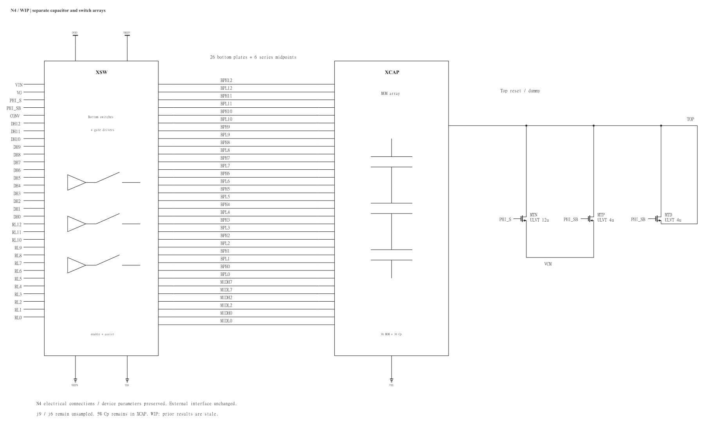

# CDAC 阵列层级重构与等价核验

2026-11-01。按用户要求，将正式 N4 的电容与底板开关拆成独立电气子电路，便于对应版图。参考 [RISCA 的 CDAC / DAC_swi 分区](https://github.com/rich-netlist/rnl-gallery/blob/main/examples/risca/L2_single_ch_V2.scs)。本次没有尺寸、供电、拓扑优化或仿真；[issue #125](https://github.com/many-question/ADC-12b-100M/issues/125) 的优化暂停继续有效，候选保持 WIP。

## 图纸与层级

| 电路 | 内容 | 图纸 |
|---|---|---|
| `adc_cdac` | 原顺序的 37 个外部端口；XSW、XCAP 和顶板 MTN/MTP/MTD | [顶层](schematic-array.png) |
| `XCAP: mq_cdac_cap_array` | 直接包含全部 36 个 MOM 实例和 36 个底板/MID 对地 Cp，没有开关、驱动或按位混合层级 | [纯电容阵列](schematic-capacitors.png) |
| `XSW: mq_cdac_switch_array` | 13 组纯开关子层、参考驱动、命令整形、共享 enable/assist | [开关阵列](schematic-switches.png) |
| `XSW.XSW12: mq_cdac_sw12` | H/L 底板采样、参考驱动、共享/辅助开关 | [最高位开关](schematic-switch12.png) |

两个阵列的连接顺序为 `BPH12 BPL12 ... BPH0 BPL0 MIDH7 MIDL7 MIDH2 MIDL2 MIDH0 MIDL0`。
串联半单位电容中点通过真实端口连接 XSW 内的采样传输门；它们的寄生保留在 XCAP。
j9、j6 仍不采样，EN 接 DVDD、ENB 接 VREFN。所有物理 MOM 的底板寄生仍为 5%；该比例为给定估计，不是提取值。

[电路文件](adc_cdac.scs) 包含全部 33 个子电路的完整 RNL。标准 MOS、电容、逻辑门、电源与地符号保持一致，层级符号画出功能和接口；仅真实分支画接点。原位单元中不再同时包含电容与开关。V29/V33 历史诊断源文件未改动。为满足目录大小限制，旧版图纸预览归档到基线提交：[V29](https://github.com/many-question/ADC-12b-100M/blob/234f5f158ec510652a75e0f3b5089be80ebd4357/design/xtor/adc_cdac/many-question-codex/schematic-v29-assist.png) / [V33](https://github.com/many-question/ADC-12b-100M/blob/234f5f158ec510652a75e0f3b5089be80ebd4357/design/xtor/adc_cdac/many-question-codex/schematic-v33-assist.png)。历史仿真诊断图和结果全部保留。

## 逐器件证明

冻结基线为 `234f5f158ec510652a75e0f3b5089be80ebd4357`。冻结包包含旧候选全部文件、完整结果文件和逐文件 SHA-256 清单。
独立审计脚本直接解析旧、新两份源文件，不调用重构脚本、构造映射或 adcflow 网表解析器；分别递归展开后，逐器件核对模型、全部参数、端子数量与顺序，包括 MOS bulk。
由对应端子的连接反推出网络映射，并检查正反向唯一性，防止漏接、短接或仅数量相等的伪等价。
可下载基线提交的旧源文件与本提交的源文件，运行独立的 [检查脚本](hierarchy-check.txt)：`python hierarchy-check.txt BEFORE.scs AFTER.scs`，无需 adcflow 或 PDK。

- 612 个叶器件一一对应：540 MOS、36 MOM、36 Cp。
- 271 个网络双向一一对应；37 个顶层端口及顺序完全一致。
- 所有 MOM `multi`、器件尺寸、模型、Cp 数值、串联 MID 和 j9/j6 固定使能连接均一致。
- [完整器件路径与网络映射](schematic-audit.txt) 覆盖全部 612 个器件和 271 个网络。例如 `XB12.CH → XCAP.B12_CH`，`XB12.XDH.MNOUT → XSW.XSW12.XDH.MNOUT`，`XB7.MIDH → MIDH7`。

依赖哈希 **`e51ec096bda93b5c → 4dbb1486ab9992ae`**。这是实际电气层级重构，不能沿用此前“仅 RNL 注释变化”的声明。

## 路径与结果

正式 `tb/cdac` 和 `measure/cdac.py` 未硬编码旧内部路径。SOA walker 按新层级动态生成探针：weights/settle 各 540 管、双侧 track 1080 管；逐管端子映射均一致，无未知器件或路径问题，无需修改共享工具。
旧诊断脚本若引用 `XB*.BH/MIDH/XDH`，须按映射更新后再使用；旧波形必须继续按旧路径解释。

全部 **397 份结果保持原字节**，未 rehash。五份原本已因测试台过期的 N4 结果新增网表哈希过期原因：TT/SS weights、TT/SS settle、TT track；其余判定不变，没有 fresh 结果转 stale。旧指标不构成新层级的正式验收证据。

## 验证与后续范围

RNL check 为 0 errors / 0 warnings / 0 hints，全部新层级已渲染并目视检查。项目检查和 CI 状态见 PR65 对应提交。精选 PNG 均小于 200 kB，目录扁平且小于 2 MB。

本次静态重构可交付，但不能替代仿真。恢复仿真后，建议最小层级回归为 TT 的 weights、settle、track 三个既有测试，核对测量、SOA 保存路径及指标相对基线的数值差；它们不构成完整资格。正式验收仍需按现行规格跑所需全角及后续系统回归。本轮未启动这些测试，也未重跑全部历史结果。
