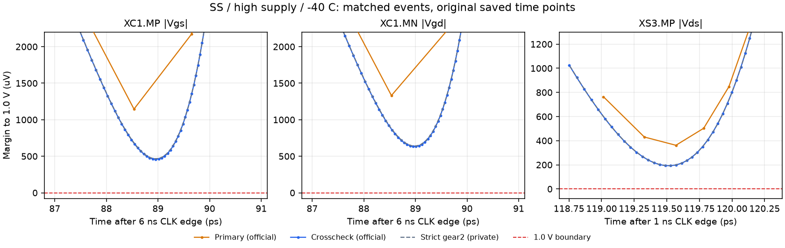

# Numerical evidence after PR #95

Status on 2026-10-31: six fresh primary records, forty stale timing records, candidate WIP. All completed primary/crosscheck metrics pass their limits. The unresolved issue is whether the observed per-pair differences meet the project's convergence requirement; see [#103](https://github.com/many-question/ADC-12b-100M/issues/103). No new acceptance threshold is introduced here.

## Source and prescribed settings

The ten official jobs used clean `c6152d236e525793ecc4809b9a6c9dfb9fd0ad77` and unchanged electrical hash `878752080031c251`. The official runner recorded the original primary values and `meta.crosscheck`. The four alternate runs are diagnostics attached to their primary records, not four extra qualification records.

| Setting | Official primary | Official crosscheck |
|---|---|---|
| Mode / preset | APS / conservative | APS / conservative |
| Method | gear2only | traponly |
| Actual reltol | 1e-4 | 1e-8 (requested 1e-7) |
| Actual voltage absolute tolerance | 1 uV | 10 nV |
| Explicit maxstep | none | 1 ps |
| relref / lteratio | alllocal / 10 | alllocal / 10 |

The same original 161 ns stimulus, duties, loads and voltage limit apply. Every saved time point was checked for all 60 MOS / 180 Vgs, Vgd and Vds pairs. Raw-precision peaks below were independently recomputed from these original saved waveforms and agree with the official rounded SOA tables. They do not overwrite those tables.

Reproduction of the risk batch with the merged official flow:

```text
python -m adcflow sim tb_clkgen_timing --view adc_clkgen=xtor:many-question --corners ss_high_125,ss_high_m40,ss_low_125,fs_high_27 --mode aps --jobs 6 --crosscheck --keep
```

## Whole-window peak comparison

"Difference / margin" uses each pair's own smaller distance to 1.0 V, then takes the largest ratio across the 180 pairs. The pair with the largest absolute difference can differ from the pair with the largest ratio or the corner's highest peak.

| Corner | Highest primary / crosscheck peak (V) | Largest pair-peak difference (uV) | Largest pair difference / its closer margin |
|---|---:|---:|---:|
| ss_high_125 | 0.999930465106 / 0.999926114761 | 266.613012 | 6.256% |
| ss_high_m40 | 0.999638087123 / 0.999807377060 | 697.342910 | 149.789% |
| ss_low_125 | 0.818799718985 / 0.818803991939 | 325.441203 | 0.174% |
| fs_high_27 | 0.999675807128 / 0.999686196530 | 441.465620 | 10.806% |

At SS/high/-40 C, XC1.MP Vgs changes from **0.998855553552 V** to **0.999541835585 V**: 686.282 uV versus a closer margin of 458.164 uV. XC1.MN Vgd changes by 697.343 uV versus 632.857 uV. The corner's highest pair, XS3.MP Vds, changes by 169.290 uV versus 192.623 uV. Both settings still give zero voltage-limit violations.

SS/low/125 C conversion delay changes from 196.741499052 ps to 196.460932200 ps: 0.280567 ps versus the primary's 3.258501 ps margin. Limits and judgment remain the official ones.

## Same-event diagnosis

Comparisons below use the same external CLK edge and a 0.3 ns diagnostic window. Corresponding CLK 50% crossings agree within 0.001 ps. These windows locate the discrepancy; formal SOA coverage remains the entire 161 ns waveform.

The reference was linearly sampled at the primary's saved timestamps. "Grid reduction" is the decrease in the reference's own maximum after that resampling. "Remaining gap" is its resampled maximum minus the primary maximum. Their sum equals the same-event peak difference. This is an algebraic diagnostic, not a unique causal separation of sampling and solver error: phase and waveform-shape differences also affect the remainder.

| Pair | CLK edge (ns) | Reference minus primary peak (uV) | Reference grid reduction (uV) | Remaining gap (uV) |
|---|---:|---:|---:|---:|
| XC1.MP gs | 6 | 687.374173 | 219.086096 | 468.288077 |
| XC1.MP gs | 156.5 | 686.015251 | 219.353571 | 466.661680 |
| XC1.MN gd | 6 | 697.856269 | 237.847809 | 460.008460 |
| XC1.MN gd | 156.5 | 697.342910 | 239.048120 | 458.294790 |
| XS3.MP ds | 1 | 169.274143 | 6.163511 | 163.110633 |
| XS3.MP ds | 71 | 718.682496 | 11.512385 | 707.170110 |

The discrepancy persists for matched events and after reference resampling. For XS3.MP at the 71 ns edge, the same-event difference is 718.682 uV, larger than the 169.290 uV difference between whole-window maxima; the two whole-window maxima occur at different cycles. These observations do not support explaining the entire difference solely by selecting different cycles or retaining fewer output points.



## Supplemental private strict-tolerance comparison

The grey curve above is a retained private diagnostic from clean `3b0c002`, before the flow merged, with the identical electrical circuit and matching test parameters/globals. It used conservative gear2only, actual reltol=1e-7 and voltage absolute tolerance=10 nV, without explicit maxstep. It is not a formal record or a replacement for the prescribed crosscheck.

Compared with the formal strict traponly crosscheck over all 180 pairs:

| Corner | Largest pair-peak difference (uV) | Largest difference / closer pair margin |
|---|---:|---:|
| ss_high_125 | 3.843078 | 0.326% |
| ss_high_m40 | 7.057046 | 1.484% |
| ss_low_125 | 4.912705 | 0.003% |

These tighter profiles are substantially closer to one another. This supports investigating tolerance sensitivity, but does not identify a unique cause or waive the official convergence requirement. The maintainer's decision in #103 will determine the next official settings/evidence and remaining reruns. Original official values, failed eligibility conditions and stale records are preserved.
