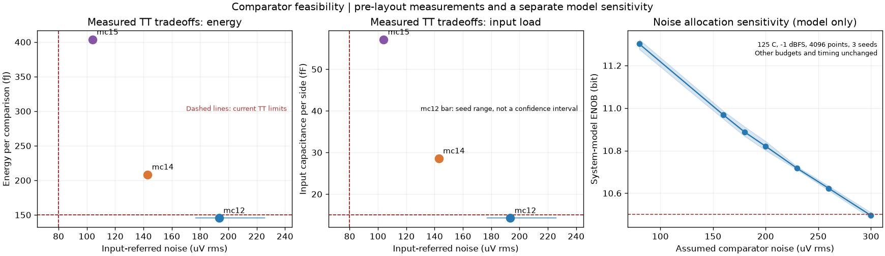

# 比较器实测折衷与顶层指标分配讨论

日期：2026-10-27。状态：`xtor-wip`，未签核。

**结论：先停止尺寸搜索，请顶层评估噪声预算。** 在本轮尝试中，保持现有输入电容与能量分配时，
获得了约 **0.19 mV rms** 的 TT 噪声水平；80 uV 尚未达到。继续降低噪声已明显增加输入电容和能量。
这些是已探索样本中的实测折衷，不是理论极限，也不是已证明的全局最优前沿。

## 代表性组合

全部为指定器件模型、APS、前仿真，使用现有测试台与度量。表内除明确说明外均为 TT，
延时单位 ps、能量 fJ、输入电容为每端 fF、噪声为差分输入等效 uV rms。

| 版本 | 噪声 | 1 mV 延时 | 30 mV 延时 | 复位 | 能量 | Cin | 回踢 uV/周期 |
|---|---:|---:|---:|---:|---:|---:|---:|
| 当前规格（TT 项） | 80 | 80 | 50 | 35 | 150 | 15 | 40 |
| `mc12`：保持当前负载/能量分配 | **193.5（4 种子合并）** | **59.16** | **47.65** | **19.34** | **145.38** | **14.23** | **0.014** |
| `mc14`：更大的输入对 | 143.0（1 种子） | 74.18 | 60.98 | 25.83 | 208.34 | 28.56 | 0.108 |
| `mc15`：进一步放大器件与负载 | 104.0（1 种子） | 69.45 | 58.27 | 23.26 | 403.57 | 57.12 | 0.088 |

`mc12` 的四个种子分别得到 177.1、183.1、188.6、225.6 uV；合并 3328 次判决（每输入电平
256 次）的同类 CDF 拟合为 193.5 uV。该范围不是置信区间，也不是工艺角范围。正式结果目录仍记录
标准测试的 seed=1 结果 177.1 uV；多种子分析另存于 `characterization.json`，不能挑选最低种子作为保证值。

`mc14` 和 `mc15` 同时违反现行噪声、30 mV 延时、能量和 Cin 限值，仅用于分配讨论。
`mc12` 在已测 TT 确定性指标、能量、Cin 和回踢上通过，但噪声仍失败，不能进入交付评审。

## 已完成的验证与边界

- 先试经典单级 StrongARM，再试输入对漏极匹配 MOM 负载，随后试 Miyahara 两级自定时核心。
  详细历史见 `README.md`；阶段性网表、标准结果和图都有独立 Git 检查点。
- 本地器件 callback 自检及完整参考集通过：903 个案例、324 类器件、129697 个参数比较。
  当前版本的单位 MOS 源漏几何、串联电阻和应力距离由实际 callback 求解，未使用默认值代替成功求解。
  求解数据留在本地；提交中只有器件实例参数。
- `mc12` 七个 quick 工艺角的 1 mV 延时最大 **94.31 ps**，满足这些角适用的 120 ps 限值；
  再生时间常数最大 **9.00 ps**，复位最大 **27.59 ps**，确定性测试错误数均为 0。
- 80 ps 的 1 mV 延时限值、50 ps 的 30 mV 延时限值、150 fJ 能量限值只适用于 TT。
  现有报告程序会把这些限值也打印到其他角；这里按 YAML 的 `corners` 字段判读，未改测试工具。
  快角能量最高 266.58 fJ 作为额外信息报告，不把它误判成违反仅限 TT 的能量指标。
- 噪声、Cin 和回踢尚未完成全角验证；尚未进行 50 次失配 Monte Carlo、完整输入共模/大差分范围验证、
  顶层晶体管/行为混合验证或布局寄生验证。原论文的失调校准回路未加入。
- 标准噪声测试为 +/-300 uV、13 个电平、每电平 64 次判决，单种子拟合存在采样波动；
  早期明显超过此扫描窗口的噪声值只能视为粗略诊断。
- `mc04` 的选择性噪声诊断中，仅输入对有噪声时约 162 uV，整个前级约 178 uV，第二级约 78 uV。
  这些是关闭部分噪声源的诊断，不是验收结果；不能用关闭噪声后的值代替总噪声。
- 本轮某个筛选作业发生 Verilog-A 编译缓存错误，已作为无效噪声结果排除，不据此判断电路失败。
- 所有有用仿真数据已取回本地；远端任务只作临时执行用途。没有更改接口、规格限值、测试台或工具源文件。

## 顶层噪声预算敏感性

调用现有 `adcflow.model`，只改变 `NonIdeal.sigma_cmp_top`；其他预算与时序保持默认。
使用 125 C 的模型温度、100 MS/s、49.87793 MHz 相干正弦、-1 dBFS、4096 点，种子 11/12/13。
**这不是实测比较器的全角顶层结果**：比较器噪声是人为固定的假设值，不包含该电路的温度/工艺变化；
也未把大 Cin 候选的额外负载加入 CDAC，未注入其失配、回踢、完整延时曲线或未建模非线性。

| 假设比较器噪声 uV | 模型 ENOB 均值 | 三次运行范围 |
|---:|---:|---:|
| 80 | 11.302 | 11.276–11.322 |
| 160 | 10.968 | 10.949–10.986 |
| 180 | 10.888 | 10.868–10.912 |
| 200 | 10.821 | 10.801–10.844 |
| 230 | 10.717 | 10.710–10.725 |
| 260 | 10.623 | 10.613–10.634 |
| 300 | 10.496 | 10.483–10.509 |

所有这些模型运行均无未完成转换。200–230 uV 的假设在当前模型中仍高于 10.5 bit，
但消耗了原有余量，且不能保证真实全角通过。300 uV 已接近或低于目标，没有足够裕量。
数据和源文件哈希见 `noise_budget_sensitivity.json`，复现脚本为 `noise_budget_sensitivity.py`。

## 请项目负责人决定

1. 是否将约 0.20–0.23 mV 的比较器噪声假设纳入顶层重新分配研究，同时保留当前 Cin 和能量预算？
   这是研究区间，不建议直接把 TT 值写成全角规格。应先评估其他模块余量，再确定 PVT 噪声目标。
2. 若仍需接近 0.10 mV，是否接受 Cin 约 30–60 fF、能量约 200–400 fJ 及 30 mV 延时约 58–61 ps 的方向，
   并重新核对 CDAC 上极板负载、采样噪声、环路时序和功耗？现有较大器件方案仍未达到 80 uV。
3. 若上述分配不能接受，由顶层决定是否投入额外前置放大、不同再生/积分时序或其他架构路线。
   当前有限搜索不足以证明指标本身不合理，不建议通过修改度量函数或降低仿真精度获得表面通过。

在顶层决定前保留 `mc12` 作为符合现有负载、能量及已测时序分配的工作基线，状态维持 `xtor-wip`。
