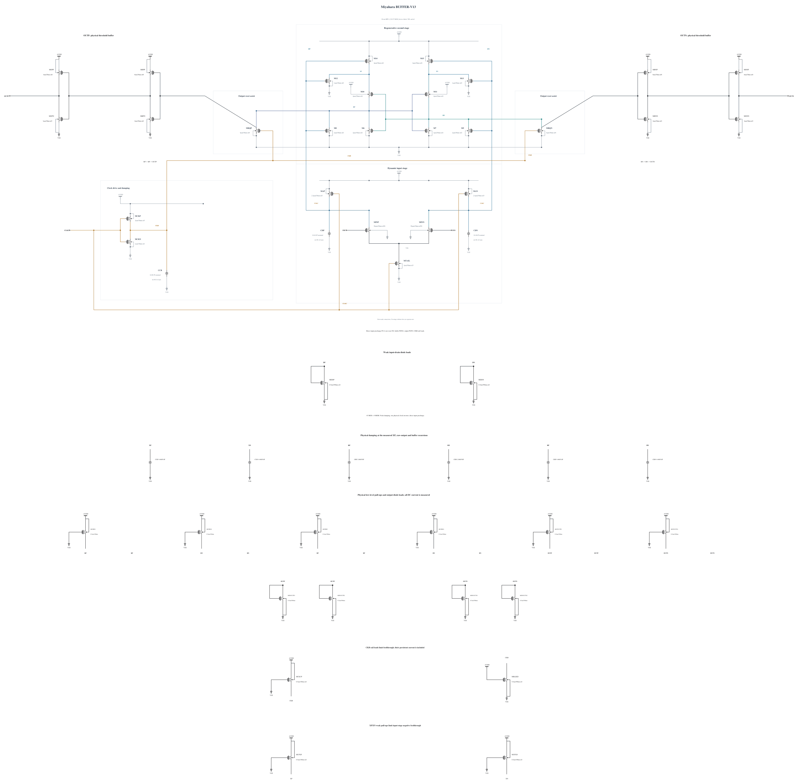

# Preserved canonical baseline before BUFFER-V13

Historical source and all 92 official records are fixed at commit `740fe564b380bc8e3b6526d8ac109503325935ad` and retained in a verified private archive. Statements below describe that old canonical source.

# Miyahara comparator: BUFFER-V12

The canonical `adc_comp.scs` now contains the electrically identical source screened as [BUFFER-V12](BUFFER-V12.md). All ten known key corners and targeted convergence at sf_high_m40 pass timing, reset, physical output validity and full-trace MOS stress. This is screening evidence; the candidate remains WIP, unqualified and unselected.

The source contains 43 MOS devices and 9 physical MOM capacitors. All dimensions and terminal parasitics come from successful callbacks or exact validated geometry reuse. Physical rail loads carry persistent current; [ENERGY-COMPARISON.md](ENERGY-COMPARISON.md) reports measured complete-circuit AVDD costs. No power limit or topology-efficiency conclusion is implied.

The old canonical netlist and all 92 official records are preserved at commit `efe4fe080ceaa9ba37f8bdfbf4a6b3eccae311ed` and in a SHA-verified archive. At promotion all 92 records became stale. Genuine new-source TT capacitance/kickback and noise cases have now been recorded; 90 old-source records remain stale. Further records will be replaced only by actual new-source runs through the existing official runner; no private measurements or old metadata are relabeled. [Promotion proof](PROMOTION-BUFFER-V12.md) records source equivalence and preserved hashes. [Historical baseline](BASELINE-BEFORE-BUFFER-V12.md) retains the previous narrative and experiment links.

[Official TT capacitance/kickback](FORMAL-BUFFER-V12.md) passes: input 19.328731 fF, CLKC 9.609325 fF and kickback 0.002026 uV. Official TT noise fails at 201.879919 uV rms against the 200 uV limit; systematic offset is 0.005300 mV. B12 expansion stops while circuit work continues to establish noise margin. Remaining-corner SOA, all required formal corners, Monte Carlo and mixed-top qualification remain to establish. No old capacitance, noise, mismatch or qualification result is inherited.

Issues #40, #63, #69, #75, #77, #78 and #84 remain acknowledged. Every older experiment and failed screen is retained separately.

[BUFFER-V13](BUFFER-V13.md) is the next independent experiment. It changes only CDP/CDN from 48 to 56 fingers to test additional front-end integration and noise margin, with all transistor dimensions retained. All ten known key corners now pass timing, reset, validity and full MOS stress, with all 360 decisions and 360 resets independently audited. TT 30 mV delay is 47.831273 ps and the worst stress is 0.99904 V. Targeted convergence at the actual worst corner also passes with a 0.99904 V peak; new-source formal capacitance/noise remain; canonical B12 and its failed formal noise record stay preserved.
