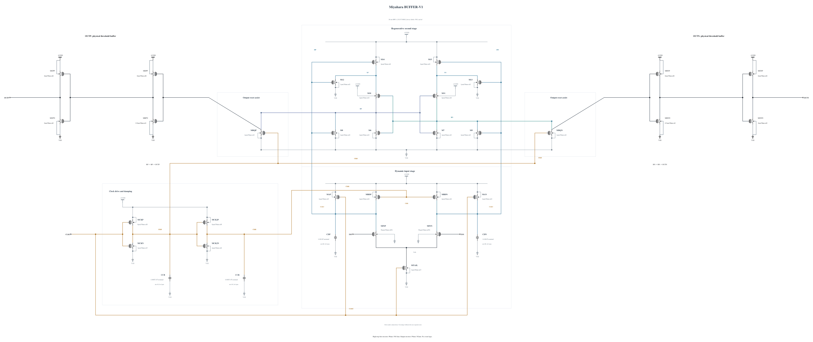

# BUFFER-V1: physical output-validity experiment

The baseline's raw outputs rise together before regeneration, with losing peaks above 50% VDD in the failing SF waveform. This experiment renames those nodes RP/RN and inserts two actual CMOS inverters per output. The first inverter uses P6 um / N0.5 um at 30 nm to move its switching region above the raw common-mode excursion; the second uses P4 um / N2 um to drive the unchanged 10 fF external load. The original core, reset and clock devices retain their geometries and connections apart from the output-node renaming.

This is a transistor-level threshold-restoration hypothesis, not a verified gate threshold. The smaller first-stage NMOS may add delay; the changed core loading may alter regeneration, noise and reset feedthrough. Every internal terminal and actual external output is included in the screen. No ideal event latch, decision detector or behavioral masking is added.

The independent [BUFFER-V1.txt](BUFFER-V1.txt) has 31 MOS and four MOM capacitors. Its electrical SHA-256 is `f7279257a3306d1219214e389fb1ae40106fb03253641590e4f4d9196327511f`. The new 0.5 um / nf1 NMOS geometry was solved by a successful, warning-free callback. Existing buffer geometries reuse successful callback results without hand scaling. Full RNL passes core 0.5.2 with 0 errors, 0 warnings and 0 hints on a byte-identical `.scs` mirror.

The first screen is planned for TT nominal 27 C, FF high -40 C, FF high 125 C, SS low 125 C, SF low -40 C and SF high 27 C. It uses the current v0.7.0 delay stimulus and meter with maxstep 0.5 ps, traponly, reltol 1e-6 and vabstol 1e-8. The two SF cases target the observed simultaneous-rise and losing-peak failures. Physical validity, full-trace |Vgs|/|Vgd|/|Vds|, delay, reset and energy gate any expansion. No validation is claimed in this source-freeze commit.

Canonical `adc_comp.scs` and its official baseline results are preserved. Failed screens stop expansion of this version while subsequent evidence-based iterations continue.
