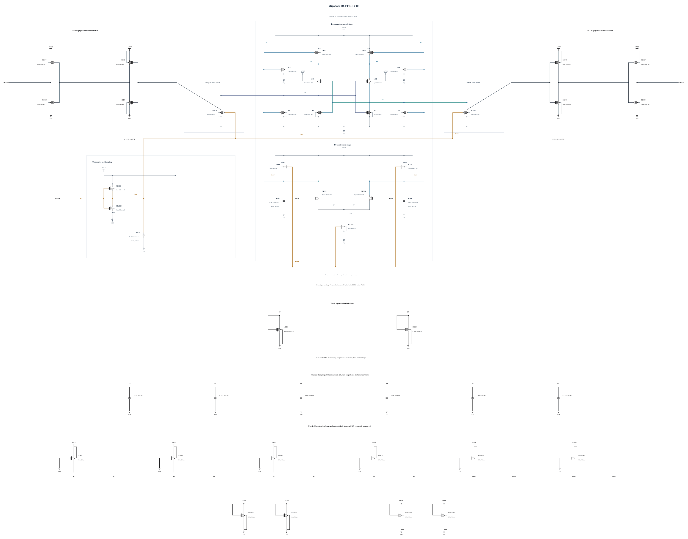

# BUFFER-V10: strengthen only the external output pull-down

B9 passes six-corner terminal stress and output validity, but SS reset is 36.120741 ps. Its SF clock peak already reaches 0.99996 V, leaving little room to strengthen the clock further. This experiment changes only MOPN and MONN from N2 to N3 um, L=30 nm, with 3 fingers. Complete geometry and parasitics are copied from an identical previously validated canonical device. Stronger output discharge and a lower inverter trip point may improve the physical reset metric; the added gate load also changes the upstream waveform, so delay, output validity and all-device stress must be measured again. No Q-shunt or weak pull-up is strengthened.

The [independent source](BUFFER-V10.txt) has electrical SHA-256 `4eae39dc8dd9e629aeb066adca6a1cba564a99e6ea9de6d8580a6dc5ac77df9b`. Full RNL on a byte-identical Spectre mirror passes core 0.5.2 with 0 errors, 0 warnings and 0 hints; the rendered schematic was inspected.

The six-key-corner screen retains the same complete transient checks and current probes. Any passing revision proceeds to further qualification; failed revisions retain their evidence and stop their own expansion. [Energy comparison](ENERGY-COMPARISON.md) reports the measured persistent-current costs of the preceding implementations; no new performance or efficiency pass is assumed.
