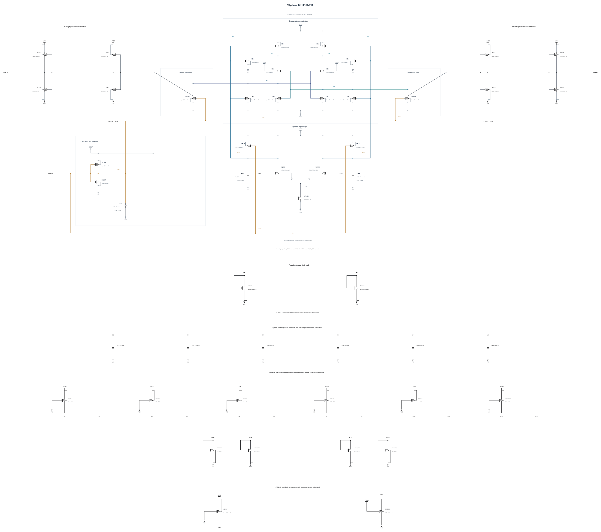

# BUFFER-V11: constrain clock feedthrough at both rails

B10 passes delay, reset and output validity at all ten measured corners, but CKB feedthrough fails stress at two newly measured corners. SF/high/-40 reaches 1.000656171 V, 1.038279 ps before the rising clock 50% crossing. FS/high/-40 reaches -11.143791 mV, 1.571604 ps before the falling crossing, producing 1.001143791 V terminal stress. The latter is the actual worst measured stress.

This experiment adds a weak P0.5um/100nm pull-up and N0.5um/500nm pull-down to CKB. Both use complete previously successful callback geometries with no warnings. The original 39 MOS and 9 MOM remain unchanged; all 41 MOS are checked individually. The persistent currents and any delay cost of these two new loads are included in the measured AVDD energy. They are physical devices, not ideal clamps.

The [independent source](BUFFER-V11.txt) has electrical SHA-256 `75fde3433404b4ab69723528ed5b66e47e7a2e2822c5bc73526a5b7b875259c6`. Full RNL on a byte-identical Spectre mirror passes core 0.5.2 with 0 errors, 0 warnings and 0 hints; the schematic was inspected. The new drawing also corrects the inherited MAP/MAN label to the actual nf3 and updates its summary dimensions; these annotation corrections do not change those devices electrically.

Screen SF/high/-40 and FS/high/-40 first. Only after they pass, complete TT, SS low/hot, SF low/cold, FF high/cold and high/hot, SF high/27 and high/hot, and FS low/hot. Check every MOS terminal voltage over the complete trace, all 36 physical polarities and resets, validity, delay, regeneration time and AVDD energy. Keep the total session concurrency at or below six jobs. No prior noise, mismatch or capacitance performance is inherited.

Passing screening would be supplemental evidence. Canonical promotion and qualification use the existing official runner, with old records preserved and honestly marked stale until replaced.
