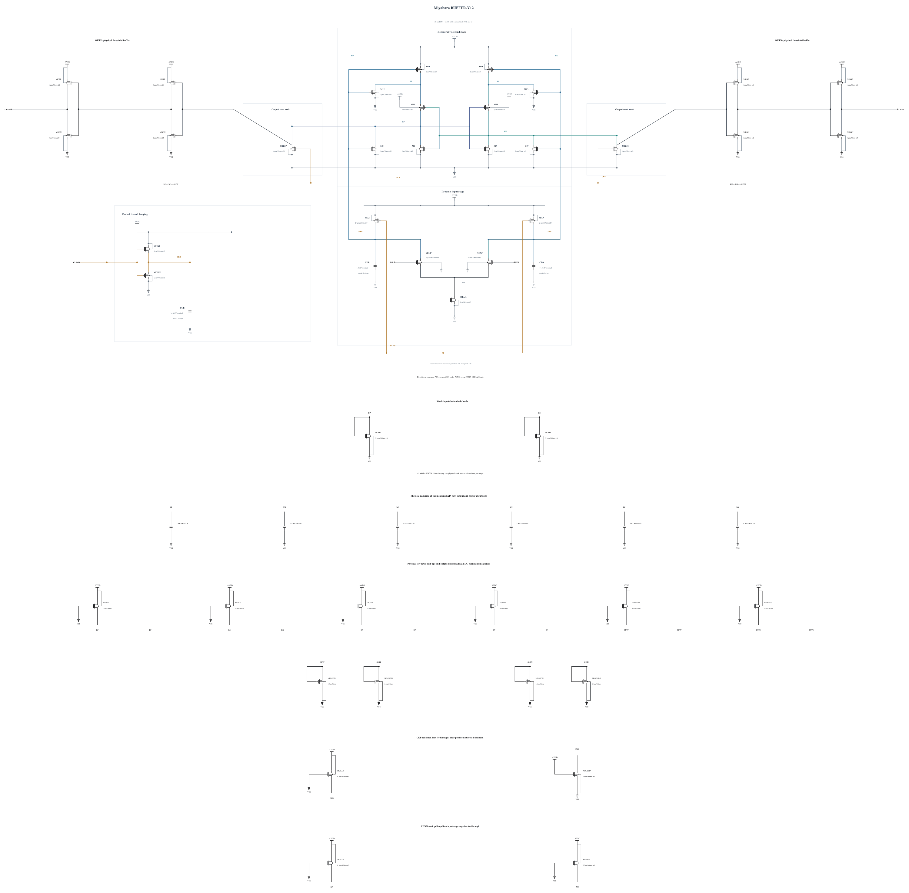

# BUFFER-V12: suppress input-stage negative feedthrough

B11 removes the clock-rail stress failure but retains the two M14/M15 Vds failures already present in B10. At FS/high/-40, XP reaches -10.919713 mV at 11.480779 ps after the rising clock 50% crossing, producing 1.00092 V maximum stress. CKB is now bounded between 0.037750 and 0.988618 V. Both targeted corners otherwise pass timing, reset, regeneration and physical output validity, with all 36 correct decisions and resets.

This experiment adds one P0.5um/100nm weak pull-up to each XP/XN node. Its complete geometry and terminal parasitics are identical to the existing callback-validated MUPRP1 device. All earlier electrical statements remain unchanged. Each of the resulting 43 MOS and 9 MOM capacitors is represented physically; the new devices' persistent current and AVDD energy are included.

The [independent source](BUFFER-V12.txt) has electrical SHA-256 `e64f215d6bd941a8c48d56a5cf4582d6459c4a31981ff85973a2e4915d96bc65`. Full RNL on a byte-identical Spectre mirror passes core 0.5.2 with 0 errors, 0 warnings and 0 hints; the rendered schematic was inspected.

Screen SF/high/-40 and FS/high/-40 first. Passing these permits the remaining eight known key corners, followed by motivated numerical convergence and new-source qualification. All-terminal trace checks, all 36 polarities and resets, output validity, delay and energy remain mandatory. The entire session stays within six simultaneous simulation jobs. No prior capacitance, noise or mismatch result is inherited. Canonical promotion uses the existing official runner and preserves the older records honestly.
