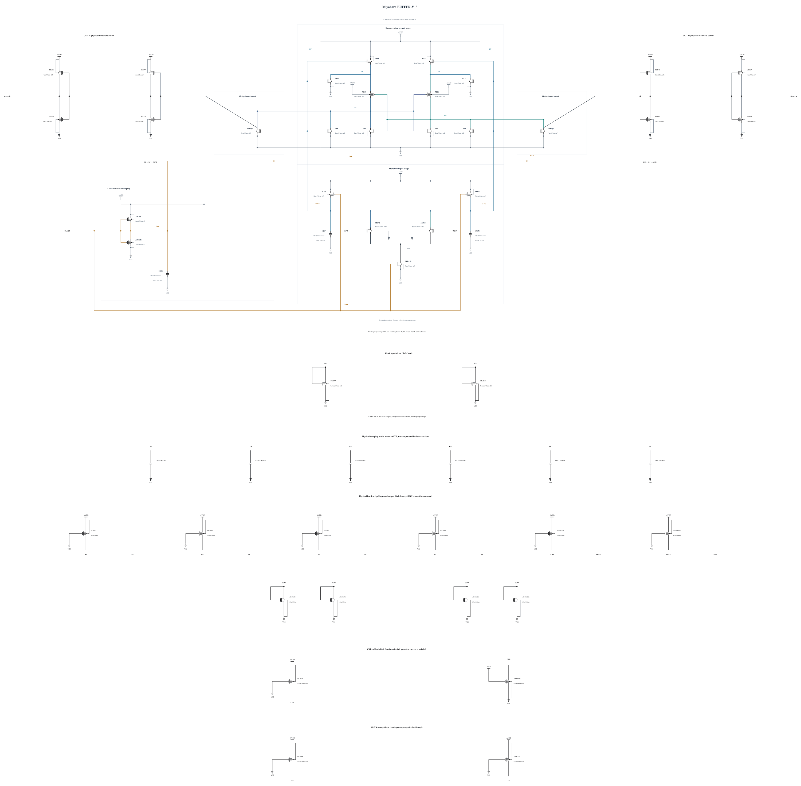

# BUFFER-V13: increase input-drain integration capacitance

B12 fails the genuine official TT noise gate at 201.879919 uV rms against 200 uV. The 95% interval crosses the limit, but the prescribed point estimate is a failure. Its S-curve and complete samples show no gross anomaly; the old baseline interval overlaps, so no precise noise penalty is assigned to a particular repair.

This source changes only the physical CDP/CDN MOMs from 48 to 56 fingers, nominally 14.06 to 16.4603 fF. Longer front-end integration is intended to improve differential signal development before the later stage decides, and to increase noise margin without widening the input transistors whose official input capacitance is already 19.328731 fF. This is a hypothesis requiring measurement. Extra capacitance costs delay and reset charge; the TT 30 mV delay limit remains 50 ps and all stress/reset gates still apply. No measured noise improvement is claimed at source freeze.

The new capacitor callback succeeds without warnings, with result SHA-256 `f553a09aa0a859e87a377f0522eb6653774ef645a8e8fd75d37e131fce9a7560`. All other capacitor dimensions and all 43 MOS instances are unchanged. Electrical SHA-256: `ce5b3787a38ea80eb6775686bbe1df538e8864a2deb3d5f784d67e119b6146e0`. The [source](BUFFER-V13.txt) has 43 MOS and 9 MOM devices and complete RNL; its byte-identical validation mirror passes with zero errors, warnings and hints. Canonical B12 and its formal failure remain preserved.

First screen SF/high/-40 and FS/high/-40, then TT speed/validity and the remaining key corners if those pass. Formal noise must establish useful margin on a frozen new source before expensive qualification expansion. The old noise result and successful private deterministic screens are not adopted as new formal measurements.

