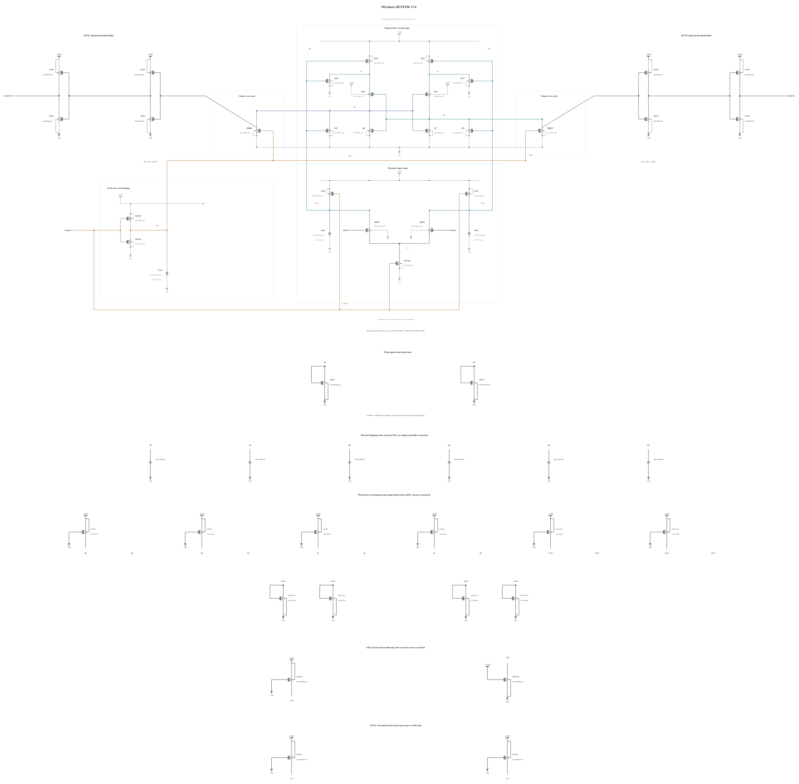

# BUFFER-V14: earlier interstage PMOS drive

B13's formal hot-corner noise fails, worst FS/low/125 at 488.025278 uV rms. The matched phase diagnosis reproduces 11/256 wrong decisions there versus 0/256 at TT, with all resets complete and stable early-to-final output signs. Existing noiseless waveforms show that DP differential transfer decays much earlier in the worst corner; at rise +30 ps its DP and XP secant gains are -2.074 and +6.685, versus TT -4.670 and +12.142. At +40 ps RP gain is +7.313 versus +27.947. The short noisy traces show the same ordering, and all 11 final errors are already present in RP-RN by +50 ps. [The diagnosis](NOISE-DIAGNOSIS-B13.md) preserves the observations and their limits.

This source changes only M14/M15, the PMOS drivers of XP/XN, from 4 um to 6 um at 30 nm with six fingers. It tests whether stronger earlier interstage drive transfers the input difference before it collapses and raises the signal entering regeneration. This is a measured hypothesis, not a proven noise attribution. Process, supply and temperature change together in the observed corner comparison. Reset-branch drain currents include displacement current, so those readings do not isolate channel contention or device noise.

Both complete geometries exactly reuse callback-validated MBPP geometry already present in B13; the successful zero-warning P6 callback has SHA-256 `ee1af01575dbb9dca5e57360e27ca64af62b4cb710b8533d97eb97d35838257d`. Every other electrical statement is unchanged, including all nine physical MOM capacitors, reset devices and output interface. The circuit still has 43 MOS and 9 MOMs. Electrical SHA-256: `1891c70233cdcacfe43d343f5388e0aaa791bdce7fc22ea7f23561c6789f887a`. Full RNL is checked and rendered on a byte-identical mirror of [BUFFER-V14.txt](BUFFER-V14.txt).

Extra gate and diffusion capacitance, switching current, reset behavior and edge stress must be measured. SF/high/-40 and FS/high/-40 come first. If they pass, TT and FS/low/125 deterministic gates precede the matched TT/worst-corner noise diagnosis, so the known worst noise corner is screened early. Remaining known corners, actual-worst convergence, canonical promotion and genuine original formal tests remain prerequisites. No B13 performance result transfers and canonical B13 with all formal failures remains preserved.

