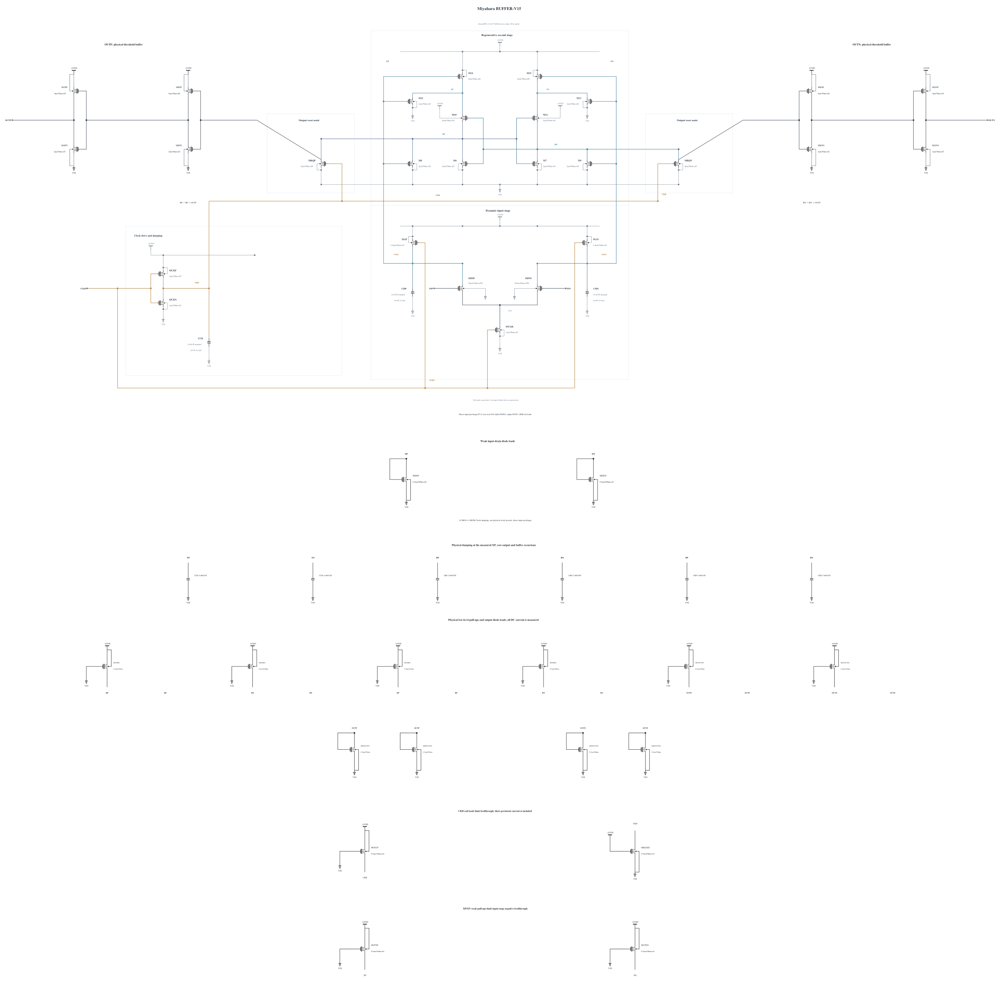

# BUFFER-V15: restore buffer-node edge margin

B14's first SF/high/-40 and FS/high/-40 screens pass all 72 actual polarities, resets and output-validity checks, but FS fails six terminal-stress pairs. The actual BN maximum is 1.000091633924 V at 23.997853 ps after a rising midpoint, with CLKC=0.99 V and CKB=0.129335 V. BP similarly reaches 1.000089066299 V. SF peaks at 0.99991 V. B14 stops before TT and noise; no noise improvement has yet been demonstrated for its stronger interstage PMOS drive.

This source changes only CBP/CBN, the physical buffer-node MOMs, from 16 to 20 fingers, nominally 4.46 to 5.66049 fF. It tests additional edge-charge storage at the two observed overvoltage nodes. All 43 MOS devices, including B14's M14/M15 P6 drivers, and the other seven MOMs are electrically unchanged. This repairs an observed edge-margin problem; it does not assume that added capacitance fixes the B13 noise mechanism. Added buffer delay and reset charge must be measured.

The new capacitor callback succeeds without warnings; its SHA-256 is `613c7aa6a617bd67d2699ba18a547794f801dbaee33aeab31e6b964b5ba9cc5d`. Electrical SHA-256: `5006ef01a47d58de546a7925aa88a7ea9d7730b43632efcaf676d28974223d94`. The [source](BUFFER-V15.txt) contains 43 MOS and 9 MOMs, with complete RNL checked on a byte-identical mirror. Canonical B13, its four formal hot noise failures and the B14 stress failure remain preserved.

First repeat SF/high/-40 and FS/high/-40. If they pass, TT and FS/low/125 deterministic screens precede the matched TT/worst-corner noise diagnosis. Broader known-corner coverage, actual-worst convergence, canonical promotion and genuine original formal gates remain to establish.

## Completed screen 20261031-082247-miyahara-buffer-v15-screen

Both initial high-voltage cold corners pass all 72 actual polarities, including 10 uV, all resets, timing, physical output validity and all 129 terminal pairs. The approximately 20 uV FS stress margin motivates tighter numerics before considering promotion.

Actual clean source commit: `51a243cefebb4ae383a1e738c4786fff4a18bbd1`. Electrical SHA-256: `5006ef01a47d58de546a7925aa88a7ea9d7730b43632efcaf676d28974223d94`. The canonical netlist and 282 official result/figure files are unchanged.

| Corner | 1 mV / 30 mV delay (ps) | Reset (ps) | AVDD (fJ/cycle) | Decided / cycles | Wrong | CMP-15 | Max stress (V) | Failed pairs |
|---|---:|---:|---:|---:|---:|---:|---:|---:|
| fs_high_m40 | 50.640570 / 41.822053 | 20.982410 | 744.198121 | 36 / 36 | 0 | 0 | 0.99998 | 0 / 129 |
| sf_high_m40 | 54.930659 / 45.180408 | 21.597744 | 800.939434 | 36 / 36 | 0 | 0 | 0.99984 | 0 / 129 |

The entire trace, including clock edges and reset, is checked for every MOS |Vgs|, |Vgd| and |Vds|. Each job uses +aps, no explicit +mt, traponly, maxstep=0.5p, reltol=1e-6 and vabstol=1e-8. The observed batch peak is 1 concurrent jobs; logs report effective single-thread simulation. All raw/deck hashes were verified, and the exact owned remote run was removed with absence confirmed.

Per-device maximum over all three terminal pairs (V):

| Device | fs_high_m40 | sf_high_m40 |
|---|---:|---:|
| MINP | 0.70380 | 0.76899 |
| MINN | 0.70391 | 0.76917 |
| MTAIL | 0.99000 | 0.99000 |
| M14 | 0.99304 | 0.99194 |
| M15 | 0.99304 | 0.99194 |
| M12 | 0.99294 | 0.99294 |
| M13 | 0.99294 | 0.99294 |
| M10 | 0.98686 | 0.98183 |
| M11 | 0.98686 | 0.98183 |
| M6 | 0.99391 | 0.99509 |
| M7 | 0.99391 | 0.99509 |
| M8 | 0.99391 | 0.99509 |
| M9 | 0.99391 | 0.99509 |
| MCKN | 0.99000 | 0.99151 |
| MCKP | 0.99000 | 0.99000 |
| MRQP | 0.99391 | 0.99509 |
| MRQN | 0.99391 | 0.99509 |
| MAP | 0.99304 | 0.99194 |
| MAN | 0.99304 | 0.99194 |
| MBPP | 0.98773 | 0.98281 |
| MBPN | 0.99998 | 0.99984 |
| MOPP | 0.98746 | 0.97907 |
| MOPN | 0.99998 | 0.99984 |
| MBNP | 0.98773 | 0.98278 |
| MBNN | 0.99997 | 0.99983 |
| MONP | 0.98746 | 0.97907 |
| MONN | 0.99997 | 0.99983 |
| MDDP | 0.98425 | 0.98640 |
| MDDN | 0.98703 | 0.98796 |
| MUPRP1 | 0.99391 | 0.99509 |
| MUPRN1 | 0.99391 | 0.99509 |
| MUPBP1 | 0.99998 | 0.99984 |
| MUPBN1 | 0.99997 | 0.99983 |
| MUPOUTP1 | 0.99000 | 0.99197 |
| MUPOUTN1 | 0.99000 | 0.99197 |
| MDNOUTP1 | 0.98763 | 0.99197 |
| MDNOUTP2 | 0.98763 | 0.99197 |
| MDNOUTN1 | 0.98763 | 0.99197 |
| MDNOUTN2 | 0.98763 | 0.99197 |
| MCKUP | 0.99000 | 0.99151 |
| MBLEED | 0.99000 | 0.99151 |
| MUPXP | 0.99222 | 0.99294 |
| MUPXN | 0.99222 | 0.99294 |

Clock charge from the mixed delay sequence is a supplemental diagnostic, not the official CMP-14 input-capacitance result. No all-corner, noise, Monte Carlo or mixed-top qualification is inferred from this screen.

## Completed screen 20261031-082954-miyahara-buffer-v15-screen

TT and the known worst B13 noise corner FS/low/125 pass all 72 actual polarities, resets, timing, physical output validity and all 129 terminal pairs. These noiseless checks do not establish any noise benefit.

Actual clean source commit: `51a243cefebb4ae383a1e738c4786fff4a18bbd1`. Electrical SHA-256: `5006ef01a47d58de546a7925aa88a7ea9d7730b43632efcaf676d28974223d94`. The canonical netlist and 282 official result/figure files are unchanged.

| Corner | 1 mV / 30 mV delay (ps) | Reset (ps) | AVDD (fJ/cycle) | Decided / cycles | Wrong | CMP-15 | Max stress (V) | Failed pairs |
|---|---:|---:|---:|---:|---:|---:|---:|---:|
| fs_low_125 | 69.070684 / 53.412240 | 26.136200 | 448.534099 | 36 / 36 | 0 | 0 | 0.81248 | 0 / 129 |
| tt_nom_27 | 57.546945 / 46.641150 | 23.988784 | 573.034820 | 36 / 36 | 0 | 0 | 0.90877 | 0 / 129 |

The entire trace, including clock edges and reset, is checked for every MOS |Vgs|, |Vgd| and |Vds|. Each job uses +aps, no explicit +mt, traponly, maxstep=0.5p, reltol=1e-6 and vabstol=1e-8. The observed batch peak is 1 concurrent jobs; logs report effective single-thread simulation. All raw/deck hashes were verified, and the exact owned remote run was removed with absence confirmed.

Per-device maximum over all three terminal pairs (V):

| Device | fs_low_125 | tt_nom_27 |
|---|---:|---:|
| MINP | 0.54155 | 0.60585 |
| MINN | 0.54155 | 0.60594 |
| MTAIL | 0.81000 | 0.90000 |
| M14 | 0.81121 | 0.90190 |
| M15 | 0.81121 | 0.90190 |
| M12 | 0.81069 | 0.90202 |
| M13 | 0.81134 | 0.90202 |
| M10 | 0.80012 | 0.89284 |
| M11 | 0.80012 | 0.89284 |
| M6 | 0.79862 | 0.90196 |
| M7 | 0.79862 | 0.90196 |
| M8 | 0.80796 | 0.90196 |
| M9 | 0.81134 | 0.90196 |
| MCKN | 0.81000 | 0.90169 |
| MCKP | 0.81000 | 0.90000 |
| MRQP | 0.80950 | 0.90196 |
| MRQN | 0.80950 | 0.90196 |
| MAP | 0.81121 | 0.90190 |
| MAN | 0.81134 | 0.90190 |
| MBPP | 0.80787 | 0.89538 |
| MBPN | 0.81248 | 0.90877 |
| MOPP | 0.80346 | 0.89337 |
| MOPN | 0.81248 | 0.90877 |
| MBNP | 0.80786 | 0.89536 |
| MBNN | 0.81248 | 0.90876 |
| MONP | 0.80346 | 0.89337 |
| MONN | 0.81248 | 0.90876 |
| MDDP | 0.80796 | 0.89764 |
| MDDN | 0.81134 | 0.90045 |
| MUPRP1 | 0.81000 | 0.90196 |
| MUPRN1 | 0.81000 | 0.90196 |
| MUPBP1 | 0.81248 | 0.90877 |
| MUPBN1 | 0.81248 | 0.90876 |
| MUPOUTP1 | 0.81000 | 0.90000 |
| MUPOUTN1 | 0.81000 | 0.90000 |
| MDNOUTP1 | 0.80251 | 0.89973 |
| MDNOUTP2 | 0.80251 | 0.89973 |
| MDNOUTN1 | 0.80251 | 0.89973 |
| MDNOUTN2 | 0.80251 | 0.89973 |
| MCKUP | 0.81000 | 0.90169 |
| MBLEED | 0.81000 | 0.90169 |
| MUPXP | 0.81069 | 0.90202 |
| MUPXN | 0.81069 | 0.90202 |

Clock charge from the mixed delay sequence is a supplemental diagnostic, not the official CMP-14 input-capacitance result. No all-corner, noise, Monte Carlo or mixed-top qualification is inferred from this screen.

## Completed screen 20261031-083004-miyahara-buffer-v15-screen

The tighter FS/high/-40 run passes all 36 actual polarities, resets, timing, physical validity and all terminal pairs. Its very small stress margin is retained as an unresolved robustness concern; no canonical promotion follows from these screens.

Actual clean source commit: `51a243cefebb4ae383a1e738c4786fff4a18bbd1`. Electrical SHA-256: `5006ef01a47d58de546a7925aa88a7ea9d7730b43632efcaf676d28974223d94`. The canonical netlist and 282 official result/figure files are unchanged.

| Corner | 1 mV / 30 mV delay (ps) | Reset (ps) | AVDD (fJ/cycle) | Decided / cycles | Wrong | CMP-15 | Max stress (V) | Failed pairs |
|---|---:|---:|---:|---:|---:|---:|---:|---:|
| fs_high_m40 | 50.641584 / 41.821896 | 20.940190 | 744.201121 | 36 / 36 | 0 | 0 | 0.99999 | 0 / 129 |

The entire trace, including clock edges and reset, is checked for every MOS |Vgs|, |Vgd| and |Vds|. Each job uses +aps, no explicit +mt, traponly, maxstep=0.125p, reltol=1e-7 and vabstol=1e-9. The observed batch peak is 1 concurrent jobs; logs report effective single-thread simulation. All raw/deck hashes were verified, and the exact owned remote run was removed with absence confirmed.

Per-device maximum over all three terminal pairs (V):

| Device | fs_high_m40 |
|---|---:|
| MINP | 0.70379 |
| MINN | 0.70391 |
| MTAIL | 0.99000 |
| M14 | 0.99305 |
| M15 | 0.99305 |
| M12 | 0.99295 |
| M13 | 0.99295 |
| M10 | 0.98687 |
| M11 | 0.98687 |
| M6 | 0.99391 |
| M7 | 0.99391 |
| M8 | 0.99391 |
| M9 | 0.99391 |
| MCKN | 0.99000 |
| MCKP | 0.99000 |
| MRQP | 0.99391 |
| MRQN | 0.99391 |
| MAP | 0.99305 |
| MAN | 0.99305 |
| MBPP | 0.98773 |
| MBPN | 0.99999 |
| MOPP | 0.98747 |
| MOPN | 0.99999 |
| MBNP | 0.98773 |
| MBNN | 0.99998 |
| MONP | 0.98746 |
| MONN | 0.99998 |
| MDDP | 0.98425 |
| MDDN | 0.98703 |
| MUPRP1 | 0.99391 |
| MUPRN1 | 0.99391 |
| MUPBP1 | 0.99999 |
| MUPBN1 | 0.99998 |
| MUPOUTP1 | 0.99000 |
| MUPOUTN1 | 0.99000 |
| MDNOUTP1 | 0.98765 |
| MDNOUTP2 | 0.98765 |
| MDNOUTN1 | 0.98765 |
| MDNOUTN2 | 0.98765 |
| MCKUP | 0.99000 |
| MBLEED | 0.99000 |
| MUPXP | 0.99223 |
| MUPXN | 0.99223 |

Clock charge from the mixed delay sequence is a supplemental diagnostic, not the official CMP-14 input-capacitance result. No all-corner, noise, Monte Carlo or mixed-top qualification is inferred from this screen.

## Numerical margin and next diagnostic

The unrounded maximum over all 129 terminal pairs at 0.125 ps / 1e-7 / 1e-9 is 0.999986654921 V (MBPN ds), only 13.345079 uV below 1 V, at 23.906897971 ps from the nearest rising midpoint. This independent raw calculation agrees with the shared SOA evaluator's rounded 0.99999 V maximum; the earlier near-plateau annotation is not substituted for the peak.

Relative to 0.5 ps / 1e-6 / 1e-8, the largest change across the full rounded pair table is 20.000 uV, with a 10 uV table resolution. Tight-minus-reference changes are +0.001014098 ps at 1 mV, -0.000157645 ps at 30 mV, -0.042219911 ps reset and +0.003000096 fJ/cycle. Both settings pass, but this does not demonstrate broad voltage margin. If the early noise diagnosis is useful, this narrow point requires further convergence assessment before promotion, in addition to all remaining known corners.

The next private diagnosis compares TT and FS/low/125 with the same short +/-800 uV, 128 cycles per level, 50 GHz, seed-1 protocol used for B13. It retains the input, interstage, regeneration and output phases plus all device currents. No result is yet available for this source, and no B13 formal pass transfers.
