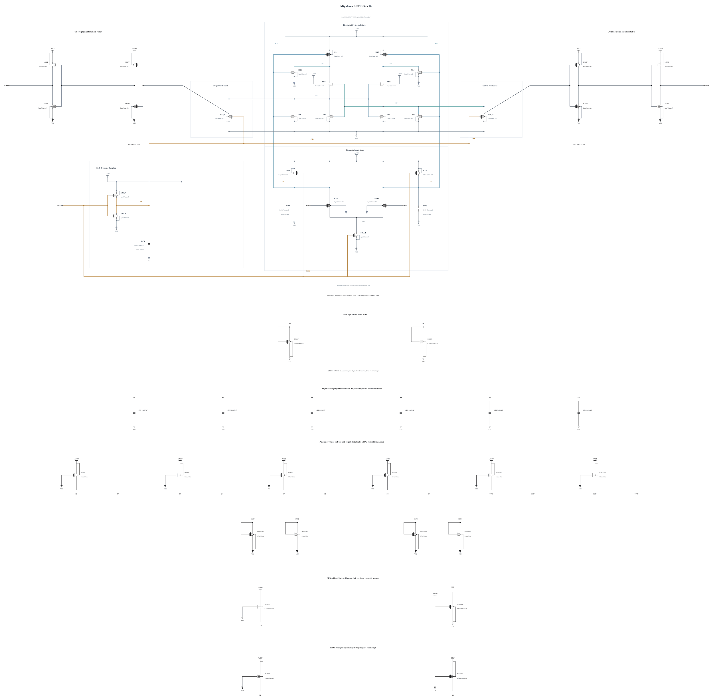

# BUFFER-V16: test regeneration reset-assist loading

B15's paired short diagnosis has 0/256 wrong polarities at TT and 6/256 at FS/low/125, with complete reset, no later interface sign changes and no full-trace stress violation. The FS result is improved from B13's 11/256 in this finite sample, but does not establish the 240 uV requirement. All six errors are already present in RP-RN at +50 ps, which agrees with every final decision. B15 remains unpromoted, including its separate 13.345 uV cold high-voltage stress-margin concern.

The FS input difference remains correct for every sample at +20 and +30 ps, while later transfer loses discrimination. At +30 ps B15's two-level DP/XP/RP descriptive SNR values are 3.561/2.578/1.253. At +40 ps RP gain/SNR is 12.734/2.266, versus B13 7.557/1.852. Stronger interstage drive improved early transfer but residual errors remain; B13 to B15 also changed buffer capacitors, so it is not a one-variable causal comparison.

At +30 ps, normalized CKB remains about 0.14467 VDD and RP is about 0.06063 VDD. The observed MRQP drain current averages 47.3505 uA, with the weak RP PMOS at -100.0087 uA. These terminal currents include displacement and do not isolate channel contention or a device noise contribution. They motivate a controlled reset-assist geometry test rather than proving that the reset transistor causes all residual noise.

Only MRQP/MRQN change from 4 um/30 nm/nf4 to 2 um/30 nm/nf2. The geometry is exactly the existing M6 device and every parameter matches a successful zero-warning callback, SHA-256 `d899f4fdf621dad61d7ca1a5c55d8f8022b122be5a201a46befb1154bb160c86`. All other 41 MOS devices and all nine MOMs remain identical. This reduces reset-assist drive and loading, including CKB gate load; possible benefits to release timing and possible costs in reset speed, validity and voltage excursion must all be measured.

Electrical SHA-256: `dbec21e70ed9aaf442210a58df360b115215013bcf1b60301347e306f0e8dffd`. The [source](BUFFER-V16.txt) contains 43 MOS and 9 MOMs with complete RNL checked on a byte-identical mirror. First SF/high/-40 and FS/high/-40 screens are followed, only if useful, by TT and the known worst FS/low/125 corner and their matched short phase diagnosis. Full known-corner coverage, actual-worst convergence and genuine formal tests remain open. Canonical B13 and every genuine formal failure remain unchanged.

