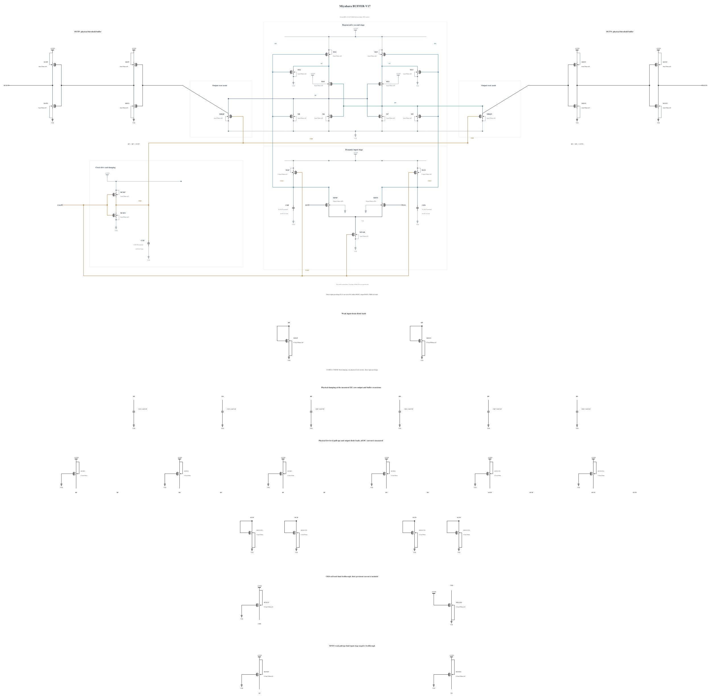

# BUFFER-V17: test earlier physical clock release

B15 retains six wrong polarities in the paired FS/low/125 short diagnosis. B16 then reduced the two regeneration reset assists from N4 to N2. It fails the first FS/high/-40 stress screen at a raw BP peak of 1.000025374154 V and slows reset by 6.438097 ps relative to B15. B16 therefore stops before TT or noise expansion. Its measured failure is preserved in [BUFFER-V16.md](BUFFER-V16.md).

This experiment branches electrically from B15. Only the physical clock inverter NMOS MCKN changes from 1 um/30 nm/nf1 to 2 um/30 nm/nf2. The two regeneration reset assists retain their B15 N4 geometry. All other 42 MOS devices and all nine MOMs remain identical to B15, including the 20-finger BP/BN capacitors and 48-finger CKB capacitor. This tests faster CKB release while retaining reset strength. It does not assume that B16 isolated channel noise: changed geometry also changes capacitance and the clock trajectory.

The new geometry exactly matches existing M6 and every numerical parameter agrees with the successful zero-warning N2 callback, SHA-256 `d899f4fdf621dad61d7ca1a5c55d8f8022b122be5a201a46befb1154bb160c86`. This is reuse of that checked callback and existing geometry; no new callback execution is claimed. Possible clock undershoot, output-buffer overshoot, reset degradation and increased clock capacitance must be measured.

Electrical SHA-256: `f746984dca9a8b27c38058b15ad679b845a933f70653275d4fd187a41aa7be70`. The [source](BUFFER-V17.txt) contains 43 MOS and 9 MOMs with complete RNL checked on a byte-identical mirror. SF/high/-40 and FS/high/-40 are screened first, followed only on a useful pass by TT and the known worst FS/low/125 corner and a matched short phase diagnosis. Full known-corner coverage, actual-worst numerical convergence, canonical promotion and genuine formal tests remain open. Canonical B13 and every original formal failure remain unchanged.

