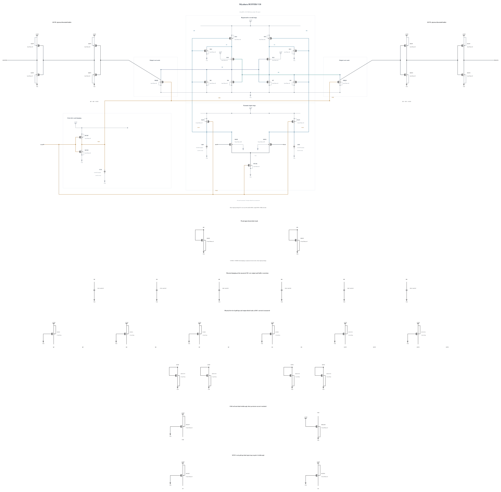

# BUFFER-V18: test stronger input-to-XP/XN drivers

B17 passes four initial deterministic corners and improves cold high-voltage stress margin, but its matched short FS/low/125 diagnosis retains four errors out of 256. Changing only clock pull-down reduces mean CKB/VDD at +30 ps from 0.144669 to 0.025470; FS RP SNR at +40 ps nevertheless increases only about 1.09%. DP signs at +20/+30 ps remain correct for every sample, while RP-RN at +50 ps already contains all four final errors. [BUFFER-V17.md](BUFFER-V17.md) preserves the full result and stopped broader expansion; no formal noise pass is claimed.

This experiment branches electrically from B17. Only M14/M15, the PMOS devices driven by DP/DN and supplying XP/XN, change from 6 um/30 nm/nf6 to 8 um/30 nm/nf8. Length and 1 um finger width remain fixed; total width and finger count both increase. A new successful zero-warning P8 callback supplies full geometry and parasitics, SHA-256 `20855415d9559ad00227138e98d1e759f6c67857f07cd4c5123d67502d0fec87`. All other 41 MOS devices and all nine MOMs are identical to B17, including its N2 clock pull-down, N4 regeneration reset assists and 20-finger BP/BN capacitors.

The hypothesis is that stronger DP/DN-controlled pull-up can change earlier XP/XN and RP/RN transfer while retaining the improved clock trajectory. Geometry also changes input-drain loading, capacitance, current and noise, so no isolated transconductance or device-noise benefit is assumed. The earlier P6 experiment exposed buffer-node stress, making SF/high/-40 and FS/high/-40 the first checks again. TT and the known worst FS/low/125 follow only on a useful pass, then matched short phase diagnosis before wider qualification.

Electrical SHA-256: `188a1104b165095a8732e55525b0cd62f381715785475a525b45a13dfb50b654`. The [source](BUFFER-V18.txt) contains 43 MOS and 9 MOMs with complete RNL checked on a byte-identical mirror. Remaining known corners, actual-worst numerical convergence, source-preserving canonical promotion and genuine formal tests remain open. Canonical B13 and every original formal failure remain unchanged.

