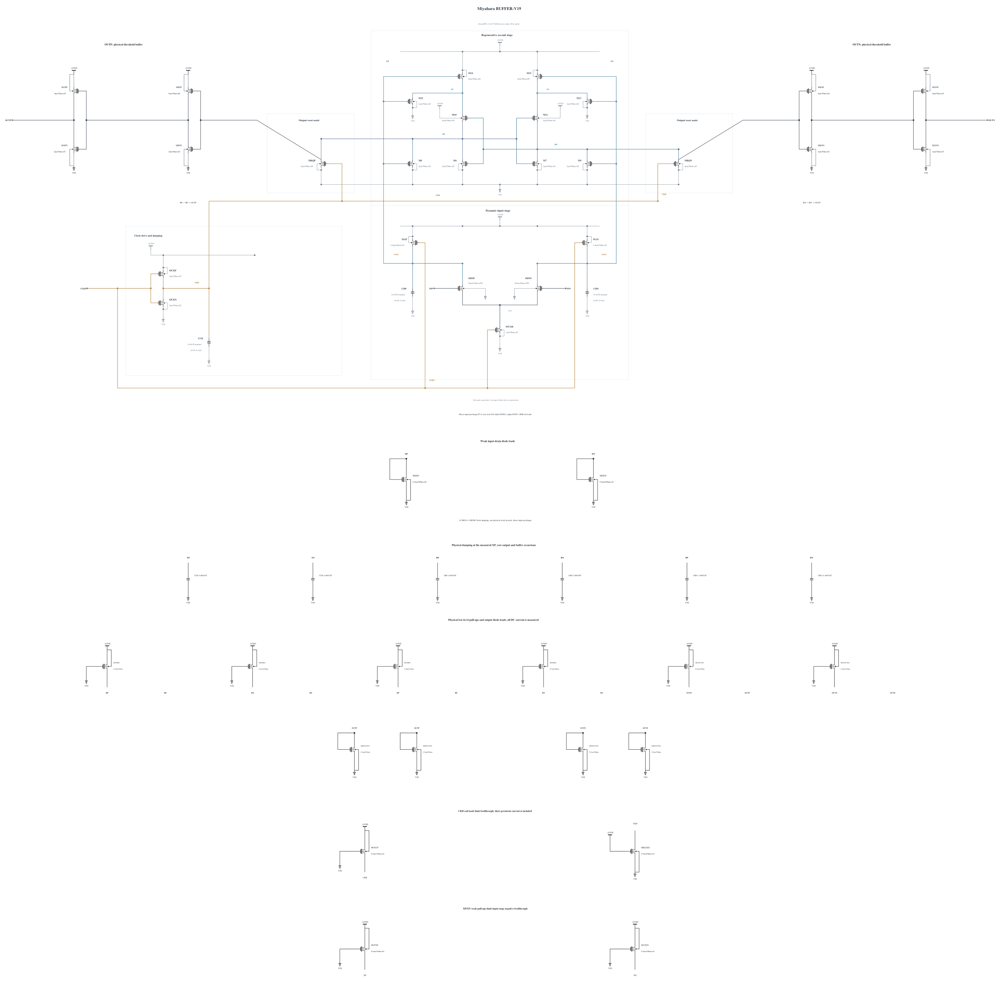

# BUFFER-V19: buffer-node capacitance repair with P8 interstage drive

B18 fails six terminal pairs at each of SF/high/-40 and FS/high/-40. The raw BN peaks are 1.000148479010 V and 1.000274971668 V, respectively, at about 26 ps and 24 ps after rising clock midpoints. All 72 actual decisions, resets and output-validity checks pass, but do not override the strict stress failure. [BUFFER-V18.md](BUFFER-V18.md) retains the failed source and complete waveform evidence; B18 stops before TT or noise.

This experiment changes only CBP/CBN from 20 to 40 fingers, nominally 5.66049 to 11.66040 fF, while retaining B18's P8 interstage drivers, N2 clock pull-down and N4 reset assists. All 43 MOS devices and the other seven MOMs remain electrically identical to B18. The zero-warning capacitor callback is `4bc15f8a37163feb5d1e8333ee1c148f7b5251d005c3a4cff620995266a433b7`; the finger length, width, spacing and metal range are unchanged.

The larger MOMs test more storage for the observed BP/BN edge excursion. The earlier 16-to-20-finger change on a different driver/clock source bought only about 100 uV of peak reduction, so its margin cannot be transferred here. Added buffer delay and reset charge must be measured. This change assumes no noise benefit; B17's clock-release improvement produced only about 1.09% higher FS RP signal-to-noise ratio at +40 ps in the matched short experiment.

Electrical SHA-256: `80b52d592af5f3f92260a40206a5aa08793031e29a1cdecf1f9f9cf508e9b710`. The [source](BUFFER-V19.txt) contains 43 MOS and 9 MOMs, with complete RNL checked on a byte-identical mirror. SF/FS high/-40 are checked first. On a pass, TT and FS/SS low/125 deterministic screens precede a matched short noise-phase diagnosis, to expose the reset-speed cost early. The remaining known corners, actual-worst convergence, source-preserving canonical promotion and genuine original formal tests remain open. Canonical B13 and all original failures remain unchanged.

