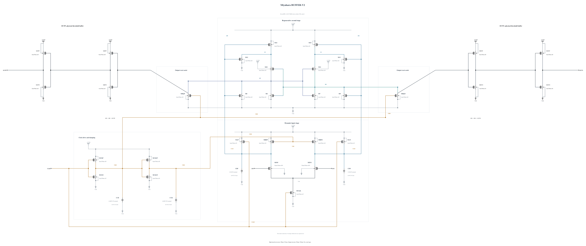

# BUFFER-V2: recover threshold-stage speed

BUFFER-V1 has a large output-validity margin in its six screened corners but misses the TT 30 mV delay by 2.984 ps. This experiment changes only the first buffer NMOS from 0.5 um/nf1 to 1 um/nf1, using the existing successful callback geometry. It increases pull-down drive and lowers the first-stage switching region. The P6 first-stage device, second inverter, core and reset circuitry remain electrically identical to V1.

The first diagnostic compares TT and SF low/-40 C against their existing V1 traces at the same 0.5 ps settings. It tests whether the speed recovery preserves physical losing-output suppression before spending work on a separate reset/feedthrough redesign. V1's high-voltage failures remain known concerns; no high-voltage qualification is inherited or claimed.

Independent source: [BUFFER-V2.txt](BUFFER-V2.txt), 31 MOS and four MOM. Electrical SHA-256: `2fcb783897758f6e3191cf85edcb8dc3a3fc8b4b357e80f8a59de2cfefa1b666`. Full RNL passes core 0.5.2 on a byte-identical `.scs` mirror with 0 errors, 0 warnings and 0 hints. This source-freeze commit claims no performance result.

## Completed targeted speed/validity check

Actual frozen source: `c4c736318f2d05a1fd3eb59f8d4e739a77ba5ebd` (full commit retained in each private record). TT 30 mV delay falls from 52.984285 to 48.296388 ps. Both targeted traces decide all 36 cycles with correct first-event polarity and CMP-15 = 0. The threshold-stage speed change is retained for the next reset/feedthrough revision.

| Corner | 1 mV ps | 30 mV ps | Reset ps | AVDD fJ | Losing peak % VDD | Max terminal V | Violating pairs / 93 |
|---|---:|---:|---:|---:|---:|---:|---:|
| tt_nom_27 | 58.878904 | 48.296388 | 22.647479 | 205.667996 | 0.122957 | 0.921550 | 0 |
| sf_low_m40 | 72.605439 | 58.773821 | 25.850392 | 147.619438 | 0.162395 | 0.847300 | 0 |

This is a two-corner diagnostic, not a high-voltage clearance. The next step must repair V1's observed high-voltage clock/reset excursions and recheck the complete circuit. No all-corner, noise or MC expansion has been launched. Both jobs used +aps, no ++aps or explicit +mt, with solver multithreading disabled; actual peak was one job because the first job warmed the shared AHDL library. Concurrent work was explicitly reserved under the session ceiling of six. Raw/source/deck hashes were verified before remote cleanup.
