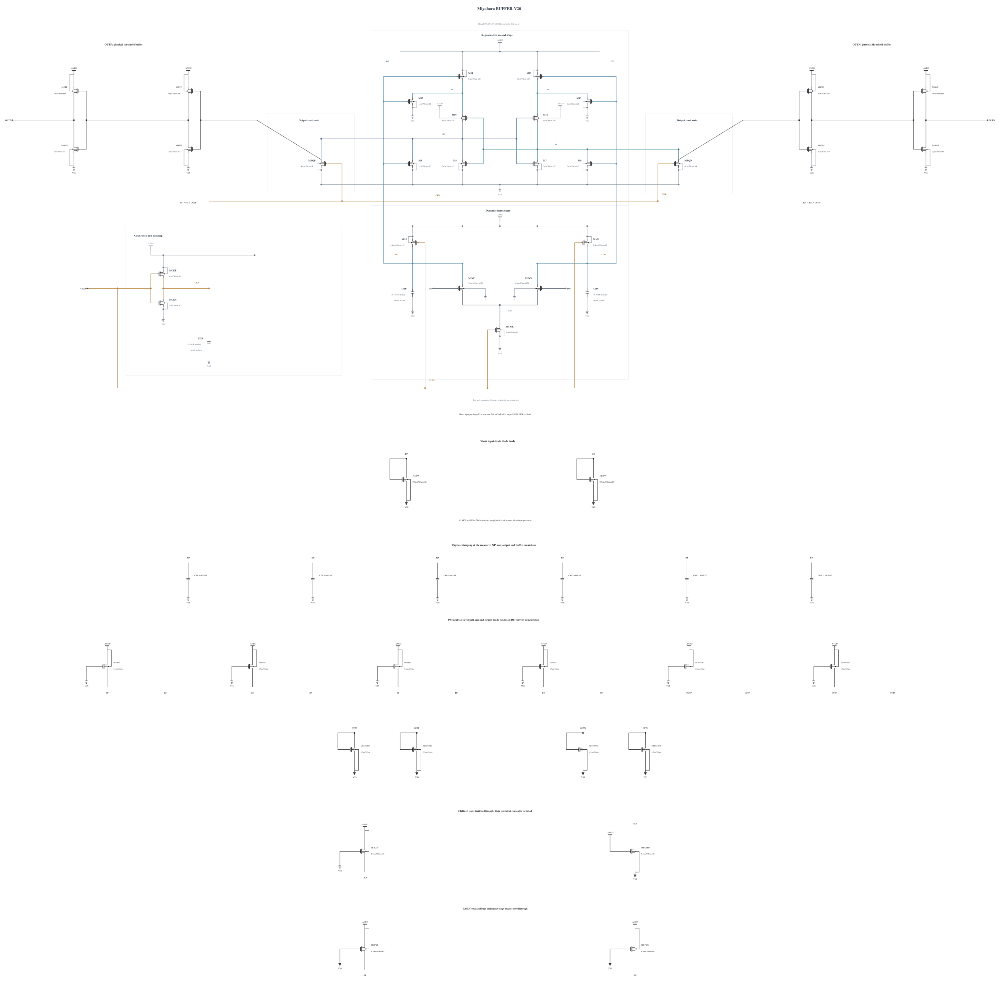

# BUFFER-V20: stronger CKB rise for hot slow reset

B19 repairs the buffer-node high-voltage cold stress but fails SS/low/125 reset at 36.016839 ps against 35 ps. All 180 actual polarities and completed resets, output validity and terminal stress pass across its five initial corners; the reset-time failure still stops noise and broader expansion. At its worst SS cycle, CKB reaches 50%/90% after 8.523814/17.044882 ps, both RP/RN fall below 30% after 22.157436 ps, both BP/BN exceed 90% after 30.059430 ps, and the external outputs reset after 36.016839 ps. [BUFFER-V19.md](BUFFER-V19.md) preserves the source, failure and measured path.

This source retains all B19 P8 interstage drivers, N2 clock pull-down, N4 regeneration reset assists and 40-finger buffer capacitors. Only the CKB inverter PMOS MCKP changes from 3 um/nf3 to 4 um/nf4, with 30 nm length and 1 um finger width fixed. All other 42 MOS devices and all nine MOMs are electrically identical to B19.

The stronger pull-up tests earlier CKB assertion and reset-assist conduction while retaining the repaired BP/BN capacitance. Its added loading and changed drive also affect input clock charge, release, stress and noise, so the reset benefit is not assumed. This does not establish a P8 interstage noise benefit.

The successful zero-warning callback supplies the full geometry and parasitics, SHA-256 `8d2096c6b74343943491aeda9c02802217e12d4ab27360776cf0eeff75c274cd`. Electrical SHA-256: `53b627cde3353cbe6176adc85391ea2ccb4b51dd81d63849c0ad6c56a5aa895f`. The [source](BUFFER-V20.txt) contains 43 MOS and 9 MOMs with complete RNL checked on a byte-identical mirror.

The first batch covers the failing SS/low/125 corner and both SF/FS high/-40 stress corners. TT and FS/low/125 follow only if that batch passes, before a matched short noise-phase diagnosis. Remaining known corners, actual-worst numerical convergence, source-preserving canonical promotion and original formal tests remain open. The canonical source and every genuine original record remain unchanged.

