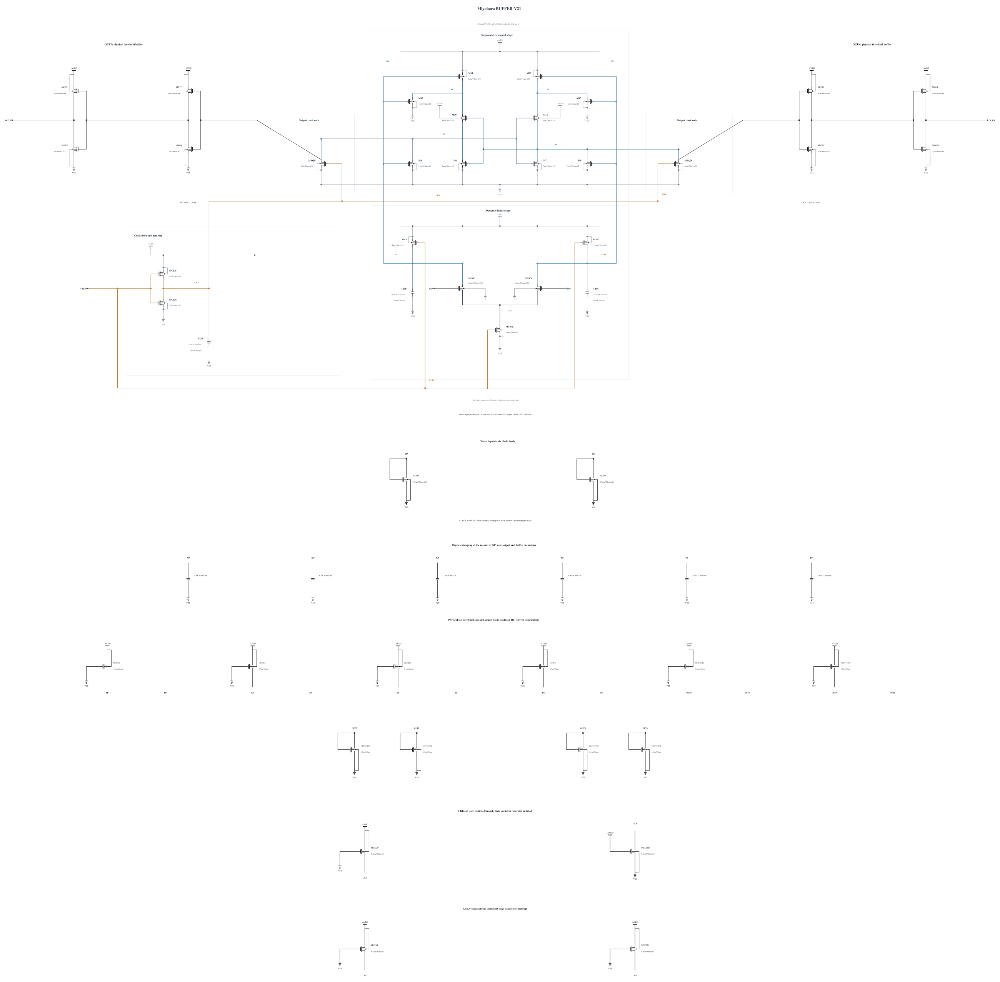

# BUFFER-V21: larger regeneration-node storage

B20 passes the full proposed-settings TT noise precheck at 191.43800312001045 uV rms but fails FS/low/125 at 343.4944014285115 uV against 240 uV (95% profile interval 332.03 to 355.53 uV). All 8704 finite samples per corner remain preserved. [NUMERICS-94.md](NUMERICS-94.md) records the failure and verified archive. B20 qualification expansion has stopped.

This experiment changes only CRP/CRN from 8 to 16 MOM fingers, 2.06055 to 4.46051 fF. Every one of the 43 MOS devices and the other seven MOMs is electrically identical to B20. Finger length, width, spacing and metal range remain unchanged. The zero-warning callback SHA-256 is `84249f3512afcb0edf2f7347f87ad24398cca5bb59af70eca1e7bd579b236135`.

Earlier phase diagnoses found correct DP/DN signs before residual errors appeared at RP/RN. Added local storage tests whether the early regenerative-node signal/noise trajectory improves. It also slows voltage development, adds reset charge and changes coupling; a noise benefit is not assumed and a simple kT/C estimate cannot establish input-referred noise. B20 has limited TT timing and SS hot reset margin, so those checks accompany SF/FS high-voltage cold whole-trace terminal stress and output validity. FS/low/125 is included because it is the failed noise corner.

The private screen uses conservative APS with no explicit maxstep, checking the actual Spectre log. It preserves the physical stimuli and original measurements and does not alter shared testbenches, tools, thresholds or formal results. Proposed-settings screens do not constitute official acceptance. Electrical SHA-256: `6f23c8669d6380bef466bdf2537d515f1e1802ce113310be3ffabaf43689f319`. The [source](BUFFER-V21.txt) contains complete RNL checked on a byte-identical mirror. Canonical B20 and every earlier failure remain preserved; B21 is not promoted or qualified.

## Proposed-settings reset failure

The five-corner screen from clean source `a1d163133ac6c59acdc2ed46523023e16c80949e` fails SS/low/125 reset at 35.42069219051348 ps against 35 ps. All 180 actual polarities and completed resets, output validity and every one of the 129 terminal pairs pass; that does not waive the reset-time failure. TT 30 mV delay is 48.663763208048096 ps. The unrounded worst SF terminal peak is 0.998853677474198 V, with FS high/-40 at 0.9988073872384855 V. B21 noise and broader qualification expansion stop.

At the worst SS cycle 20, measured after CLKC falls through 50%, CKB reaches 50%/90% after 7.6271617982212385/14.33700293928296 ps; both RP/RN fall below 30% after 21.104650816182517 ps; both BP/BN exceed 90% after 29.37357591729302 ps; the outputs reset after 35.42069219051348 ps. These saved-point diagnostics locate the path without changing its official definition. All five corners, full raw waveforms and the failure are preserved in CRC/SHA-verified archive `15f17579b154b710df0b0f74b6995236d69403baf66e398f64f79f039990e0de`; the exact owned remote run is absent. [NUMERICS-94.md](NUMERICS-94.md) records actual conservative/gear2only settings and every corner.
