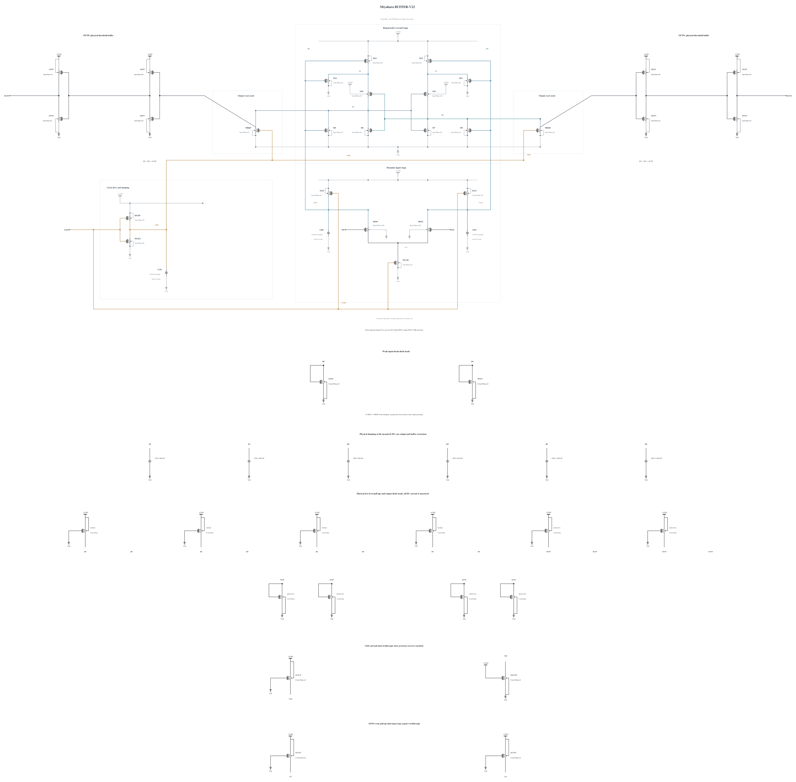

# BUFFER-V22: stronger CKB pull-up for reset

> Evidence retention (2026-10-31): Superseded raw was released. Historical verification does not imply current availability; [retained evidence](EVIDENCE-RETENTION.md) determines which runs can be re-audited.

**Full physical FS/low/125 noise fails:** `342.51175741522553` uV rms against 240 uV, with a model-conditional 95% profile interval of `[331.11, 354.49]` uV. The reset repair passes the deterministic gates below, but B22 qualification expansion stops at this noise failure. Canonical B20 is unchanged; no B22 promotion or TT-noise pass is claimed.

B21 enlarges only RP/RN MOMs, but its proposed-settings screen fails SS/low/125 reset at 35.42069219051348 ps against 35 ps. All five corners pass 180 actual polarities and completed resets, output validity and full-trace terminal stress. The reset-time failure stops noise expansion. [BUFFER-V21.md](BUFFER-V21.md) preserves the complete failure and measured path.

This experiment retains both 16-finger RP/RN MOMs and changes only MCKP from 4 um/nf4 to 5 um/nf5, with 30 nm length and 1 um finger width fixed. Every other 42 MOS device and all nine MOMs remain electrically identical to B21. The zero-warning callback supplies the geometry and terminal parasitics, SHA-256 `0f9b99701437867b499708c6e500ca31a352b771d4a7a544085f7fc2f609c918`.

The B21 worst reset cycle has CKB at 90% after 14.33700293928296 ps, both RP/RN below 30% after 21.104650816182517 ps, both BP/BN above 90% after 29.37357591729302 ps, and external reset after 35.42069219051348 ps. Stronger CKB pull-up tests an earlier reset assertion through that path. Added clock loading and altered release also affect noise and stress, so no isolated reset or noise benefit is assumed.

The independent private screen uses the merged adc_comp 0.8.0 official testbench baseline without numerical overrides, with APS and actual conservative/gear2only settings checked in the log. It first covers SS hot reset, SF/FS high-voltage cold stress, TT timing and FS/low/125. No formal result or shared testbench, measurement, rule or threshold is modified. Full noise follows only after a useful deterministic pass. Canonical B20 and all earlier failures remain preserved; B22 is not promoted or qualified.

Electrical SHA-256: `379e31cd1bf978f5458ea12c2d011f0273dc918a4db5d1a8ea32b48fad8ee0b3`. The [source](https://github.com/many-question/ADC-12b-100M/blob/2db9f93848412c520ab08fb6218adf376ff2cd50/design/xtor/adc_comp/many-question-miyahara/BUFFER-V22.txt) contains complete RNL checked on a byte-identical mirror.

## Completed merged-baseline deterministic checks

The five baseline corners pass all 180 actual polarities including 10 uV, all 180 completed resets, output validity and every one of 129 MOS terminal pairs per corner. Four tighter repeats retain all 144 actual polarities and resets, with every unrounded terminal pair below 1 V. Both runs use frozen source `d8f3002c6dec07fb8fa03646e07997a38397a666`; baseline numeric overrides are empty, and the tighter run is a separate private convergence diagnostic. These are not formal canonical-view records.

| Accuracy | Corner | 1 mV ps | 30 mV ps | Reset ps | Unrounded maximum V |
|---|---|---:|---:|---:|---:|
| baseline | fs_high_m40 | 52.93369761117734 | 43.71905338590627 | 21.40886558252379 | 0.9987689884747367 |
| baseline | fs_low_125 | 70.67752129671038 | 54.87276834982642 | 26.694289075595393 | 0.8132496587361018 |
| baseline | sf_high_m40 | 57.15064240311624 | 46.99537929713503 | 22.399532917303965 | 0.9988323827373253 |
| baseline | ss_low_125 | 85.03318060223232 | 67.42903685514568 | 34.071442458944574 | 0.8168296144469954 |
| baseline | tt_nom_27 | 60.047639458416775 | 48.661348936960785 | 24.72516506509906 | 0.9077389719481126 |

baseline archive SHA-256 `5f94e2debe4a8f549c57e17719cfd46eeb8936fbbb6f0c957640cb56059d4c6d`; every member was verified by CRC and SHA-256 readback, and the exact owned remote directory is absent.

| Accuracy | Corner | 1 mV ps | 30 mV ps | Reset ps | Unrounded maximum V |
|---|---|---:|---:|---:|---:|
| tighter | fs_high_m40 | 53.04113562026039 | 43.70729498255623 | 20.986455394458936 | 0.9989851539211555 |
| tighter | sf_high_m40 | 57.306128209559304 | 47.00758188491303 | 22.01269078196144 | 0.9991158110744197 |
| tighter | ss_low_125 | 85.33995498878679 | 67.42728229073158 | 33.30087103116152 | 0.8170473403941269 |
| tighter | tt_nom_27 | 60.21527138807405 | 48.66627211683584 | 24.2820809269341 | 0.9079078633415121 |

tighter archive SHA-256 `a964a42812482b2f92e4d57f789d3e10c0c987b7d8b93ffa6cfdfb9c8980f1da`; every member was verified by CRC and SHA-256 readback, and the exact owned remote directory is absent.

At SS/low/125, worst reset falls from B21's `35.42069219051348` ps to B22's `34.071442458944574` ps. Across all 36 matched cycles, output reset advances by between `1.0408161138824923` and `1.938232589408642` ps, mean `1.8562610933024115` ps. CKB 90% advances by a mean `2.6546916118180985` ps. The complete tested testbench bytes and actual numerical settings match across this comparison; the original pre-adapter testbench and override dictionaries differ across the workflow merge. Geometry changes capacitance, drive and bias together, so this timing comparison does not isolate noise.

Tighter TT whole-cycle AVDD energy is `596.9203641859505` fJ/cycle: `221.54754546610465` evaluation plus `375.3728187198458` reset. All supply probes are present and KCL closes; energy is report-only. Mixed-delay clock-charge measurements are diagnostic and do not replace the official capacitance test.

### Every terminal pair, maximum across the four tighter corners

All saved transient points, including clock edges, are included. Values below are unrounded stored maxima. Full traces, per-corner maxima and timing remain in the verified archive.

| MOS | Pair | Peak V | Corner |
|---|---|---:|---|
| M10 | ds | 0.987122241947965 | fs_high_m40 |
| M10 | gd | 0.9735408010510315 | fs_high_m40 |
| M10 | gs | 0.9716151203088417 | fs_high_m40 |
| M11 | ds | 0.987125064037395 | fs_high_m40 |
| M11 | gd | 0.9735408010510315 | fs_high_m40 |
| M11 | gs | 0.9716136185148088 | fs_high_m40 |
| M12 | ds | 0.992806488812581 | sf_high_m40 |
| M12 | gd | 0.9928964845312909 | fs_high_m40 |
| M12 | gs | 0.9863263296651531 | sf_high_m40 |
| M13 | ds | 0.9928064858835591 | sf_high_m40 |
| M13 | gd | 0.9928965626924228 | fs_high_m40 |
| M13 | gs | 0.987929134918838 | sf_high_m40 |
| M14 | ds | 0.9549853536692814 | fs_high_m40 |
| M14 | gd | 0.9928964845312909 | fs_high_m40 |
| M14 | gs | 0.9929894300055667 | fs_high_m40 |
| M15 | ds | 0.9550077673213851 | fs_high_m40 |
| M15 | gd | 0.9928965626924228 | fs_high_m40 |
| M15 | gs | 0.9929894265106166 | fs_high_m40 |
| M6 | ds | 0.9949887846215313 | sf_high_m40 |
| M6 | gd | 0.9735408010510315 | fs_high_m40 |
| M6 | gs | 0.9949887661767777 | sf_high_m40 |
| M7 | ds | 0.9949887661767777 | sf_high_m40 |
| M7 | gd | 0.9735408010510315 | fs_high_m40 |
| M7 | gs | 0.9949887846215313 | sf_high_m40 |
| M8 | ds | 0.9949887846215313 | sf_high_m40 |
| M8 | gd | 0.9927721792716255 | fs_high_m40 |
| M8 | gs | 0.9863263296651531 | sf_high_m40 |
| M9 | ds | 0.9949887661767777 | sf_high_m40 |
| M9 | gd | 0.9927721757902384 | fs_high_m40 |
| M9 | gs | 0.987929134918838 | sf_high_m40 |
| MAN | ds | 0.9929894265106166 | fs_high_m40 |
| MAN | gd | 0.9899885673136092 | fs_high_m40 |
| MAN | gs | 0.99 | fs_high_m40 |
| MAP | ds | 0.9929894300055667 | fs_high_m40 |
| MAP | gd | 0.9899885650587886 | fs_high_m40 |
| MAP | gs | 0.99 | fs_high_m40 |
| MBLEED | ds | 0.996179553338692 | sf_high_m40 |
| MBLEED | gd | 0.978890775006858 | fs_high_m40 |
| MBLEED | gs | 0.99 | fs_high_m40 |
| MBNN | ds | 0.9991158110744197 | sf_high_m40 |
| MBNN | gd | 0.9885497455236213 | fs_high_m40 |
| MBNN | gs | 0.9949887661767777 | sf_high_m40 |
| MBNP | ds | 0.9798569213817956 | fs_high_m40 |
| MBNP | gd | 0.9885497455236213 | fs_high_m40 |
| MBNP | gs | 0.9886344541830877 | fs_high_m40 |
| MBPN | ds | 0.9991069568088615 | sf_high_m40 |
| MBPN | gd | 0.9885709511601763 | fs_high_m40 |
| MBPN | gs | 0.9949887846215313 | sf_high_m40 |
| MBPP | ds | 0.9798679658478379 | fs_high_m40 |
| MBPP | gd | 0.9885709511601763 | fs_high_m40 |
| MBPP | gs | 0.9886570902458104 | fs_high_m40 |
| MCKN | ds | 0.996179553338692 | sf_high_m40 |
| MCKN | gd | 0.9857881542565876 | sf_high_m40 |
| MCKN | gs | 0.99 | fs_high_m40 |
| MCKP | ds | 0.978890775006858 | fs_high_m40 |
| MCKP | gd | 0.9857881542565876 | sf_high_m40 |
| MCKP | gs | 0.99 | fs_high_m40 |
| MCKUP | ds | 0.978890775006858 | fs_high_m40 |
| MCKUP | gd | 0.996179553338692 | sf_high_m40 |
| MCKUP | gs | 0.99 | fs_high_m40 |
| MDDN | ds | 0.987929134918838 | sf_high_m40 |
| MDDN | gd | 0.0 | fs_high_m40 |
| MDDN | gs | 0.987929134918838 | sf_high_m40 |
| MDDP | ds | 0.9863263296651531 | sf_high_m40 |
| MDDP | gd | 0.0 | fs_high_m40 |
| MDDP | gs | 0.9863263296651531 | sf_high_m40 |
| MDNOUTN1 | ds | 0.9888774622560248 | sf_high_m40 |
| MDNOUTN1 | gd | 0.0 | fs_high_m40 |
| MDNOUTN1 | gs | 0.9888774622560248 | sf_high_m40 |
| MDNOUTN2 | ds | 0.9888774622560248 | sf_high_m40 |
| MDNOUTN2 | gd | 0.0 | fs_high_m40 |
| MDNOUTN2 | gs | 0.9888774622560248 | sf_high_m40 |
| MDNOUTP1 | ds | 0.9888774666511897 | sf_high_m40 |
| MDNOUTP1 | gd | 0.0 | fs_high_m40 |
| MDNOUTP1 | gs | 0.9888774666511897 | sf_high_m40 |
| MDNOUTP2 | ds | 0.9888774666511897 | sf_high_m40 |
| MDNOUTP2 | gd | 0.0 | fs_high_m40 |
| MDNOUTP2 | gs | 0.9888774666511897 | sf_high_m40 |
| MINN | ds | 0.7693944469979572 | sf_high_m40 |
| MINN | gd | 0.5463353200811645 | sf_high_m40 |
| MINN | gs | 0.5433216647749427 | fs_high_m40 |
| MINP | ds | 0.769220913206481 | sf_high_m40 |
| MINP | gd | 0.5462898896614288 | sf_high_m40 |
| MINP | gs | 0.5433216681640164 | fs_high_m40 |
| MONN | ds | 0.9888774622560248 | sf_high_m40 |
| MONN | gd | 0.9833512031122122 | fs_high_m40 |
| MONN | gs | 0.9991158110744197 | sf_high_m40 |
| MONP | ds | 0.9847520015029182 | fs_high_m40 |
| MONP | gd | 0.9833512031122122 | fs_high_m40 |
| MONP | gs | 0.9798569213817956 | fs_high_m40 |
| MOPN | ds | 0.9888774666511897 | sf_high_m40 |
| MOPN | gd | 0.9833328320123238 | fs_high_m40 |
| MOPN | gs | 0.9991069568088615 | sf_high_m40 |
| MOPP | ds | 0.9847514072120856 | fs_high_m40 |
| MOPP | gd | 0.9833328320123238 | fs_high_m40 |
| MOPP | gs | 0.9798679658478379 | fs_high_m40 |
| MRQN | ds | 0.9949887661767777 | sf_high_m40 |
| MRQN | gd | 0.986439763608178 | fs_high_m40 |
| MRQN | gs | 0.996179553338692 | sf_high_m40 |
| MRQP | ds | 0.9949887846215313 | sf_high_m40 |
| MRQP | gd | 0.9864398225168134 | fs_high_m40 |
| MRQP | gs | 0.996179553338692 | sf_high_m40 |
| MTAIL | ds | 0.6036019579093715 | ss_low_125 |
| MTAIL | gd | 0.9899890141570468 | fs_high_m40 |
| MTAIL | gs | 0.99 | fs_high_m40 |
| MUPBN1 | ds | 0.9798569213817956 | fs_high_m40 |
| MUPBN1 | gd | 0.9991158110744197 | sf_high_m40 |
| MUPBN1 | gs | 0.99 | fs_high_m40 |
| MUPBP1 | ds | 0.9798679658478379 | fs_high_m40 |
| MUPBP1 | gd | 0.9991069568088615 | sf_high_m40 |
| MUPBP1 | gs | 0.99 | fs_high_m40 |
| MUPOUTN1 | ds | 0.9847520015029182 | fs_high_m40 |
| MUPOUTN1 | gd | 0.9888774622560248 | sf_high_m40 |
| MUPOUTN1 | gs | 0.99 | fs_high_m40 |
| MUPOUTP1 | ds | 0.9847514072120856 | fs_high_m40 |
| MUPOUTP1 | gd | 0.9888774666511897 | sf_high_m40 |
| MUPOUTP1 | gs | 0.99 | fs_high_m40 |
| MUPRN1 | ds | 0.9886344541830877 | fs_high_m40 |
| MUPRN1 | gd | 0.9949887661767777 | sf_high_m40 |
| MUPRN1 | gs | 0.99 | fs_high_m40 |
| MUPRP1 | ds | 0.9886570902458104 | fs_high_m40 |
| MUPRP1 | gd | 0.9949887846215313 | sf_high_m40 |
| MUPRP1 | gs | 0.99 | fs_high_m40 |
| MUPXN | ds | 0.9550077673213851 | fs_high_m40 |
| MUPXN | gd | 0.9928064858835591 | sf_high_m40 |
| MUPXN | gs | 0.99 | fs_high_m40 |
| MUPXP | ds | 0.9549853536692814 | fs_high_m40 |
| MUPXP | gd | 0.992806488812581 | sf_high_m40 |
| MUPXP | gs | 0.99 | fs_high_m40 |

Full noise is still untested for B22 at this checkpoint. The known FS/low/125 B20 noise failure motivates testing that corner first. Capacitance, remaining corners, formal coverage, mismatch, operating range, mixed-top validation and lead review remain open. Canonical B20 and all earlier failures stay preserved.

## Completed full-noise failure

Run `20261031-134338-miyahara-buffer-v22-spec08-noise-baseline-screen` uses frozen clean source `7c5afe3be0b5553506c216181995eb07d6fd8bb1` and the unmodified merged 0.8.0 physical testbench baseline, with every physical noise source enabled. The full 17 levels and 512 finite decisions per level are retained; no decisions are omitted. APS, actual conservative/gear2only/reltol 1e-4/vabstol 1e-6, alllocal and lteratio 10 match the baseline. No explicit maxstep or method is set. The bandwidth is 50 GHz, seed 1 and actual low-frequency cutoff 287.216 kHz.

Noise is `342.51175741522553` uV rms (95% profile interval `[331.11, 354.49]` uV), and absolute fitted offset is `0.012396837306869593` mV. The minimum sampled output magnitude is `0.7853750104008` V; the maximum absolute standardized Gaussian-fit residual is `3.0544527204236176`. These diagnostics do not prove a Gaussian physical distribution. [NUMERICS-94](NUMERICS-94.md) preserves all 17 output counts and exact numerical settings. The original sampled-only noise waveform does not establish reset history or full-trace stress; those are separately audited above.

This outcome remains close to B20's 343.4944014285115 uV failure and does not establish a noise improvement. The next investigation uses explicitly artificial source-suppression trials to locate sensitivity before choosing another physical change. Those trials cannot qualify a circuit or be variance-subtracted into unique additive noise contributions. Any subsequent physical candidate restores all stochastic sources.

Archive SHA-256 `26e302577d4bb1e1ba873aa319be231f6edc2458770a06bc2ab6fc7215845240` was verified by reading every member back with CRC and SHA-256; the exact owned remote directory is absent. Formal records are unchanged.

[Artificial B22 source diagnostics](NOISE-SOURCE-DIAGNOSTICS-B22.md) retain input-pair and regenerative-stage suppression trials at the failed FS/low/125 corner. They are ineligible for qualification; physical B22 noise remains 342.51175741522553 uV rms.
