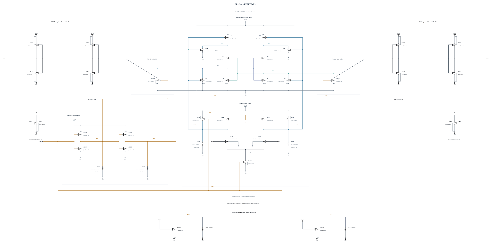

# BUFFER-V3: cross-output discharge and clock damping

B2 passes the six key corners' decision, output-validity and timing checks but retains raw-output reset undershoot and clock-node excursions. This experiment adds an 8 um NMOS from each raw node to ground, gated by the opposite physical external output. Once one output wins, it can hold the opposite raw node low through the observed reset-coupling interval. Both clamp gates are low during initial evaluation; this differs electrically from a keeper that continuously opposes the winning node. The feedback is implemented with actual transistors and is itself subject to validity and timing checks.

Each clock node also gets an N1 um discharge device with gate at AVDD and another 2.06055 fF physical MOM capacitor in parallel with its existing damping capacitor. Their DC current and reduced swing are included in measured AVDD energy. To drive the added clamp-gate loads, the output inverter becomes P6/N3 and the first buffer pull-down becomes N2. These changes can alter threshold behavior, races and reset speed; none is assumed safe merely because B2 passed output validity.

All MOS and capacitor geometries use successful callback outputs. The new N8 geometry has zero callback warnings. The independent [BUFFER-V3.txt](BUFFER-V3.txt) contains 35 MOS and six MOM capacitors. Electrical SHA-256: `ee0e3ce105af6fc5be92e3f23d90812e854cee53296eaa3b83b9c1bac9937aca`. Full RNL checks on a byte-identical `.scs` mirror pass core 0.5.2 with 0 errors, 0 warnings and 0 hints.

The first screen is TT nominal 27 C, FF high/-40 C and SF low/-40 C at 0.5 ps, with all 105 terminal pairs, actual decisions/outputs, delay, reset and energy. These three cases gate further key-corner work. No ideal event capture, extra bias port or inherited validation is used. This source-freeze commit has no performance result.
