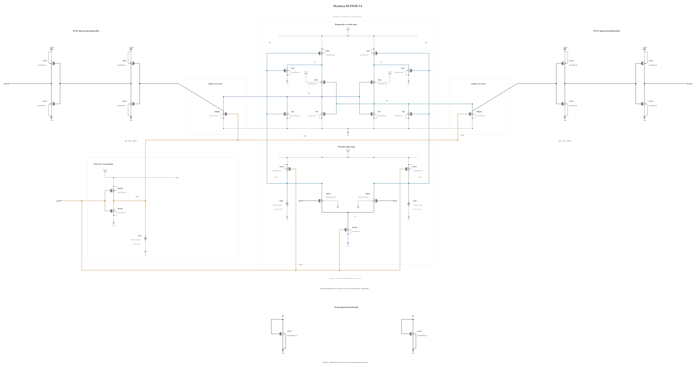

# BUFFER-V4: direct input precharge and stronger clocked reset

B3 still shows input-drain overshoot during the delayed CKR rising edge and negative raw-output excursions during reset. This experiment returns to the B2 physical buffer and changes the reset path. It removes the CKR inverter and its input-precharge PMOS pair; the remaining direct-CLKC input precharge uses P1.6 um on each side. Each input drain receives a diode-connected N0.5 um / 500 nm load to create high-level headroom. These are actual PDK devices whose current is included in energy.

The raw-output reset NMOS increases from N2 to N8. CKB retains one physical CMOS inverter, with its damping MOM increased from 4.46051 to 14.06 fF. The first output-buffer NMOS becomes N2 while the output inverter remains P4/N2. This should strengthen the reset clamp and reduce clock feedthrough, while the earlier input-precharge release may recover delay. Timing, output validity, all-terminal stress and energy must establish the result; none is inherited from earlier versions.

The [independent source](BUFFER-V4.txt) has 29 MOS and three MOM capacitors. All geometries exactly reuse successful warning-free callbacks. Electrical SHA-256: `91f4c449bd4406e30da73e25fe881a2c2d2816c8cfb47d0e9ab43b920fdbb1fb`. RNL core 0.5.2 checks the byte-identical Spectre mirror with 0 errors, 0 warnings and 0 hints.

The first screen uses TT nominal 27 C, FF high/-40 C and SF low/-40 C, checking all 87 MOS terminal pairs over the entire trace, actual decisions, CMP-15, delay, reset and AVDD energy. This source-freeze commit makes no pass claim. The canonical source and its official records remain unchanged.
