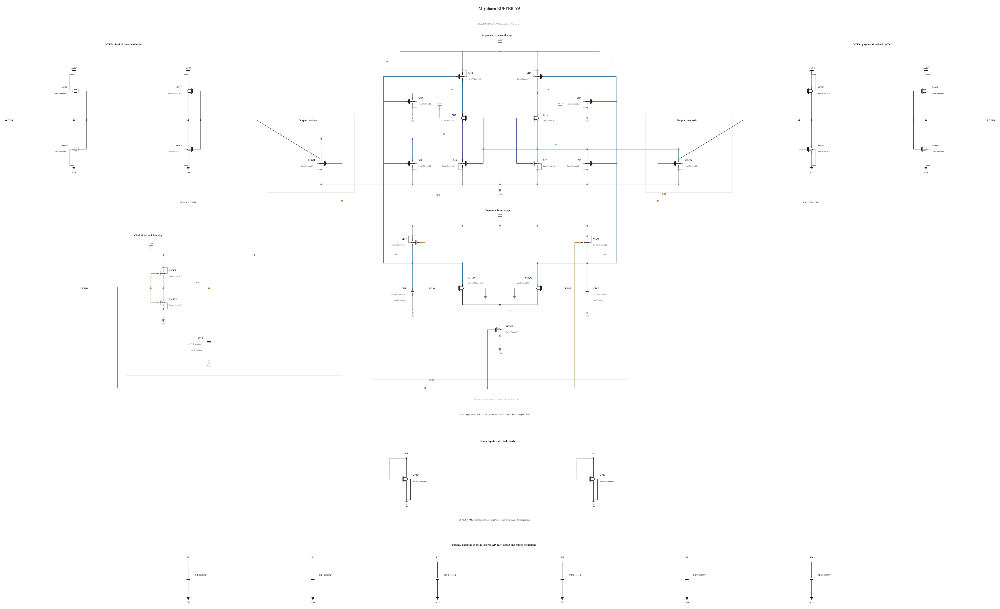

# BUFFER-V5: damp measured raw and buffer excursions

B4 removes input-drain overvoltage and gains timing margin, but its stronger N8 reset injects a negative step into RP/RN as CKB falls. The buffer transition also produces external-output overshoot during reset. This experiment reduces raw reset to N4 and the physical clock driver to P4/N2. It adds one validated 2.06055 fF MOM at each XP/XN, RP/RN and BP/BN node, the three node families with measured undershoot or excessive slew. External 10 fF loads and all testbench stimuli remain unchanged.

The capacitors and slower reset/clock edges may reduce voltage peaks while adding decision delay. The previous TT 30 mV delay of 43.714 ps provides a measured margin for this experiment; it is not inherited as a pass. All capacitances are real PDK MOM instances. No ideal clamp, latch or event capture is used.

The [independent source](BUFFER-V5.txt) contains 29 MOS and nine MOM capacitors; all geometries reuse successful warning-free callbacks. Electrical SHA-256: `ecfaae10a0ad2b33a7c5fea90bcb4fc4d00dff60662c20f1c534ce3f0b9578ad`. The complete byte-identical Spectre mirror passes RNL core 0.5.2 with 0 errors, 0 warnings and 0 hints.

The first TT, FF high/-40 C and SF low/-40 C screen checks all 87 terminal pairs throughout the trace, actual decisions/outputs, delay/reset and AVDD energy. This source-freeze commit makes no performance claim.
