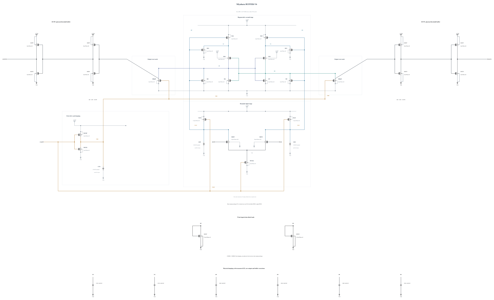

# BUFFER-V6: slower reset-clock edges and stronger buffer damping

B5 retains correct physical decisions and TT timing, but its cold-FF clock release, raw output and buffer nodes still cross below ground by 11 to 17 mV; the external output reaches 1.00833 V at reset. This experiment halves the clock driver from P4/N2 to P2/N1. The slower CKB edges are intended to reduce clock feedthrough and soften the clocked reset. XP/XN and BP/BN MOM capacitance increases from 2.06055 to 4.46051 fF; raw-node MOM capacitance remains 2.06055 fF. No other electrical change is made.

The changes consume delay and reset margin, so the first screen checks them together with terminal stress and physical output validity. All geometries reuse successful callbacks. The [independent source](BUFFER-V6.txt) has 29 MOS and nine MOM capacitors. Electrical SHA-256: `c0ac4c8d5b9dd4e9c552a20786159864e97d275efce7174e43fb89642f4924a1`. Full RNL on a byte-identical Spectre mirror passes core 0.5.2 with 0 errors, 0 warnings and 0 hints.

The first screen uses TT, FF high/-40 C and SF low/-40 C, checking all 87 terminal pairs throughout the trace, actual decisions/outputs, delay/reset and measured AVDD energy. No performance claim is made at source freeze.
