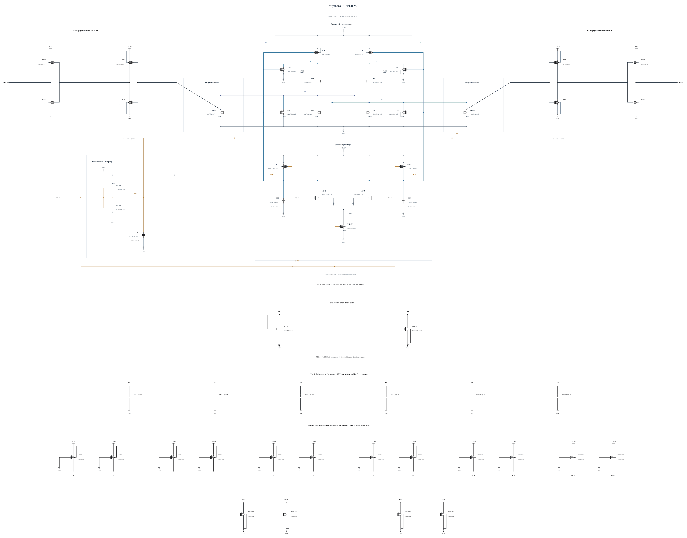

# BUFFER-V7: physical rail headroom at raw, buffer and output nodes

B6 passes clock and XP/XN stress but retains small RP/RN, BP/BN and output excursions. Timing margin is limited, so this experiment keeps B6 clock drive and all capacitances. Each raw, buffer and external output node receives two parallel P0.5 um / 100 nm devices from AVDD, with gates at VSS, to create a small physical low-level offset. Each external output also receives two parallel diode-connected N0.5 um / 500 nm loads to provide high-level headroom. Every device is explicit with m=1 and complete validated parasitics.

These are conducting MOS loads, not ideal voltage clamps. They can change logic levels, static current, regeneration, mismatch and noise. All 45 devices are included in full-trace SOA and supply-energy measurements. Output validity and reset must still meet the original thresholds; the testbench and its external loads are unchanged. All new geometries reuse successful warning-free callbacks from separately recorded experiments.

The [independent source](BUFFER-V7.txt) has 45 MOS and nine MOM capacitors. Electrical SHA-256: `84adf25419d9cc426e80a5d4fc11669679a09444c3e56f1275729e7f1fdfdad1`. Full RNL on a byte-identical Spectre mirror passes core 0.5.2 with 0 errors, 0 warnings and 0 hints.

The first TT, FF high/-40 C and SF low/-40 C screen checks all 135 MOS terminal pairs throughout the trace, actual decisions, CMP-15, delay/reset and measured AVDD energy. No earlier circuit qualification is inherited.
