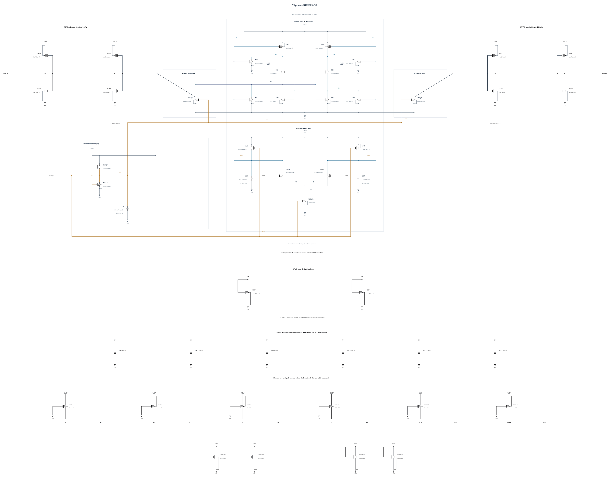

# BUFFER-V8: reduce the physical low-level pull-ups

B7 passes all 135 terminal-pair checks and physical output validity at its first three corners, but SF low/cold reset is 36.559095 ps against 35 ps. Its weak pull-ups produce about 40-56 mV output low levels and substantial DC energy. This experiment removes one of the two identical PMOS pull-ups at each RP, RN, BP, BN, OUTP and OUTN. One P0.5 um / 100 nm remains at each node; both N0.5 um / 500 nm diode loads on each external output remain. All other B7 devices and capacitances are identical.

The [independent source](BUFFER-V8.txt) has 39 MOS and nine MOM capacitors. Electrical SHA-256: `641de06f404b3c9d3837b4f2c021782942633e43b9064ca2b5169c4ebaa7c841`. Remaining geometries and complete parasitics reuse their successful zero-warning callbacks. Full RNL on a byte-identical Spectre mirror passes core 0.5.2 with 0 errors, 0 warnings and 0 hints; the rendered schematic was inspected.

The initial TT, FF high/-40 C and SF low/-40 C screen checks all 117 MOS terminal pairs throughout the trace, actual decisions, CMP-15, delay/reset and AVDD energy. Only a passing screen permits the remaining key corners. The original testbench and output-validity thresholds apply without inherited qualification.
