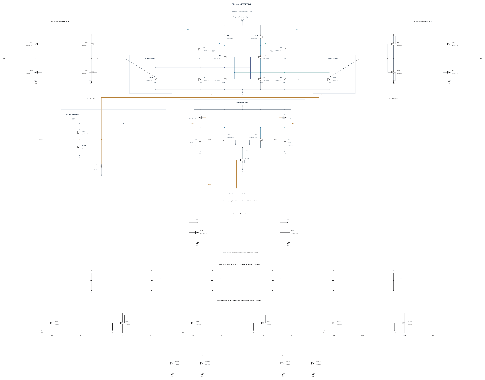

# BUFFER-V9: earlier clocked reset and input-drain recharge

B8 passes six-key-corner terminal stress and physical output validity but SS low/hot reset is 41.146991 ps. At 20 ps after the falling clock, CKB is only 0.663 V, the raw winner remains at 0.475 V, and DP is only 0.159 V, leaving the second-stage supply conducting. This experiment changes the clock PMOS P2 to P3 and direct input precharge P1.6 to P2.4. The intent is to start raw reset earlier and shut off its competing PMOS supply earlier. All physical rail-offset loads and buffer capacitances remain; no ideal gate or changed threshold is introduced. Both complete geometries reuse successful zero-warning callbacks.

The [independent source](BUFFER-V9.txt) has electrical SHA-256 `8c1e96b76b749f0d72b0be3c3f3ba4d1e1dd6cc4c3813b74074600af39df3c2f`. Full RNL on its byte-identical Spectre mirror passes core 0.5.2 with 0 errors, 0 warnings and 0 hints; the schematic was inspected.

Six key corners now include both limiting SF cases and SS low/hot, together with TT and FF high/cold/hot. Every MOS terminal pair, all physical decisions, output validity, delay/reset and AVDD energy are checked over the entire trace. The next necessary simulations also save AVDD and device branch currents so reset/evaluation energy and persistent load current can be measured. See [energy comparison](ENERGY-COMPARISON.md); no prior qualification or topology-only efficiency advantage is claimed.

## Completed screen 20261031-043914-miyahara-buffer-v9-screen

All six key corners pass full-trace terminal stress and physical output validity. SS low/hot reset improves from B8 41.146991 ps to 36.120741 ps but still fails the 35 ps limit, so this version is not expanded. SF high/27 clock stress is 0.99996 V, with little margin for further clock strengthening. TT 30 mV delay is 47.344962 ps. The next change addresses the external output discharge instead of further increasing clock drive; measured phase and rail-load energy are retained.

Actual clean source commit: `c4e366c841712025b75808520c72e9046dae18da`. Electrical SHA-256: `8c1e96b76b749f0d72b0be3c3f3ba4d1e1dd6cc4c3813b74074600af39df3c2f`. The canonical netlist and 274 official result/figure files are unchanged.

| Corner | 1 mV / 30 mV delay (ps) | Reset (ps) | AVDD (fJ/cycle) | Decided / cycles | Wrong | CMP-15 | Max stress (V) | Failed pairs |
|---|---:|---:|---:|---:|---:|---:|---:|---:|
| ff_high_125 | 50.966361 / 38.198718 | 21.550316 | 759.449881 | 36 / 36 | 0 | 0 | 0.99635 | 0 / 117 |
| ff_high_m40 | 42.995613 / 34.817816 | 19.819659 | 651.442856 | 36 / 36 | 0 | 0 | 0.99957 | 0 / 117 |
| sf_high_27 | 54.989377 / 44.777471 | 25.028001 | 626.447574 | 36 / 36 | 0 | 0 | 0.99996 | 0 / 117 |
| sf_low_m40 | 73.448133 / 57.623859 | 29.986905 | 326.220240 | 36 / 36 | 0 | 0 | 0.82262 | 0 / 117 |
| ss_low_125 | 84.162929 / 66.277669 | 36.120741 | 335.121925 | 36 / 36 | 0 | 0 | 0.81926 | 0 / 117 |
| tt_nom_27 | 58.861456 / 47.344962 | 26.429966 | 455.719327 | 36 / 36 | 0 | 0 | 0.90964 | 0 / 117 |

The entire trace, including clock edges and reset, is checked for every MOS |Vgs|, |Vgd| and |Vds|. Each job uses +aps, no explicit +mt, traponly, maxstep=0.5 ps, reltol=1e-6 and vabstol=1e-8. The observed batch peak is 3 concurrent jobs; logs report effective single-thread simulation. All raw/deck hashes were verified, and the exact owned remote run was removed with absence confirmed.

Per-device maximum over all three terminal pairs (V):

| Device | ff_high_125 | ff_high_m40 | sf_high_27 | sf_low_m40 | ss_low_125 | tt_nom_27 |
|---|---:|---:|---:|---:|---:|---:|
| MINP | 0.57704 | 0.69652 | 0.71949 | 0.60052 | 0.54079 | 0.60493 |
| MINN | 0.57710 | 0.69664 | 0.71963 | 0.60065 | 0.54079 | 0.60502 |
| MTAIL | 0.99000 | 0.99000 | 0.99000 | 0.81000 | 0.81000 | 0.90000 |
| M14 | 0.98726 | 0.99957 | 0.99459 | 0.81880 | 0.81443 | 0.90792 |
| M15 | 0.98726 | 0.99949 | 0.99461 | 0.81880 | 0.81434 | 0.90792 |
| M12 | 0.98763 | 0.99317 | 0.99339 | 0.81495 | 0.81193 | 0.90298 |
| M13 | 0.98921 | 0.99317 | 0.99339 | 0.81495 | 0.81193 | 0.90298 |
| M10 | 0.95594 | 0.97917 | 0.97399 | 0.80797 | 0.80020 | 0.89187 |
| M11 | 0.95594 | 0.97917 | 0.97399 | 0.80797 | 0.80020 | 0.89187 |
| M6 | 0.97581 | 0.99446 | 0.99453 | 0.81693 | 0.81058 | 0.90383 |
| M7 | 0.97581 | 0.99446 | 0.99453 | 0.81693 | 0.81058 | 0.90383 |
| M8 | 0.98747 | 0.99446 | 0.99453 | 0.81693 | 0.81058 | 0.90383 |
| M9 | 0.98921 | 0.99446 | 0.99453 | 0.81693 | 0.81127 | 0.90383 |
| MCKN | 0.99635 | 0.99890 | 0.99996 | 0.82262 | 0.81926 | 0.90964 |
| MCKP | 0.99000 | 0.99908 | 0.99585 | 0.81982 | 0.81592 | 0.90831 |
| MRQP | 0.99635 | 0.99890 | 0.99996 | 0.82262 | 0.81926 | 0.90964 |
| MRQN | 0.99635 | 0.99890 | 0.99996 | 0.82262 | 0.81926 | 0.90964 |
| MAP | 0.99000 | 0.99211 | 0.99105 | 0.81214 | 0.81035 | 0.90204 |
| MAN | 0.99000 | 0.99211 | 0.99105 | 0.81310 | 0.81127 | 0.90203 |
| MBPP | 0.98576 | 0.98572 | 0.98304 | 0.81043 | 0.80654 | 0.89677 |
| MBPN | 0.99208 | 0.99786 | 0.99791 | 0.82237 | 0.81557 | 0.90810 |
| MOPP | 0.95908 | 0.97470 | 0.96547 | 0.79983 | 0.79576 | 0.88668 |
| MOPN | 0.99208 | 0.99786 | 0.99791 | 0.82237 | 0.81557 | 0.90810 |
| MBNP | 0.98575 | 0.98571 | 0.98301 | 0.81043 | 0.80654 | 0.89677 |
| MBNN | 0.99208 | 0.99786 | 0.99790 | 0.82236 | 0.81556 | 0.90810 |
| MONP | 0.95908 | 0.97470 | 0.96547 | 0.79983 | 0.79576 | 0.88668 |
| MONN | 0.99208 | 0.99786 | 0.99790 | 0.82236 | 0.81556 | 0.90810 |
| MDDP | 0.98747 | 0.98546 | 0.98776 | 0.81047 | 0.80877 | 0.89782 |
| MDDN | 0.98921 | 0.98812 | 0.98864 | 0.81310 | 0.81127 | 0.90071 |
| MUPRP1 | 0.99000 | 0.99446 | 0.99453 | 0.81693 | 0.81058 | 0.90383 |
| MUPRN1 | 0.99000 | 0.99446 | 0.99453 | 0.81693 | 0.81058 | 0.90383 |
| MUPBP1 | 0.99208 | 0.99786 | 0.99791 | 0.82237 | 0.81557 | 0.90810 |
| MUPBN1 | 0.99208 | 0.99786 | 0.99790 | 0.82236 | 0.81556 | 0.90810 |
| MUPOUTP1 | 0.99000 | 0.99000 | 0.99140 | 0.82150 | 0.81125 | 0.90224 |
| MUPOUTN1 | 0.99000 | 0.99000 | 0.99140 | 0.82150 | 0.81125 | 0.90224 |
| MDNOUTP1 | 0.98041 | 0.98946 | 0.99140 | 0.82150 | 0.81125 | 0.90224 |
| MDNOUTP2 | 0.98041 | 0.98946 | 0.99140 | 0.82150 | 0.81125 | 0.90224 |
| MDNOUTN1 | 0.98042 | 0.98946 | 0.99140 | 0.82150 | 0.81125 | 0.90224 |
| MDNOUTN2 | 0.98042 | 0.98946 | 0.99140 | 0.82150 | 0.81125 | 0.90224 |

Clock charge from the mixed delay sequence is a supplemental diagnostic, not the official CMP-14 input-capacitance result. No all-corner, noise, Monte Carlo or mixed-top qualification is inferred from this screen.
