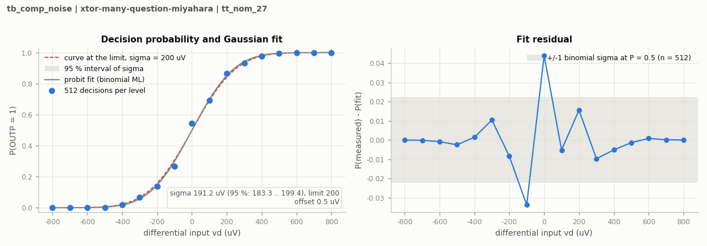
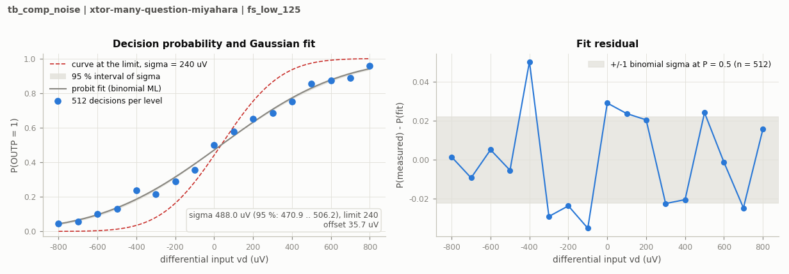

# BUFFER-V13: genuine new-source formal gates

The canonical source is electrically identical to the ten-key-corner and tight-convergence source. The existing official runner, original testbench, numerical settings, measurement and recorder are unchanged. Private screens are not adopted as official records.

## TT capacitance and kickback: pass

Run `20261031-070641-13bb-tb_comp_kickback` starts from clean source commit `d4c88fe23e96627826be3e39d56de1ba71ed01ab`. Electrical SHA-256 is `ce5b3787a38ea80eb6775686bbe1df538e8864a2deb3d5f784d67e119b6146e0`.

| Metric | Measured | Limit |
|---|---:|---:|
| Input capacitance | 19.328731218738 fF | 20 fF |
| CLKC capacitance | 9.604337628086 fF | 16 fF |
| Differential kickback | 0.001649260400 uV | 40 uV |

The [official TT result](../../../../results/adc_comp/tb_comp_kickback/xtor-many-question-miyahara/tt_nom_27.json) retains its actual clean-source metadata. The complete original run and result figures are SHA-verified in a private archive, and the exact owned remote directory is confirmed absent. Execution uses +aps without explicit +mt; logs confirm effective single-thread operation.

At the completion of this first gate one of 92 records matched B13; 91 remained stale. The prescribed original TT noise test follows below. No B12 noise, remaining-corner, Monte Carlo or mixed-top result transfers.

## TT noise: prescribed point estimate passes

Run `20261031-071236-dad5-tb_comp_noise` uses actual clean source `78ab776553b77383cb642956e43ed6ac203a3749` and the unchanged original 17 x 512 decisions, 50 GHz bandwidth and seed 1. The official estimate is **198.728193916 uV rms**, against 200 uV at TT and 240 uV for the all-corner requirement. The 95% profile-likelihood interval is 190.74–207.11 uV. Absolute systematic offset is 0.004044969093 mV. The prescribed point estimate passes; the 1.271806 uV margin is small and the interval crosses 200 uV. No robustness margin or statistically isolated repair benefit is claimed, and no seed/sample-count retry is used. B12's interval overlaps this one.

All 8704 samples are present and finite, with exactly 512 at every level and none outside the expected sequence. Minimum absolute sampled OUTP-minus-OUTN is 0.873724294294 V. Maximum absolute standardized binomial fit residual is 1.922026; the S-curve has no gross anomaly. The fit interval is conditional on the Gaussian-CDF model. Original outputstart=tstop prevents inferring full reset or MOS-stress coverage from this official noise waveform; the separate deterministic and diagnostic evidence retains its own scope.

| Input (uV) | OUTP count / 512 | Probability |
|---:|---:|---:|
| -800 | 0 / 512 | 0.00000000 |
| -700 | 0 / 512 | 0.00000000 |
| -600 | 2 / 512 | 0.00390625 |
| -500 | 3 / 512 | 0.00585938 |
| -400 | 17 / 512 | 0.03320312 |
| -300 | 24 / 512 | 0.04687500 |
| -200 | 77 / 512 | 0.15039062 |
| -100 | 136 / 512 | 0.26562500 |
| 0 | 269 / 512 | 0.52539062 |
| 100 | 341 / 512 | 0.66601562 |
| 200 | 443 / 512 | 0.86523438 |
| 300 | 476 / 512 | 0.92968750 |
| 400 | 499 / 512 | 0.97460938 |
| 500 | 508 / 512 | 0.99218750 |
| 600 | 511 / 512 | 0.99804688 |
| 700 | 512 / 512 | 1.00000000 |
| 800 | 512 / 512 | 1.00000000 |

[Official TT result](../../../../results/adc_comp/tb_comp_noise/xtor-many-question-miyahara/tt_nom_27.json) and its plot retain the original runner metadata. Raw/deck hashes are verified and the exact owned remote run is absent. Two genuine TT cases now match B13 and 90 older-source records remain stale. Next are required official noise cases at SS/low/125, FF/high/125, SF/high/125 and FS/low/125, whose private deterministic stress gates already pass. Remaining-corner stress, all required formal coverage, mismatch and mixed-top qualification remain open.

## Four required hot noise corners: fail

Run `20261031-072520-383e-tb_comp_noise` uses actual clean source `33c0e9c134b6169f570faba63572ef5c6a2c15ec`, the same B13 electrical source and the unchanged original 17 x 512 decisions, 50 GHz bandwidth and seed 1. All four required corners fail CMP-13 (240 uV). No sample, seed or fitting rule is changed. B13 qualification expansion stops; the next work diagnoses the worst FS/low/125 corner against TT before choosing a physical repair.

| Corner | Noise (uV rms) | 95% interval (uV) | Absolute offset (mV) | Min sampled output difference (V) | Max standardized residual |
|---|---:|---:|---:|---:|---:|
| ss_low_125 | 294.826930752 | 284.74–305.39 | 0.010776703 | 0.786590032 | 2.817139 |
| ff_high_125 | 302.386218452 | 292.12–313.14 | 0.019530862 | 0.952064221 | 2.935127 |
| sf_high_125 | 259.281840989 | 250.03–268.97 | 0.010832105 | 0.954018736 | 2.306044 |
| fs_low_125 | 488.025277828 | 470.89–506.25 | 0.035684639 | 0.785242521 | 2.926982 |

Each corner has all 8704 finite samples, exactly 512 per level, with none outside the expected sequence. The recorded S-curves have broad transitions; sampled outputs are resolved. This excludes missing samples as the explanation but does not identify the noisy circuit stage. The Gaussian-fit intervals are conditional on the fit model. Original outputstart=tstop does not establish reset history, full-trace stress or intermediate dynamic behavior. Those require separate physical observations.

| Input (uV) | ss_low_125 OUTP / 512 | ff_high_125 OUTP / 512 | sf_high_125 OUTP / 512 | fs_low_125 OUTP / 512 |
|---:|---:|---:|---:|---:|
| -800 | 5 | 3 | 2 | 23 |
| -700 | 0 | 2 | 0 | 29 |
| -600 | 13 | 17 | 5 | 52 |
| -500 | 23 | 22 | 16 | 67 |
| -400 | 41 | 55 | 41 | 121 |
| -300 | 62 | 51 | 43 | 111 |
| -200 | 124 | 124 | 100 | 149 |
| -100 | 167 | 157 | 154 | 182 |
| 0 | 275 | 253 | 267 | 256 |
| 100 | 311 | 309 | 320 | 295 |
| 200 | 387 | 381 | 407 | 334 |
| 300 | 421 | 415 | 438 | 350 |
| 400 | 459 | 462 | 476 | 385 |
| 500 | 494 | 485 | 495 | 437 |
| 600 | 499 | 500 | 508 | 448 |
| 700 | 504 | 502 | 510 | 455 |
| 800 | 512 | 511 | 512 | 490 |

The genuine results and their figures remain in the candidate result directory with their actual clean-source metadata. Raw/deck hashes and the private evidence archive are SHA-verified; the exact owned remote run is confirmed absent. Six of the current 96 records now match B13 (TT kickback/capacitance, TT noise and these four failed noise cases); 90 older-source records remain stale. Freshness does not imply passing. No remaining-corner, Monte Carlo or mixed-top qualification is claimed.

