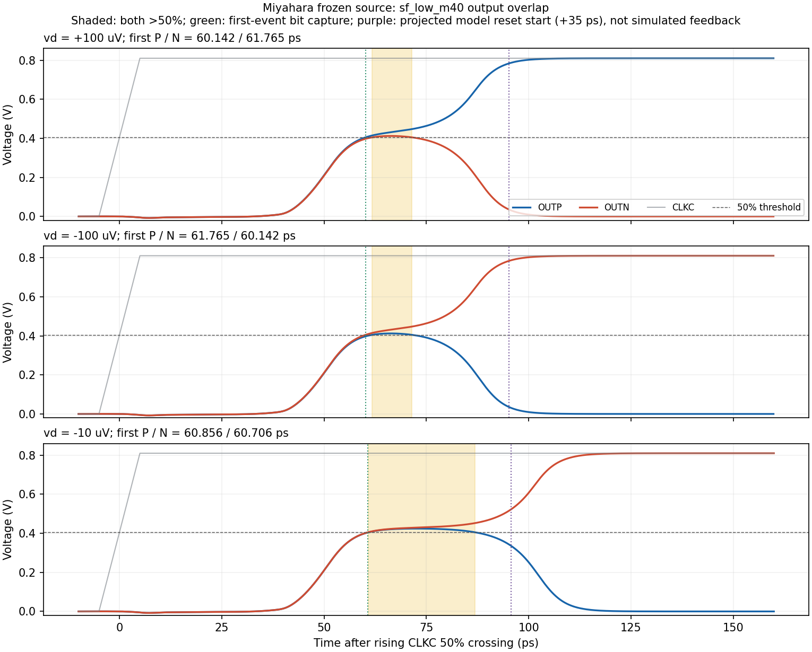

# Output overlap and SAR interface

The frozen Miyahara source has an output-overlap concern in the SF corners. This is separate from its known device-voltage failure. Existing formal metric records are retained unchanged; they do not establish the complete comparator interface. [Issue #77](https://github.com/many-question/ADC-12b-100M/issues/77) records the independently reviewed contract and measurement gap.

The [lead decision on #77](https://github.com/many-question/ADC-12b-100M/issues/77#issuecomment-6514624643) now requires a single 50% crossing and losing-output peak below 30% VDD through each evaluation interval. Its measurement implementation is pending in the main audited here (`33337c6`). The preserved overlap evidence below remains a known failure; it is not a new formal validity measurement. All 45 v0.5.0 delay records are also stale after #78. [REFRESH.md](REFRESH.md) records the combined refresh plan.

## Frozen-source repeat

The private repeat uses SF / 0.81 V / -40 C, VCM 0.49 V, the standard mixed differential sequence, 400 ps clocks, 10 fF per output and noise off. Maximum step is 0.25 ps, method traponly, reltol 1e-6 and voltage abstol 1e-8. The private run was prepared from clean source commit [85d02214e19cb0b918e2a3f5a95d393fe1821d48](https://github.com/many-question/ADC-12b-100M/commit/85d02214e19cb0b918e2a3f5a95d393fe1821d48). No device, capacitor or connection changed. Electrical SHA-256: `e8a0e3d3dc1366cd20f72c291397b352c8b9a6eeb87df618e41c49199372597a`.

The repeat has 12 intervals with both OUTP and OUTN above 0.405 V. The largest saved min(OUTP, OUTN) is 0.424097 V (0.523576 VDD). The longest linearly interpolated overlap is 26.091 ps; its enclosing-sample duration bracket is [25.750, 26.250] ps. The largest saved time interval in this run is 0.250000 ps.

The maximum occurs in cycle 18, 72.581 ps after the rising CLKC 50% crossing: OUTP = 0.424097 V, OUTN = 0.429107 V and CLKC = 0.810000 V.

The crossing estimates are interpolated between the actual saved samples. The bracket localizes the crossing times assuming no additional unsaved crossing; it does not bound solver error, continuous-waveform curvature or physical receiver uncertainty. A saved-point span is not reported as the exact duration.

| Differential input | First OUTP 50% crossing | First OUTN 50% crossing | Both-high interval | Stable 80/20 point bracket |
|---|---:|---:|---:|---:|
| +100 uV | 60.142 | 61.765 | 61.765–71.486 | [88.504, 88.711] |
| -100 uV | 61.765 | 60.142 | 61.765–71.486 | [88.504, 88.711] |
| -10 uV | 60.856 | 60.706 | 60.856–86.947 | [103.092, 103.299] |

All times in the table are ps after the rising CLKC 50% crossing. The stable point is the first saved point after the last violation of correct output >80% VDD and the opposite output <20% VDD, before the clock starts falling; the interval brackets that sampled transition. The interpolated first-crossing polarity is wrong in 0/36 cycles in this noise-off repeat, including 0 wrong cases for |vd| >= 100 uV. This is not a statistical noise or mismatch test.

The green line marks the first output event, which would latch the internal bit in the current behavioral SAR model. The purple line is only that model's projected clock-fall command at first event +35 ps for speed=1. The plotted CLKC is the independent module stimulus; feedback from SAR and CDAC was not simulated here.

## What the current receiver does

The behavioral SAR uses a threshold of 0.5 x DVDD ([line 64](https://github.com/many-question/ADC-12b-100M/blob/c8910f98d242f32d5b23afbc6bedf9de26115c22/design/behav/veriloga/adc_sarlogic_va.va#L64)). Either OUTP or OUTN rising through that threshold is accepted while waiting ([lines 105–110](https://github.com/many-question/ADC-12b-100M/blob/c8910f98d242f32d5b23afbc6bedf9de26115c22/design/behav/veriloga/adc_sarlogic_va.va#L105-L110)). The first accepted event immediately clears waiting and stores its polarity in bits ([lines 9–20](https://github.com/many-question/ADC-12b-100M/blob/c8910f98d242f32d5b23afbc6bedf9de26115c22/design/behav/veriloga/adc_sarlogic_va.va#L9-L20)); the opposite later rise is ignored. This is first-event capture, with no explicit one-hot validity check. An exact event tie has no explicit arbitration contract.

UP/DN is scheduled after speed x 30 ps and the CLKC fall command after speed x 35 ps ([parameters](https://github.com/many-question/ADC-12b-100M/blob/c8910f98d242f32d5b23afbc6bedf9de26115c22/design/behav/veriloga/adc_sarlogic_va.va#L38-L49), [scheduled updates](https://github.com/many-question/ADC-12b-100M/blob/c8910f98d242f32d5b23afbc6bedf9de26115c22/design/behav/veriloga/adc_sarlogic_va.va#L127-L129)); output transitions take 10 ps. The next comparison waits for both outputs below threshold and the DAC wait to complete ([lines 117–125](https://github.com/many-question/ADC-12b-100M/blob/c8910f98d242f32d5b23afbc6bedf9de26115c22/design/behav/veriloga/adc_sarlogic_va.va#L117-L125)). The receiver therefore does not overwrite a stored bit merely because the other output later rises, and a later falling edge does not release the next clock while the first output remains high.

The structural top connects the comparator outputs directly to SAR ([top](https://github.com/many-question/ADC-12b-100M/blob/c8910f98d242f32d5b23afbc6bedf9de26115c22/design/top/adc_top.scs#L23-L27)). The current sine bench supplies both AVDD and DVDD from the same vdd ([bench](https://github.com/many-question/ADC-12b-100M/blob/c8910f98d242f32d5b23afbc6bedf9de26115c22/tb/top/tb_top_sine.scs#L27-L30)), and beh_speed defaults to 1.0 unless overridden ([runner](https://github.com/many-question/ADC-12b-100M/blob/c8910f98d242f32d5b23afbc6bedf9de26115c22/tools/adcflow/runner.py#L163-L175)). SAR is still unselected ([specification](https://github.com/many-question/ADC-12b-100M/blob/c8910f98d242f32d5b23afbc6bedf9de26115c22/specs/blocks/adc_sarlogic.yaml#L4)), with no transistor SAR candidate in this checkout. The behavioral wrapper presents 5 fF per comparator output ([wrapper](https://github.com/many-question/ADC-12b-100M/blob/c8910f98d242f32d5b23afbc6bedf9de26115c22/design/behav/adc_sarlogic.scs#L12-L22)), whereas this independent comparator test uses 10 fF. Thus the ideal model and the module trace do not determine a future physical receiver's threshold mismatch, minimum pulse width or race behavior.

## Measurement scope and risk

The official delay extractor chooses whichever 50% output crossing occurs first and checks that polarity for |vd| >= 100 uV ([lines 43–54](https://github.com/many-question/ADC-12b-100M/blob/c8910f98d242f32d5b23afbc6bedf9de26115c22/tools/adcflow/measure/comp.py#L43-L54)). It does not fail merely because the other output also crosses. The noise test instead samples OUTP minus OUTN when CLKC falls ([noise bench](https://github.com/many-question/ADC-12b-100M/blob/c8910f98d242f32d5b23afbc6bedf9de26115c22/tb/comp/tb_comp_noise.scs#L17-L18)); its reported fit does not independently validate the first-event receiver protocol.

The comparator contract says exactly one output rises during evaluation ([contract](https://github.com/many-question/ADC-12b-100M/blob/c8910f98d242f32d5b23afbc6bedf9de26115c22/specs/blocks/adc_comp.yaml#L9-L12)). Under the 50% threshold used by the current model and metric, the observed overlap does not meet that one-rise description. The nominal noise-off first events in this module repeat have the correct polarity, and the ideal receiver ignores later rises; no incorrect closed-loop conversion is demonstrated here. Noise, mismatch or unequal receiver thresholds could change first-event ordering, and actual SAR/CDAC feedback changes both the clock and the input before the independent module trace ends. Those effects are not established by this read-only audit. The candidate stays WIP and is not interface-qualified.

The private waveform SHA-256 is `229c14859e4f2a4e28a54d72c14a4baea79dc66dbafc79fb785870ebd76fe4f0`. Frozen decks, every crossing bracket and raw evidence remain in the private archive; only this derived figure and assessment are published.
