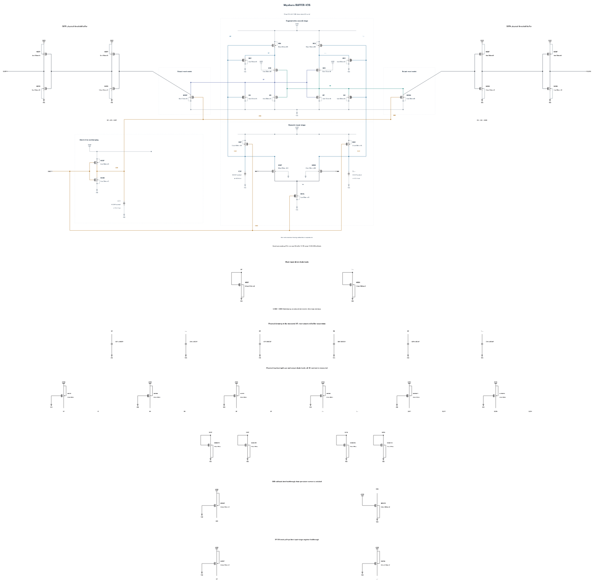

# Miyahara comparator: restored original B26

The canonical source is now the original physical **B26**, restored byte-for-byte from its two historical Git objects. [B26 restoration and evidence](RESTORATION-B26.md) records fresh full TT / FF-low-125 / FS-low-125 noise of **171.168936 / 265.467147 / 270.616353 uV rms**, all passing current limits. First-round TT delay/loading, representative device SOA, short-reset windows and numerical crosschecks also pass. Remaining full-corner tests and TT 50-sample mismatch are running; mixed-top and lead verification remain outstanding. Candidate status is **WIP, unqualified and unselected**. Historical results retain their original identities.

## Historical B20 and subsequent experiments

> Superseded raw was released. Historical audits do not imply availability; see [retained runs](EVIDENCE-RETENTION.md).

Canonical **B20 fails the merged adc_comp 0.8.0 official FS/low/125 noise test at 343.4944014285115 uV rms against 240 uV**. The original 17 x 512 decisions are retained, with a model-conditional 95% profile interval of 332.03 to 355.53 uV. [FORMAL-SPEC08](FORMAL-SPEC08.md) links the genuine committed result and figure. At the recorded 0.8 checkpoint, dependency coverage was 1 fresh / 96 records; this is not a current 0.9 freshness count. This candidate remains WIP, unqualified and unselected.

The independent [B22 experiment](BUFFER-V22.md) passes five merged-baseline deterministic corners and four tighter repeats: all 180/144 actual decisions and resets, output validity and all 129 unrounded MOS terminal pairs. Its stronger CKB pull-up repairs B21's SS reset failure to 34.071442458944574 ps at baseline and 33.30087103116152 ps tighter. However, its complete FS/low/125 noise test **also fails at 342.51175741522553 uV rms** (331.11 to 354.49 uV). B22 qualification expansion stops; B22 TT noise remains untested and B22 is not promoted. Further circuit design continues, preserving every failure.

The canonical source contains 43 MOS devices and nine physical MOM capacitors. All dimensions and terminal parasitics come from successful callbacks or exact verified geometry reuse. Physical rail loads carry persistent current. [ENERGY-COMPARISON](ENERGY-COMPARISON.md) and the later private reports retain whole-cycle AVDD measurements; energy is report-only.

The historical B20 drawing is [preserved at its published commit](https://raw.githubusercontent.com/many-question/ADC-12b-100M/2579cdf3c91b81599ca5f9f74a1744495ddfc1ea/design/xtor/adc_comp/many-question-miyahara/schematic.png).

[NUMERICS-94](NUMERICS-94.md) retains the numerical migration and every private gate. PR #95 is merged at c6152d236e525793ecc4809b9a6c9dfb9fd0ad77, with comp 0.8.0 and exact ADCToolbox commit cd72061ff3b7a977163dac540da126ae22f5e38d. The runtime passes the #96 self-check at 79.999999999274 dB. New evidence uses APS and actual conservative settings, without explicit maxstep or method. No old or private result is relabeled as formal.

Earlier private B20 TT noise is 191.43800312001045 uV rms; it is not a new formal TT result. Its separate tighter TT capacitance measurements are 19.328731218738323 fF per input and 11.288471705097978 fF for CLKC. The specified net differential change after evaluation plus reset is 8.49919999830473e-05 uV, within numerical drift. Instantaneous differential disturbance reaches 25.237840952966987 uV during evaluation and common-mode excursion reaches 7.4257336460090695 mV. These instantaneous values are distinct from the net metric and are not compared to its 40 uV limit. Actual-CDAC validation must check decision-phase differential and common-mode disturbance.

[B21](BUFFER-V21.md) retains its SS reset failure at 35.42069219051348 ps. [B20 promotion proof](PROMOTION-BUFFER-V20.md), [historical baseline](BASELINE-BEFORE-BUFFER-V20.md) and [old-setting original runs](FORMAL-BUFFER-V20.md) preserve earlier sources, records and verified archives. Historical figures use byte-verified fixed published links where duplicate local PNGs were removed. No failure or stale record is discarded.

Issues #40/#63/#69/#75/#77/#78/#84/#100 remain acknowledged. The branch includes main f1ac9a5's site-only fix; comparator tools, testbenches and specifications are unchanged by this candidate. Remaining corners, full formal coverage, 50-sample mismatch, operating range, mixed-top regression and lead review remain open.

[Artificial B22 source diagnostics](NOISE-SOURCE-DIAGNOSTICS-B22.md) retain input-pair and regenerative-stage trials plus the completed subgroup split. Front-driver noise suppression gives 314.50354475961876 uV rms; latch/DP-device suppression gives 281.27833319310434 uV rms, each with all 17 x 512 decisions and unchanged physical source. These artificial widths cannot be variance-subtracted into independent contributions and are ineligible for qualification; full physical B22 noise remains the failed 342.51175741522553 uV rms result.

[B23](BUFFER-V23.md) fails TT 30 mV delay (50.1497 ps) and SS/FS low-hot reset (46.1394/35.6926 ps). All 180 actual/reset cycles and 129 terminal pairs per corner pass; the timing failures stop noise expansion. Its dedicated Cin/CLK values are 19.3287/12.1051 fF. The retained path comparison identifies delayed RP/RN reset after stage scaling; no B23 noise improvement or promotion is claimed.

[B24](BUFFER-V24.md) repairs low-hot reset with N8 assists and eight-finger RP/RN MOMs but strictly fails TT 30 mV delay at 50.00497745635165 ps; no B24 noise result exists.

Independent [B25](BUFFER-V25.md), with N2.6 first-buffer pull-downs and 44-finger buffer-node MOMs, passes five baseline deterministic corners: 180 actual/reset cycles and all 129 terminal pairs per corner. TT 30 mV delay is 48.65231181041175 ps, SS hot reset is 32.64727688136176 ps, and the narrowest stress margin is 424.92663561322087 uV. Dedicated TT Cin/CLKC are 19.328731218738323/12.105047338129033 fF. **Tighter FS/high/-40 fails twice with SPECTRE-16929 at 137.816 ps**, with identical source/TB/numerics and normalized decks. Both failed runs and partial traces remain archived; no complete tighter gate or B25 noise result exists, and noise expansion is held.

Independent [B26](BUFFER-V26.md) increases BP/BN MOMs from 44 to 48 fingers and passes five baseline/four tighter deterministic corners plus TT loading. **Full physical FS/low/125 noise remains a failure at 270.61635250554104 uV rms [261.07, 280.6] against 240 uV**, with every 17 x 512 decision retained. Qualification expansion stops; canonical B20 and the genuine formal failure remain unchanged.

Independent [B27](BUFFER-V27.md) weakens only M8/M9 N4 to N2 to test earlier latch release. Five baseline corners and TT capacitance pass; TT 30 mV delay is 47.5707 ps. **Tighter FS/high/-40 fails with SPECTRE-16929 at 137.149 ps**; four planned corners never started. The complete failure is retained, no B27 noise test follows, and B26's physical noise failure remains unchanged.

Independent [BUFFER-V28](BUFFER-V28.md): original baseline recovered; see the report for measured failures and remaining gates.

## Current 1.1 V restoration work

The branch now includes main `17b3a0c` (adc_comp 0.9.0). Issue #116 is acknowledged: delay and kickback require fresh dependency evidence after their explicit save-policy change. The project terminal-voltage limit is 1.1 V at all corners; historical 1.0 V screening failures are retained as historical diagnostics and are not current rejection criteria.

Historical B2 restoration passes five representative deterministic corners and TT loading, and passes full physical TT noise at 186.695494 uV rms. **FS/low/125 noise fails at 469.460077 uV rms against 240 uV.** Full-corner and mismatch expansion stops for this source. [Restoration evidence](RESTORATION-11.md) retains unrounded intervals, provenance, archive checks and measured runtime. Canonical source and formal results remain unchanged.

[Secondary historical r0t3c1 screening](RESTORATION-SECONDARY.md) fails CMP-15 in 24 TT cycles and stops before noise expansion. [B2 mechanism analysis](RESTORATION-MECHANISM.md) compares retained front-stage and regenerative trajectories and proposes isolated physical changes while preserving output buffers; individual device-noise contributions remain unmeasured.

[Isolated physical trials](RESTORATION-TRIALS.md) pass five representative deterministic corners and TT loading, but fail full FS noise: B2-C52 gives 463.74178616731064 uV rms, B2-P5 gives 395.8138409185866 uV rms, and the bounded second PMOS step B2-P6 gives 357.532354035666 uV rms against 240 uV. P6 improves 23.8% from B2 and 9.7% from P5, with a 3.43% TT energy increase from B2, but remains unqualified. All three stop before TT noise and further qualification expansion. Each retains its own callback-verified frozen source; the capacitor and PMOS changes are never combined.

[P6-N075 isolated transfer-width trial](RESTORATION-N075.md) retains its separate evidence.
