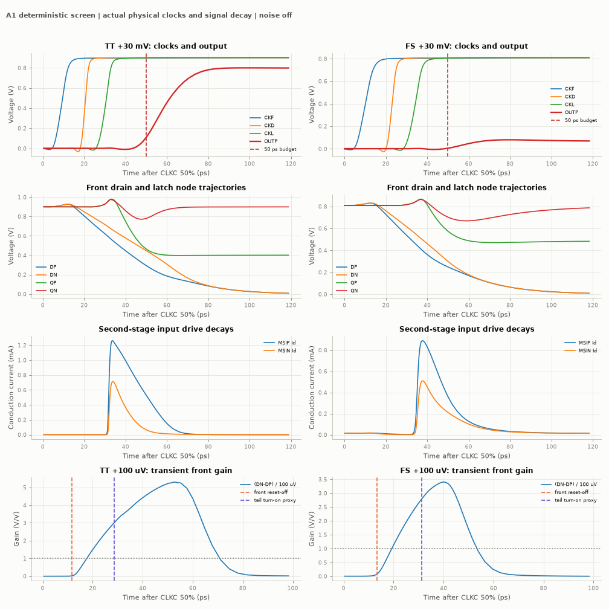

# A1 first deterministic screen — stop gate reached

A1 fails the initial timing and decision gates. No further corners, common-mode endpoints, noise or mismatch were run. The physical circuit, complete RNL, three self-reported result records and their evidence figures are retained for review. Status remains `wip`, not eligible.

The frozen source was committed as `3e1cc051bff23c53a3924698146a940d936114d6`. Raw source SHA256: `7b7704805d581c7733a4f2bdf7ea81649cd6ca8aa00d14e27f4d608f5c3a8ffc`. It contains 40 MOS and 10 MOM devices. Each distinct device geometry was regenerated by a successful callback; nominal MOM capacitance is 76.3015 fF per front drain. The 50 placed devices have explicit pin wires, exact net labels, orientation, matched-pair semantics and functional groups. The source was not tuned after viewing the results.

## Recorded results

Only the official TT and FS 36-cycle `tb_comp_delay` stimuli and TT `tb_comp_kickback` were used. All three Spectre jobs completed without errors in APS with the current conservative numerics. Added saves are explicit output diagnostics only; stimuli, numerical settings and official measurement code were not changed.

| Measurement | TT | FS |
|---|---:|---:|
| Decisions completed / 36 | 8 / 36 | 4 / 36 |
| Correct decided amplitudes | ±100 mV, ±30 mV | ±100 mV |
| CMP-09 wrong or missing decisions, absolute vd≥100 µV | 20 | 24 |
| CMP-06 30 mV mean delay | **59.9852234803 ps, FAIL** | No decision; no delay value |
| 1 mV delay / regeneration fit | Missing, FAIL | Missing, FAIL |
| Maximum measured output reset time | 20.6034994436 ps | 20.0389140300 ps |
| CMP-15 validity violations | 0 | 0 |
| Worst losing-output peak | 0.394416% VDD | 0.276968% VDD |
| Average AVDD energy / comparison | 420.94059408 fJ | 394.610666868 fJ |
| Exact maximum terminal voltage | 0.9951685283505293 V | 0.8666201665482614 V |

CMP-15 excludes cycles in which neither output crosses the decision threshold. Thus its zero count is compatible with severe missing-decision failures and cannot be advertised as 36 valid decisions. All 36 cycles have both outputs below 10% VDD in the reset interval, but an already-low output in an undecided cycle is not evidence of successful comparison or unusually fast reset. No failed cycle was removed from the official metrics. The maximum saved step within evaluation intervals was 17.7055 ps at TT and 19.2273 ps at FS; official validity checks every saved point.

TT loading gives Cin = **19.0659664077 fF/input**, CLKC charge capacitance = **11.8130755138 fF** (official limits 20 and 16 fF). The official differential kickback estimator returns 0.0000884453 µV; this is below the documented numerical floor and is not a claim of physical sub-nanovolt kickback. The loading stimulus does not demonstrate decision correctness. SOA was also checked on both comparator instances in that test: 240 pairs, maximum **0.9957659463281836 V**. The delay tests each check all 120 pairs of the 40 MOS devices. All tested pairs are below 1.1 V; untested corners remain open.

Energy has no acceptance ceiling. These values do not imply useful energy efficiency when most decisions are missing. The 0.3–0.8 pJ planning range was not turned into a specification.

## Where the time went

The following are measured 50% crossings after external CLKC 50% for representative +30 mV cycle 3. For inverting stages, “evaluate” is the falling transition. Reset-path values are relative to external CLKC falling 50%.

| Physical node | TT evaluate / reset, ps | FS evaluate / reset, ps |
|---|---:|---:|
| CKB | 4.6311 / 3.5233 | 4.3472 / 4.4578 |
| CKF | 9.2260 / 8.5409 | 10.1814 / 9.4587 |
| D1 | 12.4012 / 11.3274 | 13.3304 / 13.2664 |
| D2 | 14.6217 / 14.1979 | 16.2874 / 16.1560 |
| D3 | 18.3103 / 17.1174 | 20.0540 / 19.9626 |
| CKD | 20.5024 / 19.7479 | 23.0461 / 22.6160 |
| CKLB | 26.4811 / 5.4688 | 28.9926 / 6.7835 |
| CKL | 30.4355 / 9.5491 | 34.2834 / 10.8334 |

At TT, the front reset is effectively off at 11.9 ps, the latch-tail turn-on proxy occurs at 28.6 ps, and the second-stage reset reaches its 1% criterion at 32.6 ps. The expected core node falls through 50% VDD at 51.0712 ps and OUTP crosses 50% at 59.8945 ps. Thus CKL-to-output adds **29.4590 ps**, including **8.8233 ps** from core 50% to output 50%. Even that single representative 30 mV cycle fails the 50 ps budget; the four-cycle mean is 59.9852 ps. A fixed ideal 20 ps clock delay was neither assumed nor substituted.

At FS, front reset-off is 13.5 ps, the tail proxy is 31.3 ps, and second-stage reset-off is 38.2 ps. There is no expected core or output 50% crossing at 30 mV. The core minimum is 0.47061 V and the output peak is only 0.07987 V, below the 0.405 V decision threshold.

Reset-off is a stated operational criterion, not literal zero leakage: summed absolute reset conduction current ≤1% of the corresponding branch/tail current, nonpositive |Vgs|−|Vth|, and branch/tail current above 1 µA. The calculation uses a 0.1 ps interpolated grid. For the representative cycle, tightening front reset to 0.1% shifts release to TT12.7/FS14.8 ps; second-stage 0.1% release occurs at TT34.2 ps but is never reached at FS before CLKC falls. A1 therefore does not establish a perfectly isolated integration phase.

The tail proxy requires both physical tail gate overdrives ≥0 and current greater than the current at external CLKC rise plus 1% of the cycle peak. It is not an exact regeneration-onset estimate. The off-state second-tail current is already 1.40 µA at TT and 29.51 µA at FS for this cycle; using 1% of peak current alone would falsely label the FS tail “on” at time zero.

## Gain exists, but the second stage loses its drive

At +100 µV cycle 13, the interval from 1% front reset-off to the tail proxy is 16.8 ps at TT and 17.9 ps at FS. The input ∫gm is 392.354/380.203 fF; branch-current means are 1.524/1.688 mA. Front gain at the interval end is 3.007/2.794, with positive input saturation margins of at least 378/150 mV. The portions with gain≥1, gm>1 mS and positive saturation margin last approximately 10.96/11.88 ps. This shows a useful transient front-gain interval; it does not prove noise feasibility or successful two-stage regeneration.

The front common mode falls from 0.9263 to 0.6912 V at TT and 0.8289 to 0.5546 V at FS over those intervals. A diagonal capacitance proxy (MOM + input cdd + reset cdd + second-input cgg) is about 106.69–106.86 fF at TT and 107.69–107.95 fF at FS. Total terminal capacitances already include junction terms; capbd/capbs were not added again. Coupled capacitances and internal series nodes are not reduced by this proxy.

At FS +30 mV, D common mode is 0.5052 V at CKL 50%, 0.4114 V at 40 ps, 0.1742 V at 60 ps and 0.0649 V at 80 ps. The second positive input branch initially reaches about 0.83 mA at 40 ps, but falls to 0.127 mA at 60 ps and 0.0323 mA at 80 ps. Its gate overdrive is negative by 80 ps. Both second-input Vds−Vdsat margins can remain positive while their gate drive disappears; saturation margin alone is therefore not a sufficient capability check. The front differential gain also collapses. The observed trajectory is consistent with the delayed, conductively fed second latch failing to finish discharging its winning node before the first-stage drive decays. No counterfactual circuit was simulated to assign unique causality.

At the end of evaluation, TT +100 µV outputs are only 8.70/6.38 mV and FS outputs 7.42/6.97 mV. They are missing decisions, not hidden correct small-signal decisions.

Gate-only interstage connection still allows capacitive feedback. Around CKL, the +30 mV front-node changes over the window CKL−1 to CKL+5 ps are TT DP−109.61/DN−87.33 mV and FS DP−104.88/DN−94.78 mV. Most of this is ongoing integration. Relative to a linear continuation of the CKL−3 to CKL−1 ps slope, the residuals are TT−2.98/−8.54 mV and FS+4.27/−5.20 mV. These are temporal diagnostics, **not isolated reverse-kickback measurements**: the one trajectory cannot separate normal current/headroom changes from capacitive feedback. The external official kickback test is reported separately above.

## Validation and evidence custody

The stage source passes ports, candidate-content and complete RNL checks (0 errors, 0 warnings). Local `adcflow check all` returns zero errors and 278 result warnings, including this candidate's failed metrics above and warnings on pre-existing evidence. The three new records are fresh; a successful structural check does not mean the measured specifications pass. `pytest -q -m "not slow"` passed **458 tests**, with one deselected. Candidate path/author checks and PR CI are reported with the PR.

The source and official test dependency hashes are recorded with each result; additional diagnostic saves are described in metadata. Raw model files, logs, waveforms and machine details are excluded from Git. Two immutable private archives passed CRC and per-member SHA verification, and both owned remote run directories were removed and confirmed absent. Archive hashes:

- TT/FS: `2257583a8dcbf610a9bf56e30fa7e153e4fc1161fe8cb31937dad0482aec520d`.
- TT loading: `df8e39c41a6aeb17e09f649a4bec7e2960e8e39c96a1f34b2cf5addeb290f4d5`.

All original StrongARM and Miyahara evidence remains at the immutable commits linked in README. No formal specifications or other candidates were modified. Exactly three jobs were run for this revision. No parameter grid, ideal-clock workaround, noise run or expansion followed the failed gate.

