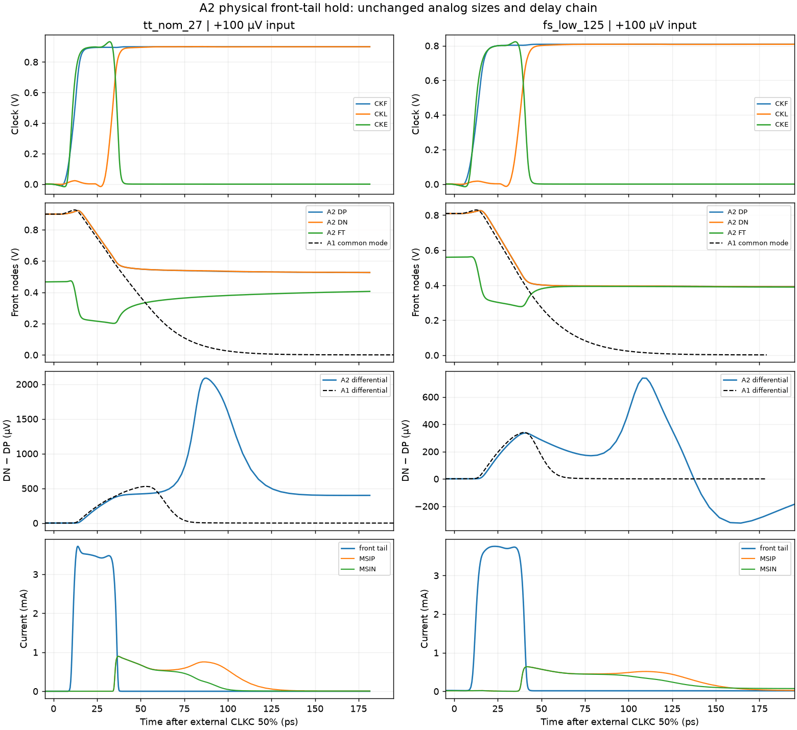

# A2 physical front-tail hold — decisions restored, TT timing still fails

Exactly two official noise-off 36-cycle delay jobs were run, at TT and FS. Both complete all 36 decisions correctly, versus A1's 8/36 and 4/36. **TT 30 mV mean delay is 56.7251 ps, above 50 ps.** This is useful mechanism evidence, not qualification. No loading, noise, mismatch, further corners or shorter clock variant was run. The old TT loading record belongs to A1 and is stale for this source.

## Frozen physical change

A2 adds one four-MOS NOR2: CKE = NOT(CKB OR CKL), with N4 parallel pulldowns and P8 series pullups, all L30nm. Only MFT1/MFT2 gates move from CKF to CKE. MRDP/MRDN stay on CKF, so ending integration does not precharge and erase the front signal. All existing analog geometries, MOMs, four delay inverters, second latch and output buffers are unchanged; a device-by-device assertion checks this. N4/P8 callbacks were rerun successfully and exactly match the previous geometry values. There are now 44 MOS and 10 MOM devices, all with explicit RNL placement, orientation, pin wires and net labels.

Source stage commit: `66c13ca91b8b0eaaf2471574162d38eb8bef147a`. Source SHA256: `92d1ff4ebf092f2774f8b80291daa8480ef114580dae23feb9d4220ae78980cb`. Electrical SHA256: `0a2d9eac4e2760f103f6ffa6dd5babbe9c0b4a8e2f250ecf404934221d9d4e77`. [A1 remains frozen at d948f9af](https://github.com/many-question/ADC-12b-100M/tree/d948f9af607cb669d18d37c2175624e726b4f7e3/design/xtor/adc_comp/many-question-splitstage); its electrical hash differs. No tuning followed these two jobs.

| Stable phase | CKB | CKL | CKE | Front reset |
|---|---:|---:|---:|---|
| Reset | 1 | 0 | 0 | On through low CKF |
| Integrate | 0 | 0 | 1 | Off after CKF rises |
| Hold / regenerate | 0 | 1 | 0 | Stays off through high CKF |

On return to reset, CKB must rise before CKL falls to avoid a second CKE pulse. On evaluation, physical NOR delay and reset-release overlap must be measured. Neither follows from the stable truth table alone.

## Official measurements

| Metric | TT | FS |
|---|---:|---:|
| Correct decisions / 36, including ±10/30 µV | 36/36 | 36/36 |
| CMP-09 wrong or missing decisions | 0 | 0 |
| 30 mV mean delay | **56.7251023 ps, FAIL** | 69.5463277 ps |
| 1 mV delay | 70.4111391 ps | 91.9984518 ps |
| Regeneration fit | 4.7592882 ps | 7.4037225 ps |
| Maximum output reset time | 21.6168540 ps | 24.0876952 ps |
| CMP-15 violations | 0 | 0 |
| Losing-output peak | 22.8994% VDD | 15.8337% VDD |
| Energy/comparison, reported only | 346.824112 fJ | 375.656392 fJ |
| Maximum exact terminal voltage | 0.9951807461 V | 0.8617235537 V |

All 132 specified terminal pairs of the 44 MOS devices pass 1.1 V in each tested corner. All 36 outputs return below 10% VDD during reset. Unlike A1, zero CMP-15 violations accompanies 36 actual decisions; no undecided cycle is hidden. Deterministic small-input correctness does not establish noisy error probability or mismatch performance. FS 30 mV delay is reported for diagnosis; the 50 ps CMP-06 requirement applies at TT.

## Actual clocks and continuing second-stage drive

For representative +30 mV cycle 3, times are relative to external CLKC 50%:

| Event | TT, ps | FS, ps |
|---|---:|---:|
| CKB falling 50% | 6.446 | 6.169 |
| CKE rising 50% | 10.693 | 11.960 |
| CKF rising 50% | 11.899 | 13.105 |
| Front reset-off, stated 1% current criterion | 14.1 | 15.8 |
| CKD rising 50% | 23.210 | 25.968 |
| CKL rising 50% | 33.568 | 37.739 |
| Second reset-off, 1% criterion | 36.0 | 42.1 |
| CKE falling 50% / 10% | 36.576 / 38.321 | 40.639 / 42.785 |
| Expected core falling 50% | 50.803 | 59.089 |
| Expected output rising 50% | 56.717 | 69.528 |

The complete delay-chain crossings are retained in the audit. NOR loading shifts CKL later than A1's 30.436/34.283 ps. CKE also starts rising before front reset fully releases; the circuit is not an ideal non-overlapping integrator. The reset-off and tail-on operational criteria retain the definitions in A1-SCREEN; reaching Vgs≈Vth is not treated as zero current.

In the first 100 ps after each CLKC fall, the maximum CKE excursion across all cycles is only TT19.115/FS20.293 mV; no half-supply re-enable pulse occurs. Front-tail reset-interval current peaks are TT0.668/FS21.755 µA. These are measured currents, not assumed zero leakage.

The second latch's winning pulldown still passes through its input transistor and tail. Preserving front common mode therefore maintains a usable current path. For +100 µV, starting 10 ps after CKE falls below 10%, both second inputs retain positive overdrive through the end of evaluation: minimum TT0.2069 V and FS0.1627 V. Correct output crossing occurs at TT81.192/FS109.283 ps. At FS100ps the two second-branch currents are approximately 487/398 µA, versus the loss of drive in A1.

## Hold is finite and differential retention is imperfect

Use +100 µV cycle 13, with “stable hold” defined as CKE falling 10% plus 10 ps through the end of evaluation (~200 ps). This excludes the main switching transient but does not assert settling or ideal isolation.

| Observed stable-hold quantity | TT | FS |
|---|---:|---:|
| Interval start | 48.324 ps | 52.795 ps |
| Front-tail conduction current range | 0.303–0.434 µA | 14.081–14.391 µA |
| Front common mode, start → end | 0.55014 → 0.52575 V | 0.39954 → 0.39113 V |
| FT, start → end | 0.32225 → 0.40964 V | 0.38472 → 0.38898 V |
| DN−DP, start → end | 418.54 → 400.02 µV | 267.99 → **−163.45 µV** |
| Front diagonal capacitance proxy | 108.32–108.77 fF | 109.66–110.15 fF |

The FS front differential reverses after the latch has already selected the correct output, which remains valid. Around regeneration, both TT and FS differential traces show substantial feedback excursions. Thus A2 preserves common mode sufficiently for this deterministic latch to finish; it does not provide a faithful, isolated differential sample. TT40ps front-tail current is only 0.328 µA while each front input still conducts about 298 µA as FT redistributes charge. Equating tail shutoff with immediate front-input shutoff would be incorrect.

The transition window (CKE50−5ps through CKE10+10ps) includes continuing integration and feedthrough: TT common mode falls 0.66725→0.55014 V while FT rises 0.20592→0.32225 V; FS common mode falls 0.51443→0.39954 V while FT rises 0.28109→0.38472 V. These changes are not uniquely assignable to switch injection.

## Charge conservation and numerical limits

Saved terminal currents provide complete DP/DN cutsets: front-input drain + front-reset drain + second-input gate + all five MOM terminals. FT uses both front-input source terminals and both front-tail drain terminals. Positive charge below leaves the node into the named branch. For FS +100 µV stable hold, in fC:

| Node | Front input | Front reset | Second input gate | MOM | Sum |
|---|---:|---:|---:|---:|---:|
| DP | +0.933643 | −0.750789 | +0.433212 | −0.616066 | approximately 0 |
| DN | +0.955972 | −0.753525 | +0.446112 | −0.648559 | approximately 0 |

The interpolated-current KCL integral residual is below 2e−15 fC for these cutsets and FT; this verifies branch accounting, **not physical accuracy at that scale**. Decimating saved points by two changes each MOM integral by about 0.014–0.015 fC (roughly 0.18–0.20 mV using the nominal MOM capacitance), so such near-zero KCL residuals must not be interpreted as integration uncertainty. Correlated DP/DN errors may cancel, but no certified differential error bound is asserted.

The observed diagonal C range times each voltage change gives −0.899…−0.903 fC for DP and −0.946…−0.950 fC for DN. Those proxies omit the capacitance matrix and mutual-node motion and **are not rigorous total-charge bounds**; actual MOM branch integrals and measured terminal-current balance are reported separately. The input-terminal-minus-ids charge also includes displacement and other model-current terms; calling it pure NOR injection would overstate causality. The earlier 22 nA/72 µA paper budgets are references, not acceptance thresholds.

## Scope, data size and next decision

The full-MOS current/OP save set was unnecessarily broad: 665 saved value signals produced TT271.66/FS255.00 MB ASCII files. A [minimal explicit save list](A2-MINIMAL-SAVES.txt) retains all required SOA voltages and only the consumed front/tail/reset/second-input diagnostics and DP/DN/FT cutset currents. It retains 110 value signals including time; byte-counting the actual retained VALUE records estimates TT43.47/FS40.80 MB at the same sample grid, about 84% smaller. Official supply energy continues to come from the unchanged AVDD meter's `power.txt`. Future step counts and compressed size are not guaranteed. No rerun was made to change saves.

Both jobs completed with zero simulator errors. A download-size limit was recovered by fetching the existing files; no new solver was dispatched. The raw archive passed CRC and every member's SHA256 check: `53d8e34866b2687e8d1f390ae621d9875d78a1d07511199d37a701392f76cfe9`. Both jobs share one owned run directory, which was removed and confirmed absent. After analysis and archiving, only the two exact expanded transient-waveform copies are removed; source, reports and archive remain.

TT still needs 6.725 ps improvement at 30 mV. Its representative timing is CKL33.568 + core17.235 + buffer5.914 ps. A possible next independent variant would remove the first two delay inverters and feed the existing third inverter from CKF, preserving the last small-to-large stage loading and every analog size. The old CKF→D2 delay is only TT5.429/FS6.104 ps; subtracting it alone predicts approximately TT51.30 ps, still failing, and a shorter integration window can change core resolution. This is a smallest phase-change experiment for review, not a predicted fix or a dispatched job. Loading, noise and any further phase change require their own scope and evidence.
