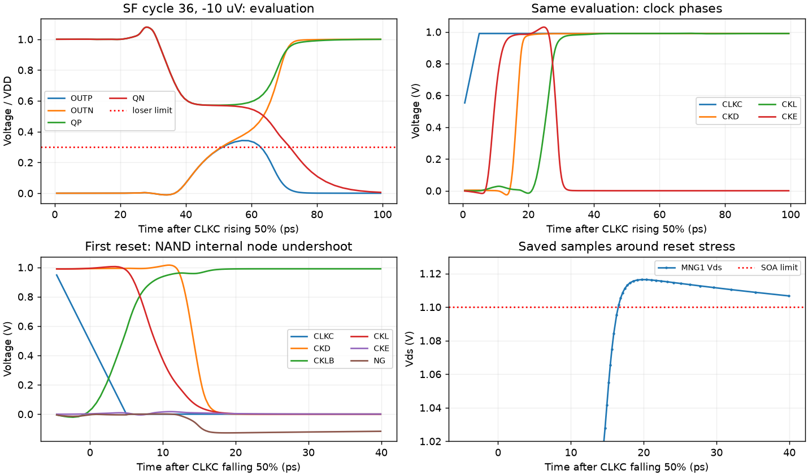

# A3 representative-corner gate: FAIL

The next bounded screen failed at SF high voltage, -40 C: CMP-15 has eight violations and MNG1 Vds reaches 1.1163759644 V against 1.1 V. Common-mode endpoints and all noise tests were therefore not dispatched. The candidate remains `wip` and is not qualified. No electrical change was made after the initial A3 screen.

Source SHA-256: `a7acfa26274ee3fda43bc6f6908afdf970f025ad49a979a989e84e9162d3cb5b`. Source stage: `6425c36bf294725b8bc3d0ec224b18e7c8170340`. The four jobs comprise three official noise-off delay corners and one private TT numerical diagnostic. All completed with simulator RC 0; solver completion does not imply specification acceptance.

| Measurement | SS low 125 C | FF high -40 C | SF high -40 C | TT tighter diagnostic |
|---|---:|---:|---:|---:|
| Correct/reset decisions | 36/36 | 36/36 | 36/36 | 36/36 |
| 30 mV delay, ps | 67.650264 | 37.290573 | 42.728112 | 49.523328 |
| 1 mV delay, ps | 85.313548 | 45.731754 | 51.124424 | 61.601803 |
| Regeneration tau, ps | 5.999427 | 3.039279 | 2.711117 | 4.357347 |
| Reset, ps | 28.093750 | 17.211103 | 19.334811 | 21.301432 |
| CMP-09 wrong decisions | 0 | 0 | 0 | 0 |
| CMP-15 violations | 0 | 0 | **8** | 0 |
| Loser peak, % VDD | 24.626076 | 28.011994 | **34.219536** | 27.670720 |
| Exact maximum terminal stress, V | 0.874075 | 1.092528 | **1.116376** | 0.992365 |
| Mean mixed-sequence energy, fJ | 282.283861 | 387.724403 | 348.574276 | 318.073000 |

The 50 ps delay limit applies at TT; the other corner delays are reported without applying that TT-only limit. CMP-10 energy is reporting only. Full 40-device terminal coverage was retained. All four jobs have no front differential reversal before the expected decision; this does not excuse either SF failure. Official SS/FF/SF records and figures are in the candidate results directory. Existing primary TT remains unchanged.

## Two distinct failure phases

At SF, VDD is 0.99 V. Cycles 15/16/33/34 (input +/-30 uV) have loser peaks approximately 31.7666% VDD at 56.212 ps after the CLKC rising midpoint. Cycles 17/18/35/36 (+/-10 uV) reach approximately 34.2195% at 57.127 ps. Positive inputs lose on OUTN; negative inputs lose on OUTP. The intended winner still decides first and no cycle has both outputs decided.

In cycle 36, losing OUTP peaks at 0.338773 V while QP/QN are 0.574233/0.554736 V; DN-DP is -150.002 uV. The expected OUTN crosses 50% at 63.604660 ps. CKL is 0.989997 V, CKLB 66.405 uV, NG 33.306 uV and CKE 99.275 uV at the loser peak. Thus the clock is already settled: both latch cores have fallen enough for the output inverters to respond before regeneration separates them. This observation supports an output transfer/common-mode mechanism, rather than a coincident clock edge; it is not a measured transistor-current attribution.

The SOA event occurs during reset, in all 36 cycles. At the largest peak, 0.324756512 ns (19.756512 ps after the first CLKC falling midpoint), CKLB=0.989202326 V and NG=-0.127173638 V. MNG1 connects `(CKLB CLKC NG VSS)`, so its Vds is 1.116375964 V although CKLB itself is below VDD. CLKC=0 V, CKD=0.000797788 V, CKL=0.003504448 V, CKE=0.003703562 V and MNG1 Vgs=0.127173638 V. The waveform is consistent with negative injection into the internal NAND node as the delayed bottom-gate CKD falls after the top device has turned off.

This is not a single saved-point spike: the first over-limit segment contains 24 saved points spanning 35.427557 ps. The peak's neighboring Vds values are 1.116122256 and 1.116328818 V, separated from the peak by 0.646719 and 0.642655 ps. No limit or numerical acceptance rule was relaxed. The reset stress and evaluation validity failure are temporally distinct; the evidence does not establish a single common clock transient causing both.

## TT numerical sensitivity

The private tighter TT job used the same source, stimuli, method and save list. Requested reltol=1e-6 and vabstol=1e-8; effective conservative settings were reltol=1e-7, voltage abstol=1e-8 and gear2only. Primary effective reltol was 1e-4. Accepted steps increased to 88,252 and maximum saved step within evaluation fell from 22.1152 to 4.2207 ps.

Relative to primary TT, 30 mV delay changes by -0.004443 ps, 1 mV delay +0.431547 ps, tau +0.369620 ps, reset -0.482278 ps, loser peak +0.421647 percentage points, and energy +0.866401 fJ. The diagnostic passes its applicable gates but leaves only 0.476672 ps delay margin and 2.329280 percentage points validity margin. It neither replaces the primary TT result nor repairs the SF failures.

## Evidence and next boundary

The archive contains all four jobs, staged sources/decks, logs, provenance and the fetch-only recovery script. CRC and every member SHA-256 were verified: 104 members, 117,899,080 bytes, archive SHA-256 `6035f494912f42df7303e00b62288da91295f1494bbad0442570b7ff4bd0f41c`. The tighter transient exceeded the initial transport size cap; only that file was fetched again with a larger cap. No simulation was repeated. Exact owned remote run cleanup was confirmed.

No CM, noise, mismatch or additional corner jobs followed the failed gate. Potential separate next experiments are NAND stack input reordering for reset-node stress and a matched output-inverter ratio adjustment for loser excursion. Neither has been implemented or validated; the sub-0.5 ps TT timing margin makes any delay cost material. The failed A3 evidence stays preserved.
