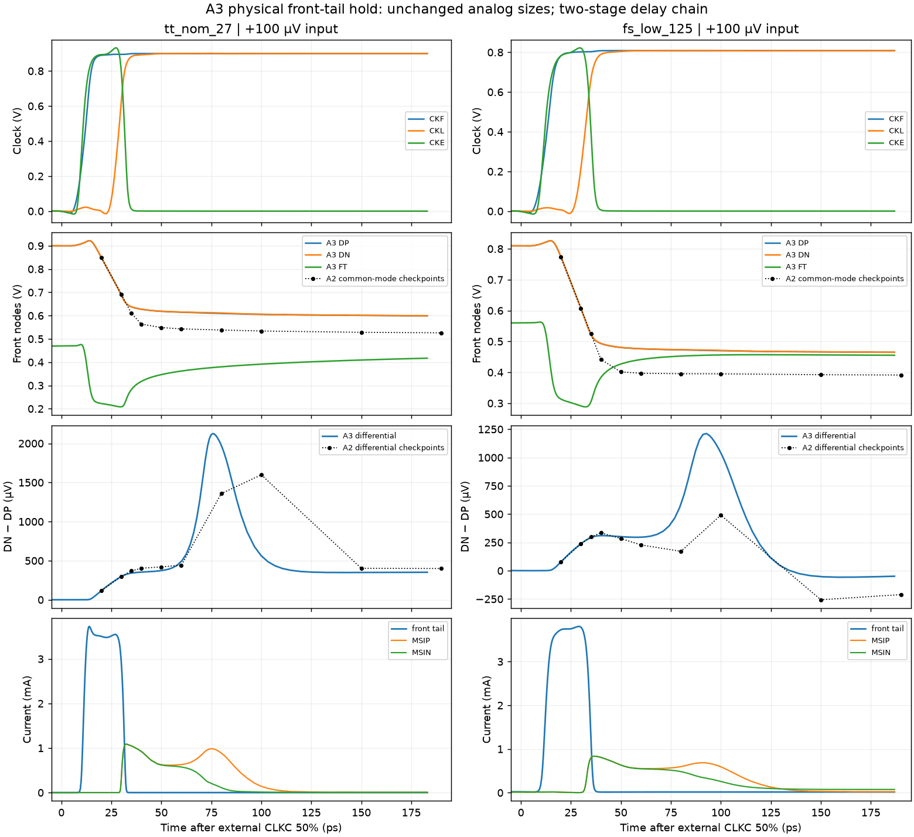

# A3 two-inverter clock screen — narrow deterministic pass

A3 passes the measured TT/FS deterministic delay and TT loading gates. TT 30 mV mean delay is **49.52777137 ps**, only **0.47222863 ps** below 50 ps. Its losing-output peak is **27.2491% VDD**, only 2.7509 percentage points below 30%. These narrow margins require further numerical/corner checks. This candidate remains `wip`, with no noise, mismatch, full-corner or qualification claim.

## Exactly one electrical change from A2

Remove the complete first two delay inverters: MD1P, MD1N, MD2P, MD2N. Change only MD3P/MD3N gate connections from D2 to CKF. MD3 remains N2/P4 and MD4 remains N4/P8; A2's NOR hold, all analog sizes, ten MOMs, second latch, resets and output buffers are unchanged. Instance-line assertions verify every retained device. All callback geometries are inherited unchanged from their successful solves; complete RNL passes without errors, warnings or hints. There are 40 MOS and 10 MOMs.

Frozen source commit: `6425c36bf294725b8bc3d0ec224b18e7c8170340`. Source SHA256: `a7acfa26274ee3fda43bc6f6908afdf970f025ad49a979a989e84e9162d3cb5b`. Electrical SHA256: `da4e2976ba9133d47d320dc077405856f53a5297362884eac589c63f28d61d61`.

[A2 evidence is frozen at 7fa8baf4](https://github.com/many-question/ADC-12b-100M/tree/7fa8baf44200b05e2e4da2d501600f1c0aa6c588/design/xtor/adc_comp/many-question-splitstage). A1 and A2 reports remain in this directory as historical evidence; only the current results describe A3.

## Three measured jobs

| Metric | TT | FS |
|---|---:|---:|
| Correct decisions, all input levels | 36/36 | 36/36 |
| CMP-09 / CMP-15 violations | 0 / 0 | 0 / 0 |
| 30 mV mean delay | 49.52777137 ps | 57.86341546 ps |
| 1 mV delay | 61.17025678 ps | 74.90997260 ps |
| Regeneration fit | 3.98772728 ps | 5.94962493 ps |
| Maximum reset time | 21.78370950 ps | 24.42071981 ps |
| Losing-output peak over complete evaluate intervals | 27.24907262% VDD | 20.75575218% VDD |
| Maximum saved step covering evaluate intervals | 22.1152 ps | 22.3679 ps |
| Energy/comparison, reported only | 317.20659847 fJ | 341.58802216 fJ |
| Exact maximum terminal voltage | 0.9919093985 V | 0.8611488572 V |

Every cycle, including ±10/30 µV, decides correctly and returns below 10% VDD during reset. CMP-15 evaluates every saved point; the sample spacing above is reported rather than hidden. Each delay job checks all 120 specified terminal pairs against 1.1 V.

TT loading gives **Cin=19.06660303 fF/input** and **CLKC=11.81375065 fF**, against 20/16 fF. Both loading-test instances pass all 240 terminal pairs, exact maximum 0.9922813589 V. The official kickback estimator gives 0.0003764677 µV, below the documented numerical floor; it is not a physical sub-nanovolt claim. This fresh loading result includes the actual A3 clock/NOR circuit.

## Stage coupling, not simple delay subtraction

Representative +30 mV cycle 3, relative to external CLKC 50%:

| Event | TT | FS |
|---|---:|---:|
| CKF 50% | 11.893 ps | 13.097 ps |
| D3 50% | 16.153 ps | 17.339 ps |
| CKD 50% | 18.358 ps | 20.397 ps |
| CKL 50% | 28.679 ps | 32.129 ps |
| Core 50% | 43.869 ps | 48.873 ps |
| Output 50% | 49.517 ps | 57.854 ps |

TT CKL moves 4.889 ps earlier than A2, core resolution after CKL improves from 17.235 to 15.190 ps, and core-to-output delay decreases from 5.914 to 5.648 ps. These measured coupled changes explain why the overall improvement exceeds simple removal of the old delay interval. Earlier launch retains higher front common mode and stronger second-input overdrive, but does not isolate a unique causal contribution from each parasitic effect.

The front-reset-off to second-tail-on proxy interval shrinks to TT12.6/FS13.0 ps from A2's 17.5/18.6 ps. At +30 mV the corresponding input ∫gm drops to TT298.706/FS274.590 fF from 423.343/399.455 fF, and front gain at its end drops to 2.415/2.199 from 3.201/2.901. Therefore better deterministic timing is **not evidence of better input noise**. Reset-off and tail-on retain A1/A2's stated operational criteria; Vgs≈Vth is not equated with zero current.

For +100 µV, CKE falls through 10% at TT33.433/FS37.200 ps. From ten ps later through evaluation end:

| Hold measurement | TT | FS |
|---|---:|---:|
| Front common mode, start → end | 0.62348 → 0.59859 V | 0.48291 → 0.46453 V |
| DN−DP, start → end | 358.66 → 352.53 µV | 304.30 → −42.60 µV |
| FT, start → end | 0.33046 → 0.42039 V | 0.41996 → 0.45497 V |
| Actual front-tail current range | 0.314–0.452 µA | 15.522–17.089 µA |
| Minimum second-input overdrive | 0.2670 V | 0.2238 V |

No front differential sign reversal occurs between CKL50 and the correct output crossing in any of the 72 tested cycles. At FS +100 µV the front differential reverses at 134.705 ps, after the output decision at 88.605 ps; the output remains valid. This is still finite common-mode retention with capacitive feedback, not an isolated differential sample. DP/DN and FT cutset current audits are retained, with the same numerical and capacitance-proxy limitations as A2; no current budget is promoted to an acceptance limit.

The A2 comparison markers are saved diagnostic checkpoints, not a reconstructed high-resolution A2 trace.

## Provenance and remaining gates

Exactly three jobs completed with zero simulator errors. Delay decks save 107 explicit signals (plus time), and loading saves 48; the broad A2 current/OP set was not reused. Both immutable raw archives passed CRC and every member's SHA256:

- TT/FS delay: `ded47b17441e26e85f47c232eb1ad795a6b1f7e99814152b5fc62d122429e270`.
- TT loading: `dc10c434489f7fe1ff7230bf1ee54ad9f52d7bda8ca9bf3bfe3246945baed8ae`.

Both owned remote run directories were removed and confirmed absent. Expanded transient copies are removed only after complete analysis and archive verification. No electrical change or unapproved expansion followed these measurements. Numerical tightening, representative corners and common-mode endpoints are the next gates; this first screen alone does not authorize a ready/selected claim.
