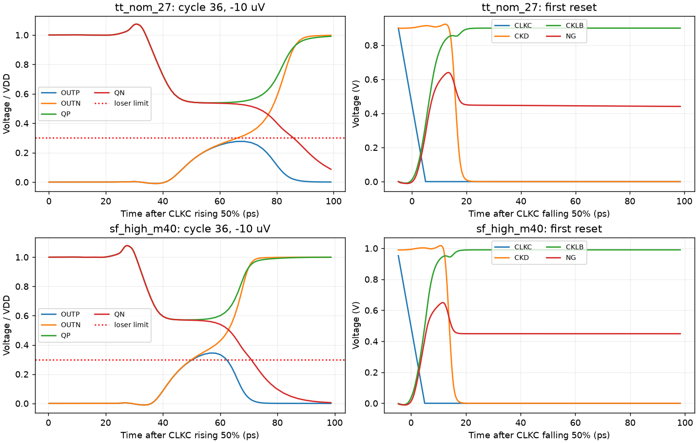

# A4 NAND-stack experiment: SOA fixed in TT/SF; SF validity still fails

A4 changes only two gate connections: MNG1 `(CKLB CLKC NG VSS)` becomes `(CKLB CKD NG VSS)` and MNG2 `(NG CKD VSS VSS)` becomes `(NG CLKC VSS VSS)`. All geometry, PMOS connections, clock stages, hold logic and analog/output devices remain unchanged. The four-row truth table still gives CKL=CLKC AND CKD. RNL was updated and checked with zero errors, warnings or hints.

Source stage: `9d4c8b3bf4c4654491dce0c9ee76184b799242a5`; source SHA-256 `8adee3aa24f60ab4e6b80d7b0e5d7de927446819d97f106a39f9b73c322d52ff`; electrical SHA-256 `e320978eb9a4d15d76369ee5eec1cd0efe4c80e2d2faa7aa4481902e03d95cf0`.

| Measurement | TT nominal 27 C | SF high -40 C |
|---|---:|---:|
| 30 mV delay, ps | 48.7458661218615 | 42.125419255079585 |
| 1 mV delay, ps | 60.232432428188766 | 50.46684188072046 |
| Regeneration tau, ps | 3.9139372049795025 | 2.68718478198057 |
| Reset, ps | 22.694929076060237 | 20.20959831430864 |
| Correct/reset decisions | 36/36 | 36/36 |
| CMP-09 wrong decisions | 0 | 0 |
| CMP-15 violations | 0 | **8** |
| Loser peak, % VDD | 27.65724835235354 | **34.47206579396765** |
| All-device exact maximum stress, V | 0.9715581010949036 | 1.073743713017862 |
| Mean sequence energy, fJ | 315.70842816 | 347.2642929096 |

Both jobs completed with RC 0 and retained all 40 MOS/120 terminal-pair coverage over the full saved transient. Every pair passes 1.1 V; the largest is now MOPN Vgs in both corners, rather than MNG1 Vds. Both have 36 correct decisions, reset and no front differential reversal before the expected output. SF still fails CMP-15 for the same +/-30 uV and +/-10 uV cycles. The experiment fixes its targeted SOA failure in these two corners but is not an overall pass or qualification.

## Measured mechanism and timing cost

NG now charges through the upper NAND device during reset before CKD falls and isolates it. Full-waveform NG extrema are [-0.0111731860, 0.6397880428] V at TT and [-0.0111590590, 0.6497569533] V at SF. The previous SF -0.127 V undershoot is absent. For the +30 mV cycle, NG at 10/20/180 ps after reset is 0.586665/0.450558/0.433185 V at TT and 0.630899/0.449067/0.448794 V at SF. This is a different, measured reset initial condition; an unchanged clock pin geometry does not prove unchanged dynamic loading.

At TT +30 mV, CKD arrives at 18.335199 ps (-0.023300 ps relative to A3), CKLB at 23.692784 ps (-0.596314), and CKL at 28.086723 ps (-0.592113). OUTP reaches 50% at 48.737030 ps (-0.779529), with CKL-to-output 20.650307 ps (-0.187416). The official worst 30 mV delay therefore improves by 0.781905 ps, leaving 1.254134 ps to the unchanged 50 ps limit. SF CKL improves by 0.548708 ps and the corresponding output by 0.601769 ps. Reset becomes about 0.91 ps slower at TT and 0.87 ps slower at SF, still passing.

SF loser peak increases by 0.252530 percentage points, so the independent validity problem is retained. No output-ratio or analog sizing adjustment is included in A4.

## Scope and evidence

Only two official 36-cycle noise-off delay jobs were run, with 107 explicit signals per job including necessary device diagnostics and all SOA voltages. Effective numerics remain conservative, gear2only, reltol=1e-4 and voltage abstol=1e-6. Maximum saved evaluation steps are 20.6608/22.5306 ps at TT/SF. The official TT/SF records are fresh for A4; A3 loading, FS, SS and FF records remain explicitly stale. No A4 loading, common-mode, additional corners, noise or mismatch tests were run.

Archive SHA-256 `9a7288a22899bbd2cbe28faa1711841d954f8bacd6ce481929f2daf49c92cb0e`, 21,064,200 bytes, 79 members; CRC and every member SHA-256 verified. Exact owned remote directory absence was confirmed. A3 failure history remains frozen at [93caae32](https://github.com/many-question/ADC-12b-100M/tree/93caae32913aef5c8a1754210ff9cf2c398f027a/design/xtor/adc_comp/many-question-splitstage).
