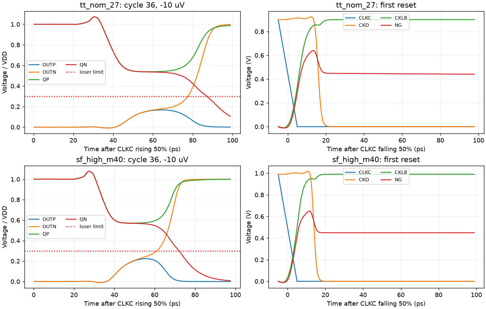

# A5 output-ratio experiment: initial TT/SF and TT loading pass

A5 changes only MOPN and MONN from N2 to N3. Both use the complete successful N3 callback geometry (W=3 um, L=30 nm, nf=3, m=1 and all returned parasitic parameters), rather than scaling W alone. All connections, the A4 NAND input reorder, hold logic, clock stages, input pairs, latch devices and MOMs remain unchanged. RNL labels and the drawing were updated; checks report zero errors, warnings or hints.

Source stage: `6ebfce977226c63742a83500b93c2f5d7638f2ca`; source SHA-256 `2de4dd1c4da47a28a4449dbac1ee532f70012475528bd4d55f5a5b71108f14bb`; electrical SHA-256 `632931d6f052a6b87efdc8e67fc59d797ed644a41cc5eec6a9166ebe0f15bc93`.

| Measurement | TT nominal 27 C | SF high -40 C |
|---|---:|---:|
| 30 mV delay, ps | 49.630304508151376 | 42.785391019502875 |
| 1 mV delay, ps | 62.45087635506587 | 52.149868391236396 |
| Regeneration tau, ps | 4.291486044948131 | 3.120966921851372 |
| Reset, ps | 20.114332593918355 | 17.628290272829243 |
| Correct/reset decisions | 36/36 | 36/36 |
| CMP-09 / CMP-15 violations | 0 / 0 | 0 / 0 |
| Loser peak, % VDD | 16.739569838440943 | 22.345051185073093 |
| All-device exact maximum stress, V | 0.9701687481122309 | 1.071869964819745 |
| Mean sequence energy, fJ | 320.06016432 | 352.3784769648 |

The two official 36-cycle noise-off tests pass every applicable delay-test specification, full reset/correctness checks and all 40-device/120-pair terminal stress checks. The maximum stress is MOPN Vgs in each. No front differential reversal occurs before the expected output. All saved samples participate in the unchanged validity measurement; neither the 30% limit nor the 50 ps TT limit was changed. Effective settings remain conservative, gear2only, reltol=1e-4 and voltage abstol=1e-6. Maximum saved evaluation steps are 20.9849/22.4346 ps.

## Validity improvement and timing cost

Relative to A4, TT loser peak falls by 10.917679 percentage points and SF by 12.127015 points, removing all eight SF validity failures. TT 30 mV delay increases by 0.8844383863 ps, leaving only **0.3696954918 ps** below the limit. SF delay increases by 0.6599717644 ps. This narrow timing margin needs a tighter numerical check on A5 itself; the earlier A3 diagnostic is not transferable.

At +30 mV, TT CKL changes by only +0.000351 ps, while the core 50% crossing moves from 43.099684 to 43.414040 ps (+0.314356 ps), and core-to-output delay increases from 5.637346 to 6.207961 ps (+0.570614 ps). SF CKL changes +0.000640 ps, core crossing +0.279187 ps, and core-to-output +0.380722 ps. The measured cost therefore includes both a core-waveform change consistent with increased gate loading and a slower output transition; it is not a clock-delay adjustment or a pure output-threshold-only change. These waveform observations do not isolate capacitance and transfer-ratio contributions experimentally.

## Fresh TT loading

After both delay gates passed, one official TT loading job was run on the same A5 source. CMP-11, CMP-12 and CMP-14 pass: Cin=19.066603027465973 fF and CLK load=11.419002410045783 fF. Two-DUT SOA covers 80 MOS/240 terminal pairs; every pair passes, maximum 0.9651219230785155 V at MOPN Vgs. The kickback metric is 0.0003840872 uV, below the numerical resolution of this setup; this is not a claim of physical sub-nV kickback. Delay jobs use 107 explicit saves, loading 48, with full required SOA node coverage.

The three jobs complete only the bounded initial screen. FS/SS/FF, common-mode endpoints, noise and mismatch are not established by these results. Their older records are stale; A5 is `wip`, not qualified. A4 is frozen at [af604643](https://github.com/many-question/ADC-12b-100M/tree/af60464331bdd6b8babb99398154fc5296225721/design/xtor/adc_comp/many-question-splitstage), with its remaining SF validity failure preserved.

Archives were verified by CRC and every member SHA-256: delay 3cbc992629c8eca2e41a58f9c1e6a2dd8b6d06264f0dd318b99bfdbdbd964cea (20,992,061 bytes, 79 members), loading 9a122ac3e636e14e3b16547cbab1849994db119d777b58826b8e1be0cd01fd5f (3,462,428 bytes, 68 members). Exact owned remote directory absence was confirmed for both runs.
