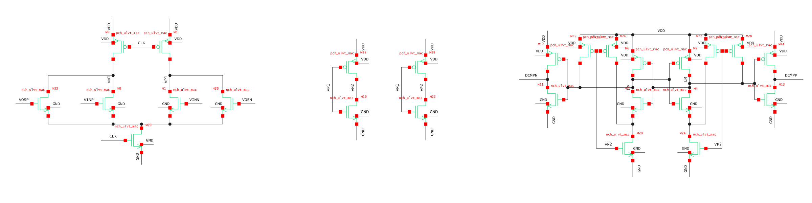

# A6 schematic: compact gallery-based layout

Drawing-only revision of `14296531a379164dc46e85dc3df060422f8516fa`. Electrical optimization remains paused under [issue 124](https://github.com/many-question/ADC-12b-100M/issues/124). No simulation, rehash, result regeneration or test-conclusion change occurred.

[Previous sheet](schematic-previous.png) · [New main schematic](schematic.png) · [Main SVG](schematic.svg) · [Complete SVG including clock details](schematic-all.svg) · [Editable RNL](adc_comp.scs)

## Reference actually read and rendered

The reference is [RISCA L3_comparator_V1.scs](https://github.com/rich-netlist/rnl-gallery/blob/b270920982c5c1bbd4634f585297a8468886d25c/examples/risca/L3_comparator_V1.scs), pinned to gallery commit `b270920982c5c1bbd4634f585297a8468886d25c`. Its complete source, local symbol/style packages and semantic package were read. It was rendered with the gallery's exact locked `@rich-netlist/runtime` **0.4.0**, with its supplied packages, and rasterized with its locked resvg **2.6.2**. The reference has no errors or warnings; its hints report intentional package-name overrides. Both the full reference and the transistor-region crop were visually inspected. The gallery's published cover is a different cell, `L2_single_ch_V2`; the comparator image below is our actual render of the requested source.

Reference attribution: RISCA example by **many-question**, semantic annotations by **Gemini-4-Argon**, distributed under [CC BY 4.0](https://creativecommons.org/licenses/by/4.0/). This image is a cropped and rasterized rendering; reference electrical content was not copied into A6. [Original example license](https://github.com/rich-netlist/rnl-gallery/blob/b270920982c5c1bbd4634f585297a8468886d25c/examples/risca/LICENSE).

## Concrete changes guided by the reference

| Reference drawing practice | Applied to A6 |
|---|---|
| Compact, mirrored input pair with a short common-source connection | Front pair separation reduced from 36 to 24 grid units; front reset/input/tail row pitch reduced from 18 to 12 |
| Regenerative devices aligned in vertical columns; feedback contained between them | Latch branch separation reduced from 36 to 24; the PMOS/NMOS pitch reduced from 18 to 12; two short, undotted feedback crossings remain between gate buses |
| Reset devices close to the nodes they precharge | QP/QN and XP/XN resets sit immediately outside the latch columns; AVDD routes run around their exterior, clear of CKL labels |
| Readable labels adjacent to the device, distinct from node labels | Device names enlarged from 1.0 to 1.2 grid units, widths from 0.9 to 1.1; explicit Arial text, green device strokes and dark wires; capacitor names moved off their wires |
| Signal flow and recognizable circuit groups carry the explanation | Main image contains only the physical integrator, regenerative stage and CMOS outputs; duplicate output inverter views and long in-figure prose removed |
| Local power connections and intentional whitespace | AVDD remains above and ground below; compact local rails; a 182-by-84-grid main viewport replaces the old five-panel overview as the opening image |

The reference's circuit region, rather than its large annotation banner, guided the proportions. A6 retains standard-library symbols instead of copying the reference's custom MOS graphics. The standard symbols have 4-grid terminal height, so a 12-grid stage pitch leaves room for the longer A6 instance names and explicit widths. The original flat `adc_comp` remains flat: no fictitious subcircuits, devices or hierarchy were introduced.

## Main and supporting views

Every image below is a viewport of the **same RNL render**, not an independently redrawn circuit. Main SVG contains the same scene with a focused viewport; complete SVG exposes all auxiliary circuitry.

| View | Content |
|---|---|
| [Main schematic](schematic.png) | 22 MOS plus ten MOMs: both analog stages and four output transistors |
| [Front integrator](schematic-front.png) | Mirrored W56 inputs, CKF resets, common FT, parallel W3 tails, ten individually named MOMs |
| [Regenerative latch](schematic-latch.png) | W6 input pair, N12/P8 regeneration, QP/QN and XP/XN resets, common ST and parallel tails |
| [Outputs](schematic-outputs.png) | Actual P4/N3 CMOS pairs shown once, OUTP/OUTN reset low |
| [Clock function](schematic-clock.png) | Standard inverter, NAND2 and NOR2 symbols on the actual existing nets |
| [Clock implementation](schematic-clock-devices.png) | All 18 physical clock MOS, including the original NAND NMOS and NOR PMOS series order |
| [Comparator symbol](schematic-symbol.png) | Existing functional seven-port symbol; inputs left, outputs right, clock below input side, AVDD above, VSS below |

Equal net labels connect across groups, as in the reference: DN drives MSIP, DP drives MSIN, QP drives the OUTP inverter and QN drives the OUTN inverter. The functional clock usages add no electrical instances. All **40 MOS and ten MOMs** appear once at physical level; the seven logic usages are explanatory views of those same clock devices.

Standard symbols used are `$NMOS`, `$PMOS`, `$CAPACITOR`, `$INVERTER`, `$NAND_2INPUT`, `$NOR_2INPUT`, `$SUPPLY`, `$GROUND` and `$JUNCTION`. All MOS bodies retain the original conventional connections: NMOS to VSS and PMOS to AVDD, permitting three-terminal symbols. The custom comparator symbol preserves its functional shape and seven ports. Its preview uses a private drawing fixture, not a simulation testbench.

The geometry audit validates every wire endpoint against the unchanged original netlist: **154 explicit wires**, **56 junction dots**. Every dot has at least three distinct wire directions on its own net; corners and unconnected crossings have no dots. Matching, differential-pair and grouping semantics remain.

## Electrical and result preservation

The previous source and all result files were snapshotted before editing. Removing only complete RNL records yields byte-identical remaining content, including original non-RNL comments. Independently, all non-comment electrical lines and their line endings compare byte-for-byte: ports, topology, instance order, models and parameters remain unchanged.

| Fingerprint | Before | After |
|---|---|---|
| Full source SHA-256 | `028f3927f1159ca1814f55f4d2ff806f1d35fcf48f39ae906cadd30742855d54` | `7b86ef236b1bba9bcdf0fb599b9b77d97cff237740a2cdd58d108c02de2f435b` |
| Electrical-lines SHA-256 | `fb35051d0ec3e345c550baddafc8e3ab43d9de7187453188e365cddca1544274` | identical |
| Non-RNL bytes SHA-256 | `d21bf83f18b9a764f4b535f7e416c233b62297fdb7ddd2f9131b84c75fc806cf` | identical |
| Simulation-dependency hash | `539043ed0964eba8` | identical |

`adcflow.netlist.content_hash` ignores RNL comments when hashing `.scs` logical electrical lines. All **20 existing result/plot files** retain their exact bytes and metadata. Actual `checks.judge` still reports **five fresh** records (TT/SF/FS delay, TT loading, FS noise) and **two historically stale** SS/FF delay records. Fresh FS noise remains **FAIL: 325.0388413768936 uV rms against 240 uV**; its [statistical limitations](A6-NOISE.md) and every previous conclusion remain intact.

A6 was checked/rendered with repository-pinned **RNL 0.5.2 (`7fe8de1`)**: **0 errors, 0 warnings, 0 hints**. The reference, previous full sheet, revised main, every detail, complete sheet and custom symbol were actually viewed. Subsequent visual fixes moved capacitor labels off wires, moved latch supply rails away from CKL labels, separated the latch-driver caption from AVDD and corrected crop boundaries. Each PNG stays below 200 kB; the candidate stays below 2 MB.

For the original isolated-device drawing before the first readability pass, see [the earlier baseline](schematic-before.png). The immediate before/after for this revision is [previous sheet](schematic-previous.png) versus [new main](schematic.png) plus its supporting views above.
