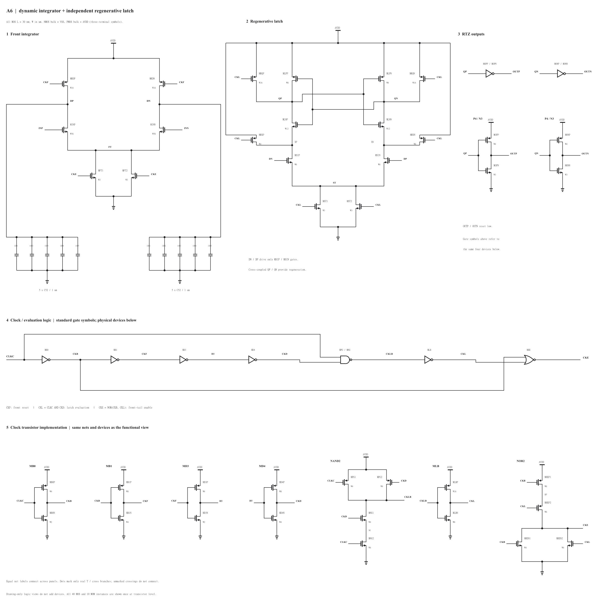
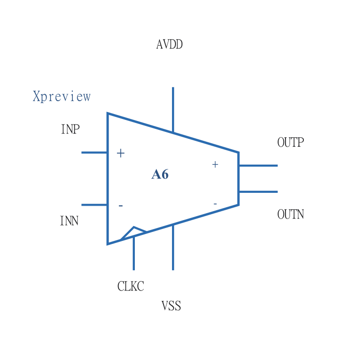

# A6 schematic readability update

This is a drawing-only revision of the A6 source at `e14223a51665d6a931de1054d4d526d93516f735`. Electrical iteration remains paused under [issue 124](https://github.com/many-question/ADC-12b-100M/issues/124). No simulation was dispatched, no result was regenerated, and the full FS noise failure remains unchanged.

[Before: exact A6 source rendered before editing](schematic-before.png) · [After: full sheet](schematic.png) · [Zoomable SVG](schematic.svg) · [Editable RNL/netlist](adc_comp.scs)

## What changed in the drawing

The previous sheet drew each device separately with four labelled terminal stubs. The new sheet shows the actual differential branches, common-source nodes, parallel tails, capacitor banks and cross-coupled feedback. The input stage, regenerative stage and output buffers read from left to right. AVDD is above each circuit and VSS is below it. Reset switches sit beside the nodes they precharge, with their supply routing outside the latch. The revised feedback wiring stays between the two regenerative branches instead of making long loops around the input pair.

The circuit remains one flat `adc_comp` subcircuit. No electrical hierarchy or module was introduced merely for drawing. Five detail images are cropped directly from the same rendered sheet, so they cannot silently acquire a different circuit:

| View | What can be checked |
|---|---|
| [Front integrator](schematic-front.png) | Mirrored W56 pair, CKF reset pair, common FT node, two W3 tail devices and all ten MOM instances |
| [Regenerative latch](schematic-latch.png) | DN/DP gate-only coupling, mirrored device stacks, QP/QN cross-coupling, XP/XN and QP/QN reset devices, common ST node |
| [RTZ outputs](schematic-outputs.png) | Standard inverter symbols and the corresponding P4/N3 transistor pairs |
| [Clock function](schematic-clock.png) | Four inverter stages, NAND plus inverter for CKL, and NOR for CKE; actual net names are shown |
| [Clock transistor detail](schematic-clock-devices.png) | All 18 clock devices, including the exact NAND NMOS and NOR PMOS series order |

The standard library provides `$NMOS`, `$PMOS`, `$CAPACITOR`, `$INVERTER`, `$NAND_2INPUT`, `$NOR_2INPUT`, `$SUPPLY`, `$GROUND` and `$JUNCTION`. All 40 MOS bodies are tied to their conventional rails in the unchanged netlist, so their symbols are three-terminal: NMOS bulk is VSS and PMOS bulk is AVDD. No device needs a special four-terminal body connection in this candidate. All 50 physical instances remain individually visible at transistor level; the nine logic-gate usages are drawing-only functional views on existing nets, not added devices.

The A6 subcircuit now has a purpose-made [seven-port comparator symbol](schematic-symbol.png): differential inputs on the left, two explicitly marked decision outputs on the right, CLKC below the input side with a clock marker, AVDD above and VSS below. The tapered comparator body and polarity marks convey its function. The preview uses a private drawing fixture only; it is not a new testbench or simulation and does not modify the candidate hierarchy.

Every drawn pin-to-wire endpoint was checked against the original net name. The 158 explicit wires use shared named points for real branches. All 56 junction dots have at least three distinct wire directions on the same net; ordinary bends and unconnected crossings have no dots. The latch feedback and clock bypass crossings are deliberately undotted. Matching, differential-pair and functional grouping semantics remain in RNL.

## Electrical and result preservation

The original file and all candidate result files were snapshotted before editing. Removing only complete RNL records from the old and new source yields **byte-identical remaining content**, including every original non-RNL comment. Independently, every non-comment electrical line, including ports, instance order, parameters and connections, is byte-identical. No whitespace normalization of electrical lines is needed for this equality.

| Fingerprint | Before | After |
|---|---|---|
| Full source SHA-256 | `8d300f399e0ff5b9f2273ba23c166ce6de63aa8218da1dd434ad4b2225d00621` | `028f3927f1159ca1814f55f4d2ff806f1d35fcf48f39ae906cadd30742855d54` |
| Electrical-lines SHA-256 | `fb35051d0ec3e345c550baddafc8e3ab43d9de7187453188e365cddca1544274` | identical |
| Non-RNL bytes SHA-256 | `d21bf83f18b9a764f4b535f7e416c233b62297fdb7ddd2f9131b84c75fc806cf` | identical |
| Project simulation-dependency hash | `539043ed0964eba8` | identical |

The project hashes `.scs` simulation dependencies through `adcflow.netlist.content_hash`, using logical electrical lines and excluding RNL comments. Consequently this drawing change does not newly invalidate results. All **20 existing result/plot files are byte-identical** to the snapshot, including their original source commits, simulation dates, full-file source hashes and failures. No rehash, recorder operation or metadata substitution was performed.

Actual `checks.judge` output after the drawing change retains **five fresh records**: TT/SF/FS delay, TT loading and FS noise. The two old SS/FF delay records remain stale for the previous electrical-source reason. Fresh means matching dependencies, not passing qualification: the fresh FS noise result still fails at 325.0388413768936 uV rms, with the [statistical limitations already documented](A6-NOISE.md).

Validation used the repository-pinned RNL CLI **0.5.2 (`7fe8de1`)**, with **0 errors, 0 warnings and 0 hints**. The before/after sheet, each detail image and the custom symbol were rendered and visually inspected. Layout iterations shortened feedback paths, moved power routing clear of CKL labels, corrected crop boundaries and moved the symbol instance label away from its supply pin. All images are below the 200 kB limit, and the candidate directory remains below 2 MB.
