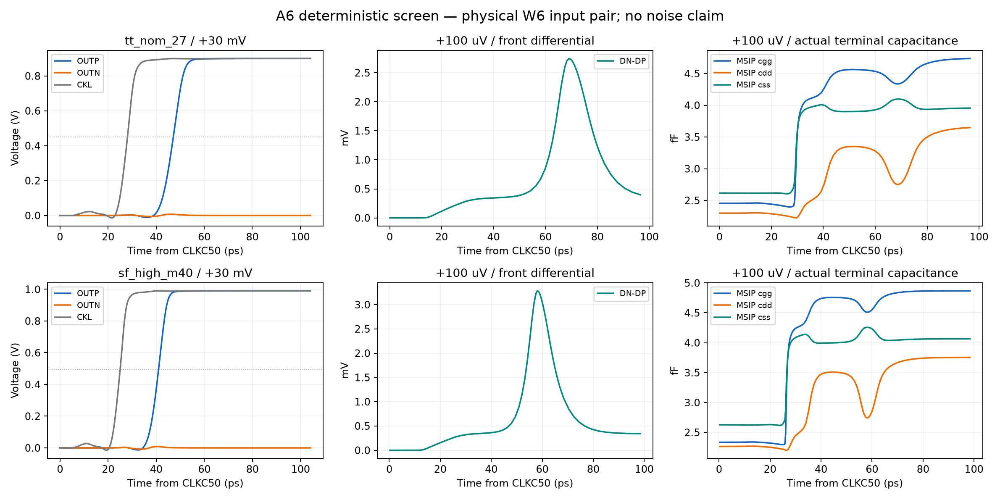

# A6 second input-pair screen

**A6 passes the bounded four-job deterministic/loading screen; noise remains untested.** Status is `wip`. No long noise, other corners, MC, CM or parameter sweep was run.

Only MSIP/MSIN change W4/nf4 to W6/nf6 (L=30 nm, Wfg=1 um, m=1), using a successful N6 callback including all diffusion/stress parameters. All connections and other 48 instances remain identical to A5: front/input/reset, both latch-tail W3 devices, regeneration N12/P8, clock network, output devices and ten MOM capacitors. The fully dynamic 40-MOS/10-MOM circuit retains the same interface. RNL has complete placements, pin wires and updated W6 annotations; check: 0 errors, warnings or hints.

A5 is frozen at `97b387c8e57fe431e81db00767f26e1465926c63`. Its [FS physical-noise failure](A5-NOISE.md) and earlier reports are historical, not A6 evidence. Fresh A6 records cover only TT/SF/FS delay and TT loading. Old SS/FF/noise records remain stale for this source.

## Measurements

Official specification 0.9.0 benches, original stimuli and numerical controls, +aps. Output-only save changes retain 33 signals per delay job (metric/SOA voltages plus MSIP/MSIN gm, ids, cgg, cdd, css); loading uses 48 signals across two DUTs. No all-device OP/current save was used.

| Corner | d30 (ps) | d1 (ps) | tau (ps) | output reset (ps) | loser peak (% VDD) | maximum stress (V) |
|---|---:|---:|---:|---:|---:|---:|
| tt_nom_27 | 47.149668074 | 57.963674069 | 3.683757309 | 20.236615096 | 19.306761 | 0.970966278607 |
| sf_high_m40 | 40.972324684 | 49.069319292 | 2.689433103 | 17.832521178 | 24.555258 | 1.073316318781 |
| fs_low_125 | 54.866015957 | 70.174330952 | 5.146100392 | 22.707189971 | 15.434626 | 0.857584694141 |

Every delay corner has **36/36 correct decisions and 36/36 output resets <=35 ps**, zero CMP-09/CMP-15 violations, and all **40 MOS / 120 terminal pairs** <=1.1 V. These are independent checks, not an inference from simulator RC0. All applicable numerical specification limits pass. The log retains PDK 0.99 V warning thresholds; these warnings are disclosed separately from the project 1.1 V limit and were not suppressed or redefined. Internal front-node reset is not assigned the output's 35 ps requirement.

TT d30 improves from A5 49.630304508151376 to 47.14966807436065 ps: **-2.480636433791 ps**, leaving **2.850331925639 ps** versus the original 0.369695491849 ps margin. SF worst stress is MOPN Vgs=1.073316318781 V, leaving 26.683681219 mV; loser peak=24.555257516% VDD remains below 30%.

TT loading: **Cin=19.066603027466 fF**, **CLK=11.419012776018 fF**, **kickback=0.000374469600077 uV**. Limits are 20 fF /16 fF /40 uV. Both DUTs' 80 MOS /240 terminal pairs pass, worst stress 0.966278619865 V. External loading was remeasured; it was not inherited from A5.

## Physical mechanism and limits

At TT +100 uV cycle13, front gain at the **original A5 CKL50 endpoint** is 2.663203226 versus 2.678878458 (-0.58514%). Actual CKL50 shifts +0.001420201 ps; across all36 TT cases shifts range -0.002404240 to +0.002366182 ps. These minute interpolated differences are reported, not used as a separate pass/fail threshold or evidence of a useful clock advance.

The same cycle's core50 occurs 5.896775992 ps earlier and output50 5.954816297 ps earlier; core-to-output delay changes only -0.058040305 ps. At external-edge+30 ps MSIP gm rises 5.384322109→6.778772618 mS (+25.90%), while Id changes 0.756240003→0.752151897 mA (-0.54%). Measured A6 MSIP cgg/cdd/css at that point are 3.556300828/2.233424033/3.597827624 fF. They are transient device diagonal capacitances, not independent lumped capacitors.

Across all36 FS cycles CKL50 shifts -0.007920617 to -0.004589233 ps; these sub-0.01 ps shifts are reported without a new acceptance threshold. FS d30 improves by3.672554321ps and d1 by7.226475858ps versus A5.

SF +100 uV has front gain ratio0.993979545, CKL50 shift+0.000850844 ps, core50 shift-4.061667950 ps and output50 shift-4.110334102 ps. At30ps its MSIP current increases17.47%; unchanged tail geometry does **not** hold instantaneous branch current fixed. Larger gm and changed internal charging compete with extra diffusion/gate load; the actual deterministic trajectories show a net timing improvement.

The prior noise mask combined this input pair with four regeneration devices. Neither this gm improvement nor the measured delay improvement predicts the six-device group's noise benefit or total comparator noise. No RSS/variance subtraction or sigma claim is made.

## Next noise measurement — recommendation only

Recommend one official **FS-low125 17 x512** full physical-noise run, matching archived A5 duration/bandwidth: 8,704 samples, seed1, stop3.4817 us, fmax50 GHz, default fmin1/stop=287.216 kHz, no new maxstep/noisefmin override. Preserve the parent's conservative/gear2only, reltol1e-4, Vab1uV, Iab1pA, relrefalllocal and lteratio10; verify effective values in the new log. Continuous waveforms remain suppressed; retain all sampler records and audit fit/sequence/history. Compare directly against CMP-13 240uV and CMP-02 2mV. A5's 341.860525uV is a historical comparator only, not A6 data. **Root review is required before this job; none was prepared or dispatched.** No short masks/seeds/grids or automatic broader qualification follows these passes.

## Provenance and execution

Source-stage commit: `338f10a747f5ff28e3e785633e2c7d8290ca25dd`.

Source SHA256: `8d300f399e0ff5b9f2273ba23c166ce6de63aa8218da1dd434ad4b2225d00621`

Electrical SHA256: `fb35051d0ec3e345c550baddafc8e3ab43d9de7187453188e365cddca1544274`

Callback SHA256: `366665f177a5e0fa47867870abb748ef434192c29fa58f63463f476a80847c8e`

Initial TT/SF delay and TT loading passed and were archived before the conditional FS deterministic job was prepared. Exactly four solver invocations; measured peak two concurrent jobs (authorized cap three). Every retrieved file matched its exact remote SHA, every archive passed CRC plus member SHA/size checks once, and all owned remote run paths were confirmed absent after retrieval. Original A5 raw archives were not modified.

| Run | jobs | archive bytes | members | archive SHA256 |
|---|---:|---:|---:|---|
| 20261101-112040-soa28-a6-delay | 2 | 6,474,206 | 79 | `882fb2f20f20966746663ce7ade4cbde49b423498dff9caee7a37197717c0c82` |
| 20261101-112040-soa28-a6-loading | 1 | 3,470,508 | 68 | `d77a015639015308fe3d8a0d8a9f254906ad7bdd57c4fcb432f98c722f2b5685` |
| 20261101-112536-soa28-a6-fs | 1 | 2,990,348 | 67 | `afe047386876bee9f843099464e79e453af48f3cc29dabf0c6b0363e803dfb64` |
