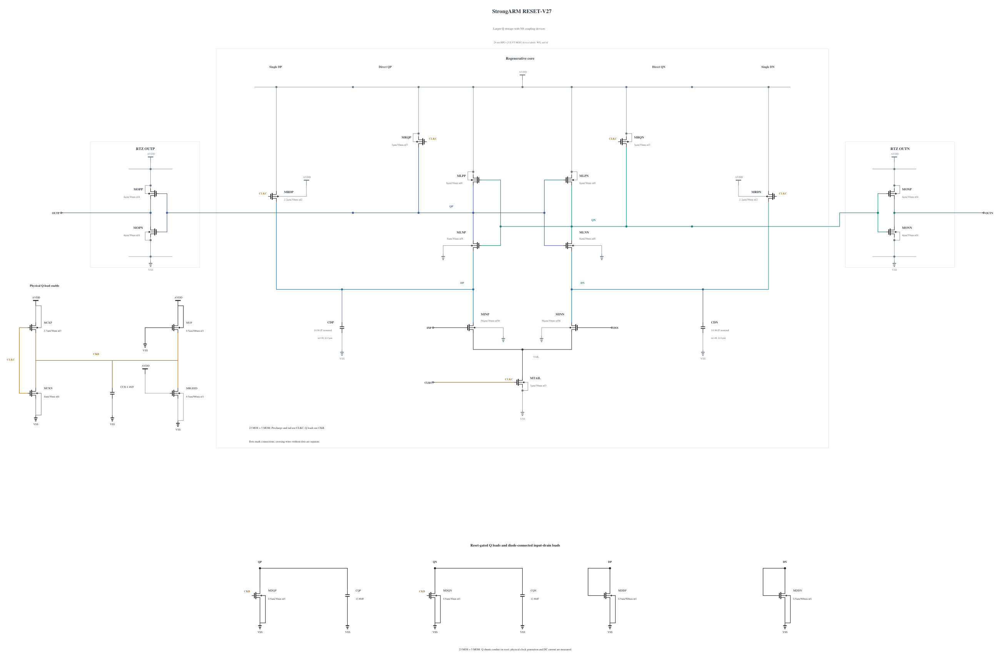

# Strongarm comparator: RESET-V27

> Superseded raw was released. Historical audits do not imply availability; see [retained runs](EVIDENCE-RETENTION.md).

Canonical **V27 fails the merged adc_comp 0.8.0 official TT noise test at 210.1008609253812 uV rms against 200 uV**. The original 17 x 512 decisions are retained, with a model-conditional 95% profile interval of 201.81 to 218.79 uV. [FORMAL-SPEC08](FORMAL-SPEC08.md) links the genuine committed result and figure. At the recorded 0.8 checkpoint, dependency coverage was 1 fresh / 92 records; this is not a current 0.9 freshness count. This candidate remains WIP, unqualified and unselected.

Independent [V28](RESET-V28.md) reduces CKB storage from 16 to 8 fingers. Critical-corner deterministic checks and tighter repeats pass, but full physical TT noise still fails at 206.44956249285457 uV rms (198.24 to 215.06 uV). Its tighter TT 30 mV delay is 49.84967366576565 ps, leaving 0.15032633423435 ps. A confidence interval crossing the limit does not establish a pass; V28 qualification expansion is stopped.

Independent [V29](RESET-V29.md) doubles four output MOS devices from 4 to 8 um. Its four-corner baseline retains all 144 actual decisions and resets, passes output validity and all 69 unrounded terminal pairs per corner, but **fails TT 30 mV delay at 50.5384103494184 ps**. Matched waveform diagnostics show a later Q-node transition outweighing the shorter Q-to-output interval. V29 qualification expansion is stopped, with no noise run or promotion. Further physical design tests output pull-up/pull-down balance before reconsidering input-tail current.

[Artificial V28 noise-source diagnostics](NOISE-SOURCE-DIAGNOSTICS-V28.md) give fitted widths of 143.69178503038893 uV with input-pair noise suppressed and 187.75199804064 uV with Q-shunt noise suppressed. These are explicitly ineligible for qualification and cannot be variance-subtracted into unique additive contributions. Complete-circuit V28 noise remains the failed result above. Every physical trial restores all noise sources.

The canonical source contains 23 MOS devices and five physical MOM capacitors. Geometry and terminal parasitics come from successful callbacks or exact verified reuse. Physical shunts and rail loads carry reset current; whole-cycle AVDD energy includes that current and is report-only.

[NUMERICS-94](NUMERICS-94.md) preserves the numerical migration and private checks. PR #95 is merged at c6152d236e525793ecc4809b9a6c9dfb9fd0ad77, with comp 0.8.0 and exact ADCToolbox commit cd72061ff3b7a977163dac540da126ae22f5e38d. The runtime passes the #96 self-check at 79.999999999274 dB. New evidence uses APS and actual conservative settings, with no explicit maxstep or method. No old or private result is relabeled as formal.

V27's separate tighter TT capacitance measurements are 19.331118542884703 fF per input and 15.782118507199666 fF for CLKC. The specified net differential change after evaluation plus reset is 3.749160010224628e-05 uV, within numerical drift. Instantaneous differential disturbance reaches 354.6187879230329 uV during evaluation and common-mode excursion reaches 7.405456990178305 mV. Those instantaneous values are distinct from the net metric and are not compared to its 40 uV limit. Actual-CDAC validation must check decision-phase differential and common-mode disturbance.

[V27 promotion proof](PROMOTION-RESET-V27.md), [historical baseline](BASELINE-BEFORE-RESET-V27.md) and prior experiment reports preserve older sources, every failure and verified archives. Historical figures use byte-verified fixed published links where duplicate local PNGs were removed. Canonical V27 remains unchanged.

Issues #40/#63/#69/#75/#77/#78/#84/#100 remain acknowledged. The branch includes main f1ac9a5's site-only fix; comparator tools, testbenches and specifications are unchanged by this candidate. Remaining corners, full formal coverage, 50-sample mismatch, operating range, mixed-top regression and lead review remain open.

Independent [V30](RESET-V30.md) retains V29 P8 output pull-ups and restores exact V28 N4 pull-downs. TT 30 mV delay improves to 47.35514490849851 ps, but SS/low/125 reset fails at 36.646221657802904 ps. All 144 actual decisions/resets, output validity and unrounded terminal pairs pass; the reset-time failure stops qualification expansion. Noise and capacitance remain untested. Further physical work tests Q precharge strength and explicitly checks the added clock load before any tail-current reduction.

Independent [V31](RESET-V31.md) repairs the SS reset gate to 33.33299224307328 ps and passes all four-corner deterministic checks, but its dedicated TT clock capacitance is **16.65232415714863 fF, FAIL 16**. Qualification expansion stops; V31 noise is untested and it is not promoted. Further physical work targets the local clock driver and load while preserving Q precharge strength.

Independent [V32](RESET-V32.md) repairs V31 clock loading and passes nine baseline/four tighter deterministic corners plus TT Cin/CLK (19.3311/15.5633 fF). TT baseline/tighter noise is 194.2333/196.1902 uV rms; both 95% intervals cross 200 uV. **Physical FS/low/125 and SS/low/125 noise fail at 371.8393 and 299.6542 uV rms against 240 uV**, with all 8704 samples per corner retained. Qualification expansion stops. [Artificial V32 source diagnostics](NOISE-SOURCE-DIAGNOSTICS-V32.md) guide further physical work; no artificial result qualifies the candidate. Canonical V27 and the genuine formal failure remain unchanged.

Independent [V33](RESET-V33.md) tests N-latch width 8 to 4 um to alter pre-regeneration timing. Five baseline/five tighter corners and TT capacitance pass, but **full physical FS/low/125 noise fails at 483.2613219887676 uV rms [466.39, 501.2]**, worse than V32. The weaker-N trial is rejected; all samples and failure evidence are retained.

Independent [RESET-V34](RESET-V34.md): original baseline recovered; see the report for measured failures and remaining gates.

## Current 1.1 V restoration work

The branch now includes main `17b3a0c` (adc_comp 0.9.0). Issue #116 is acknowledged: delay and kickback require fresh dependency evidence after their explicit save-policy change. The project terminal-voltage limit is 1.1 V at all corners; historical 1.0 V screening failures are retained as historical diagnostics and are not current rejection criteria.

Historical V2 restoration passes five representative deterministic corners and TT loading, and passes full physical TT noise at 184.174455 uV rms. **FS/low/125 noise fails at 317.000251 uV rms against 240 uV.** Full-corner and mismatch expansion stops for this source. [Restoration evidence](RESTORATION-11.md) retains unrounded intervals, provenance, archive checks and measured runtime. Canonical source and formal results remain unchanged.

[Secondary historical l16t3c1 screening](RESTORATION-SECONDARY.md) is tracked separately. [V2 mechanism analysis](RESTORATION-MECHANISM.md) uses retained internal waveforms to propose isolated physical changes; its hypotheses are not device-noise attribution. [V32 sampled-noise closure](SAMPLED-NOISE-V32.md) records a persistent 12–14% discrepancy from transient/probit and does not establish an acceptance substitute.

l16t3c1 fails complete FS noise at 274.20498833482293 uV rms and stops. The [isolated V2-C56 physical trial](RESTORATION-TRIALS.md) passes five deterministic corners and TT loading, but fails complete FS noise at 315.26264313649045 uV rms (95% profile CI 304.65758490716047 to 326.3792557323575 uV). Its 0.55% change from V2, overlapping intervals and nearly unchanged early differential peak do not justify another capacitance step. TT noise and qualification expansion stop for this frozen source.

[L16-SPLIT](RESTORATION-SPLIT-RESET.md) changes only MRDP/MRDN reset gates from CKR to CLKC. Five baseline corners, a targeted tighter SF check and TT loading pass, including all 216 actual decisions/resets and unrounded terminal-pair checks. SF peak remains below 1.1 V at 1.097304064036897 V baseline and 1.097264316244123 V tighter. Full physical FS noise is running; no improvement or qualification is claimed yet.
